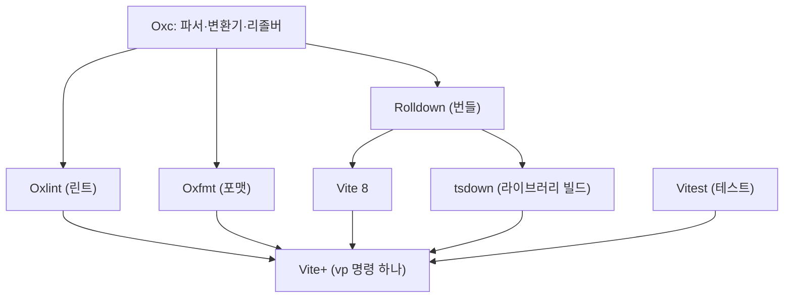

> ui.dev Bytes의 「Stop, Drop and Rolldown」(2026.01), 「Another Prettier killer has entered the villa」(2026.03), 「Vite+ enters the Matrix」(2026.03), 「Smoking that Rspack」(2026.04)와 JavaScript Weekly의 Oxfmt 베타·TypeScript 7.0 RC 소식을 바탕으로, 각 도구의 상태는 Oxc·VoidZero·Vite·Biome 공식 블로그로 확인해 재구성한 노트다.

## 무엇이 바뀌고 있나

JavaScript 도구는 오랫동안 JavaScript로 만들어졌다. ESLint, Prettier, Babel, webpack, Rollup, `tsc`가 모두 그랬다. 코드베이스가 커지면서 린트·포맷·빌드·타입 검사가 개발 루프의 병목이 되자, 같은 일을 **Rust나 Go로 다시 쓴 도구**가 하나씩 기존 도구를 대체하고 있다. esbuild(Go)와 SWC(Rust)가 변환·번들을 먼저 바꿨고, 지금은 린터·포매터·타입 검사기까지 넘어왔다.

| 역할 | 기존 (JS) | 네이티브 대안 | 언어 |
| --- | --- | --- | --- |
| 파싱·변환 | Babel | SWC, Oxc 변환기, esbuild | Rust, Rust, Go |
| 린트 | ESLint, typescript-eslint | **Oxlint**, Biome | Rust |
| 포맷 | Prettier | **Oxfmt**, Biome | Rust |
| 번들 | Rollup, webpack | **Rolldown**(Rollup 호환), **Rspack**(webpack 호환) | Rust |
| 타입 검사 | `tsc` (TypeScript 6까지) | **TypeScript 7** | Go |

번들러의 계보와 Vite 8이 Rolldown으로 통일된 과정은 [[bundlers-and-vite|번들러의 역사와 Vite]]에, TypeScript 7의 내부 변화는 [[typescript-compiler-internals|TypeScript 컴파일러 내부 구조]]에 있다.

## 네이티브가 빠른 이유

| 이유 | 설명 |
| --- | --- |
| 미리 컴파일된 기계어 | JIT 예열 없이 처음부터 최적화된 코드로 돈다. CLI처럼 짧게 실행되고 끝나는 도구에서 차이가 크다 |
| 병렬화 | Node.js의 JavaScript는 스레드 하나에서 돈다. Rust·Go 도구는 파일을 여러 코어에 나눠 동시에 파싱·검사한다 |
| 메모리 배치 | GC 없이 아레나 할당으로 AST를 연속된 메모리에 두어 할당·해제 비용과 캐시 미스가 적다 |
| 한 번 파싱해 공유 | Oxc처럼 파서·린터·포매터·변환기가 같은 AST를 쓰면, 도구마다 따로 파싱하던 중복이 사라진다 |

그래서 수치는 배 단위로 나온다. Oxfmt는 Prettier보다 30배, Biome보다 3배 빠르다고 밝히고(콜드 실행 기준), TypeScript 7은 큰 프로젝트의 빌드를 약 10배 줄였다.

## 대가: 플러그인 호환

**속도의 대부분은 「JavaScript를 실행하지 않는 것」에서 나온다.** 그런데 기존 생태계의 힘은 JavaScript로 쓴 플러그인이다. 네이티브 도구가 JS 플러그인을 부르려면 AST를 JS 쪽으로 넘기고 결과를 다시 받아야 하고, 그 경계를 넘을 때마다 속도 이점이 깎인다. 도구마다 이 문제를 다르게 푼다.

| 도구 | 플러그인 전략 | 상태 (2026.11) |
| --- | --- | --- |
| Rolldown | Rollup 플러그인 API를 그대로 받는다. 대신 흔한 일(TS·JSX 변환, CJS·ESM 상호 운용)은 내장해 JS 플러그인이 필요 없게 한다 | 1.0 안정(2026.05). Vite 8의 번들러 |
| Rspack | webpack의 설정·플러그인·로더 API를 Rust로 다시 구현한다 | 2.0. 코어 패키지가 순수 ESM이 됐다 |
| Oxlint | 핵심 규칙(ESLint 코어, typescript-eslint, react, import, unicorn, jsx-a11y 등)을 Rust로 다시 쓰고, 나머지는 ESLint 호환 **JS 플러그인**으로 돌린다 | 린터 1.x. 타입 인식 린트(tsgolint) 안정, JS 플러그인은 알파 |
| Oxfmt | Prettier 출력과 맞추는 데 집중한다. Tailwind 클래스 정렬, import 정렬, JSON·YAML·CSS·Markdown 같은 다른 언어 포맷을 내장해 Prettier 플러그인 대부분을 대신한다 | 베타. Prettier JS/TS 적합성 테스트 100% 통과. Prettier 플러그인 지원은 계획 단계 |
| Biome | 린터+포매터 한 실행 파일. 사용자 규칙은 GritQL 패턴 플러그인으로 쓴다. `tsc` 없이 자체 타입 추론으로 일부 타입 인식 규칙을 돌린다 | 2.x. Prettier 호환은 약 97% |
| TypeScript 7 | 같은 검사 규칙을 Go로 옮긴 port | 안정 API 이전이라, 컴파일러 API에 기대는 도구(Vue·Svelte 템플릿 검사, typescript-eslint 타입 규칙)는 TypeScript 6 패키지를 함께 둔다 |

정리하면 네이티브 도구가 바로 대체하기 쉬운 곳은 **표준적인 일만 하는 프로젝트**다. 사내 커스텀 ESLint 규칙, Babel 커스텀 변환, Prettier 플러그인, webpack 로더에 기대는 정도가 클수록 옮길 때 남는 것이 많다. Babel이 여전히 쓰이는 자리는 [[babel|Babel과 AST 변환]]에 있다.

## 통합 툴체인

도구가 같은 파서를 공유하게 되자 아예 하나로 묶는 흐름도 생겼다.

**Vite+** 는 VoidZero가 MIT로 공개한 통합 툴체인이다. `vp` 명령 하나가 Vite·Vitest·Oxlint·Oxfmt·Rolldown·tsdown을 묶는다. `vp env`(Node 버전), `vp install`(패키지 매니저 선택), `vp check`(린트+포맷+타입 검사 한 번에), `vp build`, 입력 지문으로 캐시하는 태스크 러너, `vp migrate`가 있다. 2026년 11월 기준 1.0 전 단계다. Biome도 린터와 포매터를 한 설정 파일로 묶는 같은 방향이다.

## 고르고 옮기는 순서

| 상황 | 선택 |
| --- | --- |
| webpack 설정·플러그인이 많은 큰 앱 | Rspack: 설정을 거의 그대로 옮겨 빌드 속도를 얻는다 |
| Vite 앱 | Vite 8로 올리면 Rolldown이 따라온다. 별도 결정이 없다 |
| Prettier 출력과 같아야 한다(대규모 코드베이스, diff 폭탄을 피하고 싶다) | Oxfmt |
| 린터와 포매터를 한 도구·한 설정으로 | Biome |
| ESLint 규칙 수백 개, 타입 인식 규칙까지 | Oxlint를 먼저 돌리고 남는 규칙만 ESLint에 둔다 |
| 커스텀 Babel 변환, Prettier 플러그인, 사내 ESLint 플러그인이 핵심 | 당장은 기존 도구를 두고, 플러그인 대체가 나오면 옮긴다 |

옮길 때는 한 번에 갈아엎지 않는다.

1. **포매터부터**: 결과가 결정적이고 검증이 쉽다. `pnpm add -D oxfmt && pnpm oxfmt --migrate prettier`로 설정을 옮기고 전체를 한 번 포맷해 diff가 거의 없는지 본다. Biome은 `biome migrate prettier`.
2. **린터는 병행**: Oxlint를 ESLint 앞에 두고, `eslint-plugin-oxlint`로 겹치는 규칙을 ESLint에서 끈다. ESLint flat config는 `npx @oxlint/migrate`로 옮긴다. ESLint에 남는 규칙이 없어지면 뺀다.
3. **번들러는 호환 계층을 타고**: Vite는 메이저 업그레이드, webpack은 Rspack으로 설정 이전. 플러그인 목록부터 호환표와 대조한다.
4. **타입 검사**: TypeScript 7로 `tsc`를 바꾸되, 컴파일러 API를 쓰는 도구용으로 TypeScript 6을 함께 둔다.
5. **잰다**: CI 시간, 에디터 저장 시 지연, 프리커밋 훅 시간을 전후로 비교한다. 빨라진 만큼 훅·에디터에서 더 자주 돌릴 수 있다.

ESLint·Prettier 자체의 설정과 역할 분담은 [[eslint-prettier|ESLint와 Prettier 설정]]에 있다.

## 한계

- **0.x와 알파가 섞여 있다.** Oxfmt는 베타, Oxlint JS 플러그인은 알파, Vite+는 1.0 전이다. 기본 경로는 안정이어도 가장자리 기능은 바뀐다.
- **호환 「100%」는 테스트 기준이다.** 적합성 테스트를 통과해도 플러그인·설정 조합에 따라 출력이 다를 수 있으니 전체 포맷 diff로 확인한다.
- **도구 다양성이 줄어든다.** 한 회사(VoidZero)의 스택이 파서부터 번들러까지 이어지는 구조는 일관성을 주는 대신 의존을 모은다.
- **빠른 것이 문제를 풀지는 않는다.** 느린 빌드의 원인이 거대한 의존성이나 과한 타입 계산이면 도구를 바꿔도 비율만 줄어든다([[typescript-performance|타입스크립트 타입 검사 성능 진단]]).

## 정리

- JS 도구가 Rust·Go로 다시 쓰이며 린트·포맷·번들·타입 검사가 배 단위로 빨라졌다. 이유는 기계어, 병렬화, GC 없는 메모리, AST 공유다.
- 대가는 JS 플러그인 생태계다. Rolldown·Rspack은 기존 API 호환으로, Oxlint는 JS 플러그인 계층으로, Oxfmt·Biome은 흔한 플러그인 기능의 내장으로 푼다.
- 커스텀 플러그인에 덜 기댈수록 옮기기 쉽다. 포매터 → 린터(병행) → 번들러 → 타입 검사 순으로 나눠 옮기고 전후를 잰다.

관련 노트: [[bundlers-and-vite|번들러의 역사와 Vite]], [[eslint-prettier|ESLint와 Prettier 설정]], [[typescript-compiler-internals|TypeScript 컴파일러 내부 구조]], [[babel|Babel과 AST 변환]], [[webpack|webpack 동작 원리]], [[typescript-performance|타입스크립트 타입 검사 성능 진단]]
