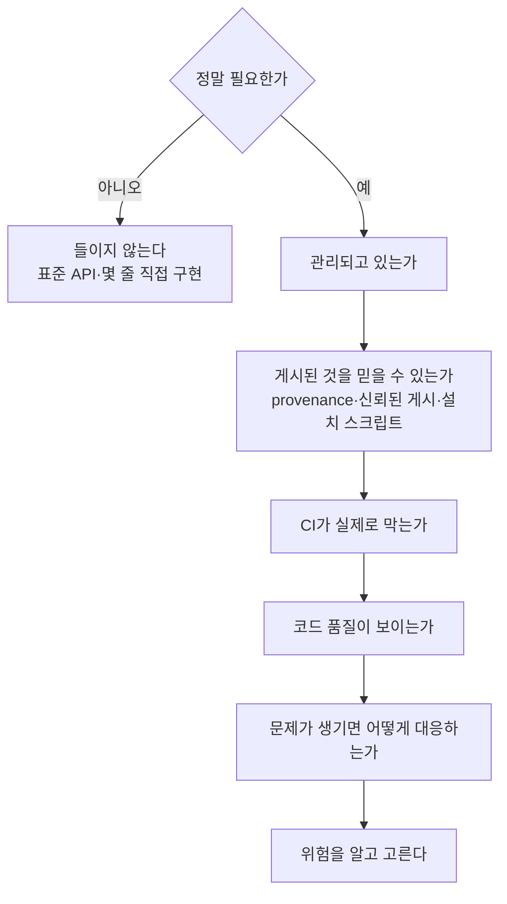
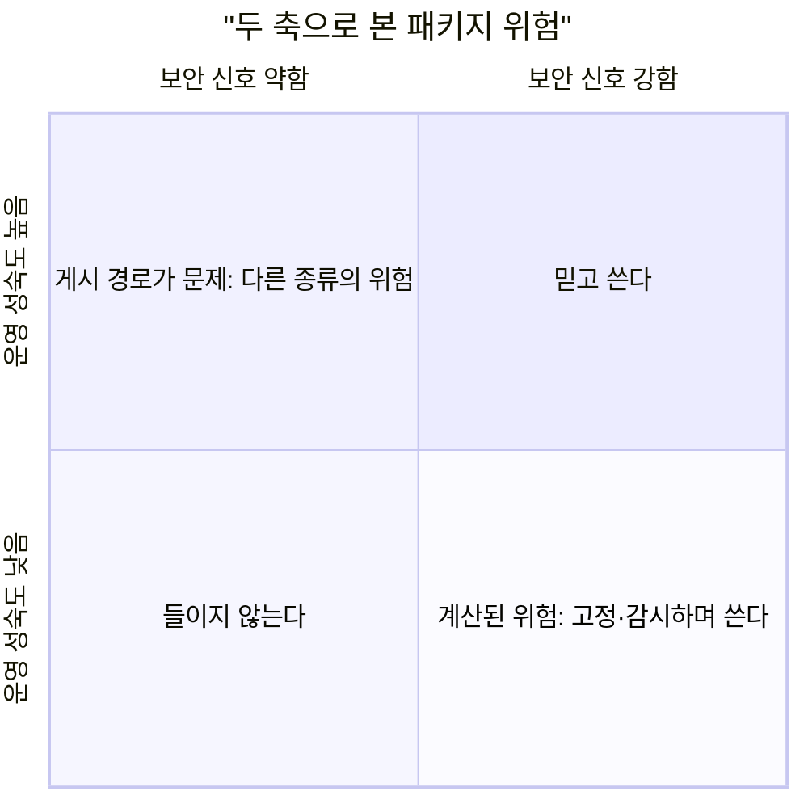

> Gabor Koos의 「[How to Evaluate an npm Package: 2026 Edition](https://blog.gaborkoos.com/posts/2026-05-29-How-to-Evaluate-an-npm-Package-2026-Edition/)」(2026.05, [한국어 번역](https://handhand.tistory.com/entry/how-to-evaluate-an-npm-package-2026-edition))을 바탕으로, JavaScript Weekly·Node Weekly·Korean FE Article이 소개한 npmx와 replacements.fyi를 더하고 npm 공식 문서로 확인해 재구성한 노트다.

## 패키지를 고른다는 것

`npm install` 한 번은 **내가 쓰지 않은 코드와 그 전이 의존성 전체를 운영 환경에 들이는 결정**이다. 설치 과정에서 무엇이 실행되고 무엇이 남는지는 [[what-npm-install-does|npm install이 하는 일]]에, 깊은 의존성 트리가 왜 공격면이 되는지는 [[small-modules|작은 모듈 철학과 npm 의존성]]에 있다. 이 노트는 그 결정을 내리기 전에 **무엇을 보고 고르는가**를 다룬다.

주간 다운로드와 GitHub 스타는 안전성·관리 상태·정직성 어느 것도 보증하지 않는다. 다운로드에는 CI가 매번 새로 받는 횟수와 오래된 패키지가 끌고 오는 전이 설치가 섞여 있다. axios가 주간 1억 회 넘게 내려받히는 것도 상당 부분 이 관성 덕분이고, 그 인기는 2026년 3월 악성 버전이 퍼지는 통로가 됐다([[npm-publishing-security|npm 패키지 게시 보안]]). 인기는 「많이 쓰인다」는 뜻이지 「검증됐다」는 뜻이 아니다.

AI 코딩 도구가 추천하는 패키지도 그대로 믿지 않는다. 모델이 지어낸 그럴듯한 패키지 이름을 공격자가 먼저 등록해 두는 **슬롭스쿼팅(slopsquatting)** 이 있다. 에이전트에게 「설치 전에 확인하라」고 프롬프트로 부탁하기보다, 설치 래퍼·훅·정책 같은 도구 수준에서 검사를 강제한다.

## 평가 순서

한 패키지에 5~10분이면 충분하고, 그래도 아무것도 보증하지 않는다. 시간이 없으면 아래 「최소 세 가지」만 본다.

### 0. 정말 필요한가

| 질문 | 판단 |
| --- | --- |
| 내일 이 패키지가 사라지면 갈아 끼우기가 얼마나 어려운가 | 제거 비용이 클수록 위험도 크다. 그만큼 더 꼼꼼히 본다 |
| 표준 API나 몇 줄로 되는가 | `fetch`, `structuredClone`, `util.parseArgs`, `util.styleText`처럼 런타임에 있으면 들이지 않는다. 대체표는 [[small-modules#표준이 작은 패키지를 대체한다\|작은 모듈 철학]]에 있다 |
| 의존성을 몇 개 끌고 오는가 | 전이 의존성이 적을수록 공격면이 작다. `npm ls --all`, npmgraph로 트리를 본다 |
| 어디에 쓰는가 | 내부 도구 하나에만 쓰는 패키지와 모든 서비스가 import하는 패키지는 위험의 무게가 다르다 |

**replacements.fyi**(e18e)는 패키지 이름을 넣으면 더 가벼운 대안이나 같은 일을 하는 Node API·코드 조각을 알려 준다. `is-number`는 한 줄 코드로, `axios`는 `fetch`로, `chalk`는 `util.styleText`로 안내한다. `package.json`을 통째로 검사하는 기능도 있다.

AI로 코드를 싸게 만들 수 있게 되면서 「직접 짤까, 들일까」의 선이 옮겨 갔다. 그래도 날짜·시간대·유니코드·파서처럼 예외가 쌓이는 일반 문제는 검증된 패키지가 유지 보수 부담이 적다. 커스터마이징이 많거나 마땅히 관리되는 패키지가 없을 때 직접 구현을 고른다.

### 1. 관리되고 있는가

- **이슈**: 오래된 열린 이슈에 반응이 있는가.
- **커밋**: 봇·CI 커밋을 걸러 내고 사람이 마지막으로 소스를 의미 있게 고친 시점을 본다. 3개월 안이면 초록, 2년 넘게 멈췄으면 빨강이다.
- **버스 팩터**: 관리자 한 명이 거의 모든 일을 하는가. 탈락 사유는 아니지만 위험이다.
- **릴리스 리듬**: npm의 Versions 탭에서 일정한 주기가 보이는가. 오래 잠잠하다가 갑자기 연달아 나온 버전은 계정 탈취의 신호일 수 있다.
- **CHANGELOG**: 커밋 해시만 나열한 기록은 쓸모가 없다. 깨지는 변경마다 마이그레이션 가이드가 있으면 신경 써서 관리한다는 뜻이다([[semantic-versioning|유의적 버전]]).

### 2. 게시된 것을 믿을 수 있는가

GitHub의 소스와 npm에 올라간 tarball은 **같다는 보장이 없다.** 그 사이에는 CI 비밀 값이나 개발자 PC의 `NPM_TOKEN`이 있다.

| 신호 | 확인하는 곳 | 초록 | 빨강 |
| --- | --- | --- | --- |
| 출처 증명(provenance) | npmjs.com 버전 페이지의 Provenance 항목 | 저장소 URL·커밋 SHA·워크플로 실행이 실제 저장소와 맞는다 | 없거나 출처가 불분명하다 |
| 신뢰된 게시(trusted publishing) | `.github/workflows/`의 게시 워크플로 | `id-token: write`로 OIDC 게시, `NPM_TOKEN` 비밀이 없다 | 장기 토큰 비밀, 손으로 하는 게시 단계 |
| 액션 고정 | `.github/workflows/*.yml` | 서드파티 액션을 커밋 SHA로 고정 | `@v3`, `@main`, `@latest` 같은 움직이는 참조 |
| 설치 스크립트 | 패키지 `package.json`의 `scripts` | 없거나, 네이티브 애드온 컴파일처럼 이유가 분명하다 | 설명 없는 `preinstall`·`postinstall` |

- 신뢰된 게시로 공개 저장소에서 공개 패키지를 올리면 provenance는 `--provenance` 없이 자동으로 붙는다(GitHub Actions·GitLab CI/CD. CircleCI는 붙지 않는다).
- 이미 설치한 패키지는 프로젝트에서 `npm audit signatures`로 레지스트리 서명과 provenance 증명을 한꺼번에 검증한다.
- provenance는 「이 tarball이 이 저장소의 이 워크플로에서 만들어졌다」만 증명한다. **그 워크플로가 오염되면 악성 버전도 유효한 provenance를 단다.** TanStack 사고가 그랬다([[npm-publishing-security|npm 패키지 게시 보안]]). 그래서 provenance는 필요조건이지 충분조건이 아니다.
- 설치 스크립트는 npm 12, pnpm 10+, Yarn 4.14+에서 기본으로 실행되지 않지만, 허용 목록에 올리는 순간 다시 내 권한으로 돈다([[package-managers#공급망 보안 기본값|공급망 보안 기본값]]).

### 3. CI가 실재하는가, 장식인가

- Actions 탭에서 CI가 머지 뒤에만이 아니라 **`pull_request`마다** 도는지 본다.
- 최근 머지된 PR 몇 개를 열어 CI가 돌았고 통과해야 머지됐는지 확인한다. 30초면 된다.
- `vitest.config`·`jest.config`에 커버리지 **임계값**(예: lines·functions·branches 80~90)이 있는가. 임계값이 없으면 커버리지는 보고만 되고 강제되지 않는다. 정적인 커버리지 배지는 신호가 아니다.
- 테스트가 `src/` 구조를 따라가거나 단위 테스트가 곁에 있으면 좋은 신호다. 스모크 테스트 파일 하나뿐이면 약하다.

### 4. 코드 품질이 보이는가

| 항목 | 좋은 신호 |
| --- | --- |
| 린트 설정 | `eslint.config.js`가 있고 비어 있지 않다 |
| `package.json`의 `exports` | `import`·`require`·`types` 조건부 진입점을 선언한다. `main`만 있으면 오래된 관행일 수 있다([[es-modules\|모듈]]) |
| `prepublishOnly` | 게시 전에 빌드·테스트를 돌린다. 실수로 깨진 릴리스를 막지만 악의적인 릴리스는 못 막는다 |
| TypeScript | `tsconfig.json`의 `strict: true`. 저장소 전체에 `any`·`@ts-ignore`가 수십 개 흩어져 있으면 타입 안전성이 약하다 |

### 5. 문제가 생기면 어떻게 되는가

- `SECURITY.md`나 GitHub 보안 정책에 비공개 제보 경로, 연락처, 응답 기대치가 있는가.
- GitHub Security 탭의 과거 권고(advisory)가 영향 버전을 명확히 적고 조율된 공개를 했는가. 잘 처리한 과거 권고는 좋은 신호다.
- osv.dev, Snyk에서 패치되지 않은 알려진 취약점이 있는가.
- 치명적 이슈를 며칠 만에 고쳤는가, 몇 달씩 열어 뒀는가.
- 행위 분석 도구(Socket.dev)는 네트워크·파일 시스템 접근, 난독화, 설치 스크립트를 짚어 주고, PR에 새 의존성이 들어올 때 경고하는 GitHub 앱이 있다. 경고에 그치지 않고 설치 시점에 정책으로 막는 방화벽형 도구도 있다.

## 그 밖에 보는 것

| 항목 | 보는 법 |
| --- | --- |
| 번들 크기·모듈 형식 | 브라우저 번들에 들어가면 크기와 트리 셰이킹 여부를 본다. named export로 필요한 함수만 가져올 수 있는가([[bundlers-and-vite\|번들러]]) |
| 의존성 수 | 하는 일에 비해 전이 의존성 트리가 크면 빨강이다 |
| 라이선스 | 회사 제품에 넣으면 라이선스 조건이 맞는지 본다([[open-source-licenses\|오픈소스 라이선스]]) |
| 기여에 열려 있는가 | 이슈·PR에 응답하고 기여를 받는 프로젝트는 문제가 생겼을 때 직접 고쳐 올릴 길이 있다 |
| 같은 문제를 푸는 후보 비교 | 비슷한 패키지가 여럿이면 내가 풀려는 문제에 가장 맞는 범위인지, 필요 없는 기능을 과하게 끌고 오지 않는지 본다 |

**npmx**(npmx.dev)는 공식 npm 레지스트리를 더 빠르고 정보가 많은 화면으로 보여 주는 비공식 브라우저다(npm, Inc.와 무관, 2026년 기준 알파). 패키지 여러 개를 크기·의존성·모듈 형식·라이선스 같은 축으로 나란히 비교하는 기능이 있어 후보를 고를 때 편하다. 레지스트리를 대체하지는 않는다.

## 체크리스트

**최소 세 가지**(시간이 없을 때):

1. 정말 필요한가?
2. provenance가 있는가?
3. 설명되지 않는 설치 스크립트가 있는가?

운영에 핵심적인 패키지라면 넷째로 **문제가 생겼을 때 관리자가 잘 대응하는가**를 더한다.

## 위험은 합격·불합격이 아니다

신호는 두 묶음으로 나눠 읽는다.

| 묶음 | 신호 |
| --- | --- |
| 보안 신호 | provenance, 신뢰된 게시, 설치 스크립트, 액션 SHA 고정 |
| 운영 성숙도 | 관리 활동, 의존성 크기, 관리자 집중도, 강제되는 커버리지, 보안 정책 |

보안 신호는 깨끗한데 관리가 약하면 버전을 고정하고 지켜보며 쓰는 **계산된 위험**이다. 보안 신호가 무너진 것은 관리가 아무리 활발해도 성격이 다른 문제다. 목표는 기본값으로 들이는 것이 아니라 **알고 고르는 것**이다.

## 정리

- 다운로드·스타는 인기 지표일 뿐이다. 필요성, 관리, 게시 경로, 설치 스크립트, CI, 품질, 대응을 본다.
- 먼저 「없어도 되는가」를 묻는다. 표준 API와 replacements.fyi가 첫 관문이다.
- provenance와 신뢰된 게시는 tarball이 저장소에서 왔다는 증명이지, 그 저장소의 CI가 안전하다는 증명은 아니다.
- AI가 추천한 이름은 슬롭스쿼팅을 의심하고, 검사는 프롬프트가 아니라 도구로 강제한다.
- 결과는 합격·불합격이 아니라 보안 신호와 운영 성숙도 두 축 위의 위치다.

관련 노트: [[small-modules|작은 모듈 철학과 npm 의존성]], [[what-npm-install-does|npm install이 하는 일]], [[package-managers|자바스크립트 패키지 매니저]], [[npm-publishing-security|npm 패키지 게시 보안]], [[frontend-dependency|프론트엔드 의존성]], [[open-source-licenses|오픈소스 라이선스]]
