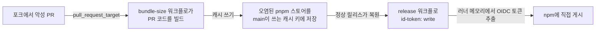

> TanStack의 「[npm 공급망 침해 포스트모템](https://tanstack.com/blog/npm-supply-chain-compromise-postmortem)」(2026.05, [한국어 번역](https://velog.io/@surim014/npm-supply-chain-compromise-postmortem)), Axios의 「[Post Mortem: axios npm supply chain compromise](https://github.com/axios/axios/issues/10636)」(2026.04), Andrey Sitnik의 「[The secure way to release an npm package in 2026](https://evilmartians.com/chronicles/the-secure-way-to-release-an-npm-package)」(2026.07)과 JavaScript Weekly·Node Weekly·Bytes·Korean FE Article이 전한 npm 보안 변경 소식을 바탕으로, 설정과 일정은 npm 공식 문서와 GitHub Changelog로 확인해 재구성한 노트다.

## 게시 경로가 공격면이다

공급망 공격자는 인기 패키지의 코드를 고치지 않는다. **그 패키지를 npm에 올릴 수 있는 권한**을 노린다. 권한이 있는 곳은 넷이다.

| 공격 지점 | 경로 |
| --- | --- |
| `node_modules` | 해킹된 의존성이 개발 PC나 CI에서 돌며 npm 토큰을 훔치거나 내 패키지에 코드를 끼운다 |
| 서드파티 CI 액션 | `v3` 같은 움직이는 태그를 악성 커밋으로 옮기면 게시 작업 안에서 그 코드가 돈다 |
| 개발자 PC | 의존성과 IDE 확장은 노트북의 파일 대부분을 읽는다 |
| CI 워크플로 실수 | `pull_request_target` 오용, 셸 인젝션, 캐시 오염, 취약한 워크플로가 남은 옛 브랜치 |

여기에 관리자를 직접 속이는 사회공학이 더해진다([[developer-targeted-social-engineering|개발자를 노리는 사회공학 공격]]). 100% 막는 방법은 없다. 목표는 **공격 비용을 올리고, 한 곳이 뚫려도 바로 공개되지 않게** 하는 것이다. 받는 쪽(설치하는 쪽)의 방어는 [[package-managers#공급망 보안 기본값|공급망 보안 기본값]], 들일 패키지를 고르는 기준은 [[npm-package-evaluation|npm 패키지를 고르는 기준]]에 있다.

## 두 사고로 본 공격 모양

### Axios (2026.03): 관리자 계정 탈취

| 단계 | 내용 |
| --- | --- |
| 접근 | 북한 연계 그룹(UNC1069)이 실제 회사 창업자를 사칭해 몇 주 동안 관계를 쌓았다. 가짜 Slack 워크스페이스, 가짜 Teams 회의에서 오디오 오류를 핑계로 「수정 프로그램」을 설치하게 했다 |
| 탈취 | 수석 관리자의 npm 계정을 장악하고 계정 이메일을 공격자 주소로 바꿨다 |
| 게시 | 평소의 CI 신뢰된 게시가 아니라 **훔친 토큰으로** `axios@1.14.1`·`0.30.4`를 올렸다. axios 코드는 그대로 두고 import되지도 않는 의존성 `plain-crypto-js@4.2.1`만 추가했다 |
| 페이로드 | 그 의존성의 `postinstall`이 플랫폼별 원격 제어 트로이목마(RAT)를 내려받아 실행하고 흔적을 지웠다. 하루 전 깨끗한 `4.2.0`을 먼저 올려 레지스트리 이력을 만들어 두었다 |
| 노출 | 몇 시간 뒤 npm이 악성 버전을 내렸다. axios를 직접 쓰지 않아도 의존성 트리에 있으면 영향을 받았다 |

교훈: **장기 토큰과 사람 계정만으로 게시할 수 있으면, 사람 하나를 속이는 것으로 끝난다.**

### TanStack (2026.05): 훔친 자격 증명 없이

관리자 토큰은 하나도 도난되지 않았다. 세 가지 약점이 이어졌다.



1. **`pull_request_target` 오용("Pwn Request")**: 이 트리거는 포크 PR에도 기본 저장소의 권한·맥락으로 돈다. 그 안에서 PR 코드를 체크아웃해 빌드했다. 신뢰·비신뢰 작업을 나누려 했지만 캐시 쓰기는 `permissions:`로 막히지 않았다.
2. **GitHub Actions 캐시 오염**: PR 실행과 `main` 푸시가 캐시 범위를 공유해, 나중에 릴리스 워크플로가 오염된 스토어를 복원했다.
3. **러너 메모리의 OIDC 토큰 추출**: 릴리스 작업에 `id-token: write`가 있었고, 복원된 악성 바이너리가 러너 프로세스 메모리에서 OIDC 토큰을 꺼내 정상 게시 단계를 건너뛰고 직접 올렸다.

42개 `@tanstack/*` 패키지에 84개 악성 버전이 6분 사이에 올라왔다. **게시는 `main`의 `release.yml`이라는 진짜 신뢰된 게시자 신원으로 이뤄졌다.** npm이 보기에는 완전히 정상이었다. 외부 연구자가 약 26분 만에 알렸고, 전부 deprecate하는 데 2시간 가까이, tarball이 지워지기까지 몇 시간이 더 걸렸다. 페이로드는 클라우드·GitHub·SSH·`~/.npmrc` 자격 증명을 긁고, 피해자가 관리하는 다른 패키지로 스스로 퍼졌다(Shai-Hulud 계열 웜). 훔친 토큰이 폐기되는지 감시하다가 폐기되면 홈 디렉터리를 지우는 장치까지 심었다. 그래서 **감염된 PC에서 바로 토큰부터 폐기하지 말고, 먼저 격리하고 경보를 읽는다.**

교훈: **신뢰된 게시도 그 워크플로가 오염되면 악성 버전에 정상 provenance를 붙여 준다.** 자동 게시만으로는 부족하고, 사람이 확인해야 공개되는 단계가 필요하다.

## 내보내는 쪽의 방어

| 방어 | 무엇을 막나 | 내용 |
| --- | --- | --- |
| 신뢰된 게시(trusted publishing) | 장기 토큰 도난 | CI가 실행마다 OIDC로 짧게 사는 게시 자격을 받는다. 저장할 `NPM_TOKEN`이 없다 |
| 출처 증명(provenance) | 레지스트리 tarball과 소스의 불일치 | 어느 저장소·커밋·워크플로에서 빌드됐는지 서명해 공개한다 |
| 토큰 게시 차단 | 남은 토큰으로 우회 게시 | 패키지 설정의 Publishing access에서 「Require two-factor authentication and disallow tokens」 |
| 단계적 게시(staged publishing) | CI나 토큰이 뚫려도 바로 공개되는 것 | CI는 스테이징까지만, 공개는 관리자가 2FA로 승인 |
| 2FA·하드웨어 키 | 피싱으로 비밀번호 탈취 | 조직 전원 2FA 강제, 승인은 하드웨어 보안 키로 |
| 태그 규칙 | 아무나 릴리스 태그를 만들어 게시 트리거 | GitHub 태그 규칙셋에서 태그 생성을 관리자만 하게 제한 |
| 워크플로 강화 | 캐시 오염·액션 하이재킹·`pull_request_target` | 아래 「게시 워크플로」 |

### 신뢰된 게시와 provenance

- 지원 CI: GitHub Actions(GitHub 호스티드 러너), GitLab CI/CD(GitLab.com 공유 러너), CircleCI(클라우드). 셀프 호스티드 러너는 아직 지원하지 않는다.
- 요구 버전: npm CLI 11.5.1+, Node.js 22.14.0+. GitHub Actions에서는 작업에 `permissions: id-token: write`가 있어야 한다.
- 공개 저장소에서 공개 패키지를 올리면 provenance가 **`--provenance` 없이 자동으로** 붙는다(GitHub Actions·GitLab). CircleCI는 provenance를 만들지 않는다.
- npmjs.com의 패키지 Settings에서 신뢰된 게시자(저장소, 워크플로 파일 이름)를 등록한다. 저장할 때 설정을 검증하지 않으므로 틀리면 첫 게시에서야 드러난다.
- 신뢰된 게시는 게시에만 쓰인다. 비공개 의존성을 `npm install`하려면 여전히 읽기 전용 토큰이 필요하다.

### 단계적 게시

`npm publish` 대신 `npm stage publish`로 올리면 버전이 스테이징 영역에 머문다. 관리자가 검토하고 승인해야 레지스트리에 공개된다.

```bash
npm stage publish              # 스테이징에 올린다(2FA 불필요, CI용)
npm stage list                 # 접근 가능한 스테이징 버전 목록
npm stage download <stage-id>  # tarball을 받아 직접 검사
npm stage approve <stage-id>   # 공개 승인(2FA 필요). npmjs.com의 Staged Packages 탭에서도 한다
```

- 요구 사항: 게시 권한, 계정 2FA, npm CLI 11.15.0+, Node.js 22.14.0+. pnpm은 11.3부터 `pnpm stage`로 지원한다.
- 신뢰된 게시와 함께 쓴다. npmjs.com의 신뢰된 게시자 설정에서 스테이징 게시만 허용하면, CI가 OIDC로 스테이징하고 사람이 2FA로 승인하는 구조가 된다. TanStack처럼 워크플로가 뚫려도 **승인 없이는 공개되지 않는다.**
- 토큰을 계속 써야 하는 자동화에는 2026년 9월부터 **스테이징 전용 토큰**(granular token의 「Read and write (stage only)」)이 있다. 이 토큰으로는 `npm publish`가 거부된다. 다만 dist-tag 이동과 deprecate는 여전히 되므로 일반 쓰기 토큰처럼 보호한다.
- 아직 없는 새 패키지를 스테이징하면 자리표시 버전 `0.0.0-stage`가 공개되고, 실제 버전은 승인 전까지 보이지 않는다.

### 레지스트리 쪽 변화(2026년 기준)

| 변화 | 내용 |
| --- | --- |
| 2FA 우회 토큰 축소 | 1단계(2026.08): 2FA 우회 granular token으로도 토큰 생성·삭제, 비밀번호·이메일·2FA 변경, 관리자·접근 권한·신뢰된 게시 설정 변경은 2FA 없이 못 한다. 2단계(2027.01 예정): 2FA 우회 토큰은 비공개 패키지 읽기와 스테이징만 할 수 있고 직접 게시는 막힌다. 대안은 신뢰된 게시나 단계적 게시다 |
| 계정 변경 보류 | 인기 패키지 관리자(high-impact) 계정은 이메일을 바꾸거나 2FA 복구 코드를 쓰면 72시간 읽기 전용이 되고 이전 이메일로 알림이 간다(2026.06). 복구 코드 로그인 뒤 72시간 보류는 2026.09부터 모든 계정에 적용된다. Axios처럼 이메일부터 바꾸는 탈취를 늦춘다 |
| 게시 시점 악성 코드 검사 | 2026.07부터 새 버전은 설치 가능해지기 전에 검사를 거친다. 보통 5분, 붐비면 15분 이상 걸리고 결과에 따라 공개·수동 검토 보류·차단된다. 검사 중에는 `npm dist-tag`는 되지만 `npm deprecate`·`npm unpublish`는 안 된다. 게시 직후 바로 설치하는 자동화는 지연을 감안한다 |
| 이중 용도(dual-use) 선언 | 보안 도구처럼 악성 코드와 닮았지만 정당한 패키지는 `package.json`의 `contentPolicy`와 패키지 루트의 텍스트 `DISCLOSURE` 파일로 선언한다. 한번 선언하면 이후 버전에서 뺄 수 없고, 신뢰된 게시·2FA 대화형 세션·단계적 게시로만 올릴 수 있다 |

### 게시 워크플로

게시 작업은 **의존성을 설치하지 않고, 서드파티 코드를 돌리지 않고, 캐시를 복원하지 않는** 작은 작업으로 분리한다.

```yaml
name: Release
on:
  push:
    tags: ['v*']          # 태그 생성은 태그 규칙셋으로 관리자만
jobs:
  build:
    runs-on: ubuntu-latest
    permissions:
      contents: read
    steps:
      - uses: actions/checkout@<커밋-SHA>       # 버전 태그 대신 SHA로 고정
        with:
          persist-credentials: false
      - uses: actions/setup-node@<커밋-SHA>
        with:
          node-version: 26
          package-manager-cache: false        # 느려도 캐시 오염 위험이 없다
      - run: npm ci --ignore-scripts
      - run: npm run build
      - uses: actions/upload-artifact@<커밋-SHA>
        with:
          name: dist
          path: dist/
  publish:
    needs: build
    runs-on: ubuntu-latest
    permissions:
      contents: read
      id-token: write     # OIDC는 이 작업에만
    steps:
      - uses: actions/checkout@<커밋-SHA>
        with:
          persist-credentials: false
      - uses: actions/download-artifact@<커밋-SHA>
        with:
          name: dist
          path: dist/
      - uses: actions/setup-node@<커밋-SHA>
        with:
          node-version: 26
          package-manager-cache: false
      - run: npm stage publish --ignore-scripts   # 공개는 사람이 2FA로 승인
```

- `<커밋-SHA>`에는 각 액션 릴리스의 전체 커밋 해시를 넣고 주석으로 버전을 적는다. `npx actions-up` 같은 도구가 고정과 갱신을 돕는다.
- `id-token: write`는 게시 작업에만 준다. 빌드·테스트 작업에는 없어야 러너 메모리에 OIDC 토큰이 생기지 않는다.
- `pull_request_target`에서 PR 코드를 체크아웃·빌드하지 않는다. 꼭 필요하면 `pull_request`로 돌리고 결과만 넘긴다.
- 워크플로 자체를 린트한다. zizmor는 위험한 트리거, 템플릿 인젝션, 고정되지 않은 액션, 과한 권한을 잡는다.
- **빌드 단계가 없는 패키지가 가장 안전하다.** 빌드가 필요해도 게시 작업과 분리한다.

## 받는 쪽과 맞물리는 설정

게시 쪽 방어는 받는 쪽의 **새 버전 유예(cooldown)** 와 맞물린다. 악성 버전은 대부분 몇 분에서 몇 시간 안에 발견되므로, 게시된 지 며칠 지난 버전만 설치하면 상당수를 피한다. TanStack 버전은 26분 만에 신고됐다.

| 매니저 | 설정 | 단위 |
| --- | --- | --- |
| npm | `npm config set --location=project min-release-age 3` | 일 |
| pnpm | `minimumReleaseAge: 4320` (`pnpm-workspace.yaml`, 11은 기본 1440) | 분 |
| Yarn | `npmMinimalAgeGate: 3d` (`.yarnrc.yml`) | 기간 문자열 |
| Bun | `bunfig.toml`의 `[install]` `minimumReleaseAge = 259200` | 초 |

의존성 갱신 봇(Dependabot, Renovate)에도 같은 유예를 건다. 설치 스크립트 기본 차단, lock 파일, `npm ci`는 [[package-managers#공급망 보안 기본값|공급망 보안 기본값]]에 있다.

npm 12는 `.npmrc` 해석도 엄격해지는 중이다. 모르는 키는 npm 11.2부터 경고하고, `strict-npmrc=true`면 오류로 처리한다(기본 `false`, 앞으로의 메이저에서 기본 오류 예정). **모르는 명령줄 플래그는 이 설정과 무관하게 항상 오류다.** 패키지 고유 설정은 `.npmrc` 대신 `package.json`의 `config` 필드(`npm_package_config_*`로 스크립트에 노출)나 환경 변수로 옮긴다.

## 정리

- 공격자는 코드가 아니라 게시 권한을 노린다. 관리자 계정(Axios)과 CI 워크플로(TanStack) 두 경로가 대표적이다.
- 장기 토큰을 없애고 신뢰된 게시로 옮기되, 그것만으로는 오염된 워크플로를 못 막는다. 단계적 게시로 사람의 2FA 승인을 공개 직전에 둔다.
- 게시 작업은 의존성 설치·캐시·서드파티 액션 없이 분리하고, 액션은 SHA로 고정하고, `id-token: write`는 게시 작업에만 준다.
- 레지스트리는 2FA 우회 토큰 축소, 계정 변경 보류, 게시 시점 검사로 기본값을 올리고 있다. 받는 쪽은 새 버전 유예로 남은 틈을 줄인다.
- 감염된 PC에서는 토큰 폐기보다 격리가 먼저다.

관련 노트: [[package-managers|자바스크립트 패키지 매니저]], [[npm-package-evaluation|npm 패키지를 고르는 기준]], [[small-modules|작은 모듈 철학과 npm 의존성]], [[developer-targeted-social-engineering|개발자를 노리는 사회공학 공격]], [[secrets-management|시크릿 관리]], [[ci-cd|CI/CD]], [[devsecops|DevSecOps와 클라우드 보안]], [[open-source-maintenance|오픈소스 운영]]
