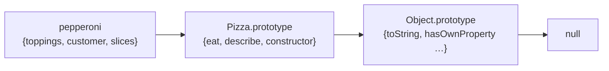
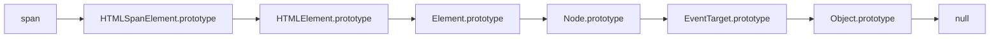
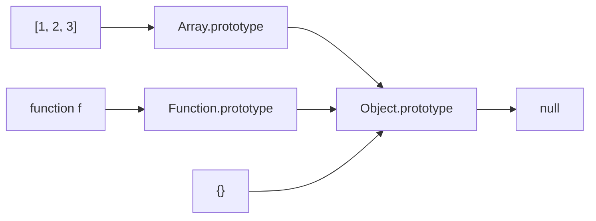

> Wes Bos의 「[Beginner JavaScript](https://wesbos.com/javascript)」 강의 노트를 바탕으로 재구성한 노트다. 프로토타입의 철학적 배경은 임성묵의 「[자바스크립트는 왜 프로토타입을 선택했을까](https://medium.com/@limsungmook/%EC%9E%90%EB%B0%94%EC%8A%A4%ED%81%AC%EB%A6%BD%ED%8A%B8%EB%8A%94-%EC%99%9C-%ED%94%84%EB%A1%9C%ED%86%A0%ED%83%80%EC%9E%85%EC%9D%84-%EC%84%A0%ED%83%9D%ED%96%88%EC%9D%84%EA%B9%8C-997f985adb42)」(2021.12)를 바탕으로 덧붙였다. web.dev의 「[Learn JavaScript](https://web.dev/learn/javascript)」 강좌의 객체·부록 모듈과 javascript.info(모던 JavaScript 튜토리얼)의 「프로토타입 상속」, 「함수의 prototype 프로퍼티」, 「내장 객체의 프로토타입」, 「프로토타입 메서드와 __proto__가 없는 객체」, 「instanceof로 클래스 확인하기」 글로 보강했다. 「[Must-Know-About-Frontend: 프로토타입](https://github.com/baeharam/Must-Know-About-Frontend/blob/main/Notes/javascript/prototype.md)」, 「[Must-Know-About-Frontend: new의 동작방식](https://github.com/baeharam/Must-Know-About-Frontend/blob/main/Notes/javascript/new.md)」의 내용을 더해 보강했다. 「[Frontend_TIL: 프로토타입 예제](https://github.com/AI-Dev-Lex-Kim/Frontend_TIL/blob/master/Javascript/%EA%B0%9D%EC%B2%B4%EC%A7%80%ED%96%A5%ED%98%95%20%ED%94%84%EB%A1%9C%EA%B7%B8%EB%9E%98%EB%B0%8D%28OOP%29/%ED%94%84%EB%A1%9C%ED%86%A0%ED%83%80%EC%9E%85%20%EC%98%88%EC%A0%9C.md)」을 바탕으로 보강했다. 정적·동적 클래스 모델과의 비교는 Dmitry Soshnikov의 「[OOP: The general theory](http://dmitrysoshnikov.com/ecmascript/chapter-7-1-oop-general-theory/)」, 「[OOP: ECMAScript implementation](http://dmitrysoshnikov.com/ecmascript/chapter-7-2-oop-ecmascript-implementation/)」을 바탕으로 보강했다.
> 헷갈리기 쉬운 출력 문제는 Lydia Hallie의 「[JavaScript Questions](https://github.com/lydiahallie/javascript-questions)」에서 개념별로 뽑아 보강했다.

## 프로토타입이란

JavaScript의 모든 객체는 숨은 링크 `[[Prototype]]`으로 다른 객체 하나(또는 `null`)를 가리킨다. 그 객체가 **프로토타입**이다. 객체에서 속성을 찾을 때 자기에게 없으면 프로토타입에서, 거기도 없으면 프로토타입의 프로토타입에서 찾는다. 이것이 **프로토타입 체인**이고, JavaScript 상속의 전부다.

배열을 만들 때마다 `push`·`filter`가 복사되지 않는 이유가 여기에 있다. 메서드는 `Array.prototype`에 한 벌만 있고 모든 배열이 그것을 빌려 쓴다.

```javascript
const names = ['wes', 'kait']
const numbers = [1, 2, 3]
names.filter === numbers.filter                // true: 같은 함수 하나를 공유한다
Object.getPrototypeOf(names) === Array.prototype // true
```

## 왜 클래스가 아니라 프로토타입인가

클래스와 프로토타입은 "같은 종류의 객체를 어떻게 묶나"에 대한 두 가지 답이다. 차이는 철학에서 왔다(Antero Taivalsaari, 「Classes vs. Prototypes: Some Philosophical and Historical Observations」, 1996).

| | 클래스 기반 | 프로토타입 기반 |
| --- | --- | --- |
| 뿌리 | 플라톤의 이데아, 아리스토텔레스의 **분류**: 공통 속성이 같으면 같은 범주다 | 비트겐슈타인의 **가족 유사성**과 Rosch의 **프로토타입 이론**: 범주는 정의가 아니라 가장 전형적인 본보기(원형)와 얼마나 닮았는가로 정해진다 |
| 객체 만들기 | 먼저 추상적인 설계도(클래스)를 정의하고 `new`로 구체화한다 | 이미 있는 구체적인 객체를 본보기로 삼아 복사하거나 연결한다 |
| 확장 | 클래스 상속 | 위임(delegation). 자기가 모르는 메시지는 원형에게 넘긴다 |
| 설계 순서 | 분류 체계를 미리 잘 세워야 한다. 잘못 세운 상속 계층은 나중에 바꾸기 어렵다 | 개별 객체를 고쳐 가며 점진적으로 발전시킨다 |

실제 언어의 경계는 표만큼 선명하지 않다. C++·Java 같은 **정적 클래스 기반**은 클래스가 컴파일 때 굳어 객체의 모양을 실행 중에 바꿀 수 없다. 반면 Python·Ruby 같은 **동적 클래스 기반**은 실행 중에 클래스에 메서드를 더하면 이미 만든 인스턴스도 그 메서드를 쓰고, 인스턴스가 클래스를 가리키는 연결을 따라 메서드를 찾는다. 이 구조는 프로토타입의 위임과 거의 같다. JavaScript의 `class`는 이 동적 클래스 모델을 프로토타입 위에 문법으로 얹은 것이다.

Rosch의 실험에서 사람들은 '새'를 떠올릴 때 참새를 전형으로, 타조·펭귄을 가장자리로 둔다. 모든 새가 공유하는 속성 목록이 아니라 원형과의 거리로 범주를 판단한다는 뜻이다. 이 생각을 언어로 옮긴 것이 1980년대의 **Self**이고, JavaScript는 Self에서 프로토타입을, Scheme에서 일급 함수와 클로저를, Java에서 문법의 겉모양을 가져왔다.

```javascript
const sparrow = { wings: 2, canFly: true }
const chicken = Object.create(sparrow)  // 설계도가 아니라 실제 객체를 원형으로 삼는다
chicken.canFly = false                  // 원형은 그대로, 자기만 달라진다(섀도잉)
chicken.wings                           // 2: 원형에 위임
```

| 관점 | 근거 |
| --- | --- |
| 렉시컬 스코프·호이스팅·호출 방식에 따라 정해지는 `this`도 "의미는 맥락에서 정해진다"는 프로토타입 철학에서 나왔다 | 이렇게 보면 `this`를 경우의 수로 외우지 않고 "누가 호출했나"라는 하나의 원리로 이해할 수 있다 |
| 이 기능들은 철학이 아니라 설계상의 선택이다 | 렉시컬 스코프는 Scheme 계열에서, 동적 `this`는 함수를 메서드로 빌려 쓰는 위임 모델에서 왔다. 클래스 언어도 렉시컬 스코프를 쓴다 |

어느 쪽이든 `this`의 규칙 자체는 [[functions|함수와 this]]에, 스코프와 호이스팅은 [[scope-and-closures|스코프와 클로저]]에 있다.

## 생성자 함수와 new

`Array`, `Date`, `Object`, `Map`은 모두 함수다. 함수 앞에 `new`를 붙여 부르면 그 함수가 **생성자(constructor)** 가 되어 인스턴스 객체를 돌려준다. 일반 함수와 구분하려고 이름을 대문자로 시작한다.

```javascript
function Pizza(toppings = [], customer) {
  this.toppings = toppings  // this = 지금 만들어지는 인스턴스
  this.customer = customer
  this.slices = 10
}

Pizza(['cheese'])               // undefined: new 없이 부르면 그냥 함수 호출이다
const pepperoni = new Pizza(['pepperoni'], 'wes')
pepperoni instanceof Pizza      // true
pepperoni.constructor === Pizza // true: 누가 만들었는지
```

`new` 없이 부르면 본문의 `this`가 인스턴스가 아니다. sloppy mode의 일반 호출에서 `this`는 전역 객체라서 `this.toppings = …`가 **전역 변수를 만들고** 반환값은 `undefined`다. strict mode(ES 모듈 포함)에서는 `this`가 `undefined`라 `TypeError`로 바로 드러나고, class는 `new` 없이 부르는 것 자체가 `TypeError`다.

`new F(...args)`는 다음 순서로 동작한다.

1. 빈 객체를 만들고, 그 `[[Prototype]]`을 `F.prototype`으로 잇는다.
2. `this`를 그 객체로 정해 `F`의 본문을 실행한다. 본문은 `this`에 인스턴스 데이터를 채운다.
3. `F`가 다른 객체를 `return`하면 그것을, 아니면 1에서 만든 객체를 돌려준다.

`[]`·`{}` 같은 **리터럴 문법**은 `new Array()`·`new Object()`를 짧게 쓴 것이고, `document.createElement('span')`은 내부에서 인스턴스를 만들어 준다. `Date`처럼 리터럴이 없는 것은 `new`를 직접 쓴다.

> 원시값(`'wes'`, `42`)은 객체가 아니다. `'wes'.toUpperCase()`가 되는 것은 메서드를 부르는 순간 엔진이 `String` 래퍼 객체로 잠시 감싸 `String.prototype`을 찾기 때문이다(오토박싱). `new String()`처럼 래퍼를 직접 만들면 안 되는 이유는 [[variables-and-types|변수와 데이터 타입]]의 「원시값과 래퍼 객체」에 있다.

## 인스턴스 속성과 프로토타입 메서드

인스턴스마다 달라야 하는 **데이터는 `this`에**, 모두가 똑같이 쓰는 **동작은 `prototype`에** 둔다.

```javascript
// ✗ 인스턴스마다 함수가 새로 만들어진다
function Pizza() {
  this.eat = function () { this.slices-- }
}
new Pizza().eat === new Pizza().eat // false: 피자 2만 개면 함수도 2만 개

// ✓ 함수는 한 벌, 모든 인스턴스가 공유한다
Pizza.prototype.eat = function () {
  if (this.slices > 0) this.slices--
  return this.slices
}
Pizza.prototype.describe = function () {
  return `${this.customer}의 피자, ${this.slices}조각 남음`
}
```

프로토타입 메서드 안의 `this`는 **메서드를 부른 인스턴스**다(`pepperoni.eat()`이면 `pepperoni`). 그래서 공유 함수 하나가 인스턴스마다 다른 데이터를 다룬다. 프로토타입에 메서드를 나중에 추가해도 이미 만든 인스턴스가 바로 쓸 수 있다. 이 위임 방식을 디자인 패턴으로 본 설명은 [[js-design-patterns|JavaScript 디자인 패턴]]의 프로토타입 패턴에 있다.

## 프로토타입 체인과 섀도잉





- `pepperoni.toppings`는 인스턴스에서 바로 찾는다.
- `pepperoni.eat`은 인스턴스에 없으니 `Pizza.prototype`에서 찾는다.
- `pepperoni.toString`은 `Object.prototype`까지 올라간다.
- 끝(`null`)까지 없으면 `undefined`다.

개발자 도구는 프로토타입을 `[[Prototype]]`(Chrome)이나 `<prototype>`(Firefox)으로 보여 준다. 이중 대괄호는 코드로 직접 쓰는 키가 아니라 내부 슬롯이라는 표시다. 체인의 메서드가 `for...in`에 끼어들지 않는 것은 내장 메서드가 열거 불가(`enumerable: false`)이기 때문이고, 직접 프로토타입에 넣은 열거 가능한 속성은 `for...in`에 나온다([[property-descriptors|속성 설명자]]).

DOM 요소가 `span instanceof Node`이면서 `Element`이기도 한 것은 이 체인 덕분이다. `instanceof`는 "오른쪽 생성자의 `prototype`이 왼쪽 객체의 체인 어딘가에 있는가"를 검사한다.

인스턴스에 같은 이름의 속성을 두면 체인을 따라가기 전에 그것이 먼저 잡힌다. 이것이 **섀도잉**이며, 메서드 오버라이딩도 같은 원리다.

```javascript
Pizza.prototype.size = 'Large'
pepperoni.size              // 'Large': 프로토타입에서 찾음
pepperoni.size = 'Medium'
pepperoni.size              // 'Medium': 인스턴스 속성이 가린다
Object.hasOwn(pepperoni, 'size') // true: 자기 속성인지 확인
'eat' in pepperoni          // true: in은 체인까지 본다
```

### 읽기만 체인을 타고, 쓰기는 자기에게 한다

**프로토타입은 읽을 때만 쓰인다.** 데이터 속성을 대입·삭제하면 체인을 거치지 않고 그 객체 자신에게 적용된다. 위의 `pepperoni.size = 'Medium'`이 `Pizza.prototype.size`를 바꾸지 않고 자기 속성을 새로 만드는 이유다.

- 체인 위의 같은 이름 속성이 **읽기 전용(`writable: false`)** 이면 자기 속성도 생기지 않는다. 대입이 sloppy mode에서는 조용히 무시되고 strict mode에서는 `TypeError`다. `Object.defineProperty(F.prototype, 'num', { value: 2, writable: false })` 뒤의 `new F().num = 1`은 여전히 `2`를 읽는다. 이때도 `Object.defineProperty(instance, 'num', …)`로는 자기 속성을 만들 수 있다.
- 예외는 **체인에 setter가 있을 때**다. `admin.fullName = 'Alice Cooper'`에서 `fullName`이 프로토타입의 접근자 속성이면, 새 속성을 만드는 대신 그 setter가 호출된다.
- 이때든 메서드 호출이든 **`this`는 프로토타입이 아니라 점 앞의 객체**다. setter나 `sleep() { this.isSleeping = true }` 같은 상속 메서드가 `this`에 쓰면 호출한 객체에 속성이 생긴다. 그래서 **메서드는 공유되고 상태는 공유되지 않는다.**
- `for...in`은 상속받은 **열거 가능한** 속성까지 돈다. 자기 속성만 원하면 `Object.keys`·`Object.entries`를 쓰거나 `Object.hasOwn`으로 거른다. 키·값을 다루는 내장 메서드는 대부분 자기 속성만 본다.
- 체인은 하나뿐이다. 객체는 `[[Prototype]]`을 하나만 가지고(단일 상속), 순환 참조로 잇거나 객체·`null` 아닌 값을 넣으면 무시되거나 에러가 난다. 여러 출처의 메서드를 섞으려면 믹스인을 쓴다([[js-design-patterns|JavaScript 디자인 패턴]]).

## 프로토타입을 다루는 API

| API | 하는 일 |
| --- | --- |
| `Object.getPrototypeOf(obj)` | 객체의 프로토타입을 읽는다 |
| `Object.create(proto, descriptors?)` | `proto`를 프로토타입으로 하는 새 객체를 만든다. 생성자 없이 상속할 때. 두 번째 인자로 자기 속성을 [[property-descriptors\|속성 설명자]] 형식으로 함께 정의할 수 있다 |
| `Object.create(null)` | 프로토타입이 없는 순수 딕셔너리. `toString` 같은 키와 충돌하지 않는다(키-값 저장이면 `Map`이 더 낫다) |
| `Object.setPrototypeOf(obj, proto)` | 이미 만든 객체의 프로토타입을 바꾼다. 엔진 최적화를 깨므로 피한다 |
| `Object.hasOwn(obj, key)` | 체인을 보지 않고 자기 속성인지 확인한다(ES2022). 상속받는 `obj.hasOwnProperty(key)`는 `Object.create(null)`로 만든 객체에는 없고 덮어쓸 수도 있어서 이쪽을 쓴다 |
| `{ __proto__: base }` | 객체 리터럴에서 프로토타입을 정하는 표준 문법. `Object.create(base)`와 같다 |
| `obj.__proto__` (읽기·쓰기) | 웹 호환 때문에 명세 부록에 **레거시로만** 표준화된 접근자다. 폐기 예정(deprecated)이라 새 코드에서는 위 함수들을 쓴다 |

`F.prototype`과 `[[Prototype]]`을 헷갈리기 쉽다. `F.prototype`은 **함수가 가진 일반 속성**으로, `new F()`로 만들 인스턴스에 연결해 줄 객체다. 인스턴스 자신의 프로토타입은 `Object.getPrototypeOf(instance)`로 본다.

| `F.prototype`의 성질 | 결과 |
| --- | --- |
| `new F()`를 **실행하는 순간에만** 읽힌다 | 나중에 `F.prototype = 다른객체`로 바꾸면 그 뒤 만든 인스턴스만 영향을 받고, 이미 만든 인스턴스의 프로토타입은 그대로다 |
| 모든 함수(화살표 함수 제외)는 기본으로 `{ constructor: F }`를 가진다 | 인스턴스는 체인을 통해 `instance.constructor === F`를 읽는다. 누가 만들었는지 모르는 객체로 `new obj.constructor(…)`처럼 같은 종류를 하나 더 만들 수 있다 |
| JavaScript는 올바른 `constructor`를 **보장하지 않는다** | `F.prototype = { jumps: true }`로 통째로 덮으면 `constructor`가 사라진다. 덮지 말고 `F.prototype.jumps = true`로 속성을 더하거나, 덮을 때 `constructor: F`를 직접 넣는다 |
| 일반 객체의 `prototype` 속성은 아무 의미가 없다 | `{ prototype: … }`은 그냥 이름이 prototype인 속성이다 |

### __proto__가 남은 이유와 "__proto__" 키 문제

| 시기 | 프로토타입을 다루는 방법 |
| --- | --- |
| 초기 | 생성자 함수의 `prototype` 속성뿐이었다 |
| ES5 | `Object.create(proto)`로 만들 수는 있지만 읽거나 바꿀 표준 방법이 없어, 브라우저가 비표준 `__proto__` 접근자를 구현했다 |
| ES2015 | `Object.getPrototypeOf`·`setPrototypeOf`가 표준이 됐지만, `__proto__`가 이미 널리 쓰여 명세 부록 B(웹 호환용)에 실렸다 |

`obj.__proto__`는 객체의 속성이 아니라 **`Object.prototype`에 있는 getter·setter**다. 그래서 사용자 입력을 키로 쓰는 사전 객체에서 키가 `'__proto__'`면 값이 저장되지 않고, 객체를 넣으면 **프로토타입이 바뀐다.** 서버에서 요청 JSON을 객체에 깊이 병합하다 `Object.prototype`을 오염시키는 공격을 **프로토타입 오염(prototype pollution)** 이라 한다.

```javascript
const dict = Object.create(null) // 프로토타입 없는 "아주 단순한" 객체
dict['__proto__'] = '값'          // 평범한 데이터 속성으로 저장된다
Object.keys(dict)                 // ['__proto__']
String(dict)                      // TypeError: toString조차 상속받지 않는다
```

임의의 키를 받는 저장소는 `Map`을 쓰거나 `Object.create(null)`로 만든다. `Object.keys(obj)`처럼 `Object.` 정적 메서드는 프로토타입이 없어도 쓸 수 있다. 같은 이유로 이미 만든 객체의 `[[Prototype]]`을 바꾸는 `setPrototypeOf`·`obj.__proto__ =`는 엔진의 속성 접근 최적화를 깨므로, 프로토타입은 **만들 때 한 번** 정한다.

## instanceof와 타입 확인

`obj instanceof C`는 다음 순서로 판단한다.

1. `C`에 정적 메서드 `C[Symbol.hasInstance]`가 있으면 그 결과를 쓴다. `static [Symbol.hasInstance](obj) { return 'canEat' in obj }`처럼 판별 규칙을 직접 정할 수 있다.
2. 없으면 `C.prototype`이 `obj`의 체인(`getPrototypeOf(obj)`, 그 프로토타입 …) 어딘가에 있는지 본다. `C.prototype.isPrototypeOf(obj)`와 같다.

생성자 함수 자체는 보지 않고 `prototype` 객체만 비교하므로, 인스턴스를 만든 뒤 `C.prototype = {}`로 바꾸면 그 인스턴스는 더 이상 `instanceof C`가 아니다.

| 방법 | 대상 | 결과 |
| --- | --- | --- |
| `typeof` | 원시값(과 함수) | `'string'`, `'object'` 같은 문자열. 배열·`null`도 `'object'` |
| `Object.prototype.toString.call(v)` | 원시값, 내장 객체, `Symbol.toStringTag`가 있는 객체 | `'[object Array]'`, `'[object Null]'` 같은 문자열 |
| `instanceof` | 객체 | 체인에 있으면 `true`. 클래스 계층과 상속 여부를 볼 때 |
| `Array.isArray(v)` | 배열 | realm이 달라도(iframe) 정확하다 |

`Symbol.toStringTag`로 `toString` 결과를 바꾸는 법은 [[js-symbol|Symbol]]에 있다.

## class는 프로토타입 위의 문법이다

ES2015의 `class`는 새 상속 모델이 아니라 위 코드를 정리한 문법이다([[class|class 문법]]).

| class 문법 | 프로토타입으로 풀면 |
| --- | --- |
| `constructor(a) { this.a = a }` | 생성자 함수 본문 |
| `eat() {}` | `Pizza.prototype.eat = function () {}` |
| `static create() {}` | `Pizza.create = function () {}` (생성자 함수 자체의 속성) |
| `class Child extends Parent` | `Child.prototype`의 프로토타입을 `Parent.prototype`으로, `Child`의 프로토타입을 `Parent`로 잇는다 |
| `super.eat()` | 체인에서 한 단계 위의 `eat`을 부른다 |

`extends` 이전에는 생성자 상속을 두 줄로 직접 이었다. 부모 생성자를 `call`로 빌려 인스턴스 데이터를 채우고, 자식 `prototype`을 부모 `prototype`에 잇는다.

```javascript
function Animal(name, sound) {
  this.name = name
  this.sound = sound
}
Animal.prototype.say = function () { return `${this.name}: ${this.sound}` }

function Dog(name) {
  Animal.call(this, name, '멍멍')                   // super(name, '멍멍')에 해당
}
Dog.prototype = Object.create(Animal.prototype)     // 메서드 체인 잇기
Dog.prototype.constructor = Dog                     // 덮어써서 사라진 constructor 복구

new Dog('바둑이').say() // '바둑이: 멍멍'
```

`Dog.prototype = Animal.prototype`처럼 같은 객체를 넣으면 자식에 추가한 메서드가 부모에도 생기므로 `Object.create`로 한 단계 끼운다. `extends`는 이 과정에 정적 메서드 상속(`Object.setPrototypeOf(Dog, Animal)`)까지 해 준다.

다만 `class`에는 함수로 흉내 낼 때 없는 차이(`new` 없이 부르면 `TypeError`, 항상 strict mode, 메서드 열거 불가, TDZ)가 있다. 비교표는 [[class#문법적 설탕 이상인 지점|class 문법]]에 있다. 새 코드에서는 생성자 함수 대신 `class`를 쓴다.

메서드를 콜백으로 넘기면(`addEventListener('click', this.showNext)`) 프로토타입에서 꺼낸 함수만 넘어가 `this`가 인스턴스가 아니게 된다. 해결법은 [[functions|함수와 this]]의 bind 절에 있다.

## 내장 객체의 프로토타입

내장 객체도 같은 규칙을 따른다. **메서드는 `Array.prototype`·`Date.prototype` 같은 프로토타입에, 데이터(배열 요소, 객체의 속성, 날짜 값)는 객체 자신에** 둔다.



- `{}`는 `new Object()`의 줄임이라 `Object.prototype`에 이어지고, `'[object Object]'`를 만드는 `toString`도 거기서 온다. 모든 내장 체인의 꼭대기에는 `Object.prototype`이 있고 그 위는 `null`이다.
- 체인에 같은 이름이 여러 번 있으면 **가까운 쪽**이 이긴다. 배열을 문자열로 바꾸면 `Object.prototype.toString`이 아니라 `Array.prototype.toString`이 돌아 `'1,2,3'`이 된다.
- 함수의 `call`·`apply`·`bind`는 `Function.prototype`에 있다.
- 원시값의 메서드는 `String.prototype`·`Number.prototype`·`Boolean.prototype`에 있다. **`null`과 `undefined`는 래퍼 객체가 없어서** 속성도 메서드도 없다.
- 내장 프로토타입의 메서드를 다른 객체에 빌려 쓸 수 있다. `join`처럼 `this[0]`·`this.length`만 보는 메서드는 유사 배열에도 동작한다(`obj.join = Array.prototype.join`). 자세한 기법은 [[function-decorators|데코레이터와 콜 포워딩]]의 메서드 빌리기에 있다. 개발자 도구에서 `console.dir(값)`으로 체인을 펼쳐 볼 수 있다.

## 내장 프로토타입은 고치지 않는다

`String.prototype`이나 `Array.prototype`에도 메서드를 넣거나 덮어쓸 수 있다. 하지만 **페이지의 모든 코드가 같은 프로토타입을 공유**하므로, 한 곳에서 `toUpperCase`를 바꾸면 그 동작을 믿는 라이브러리가 모두 깨진다. 이렇게 내장 객체를 고치는 것을 몽키 패치라 하며, 표준화에도 걸림돌이 된다. 2018년 MooTools가 넣어 둔 `Array.prototype.flatten` 때문에 표준 메서드 이름이 `flat`으로 바뀐 일이 대표적이다.

예외는 **폴리필(polyfill)** 이다. 표준에 이미 있지만 오래된 브라우저에 없는 기능을, 표준과 똑같은 동작으로 **없을 때만** 채운다.

```javascript
if (!Array.prototype.at) {
  Array.prototype.at = function (i) { /* 표준 명세대로 구현 */ }
}
```

직접 쓰기보다 core-js 같은 검증된 폴리필을 빌드 도구로 필요한 만큼만 넣는다. 지원 범위를 정하는 기준은 [[responsible-javascript|책임감 있는 자바스크립트]]의 Baseline을 참고한다.

## 정리

- 클래스는 미리 정한 분류에서, 프로토타입은 실제 본보기와의 닮음에서 출발한다. JavaScript는 Self에서 이 모델을 가져왔다.
- 객체는 `[[Prototype]]` 링크로 다른 객체에 위임한다. 없는 속성은 체인을 따라 `null`까지 찾는다.
- `new`는 빈 객체를 `F.prototype`에 잇고, `this`로 본문을 실행해 돌려준다.
- 데이터는 인스턴스(`this`)에, 공유 동작은 `prototype`에 둔다.
- 체인은 읽을 때만 탄다. 대입은 자기 속성을 만들고(체인의 setter는 예외), 상속 메서드의 `this`는 호출한 객체다.
- `F.prototype`은 `new` 순간에만 쓰이고, 기본 `constructor`는 덮어쓰면 사라진다. 내장 객체도 메서드는 프로토타입에, 데이터는 자신에 둔다.
- 프로토타입은 `Object.getPrototypeOf`·`Object.create`·`Object.hasOwn`으로 다루고 `__proto__`는 쓰지 않는다. 임의의 키를 받는 사전은 `Map`이나 `Object.create(null)`로 만든다.
- `instanceof`는 `C.prototype`이 체인에 있는지 본다(`Symbol.hasInstance`로 바꿀 수 있다).
- `class`는 이 모든 것을 감싼 문법이다. 내장 프로토타입은 폴리필 말고는 건드리지 않는다.

관련 노트: [[class|class 문법]], [[property-descriptors|속성 설명자]], [[oop-and-javascript|객체 지향 프로그래밍과 JavaScript]], [[js-design-patterns|JavaScript 디자인 패턴: 생성 패턴]], [[functions|함수와 this]], [[scope-and-closures|스코프와 클로저]], [[arrays-and-objects|배열·객체·문자열]]
