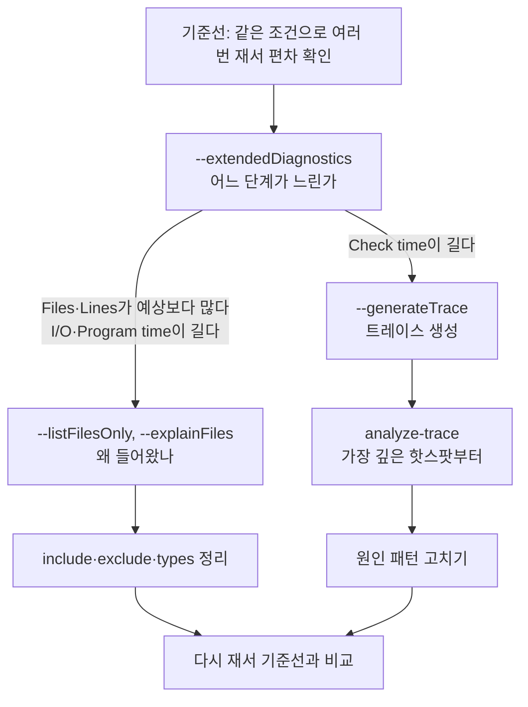

> Viget의 「[Fixing TypeScript Performance Problems: A Case Study](https://www.viget.com/articles/fixing-typescript-performance-problems)」(DevOwen 번역 「[타입스크립트 성능 문제 해결하기: 사례 연구](https://devowen.com/531)」, 2026.06)를 바탕으로, 권장 패턴과 플래그는 TypeScript 공식 위키 「[Performance](https://github.com/microsoft/TypeScript/wiki/Performance)」로 확인해 재구성한 노트다.

## 느린 타입 검사의 증상

타입 검사 비용은 CI의 `tsc` 시간보다 **에디터에서 먼저** 드러난다. 자동 완성과 호버가 늦게 뜨고, 고친 뒤에도 빨간 줄이 한참 남고, 언어 서버가 메모리 부족으로 재시작된다. 에디터의 진단은 프로젝트 전체 검사에 기대므로 프로젝트가 느리면 파일 하나를 고쳐도 느리다. 원인은 크게 둘이다.

| 원인 | 신호 |
| --- | --- |
| **너무 많이 검사한다** | 예상보다 파일·줄 수가 많다. `node_modules`, 생성된 타입, 테스트, 쓰지 않는 코드가 컴파일 컨텍스트에 들어왔다 |
| **비싸게 검사한다** | 파일 수는 적당한데 Check 시간이 길다. 특정 파일이나 식 하나가 수십 초를 쓴다 |

TypeScript 7은 Go로 다시 쓰여 같은 검사를 약 10배 빠르게 하지만, 비싼 타입은 그대로 비싸다. 비율만 줄어들 뿐 병목은 남는다.

## 진단 절차



### 1. 어느 단계가 느린가: `--extendedDiagnostics`

```bash
npx tsc --noEmit --extendedDiagnostics
```

| 항목 | 읽는 법 |
| --- | --- |
| `Files`, `Lines`, `Nodes` | 프로젝트 크기에 비해 많으면 엉뚱한 파일이 들어온 것이다 |
| `I/O Read time`, `Program time` | 길면 `include`·`exclude` 문제다 |
| `Check time` | 길면 타입 수준의 계산이 비싸다. 트레이스로 간다 |
| `Emit time` | 길면 `.d.ts` 생성 비용을 의심한다(`emitDeclarationOnly`, 반환 타입 명시) |
| `Instantiations`, `Assignability cache size` | 제네릭 인스턴스화와 할당 가능성 비교가 얼마나 많았나. 고친 뒤 줄었는지 비교하는 지표다 |
| `Memory used` | 언어 서버가 죽는다면 여기부터 본다 |

`Total time`은 다른 항목의 합이 아니다. 빌드 도구(webpack 플러그인 등) 안에서 잰 시간과 `tsc` 단독 시간을 비교하면 통합 비용도 가려진다.

### 2. 왜 들어왔나: `--listFilesOnly`, `--explainFiles`

```bash
npx tsc --listFilesOnly | wc -l
npx tsc --explainFiles > explanations.txt   # 파일마다 「누가 import해서」, 「include 패턴에 걸려서」
```

자주 보는 원인과 처리는 다음과 같다.

| 원인 | 처리 |
| --- | --- |
| `exclude`를 직접 쓰면서 기본 `node_modules` 제외가 사라졌다 | `"exclude": ["**/node_modules", "**/.*/"]` |
| `include`가 없어 루트 전체가 들어왔다 | `"include": ["src"]` |
| `@types` 패키지가 전부 전역으로 들어왔다 | `"types": ["node"]`처럼 필요한 것만 적는다. TypeScript 6부터 기본값이 `[]`다([[typescript-project-config\|TypeScript 프로젝트 설정]]) |
| 코드 생성기가 만든 거대한 타입 파일 | 실제로 쓰는지 확인하고 지운다 |
| 배럴 파일(`index.ts`에서 전부 re-export) | 하나만 import해도 묶음 전체를 읽는다. 직접 경로로 import한다 |

### 3. 어디가 느린가: `--generateTrace`와 analyze-trace

```bash
npx tsc -p tsconfig.json --generateTrace ./ts-trace --incremental false
npx @typescript/analyze-trace ./ts-trace
```

- 트레이스는 컴파일에 성공하지 않아도 뜬다. 증분 빌드면 바뀐 것만 검사해 핫스팟이 숨으니 증분을 끈다(`tsc -b`면 `-f`로 강제 재빌드).
- 큰 모노레포에서 트레이스 도중 힙이 부족하면 Node 힙 상한을 올려 실행한다: `node --max-old-space-size=8192 ./node_modules/.bin/tsc -b --generateTrace ./ts-trace`([[nodejs-memory-tuning|Node.js 메모리 구조와 튜닝]]).
- `analyze-trace`는 시간이 오래 걸린 파일과 그 안의 식을 깊이 순으로 보여 주고, `node_modules` 안의 **중복 패키지 버전**도 짚는다. 결과가 너무 적거나 많으면 `--skipMillis`·`--forceMillis`로 기준 시간을 조절한다.
- 같은 `trace.*.json`을 Chrome·Edge의 `about://tracing`이나 Perfetto UI에 올려 시간축으로 볼 수도 있지만, 큰 트레이스는 열리지 않는 일이 잦다. 요약은 analyze-trace가 가장 실용적이다.
- 트레이스 형식은 버전마다 바뀌고, 공식 위키는 Go 기반 TypeScript 7 대신 **TypeScript 5.9·6.0의 `tsc`로 트레이스를 뜨라고** 권한다. 트레이스에는 파일 경로와 소스가 들어 있으니 공유할 때 주의한다.
- 에디터만 느리면 VS Code의 `typescript.tsserver.log`를 `verbose`로 켜 TSServer 로그를 본다. 서드파티 에디터 플러그인을 끄고 비교해 본다.

## 비싼 패턴과 고치는 법

| 패턴 | 왜 비싼가 | 고치는 법 |
| --- | --- | --- |
| 교차 타입으로 객체 합치기 `A & B & {…}` | 속성을 재귀적으로 합쳐 매번 다시 계산하고, 충돌하면 `never`가 되어 오류도 알아보기 어렵다 | `interface X extends A, B {…}`. 평평한 타입 하나가 되어 관계가 캐시된다 |
| 큰 유니언 | 값 하나를 유니언의 모든 멤버와 비교하고, 중복 멤버 제거는 쌍마다 비교(제곱)한다. 멤버가 십수 개를 넘으면 문제가 되기 시작한다 | 공통 기반 타입(`interface BaseElement`)과 하위 타입으로 나눈다. 필요한 곳만 좁힌 유니언을 쓴다 |
| 이름 없는 조건부 타입 | 반환 타입 자리에 조건부 타입을 직접 쓰면 호출할 때마다 다시 계산한다 | 타입 별칭으로 빼서 이름을 붙이면 컴파일러가 캐시한다 |
| 추론에 맡긴 반환 타입 | 특히 내보내는 함수는 추론 결과가 `.d.ts`로 그대로 커진다. `.d.ts`에 `import("./x").Type`이 보이면 신호다 | 반환 타입을 명시한다 |
| 큰 스키마 위의 제네릭 헬퍼 | 쿼리 빌더(Kysely 등)를 감싼 재사용 헬퍼가 람다를 돌려주면, 중첩 호출마다 큰 유니언에서 반환 타입 추론이 연쇄된다 | 헬퍼를 없애고 쓰는 곳에 인라인하거나, 입출력 타입을 명시해 추론 사슬을 끊는다 |
| 깊은 재귀·조합 폭발 타입 | 템플릿 리터럴 조합, 타입 수준 파서처럼 경우의 수가 곱으로 늘어난다 | 재귀 깊이와 조합 대상을 줄이고, 결과를 미리 계산한 타입으로 바꾼다 |

```typescript
// 비싸다: 쓸 때마다 교차를 다시 펼친다
type Props = BaseProps & StyleProps & { onSelect(id: string): void }

// 싸다: 한 번 만든 평평한 타입
interface Props extends BaseProps, StyleProps {
  onSelect(id: string): void
}

// 비싸다: 호출마다 조건부 타입을 다시 계산
function load<T>(x: T): T extends string ? Text : T extends number ? Num : Other { /* … */ }

// 싸다: 이름 붙인 타입은 캐시된다
type Loaded<T> = T extends string ? Text : T extends number ? Num : Other
function load<T>(x: T): Loaded<T> { /* … */ }
```

조건부 타입·매핑 타입 문법 자체는 [[typescript-type-operators|TypeScript 타입 연산]]에 있다.

## 설정으로 줄이기

| 설정 | 효과 | 주의 |
| --- | --- | --- |
| 프로젝트 참조(`references`, `tsc -b`) | 패키지 경계대로 나눠 바뀐 프로젝트만 다시 검사한다. 테스트 코드를 따로 두면 제품 코드가 테스트에 끌려가지 않는다 | 너무 잘게 나누면 오버헤드가 커진다. 위키 기준 5~20개 정도 |
| `incremental` | `.tsbuildinfo`에 상태를 저장해 바뀐 파일만 다시 검사한다. `composite`면 기본으로 켜진다 | 진단용 측정 때는 끈다 |
| `skipLibCheck` | `.d.ts` 검사를 건너뛴다 | 라이브러리 선언끼리의 진짜 충돌도 숨긴다 |
| 타입 검사와 변환 분리 | 번들러는 변환만, 타입 검사는 별도 프로세스(`tsc --noEmit`, 체커 플러그인)로 돌려 빌드를 막지 않는다 | `isolatedModules`는 그 자체로 빨라지게 하지 않는다. 파일 단위 변환기가 처리 못 하는 문법을 막을 뿐이다 |
| 에디터 메모리 부족 | `disableReferencedProjectLoad`, `disableSolutionSearching` | 참조 프로젝트 간 이동 기능이 약해진다 |

## 사례: 패키지 7개짜리 모노레포

이미 프로젝트 참조와 증분 빌드를 쓰던 모노레포에서 에디터가 점점 느려졌다. Prisma, Kysely, ts-pattern, hotscript처럼 타입이 무거운 의존성을 썼다. 트레이스에서 `common.ts` 한 파일이 검사에 **약 80.6초**를 썼고, 원인은 약 30개 테이블을 담은 `Db` 인터페이스 위에서 Kysely 쿼리를 감싸 람다를 돌려주는 헬퍼 함수 하나였다. 헬퍼를 없애고 쿼리를 쓰는 곳에 인라인한 것이 가장 큰 효과였고, 순환 의존 제거(madge), 생성된 Zod 타입 삭제, 중복 패키지 정리와 버전 통일(syncpack), 배럴 파일 제거를 함께 했다.

| 지표 | 전 | 후 | 변화 |
| --- | --- | --- | --- |
| 빌드 시간 | 374.32초 | 78.55초 | -79.0% |
| 타입 검사 시간 | 226.19초 | 38.23초 | -83.1% |
| 메모리 | 약 7.07GB | 약 3.52GB | -50.2% |
| 처리 파일 수 | 14,628 | 10,445 | -28.6% |
| 할당 가능성 캐시 크기 | 7,530,942 | 989,151 | -86.9% |
| 인스턴스화 수 | 41,244,435 | 25,282,289 | -38.7% |

캐시 없는 전체 빌드는 드물기 때문에 실제로 체감되는 효과는 빌드 시간보다 **즉시 뜨는 자동 완성과 에디터 반응**이다.

## 정리

- 먼저 기준선을 잰다. `--extendedDiagnostics`로 「너무 많이 검사하나, 비싸게 검사하나」를 가른다.
- 파일이 많으면 `--explainFiles`로 들어온 이유를 보고 `include`·`exclude`·`types`·배럴 파일을 정리한다.
- Check가 길면 `--generateTrace` + `@typescript/analyze-trace`로 가장 깊은 핫스팟부터 좁힌다(트레이스는 TypeScript 6 이하 `tsc`로).
- 교차 대신 `interface extends`, 큰 유니언 대신 기반 타입, 조건부 타입에 이름, 내보내는 함수에 반환 타입. 큰 스키마 위의 추상 헬퍼는 추론 사슬을 끊는다.
- TypeScript 7로 올려도 비싼 타입은 비싸다. 원인을 고친 뒤 올리면 두 효과가 곱해진다.

관련 노트: [[typescript-project-config|TypeScript 프로젝트 설정: tsconfig·모듈 해석·선언 파일]], [[typescript-error-messages|TypeScript 오류 메시지 읽기와 흔한 오류]], [[typescript-compiler-internals|TypeScript 컴파일러 내부 구조]], [[typescript-type-operators|TypeScript 타입 연산: 타입으로 타입 만들기]], [[native-js-toolchain|Rust·Go로 다시 쓰는 JS 툴체인]]
