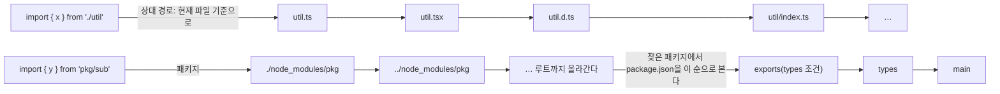
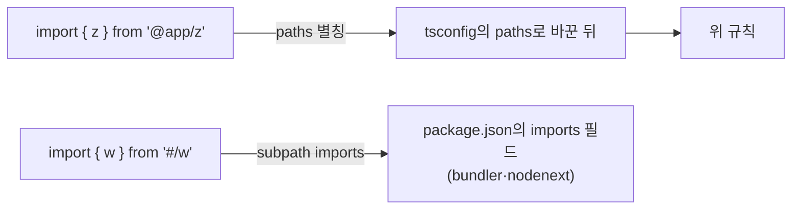

> basarat의 「[TypeScript Deep Dive](https://basarat.gitbook.io/typescript)」의 Project·Type System(선언 파일, `lib.d.ts`, 마이그레이션)·Options 장을 바탕으로, [TypeScript 6.0 릴리스 노트](https://www.typescriptlang.org/docs/handbook/release-notes/typescript-6-0.html)와 [TSConfig 레퍼런스](https://www.typescriptlang.org/tsconfig/)로 오늘 기준에 맞춰 재구성한 노트다.

## 컴파일 컨텍스트

**컴파일 컨텍스트(compilation context)** 는 TypeScript가 한 번에 함께 검사하는 파일 묶음과 그 옵션이다. 이 묶음을 정하는 파일이 `tsconfig.json`이다. 빈 객체 `{}`만 있어도 그 폴더 아래의 `.ts`·`.tsx`가 모두 들어간다.

| 항목 | 역할 |
| --- | --- |
| `include` / `exclude` | 넣고 뺄 경로와 글롭(`src/**/*`). 확장자는 생략하면 `.ts`·`.tsx`(`allowJs`면 `.js`·`.jsx`까지)로 본다 |
| `files` | 파일을 하나씩 나열한다. 파일이 늘 때마다 고쳐야 해서 보통 `include`를 쓴다 |
| `extends` | 다른 설정(`@tsconfig/strictest` 같은 공유 기본값)을 물려받는다 |
| `references` | 프로젝트를 쪼개 따로 빌드한다(`tsc -b`) |
| `compilerOptions` | 검사 강도와 출력 방식 |

- `tsc`는 현재 폴더부터 위로 올라가며 `tsconfig.json`을 찾는다. `tsc -p <경로>`로 지정하고, `tsc -w`로 감시한다.
- TypeScript 6.0부터 `tsconfig.json`이 있는 폴더에서 `tsc foo.ts`처럼 파일을 넘기면 오류(TS5112)다. 설정을 일부러 무시하려면 `tsc --ignoreConfig foo.ts`.
- 검사가 조용하다고 다 통과한 것은 아니다. 파일이 컨텍스트에 아예 없을 수 있다. `tsc --listFiles`, `tsc --explainFiles`로 무엇이 왜 들어왔는지 본다.

## 기본값과 사라진 옵션 (TypeScript 6·7)

TypeScript 6.0(2026)은 7.0으로 가는 다리 버전으로, 오래된 기본값을 바꾸고 낡은 옵션을 폐기 예고했다. **Go로 다시 쓴 7.0은 이 폐기를 모두 오류로 만든다.** 그래서 6.0에서 경고를 없앤 뒤 7.0으로 올린다.

| 옵션 | 5.9까지 | 6.0부터 |
| --- | --- | --- |
| `strict` | `false` | `true` |
| `module` | `commonjs` 등 target에 따라 | `esnext` |
| `target` | `es5` | 최신 ES(현재 `es2025`)를 따라가는 값 |
| `types` | `node_modules/@types`의 모든 패키지 | `[]`. `"types": ["node", "vitest/globals"]`처럼 직접 적는다(`["*"]`이면 예전 동작) |
| `rootDir` | 입력 파일의 공통 폴더로 추론 | `tsconfig.json`이 있는 폴더 |
| `noUncheckedSideEffectImports` | `false` | `true`: `import './x.css'`도 대상 파일이 있는지 검사한다 |

| 폐기·제거 | 대신 |
| --- | --- |
| `target: es5`, `downlevelIteration` | 최저 target은 ES2015. 더 낮은 환경은 별도 트랜스파일러 |
| `moduleResolution: node`(`node10`), `classic` | `bundler` 또는 `nodenext` |
| `baseUrl` | 접두사를 `paths`에 직접 쓴다: `"@app/*": ["./src/app/*"]` |
| `esModuleInterop: false`, `allowSyntheticDefaultImports: false` | 항상 켜진 상태. `import express from 'express'`로 쓴다 |
| `outFile`, `module: amd·umd·system·none` | 번들러(Vite, esbuild, Rollup)가 묶는다 |
| `alwaysStrict: false` | 모든 파일이 JavaScript strict mode다 |
| 네임스페이스용 `module Foo {}` 키워드 | `namespace Foo {}`. 모듈 선언 `declare module 'x' {}`는 그대로다 |
| `import x from './a.json' assert { type: 'json' }` | `with { type: 'json' }` |

`"ignoreDeprecations": "6.0"`은 6.0에서만 경고를 미루는 임시 장치다.

## 엄격도: 편의와 건전성 사이

TypeScript는 「무엇을 허용할지」를 옵션으로 조절하게 한다. 기존 JavaScript를 그대로 받아들이는 쪽(편의)과 틀릴 수 있는 코드를 모두 막는 쪽(건전성, soundness) 사이의 슬라이더다. 새 프로젝트는 `strict`를 켠 채 시작하고, 필요하면 더 조인다.

| 옵션 | `strict`에 포함 | 막는 것 |
| --- | --- | --- |
| `noImplicitAny` | 예 | 추론할 수 없어 암묵적으로 `any`가 된 매개변수·변수. 명시한 `: any`는 막지 않는다 |
| `strictNullChecks` | 예 | `null`·`undefined`를 다른 타입에 대입하는 것, 없을 수 있는 값의 속성 접근 |
| `strictFunctionTypes` | 예 | 함수 매개변수의 이변성([[typescript-type-compatibility#함수끼리 대입\|타입 호환성]]) |
| `strictPropertyInitialization` | 예 | 생성자에서 초기화하지 않은 클래스 속성 |
| `useUnknownInCatchVariables` | 예 | `catch (e)`의 `e`를 `any`로 쓰는 것. 기본이 `unknown`이 된다 |
| `noImplicitThis`, `strictBindCallApply`, `strictBuiltinIteratorReturn` | 예 | 타입 없는 `this`, `bind`·`call`·`apply` 인자 불일치, 내장 이터레이터 반환값의 `any` |
| `noUncheckedIndexedAccess` | 아니오 | 인덱스 시그니처·배열 접근 결과에 `| undefined`를 붙인다. `arr[i]`가 없을 수 있음을 드러낸다 |
| `exactOptionalPropertyTypes` | 아니오 | `age?: number`에 `undefined`를 직접 넣는 것. 「속성이 없음」과 「`undefined`가 들어 있음」을 구분한다 |
| `noImplicitReturns`, `noFallthroughCasesInSwitch`, `noImplicitOverride` | 아니오 | 일부 경로만 반환, `case` 흘러내림, `override` 없이 부모 메서드 재정의 |
| `noUnusedLocals`, `noUnusedParameters` | 아니오 | 쓰지 않는 변수·매개변수. 린터에 맡기는 팀이 많다 |

`strictNullChecks` 아래에서 검사를 넘기는 두 단언이 있다. 둘 다 컴파일러가 확인하지 않는 약속이라, 틀리면 런타임에 터진다.

```ts
declare function initialize(): void;

function getName(user?: { name: string }) {
  return user!.name;      // non-null 단언: user가 있다고 단언
}

class Form {
  value!: string;         // 확정 할당 단언: 생성자 밖(init 등)에서 채운다고 단언
  init() { this.value = ''; }
}
```

## 모듈: 파일 모듈과 전역 스크립트

**최상위에 `import`나 `export`가 하나라도 있는 파일만 모듈이다.** 없으면 전역 스크립트로 취급되어, 그 안의 선언이 컨텍스트의 모든 파일에 보인다. 서로 다른 파일의 `var foo`가 부딪히는 이유가 이것이다.

- 모듈로 만들 것이 없으면 `export {}` 한 줄을 넣는다.
- `"moduleDetection": "force"`이면 import·export가 없어도 모든 파일을 모듈로 본다.
- 일부러 전역에 두는 것은 선언 파일(아래 `global.d.ts`)뿐이다.

### module과 moduleResolution

`module`은 어떤 모듈 형식으로 출력·해석할지, `moduleResolution`은 `import '...'`의 경로를 실제 파일로 찾는 규칙이다. 실행 환경에 맞춰 둘을 짝지어 고른다.

| 실행 환경 | 설정 | 특징 |
| --- | --- | --- |
| 번들러(Vite, webpack, esbuild, Bun) | `"module": "esnext"`, `"moduleResolution": "bundler"` | 확장자 없는 상대 경로(`./foo`)와 `index` 생략을 허용한다. `package.json`의 `exports`·`imports`를 읽는다 |
| Node.js가 직접 실행 | `"module": "nodenext"`(또는 고정판 `node20`) | Node.js 규칙을 그대로 따른다. ESM 파일에서 상대 import에 **확장자가 필요**하다. `.ts` 원본에서도 `./foo.js`라고 쓴다 |
| Node.js 타입 제거로 `.ts`를 바로 실행 | 위 + `"allowImportingTsExtensions": true` 또는 `"rewriteRelativeImportExtensions": true` | `./foo.ts`라고 쓰고, 출력할 때 `.js`로 바꾼다 |

경로를 찾는 순서는 이렇다.

상대 경로와 패키지 이름은 이렇게 찾는다.



별칭과 subpath imports는 이렇게 찾는다.



- `paths`는 **타입 검사용 별칭일 뿐** 실행 코드의 경로를 바꾸지 않는다. 번들러의 `resolve.alias`나 `package.json`의 `imports`도 같이 맞춘다. 번들러와 Node.js가 모두 이해하는 `imports`(`"#/*": "./src/*"`)가 가장 이식성이 좋다.
- 예전 `moduleResolution: node`는 `exports`를 읽지 않아 요즘 패키지의 타입을 잘못 찾았다. 그래서 폐기됐다.

### 타입 전용 import와 verbatimModuleSyntax

선언 공간(아래)에서 보듯 import한 이름은 타입일 수도, 값일 수도 있다. 예전 TypeScript는 **값으로 쓰이지 않은 import를 출력에서 지웠다.** 덕분에 타입만 쓰면 런타임 의존성이 생기지 않았지만, 파일 하나만 보고 변환하는 도구(Babel, esbuild, Node.js 타입 제거)는 그 판단을 할 수 없다.

| 옵션 | 효과 |
| --- | --- |
| `import type { User }`, `import { type User, save }` | 이 이름은 타입이라고 적는다. 출력에서 지워진다 |
| `verbatimModuleSyntax` | `type`이 붙지 않은 import·export는 **적힌 그대로 남긴다.** 타입을 값처럼 import하면 오류. 무엇이 지워질지 파일만 보고 알 수 있다 |
| `isolatedModules` | 파일 단위 변환기가 처리할 수 없는 코드(타입만 다시 내보내기 등)를 막는다. `verbatimModuleSyntax`가 이것을 포함한다 |
| `erasableSyntaxOnly` | `enum`, `namespace`, 생성자 매개변수 속성처럼 지우기만으로는 안 되는 문법을 막는다. Node.js 타입 제거 실행에 맞춘다 |

부수 효과만 필요한 import(`import './polyfill'`)는 그대로 남는다. 예전에 쓰던 `import foo = require('foo')`와 「`typeof foo`로 타입만 쓰고 나중에 `require`」하는 지연 로딩 기법은 지금은 `import type`과 동적 `import()`(→ [[es-modules#동적 import: 필요할 때 불러오기|ES 모듈]])로 대신한다.

## 선언 공간: 타입과 값

TypeScript의 이름은 **타입 선언 공간**과 **값(변수) 선언 공간** 중 한쪽 또는 양쪽에 산다. `cannot find name` 오류의 상당수는 다른 공간의 이름을 찾았기 때문이다.

| 선언 | 타입 공간 | 값 공간 |
| --- | --- | --- |
| `interface`, `type` | 예 | 아니오 |
| `let`, `const`, `function` | 아니오 | 예 |
| `class`, `enum` | 예 (인스턴스 타입) | 예 (생성자·객체) |
| `namespace` | 내보낸 타입이 있으면 | 값이 있으면 |

```ts
interface Bar {}
// const b = Bar;        // 오류: Bar는 값이 아니다

const foo = 123;
// let x: foo;           // 오류: foo는 타입이 아니다
let y: typeof foo;       // 값에서 타입을 꺼낸다: number

class Point { x = 0 }
const P = Point;         // 값으로 복사하면 생성자만 옮겨진다
// let p: P;             // 오류: P는 타입 공간에 없다
let p: Point = new P();
```

`typeof`·`keyof typeof`로 값에서 타입을 끌어오는 법은 [[typescript-type-operators#keyof, typeof, 인덱스 접근|타입 연산]]에 있다.

## 바깥 코드를 설명하기: 앰비언트 선언

TypeScript로 쓰지 않은 것(브라우저 API, JavaScript 라이브러리, 빌드 도구가 주입하는 상수)도 타입 검사를 받으려면 「이런 것이 런타임에 있다」고 알려 줘야 한다. 이것이 **앰비언트 선언(ambient declaration)** 이고, 키워드는 `declare`다.

```ts
declare const __APP_VERSION__: string;          // 빌드 도구(Vite define 등)가 넣는 상수
declare function gtag(...args: unknown[]): void; // <script>로 들어온 전역 함수
declare module 'legacy-lib';                     // 타입 없는 패키지를 일단 any로
declare module '*.css' {                         // JS가 아닌 파일 import
  const classes: Record<string, string>;
  export default classes;
}
```

- **앰비언트 선언은 컴파일러와의 약속이다.** 검사도 출력도 하지 않으므로, 실제로 없거나 모양이 다르면 조용히 런타임 오류가 난다. 라이브러리가 바뀌면 선언도 고쳐야 한다.
- `.d.ts` 파일은 선언만 담는다. 코드가 출력되지 않고, 최상위 선언에는 `declare`(또는 `export`)가 붙는다.
- 전역 선언은 프로젝트에 `global.d.ts`(또는 `env.d.ts`) 하나로 모은다. 그 밖의 코드는 파일 모듈로 쓴다.
- 패키지 대부분은 타입을 직접 싣고 온다(`package.json`의 `types`·`exports`). 없으면 DefinitelyTyped의 `@types/패키지`를 먼저 찾고, 그래도 없을 때만 직접 쓴다.

### lib.d.ts와 전역 타입 확장

`window`, `document`, `Math`, `Promise` 같은 내장 객체의 타입은 TypeScript에 딸린 `lib.*.d.ts`에 있다. 대부분 `declare var window: Window` + `interface Window {…}` 모양이다. 인터페이스는 같은 이름으로 다시 선언하면 합쳐지므로(선언 병합) **lib을 고치지 않고 전역 타입을 넓힐 수 있다.**

```ts
// 모듈 파일 안에서 전역을 넓힐 때
export {};
declare global {
  interface Window { dataLayer: unknown[] }
}
window.dataLayer.push({ event: 'view' });
```

| 옵션 | 정하는 것 |
| --- | --- |
| `target` | 출력 문법 수준. 정하지 않으면 `lib`도 여기에 맞춰진다 |
| `lib` | 어떤 내장 API 타입을 쓸 수 있는가. `["es2025", "dom"]`처럼 target과 따로 정한다. 6.0부터 `dom`에 `dom.iterable`이 합쳐졌다 |
| `noLib`, `libReplacement` | 기본 lib을 빼고 직접 정의한 것을 쓴다. 특수한 런타임용이다 |
| `types` | 전역에 섞일 `@types` 패키지. 6.0부터 기본 `[]`라 `process`, `describe` 같은 전역이 필요하면 적는다 |
| `skipLibCheck` | `.d.ts` 검사를 건너뛰어 빠르게 한다. 라이브러리끼리 타입이 충돌할 때도 쓴다 |

`lib`은 타입만 준다. 실행 환경에 그 API가 없으면 폴리필(core-js 등)을 따로 넣는다.

### 라이브러리를 낼 때

| 옵션 | 역할 |
| --- | --- |
| `declaration`, `declarationMap` | `.d.ts`와 원본 위치 지도를 출력한다. 사용처에서 「정의로 이동」이 `.ts` 원본으로 간다 |
| `isolatedDeclarations` | 내보내는 함수의 반환 타입 등을 명시하게 해서, 다른 도구가 타입 검사 없이 파일마다 `.d.ts`를 만들 수 있게 한다 |
| `package.json`의 `exports` | `"types"` 조건을 맨 앞에 두어 진입점마다 선언 파일을 짝짓는다 |

## JavaScript에서 옮겨 오기

1. `tsconfig.json`을 만들고 `allowJs`(필요하면 `checkJs`)를 켜 JS와 TS를 섞어 빌드한다.
2. 파일 확장자를 하나씩 `.ts`로 바꾼다. JavaScript는 그대로 유효한 TypeScript라 동작은 바뀌지 않고 오류만 드러난다.
3. 당장 못 고치는 오류는 좁게 덮는다. 줄 단위로 `// @ts-expect-error 사유`(오류가 사라지면 이 주석이 오류가 되어 정리할 때를 알려 준다)를 쓰고, 값 하나에만 `as any`를 붙인다. 파일 전체 `// @ts-nocheck`는 마지막 수단이다.
4. 새 코드는 처음부터 타입을 붙이고, 옛 코드는 고칠 때마다 타입을 채운다. 이 과정에서 실제 버그가 나온다.
5. 타입 없는 서드파티는 `@types`를 찾고, 없으면 `vendor.d.ts`에 `declare module 'x'`로 임시 선언한 뒤 필요한 만큼 구체화한다.

## 역사

- 과거에는 파일을 모두 전역에 두고 `/// <reference path="..." />`로 순서를 잇고, `outFile`로 하나의 JS로 이어 붙였다. 「내부 모듈(internal module)」이라 부르던 `module Foo {}`가 지금의 `namespace`다. ES 모듈이 표준이 되며 모두 밀려났다.
- 모듈 출력 형식도 AMD(RequireJS), SystemJS, UMD, CommonJS가 공존했고 `import x = require()` 문법이 흔했다. 지금은 ES 모듈 문법으로 쓰고 형식 변환은 번들러나 Node.js가 맡는다.
- 타입 정의는 tsd, typings 같은 별도 관리자를 거쳐 npm의 `@types`로 정착했다.

## 정리

- `tsconfig.json`은 컴파일 컨텍스트를 정한다. 「오류 없음」이 「검사 안 함」은 아닌지 `--explainFiles`로 확인한다.
- TypeScript 6부터 `strict`·`esnext`·`types: []`가 기본이고, `node10` 해석·`baseUrl`·`outFile`·ES5 출력은 7.0에서 사라졌다.
- 해석 규칙은 실행 환경에 맞춘다: 번들러면 `bundler`, Node.js면 `nodenext`.
- `verbatimModuleSyntax`와 `import type`으로 무엇이 지워질지 파일만 보고 알게 한다.
- 이름은 타입 공간과 값 공간에 따로 산다. 바깥 코드는 `declare`로 약속하고, 전역 확장은 `declare global` + 인터페이스 병합으로 한다.

**tsconfig는 「무엇을 함께 검사하고, 얼마나 엄격하게, 어떤 실행 환경을 가정하는가」를 적는 파일이다.**

관련 노트: [[typescript-basics|TypeScript: 개념과 문법 한눈에 보기]], [[typescript-compiler-internals|TypeScript 컴파일러 내부 구조]], [[typescript-error-messages|TypeScript 오류 메시지 읽기와 흔한 오류]], [[es-modules|모듈: export와 import]], [[bundlers-and-vite|번들러의 역사와 Vite]], [[static-analysis|정적 분석: 실행하지 않고 검사하기]]
