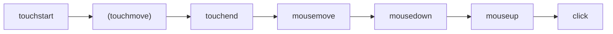
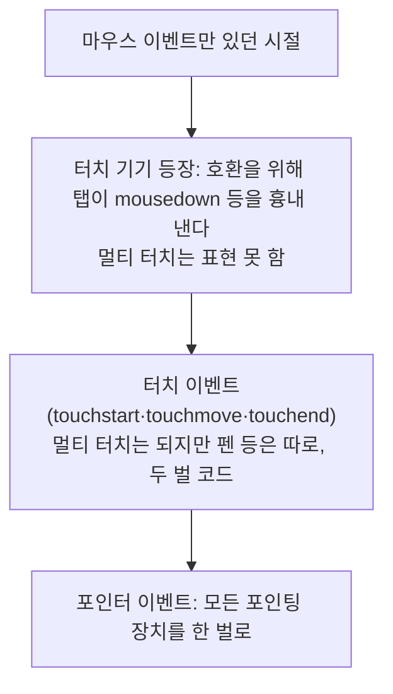
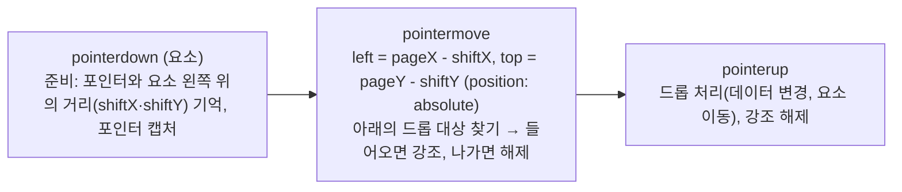

> javascript.info(모던 JavaScript 튜토리얼)의 「마우스 이벤트」, 「Moving the mouse」, 「드래그 앤 드롭과 마우스 이벤트」, 「Pointer events」, 「Keyboard: keydown and keyup」 글을 바탕으로, 브라우저 지원은 MDN으로 확인해 재구성한 노트다. 키보드 이벤트 일부는 Wes Bos의 「[Beginner JavaScript](https://wesbos.com/javascript)」 강의 노트에서 옮겨 왔다. 터치가 만드는 호환 마우스 이벤트는 TOAST UI의 「[터치와 클릭, 우리 깐부잖아](https://ui.toast.com/weekly-pick/ko_20220106)」로 보강했다. 탭 지연은 「[300ms tap delay, gone away](https://developers.google.com/web/updates/2013/12/300ms-tap-delay-gone-away)」, 「[More Responsive Tapping on iOS](https://webkit.org/blog/5610/more-responsive-tapping-on-ios/)」, HTML 드래그 앤 드롭과 포인터 락은 MDN의 「[HTML Drag and Drop API](https://developer.mozilla.org/en-US/docs/Web/API/HTML_Drag_and_Drop_API)」, 「[Pointer Lock API](https://developer.mozilla.org/en-US/docs/Web/API/Pointer_Lock_API)」를 바탕으로 보강했다.

이벤트 전파·위임·기본 동작 같은 공통 모델은 [[dom-events|DOM 이벤트]]에, 키보드 접근성과 포커스 관리 원칙은 [[keyboard-accessibility|키보드 접근성과 포커스 관리]]에 있다. 이 노트는 입력 장치별 이벤트의 세부만 다룬다.

## 마우스 이벤트

| 이벤트 | 언제 |
| --- | --- |
| `mousedown`·`mouseup` | 버튼을 누를 때·뗄 때. 어느 버튼이든 일어난다 |
| `click` | 같은 요소에서 주 버튼의 `mousedown`·`mouseup`이 이어질 때 |
| `dblclick` | 빠르게 두 번 클릭할 때 |
| `contextmenu` | 보조 버튼(보통 오른쪽)을 누를 때. 키보드의 메뉴 키로도 일어난다 |
| `mousemove` | 움직일 때 |
| `mouseover`·`mouseout`, `mouseenter`·`mouseleave` | 요소 위로 들어오고 나갈 때(아래에서 비교) |

동작 하나가 이벤트 여러 개를 만든다. 클릭 한 번은 `mousedown → mouseup → click` 순서로, 더블 클릭은 그 뒤에 `dblclick`이 더해진다. 터치스크린을 탭해도 호환을 위해 마우스 이벤트가 만들어진다.

### 어떤 버튼, 어떤 보조키

| 속성 | 값 |
| --- | --- |
| `event.button` | `0` 주 버튼(왼쪽), `1` 가운데, `2` 보조(오른쪽), `3` 뒤로, `4` 앞으로 |
| `event.buttons` | 지금 눌린 버튼들의 비트 합. 드래그 중 어떤 버튼이 눌렸는지 볼 때 |
| `shiftKey`·`altKey`·`ctrlKey`·`metaKey` | 함께 누른 보조키. `metaKey`는 macOS의 Cmd |

- `click`·`contextmenu`는 버튼이 정해져 있어 `button`을 볼 일이 적다. `mousedown`·`mouseup`에서 버튼을 가린다.
- 옛 코드의 `event.which`는 비표준이라 쓰지 않는다.
- Windows·Linux의 Ctrl 단축키는 macOS에서 Cmd다. 게다가 macOS는 **Ctrl+클릭을 오른쪽 클릭(`contextmenu`)으로 해석**한다. 그래서 `if (event.ctrlKey || event.metaKey)`처럼 둘을 함께 검사한다.
- 키보드가 없는 모바일 사용자를 위해 보조키 조합만으로 열리는 기능은 두지 않는다.

좌표는 `clientX`·`clientY`(창 기준)와 `pageX`·`pageY`(문서 기준) 두 가지다. 차이는 [[dom-geometry#좌표|요소 크기·스크롤·좌표]]에 있다.

### 원치 않는 텍스트 선택 막기

더블 클릭이나 누른 채 끌기는 기본 동작으로 글자를 선택한다. 더블 클릭으로 무언가를 하는 요소라면 `mousedown`의 기본 동작을 막아 선택을 시작하지 않게 한다.

```html
<b ondblclick="toggle()" onmousedown="return false">더블 클릭</b>
```

다른 곳에서 시작한 선택이 이 요소까지 넓어지는 것은 막지 못한다. CSS `user-select: none`을 포함한 다른 방법은 [[selection-and-range|Selection과 Range]]에 있다.

## 요소 위로 들어오고 나가기

`mouseover`·`mouseout`은 `target` 말고 **`relatedTarget`** 을 하나 더 준다.

| 이벤트 | `target` | `relatedTarget` |
| --- | --- | --- |
| `mouseover` | 포인터가 들어온 요소 | 포인터가 떠나 온 요소 |
| `mouseout` | 포인터가 떠난 요소 | 포인터가 새로 올라간 요소 |

`relatedTarget`은 `null`일 수 있다. 창 밖에서 들어왔거나 창 밖으로 나간 경우다. `event.relatedTarget.tagName`처럼 바로 쓰면 오류가 난다.

### 브라우저는 포인터를 띄엄띄엄 본다

`mousemove`는 픽셀마다 일어나지 않는다. 브라우저가 때때로 위치를 확인해 바뀌었으면 이벤트를 낸다. 그래서 빠르게 움직이면 **사이에 있는 요소를 건너뛴다.** 창 밖에서 페이지 한가운데로 바로 "점프"하기도 한다. 다만 `mouseover`가 일어난 요소에서는 떠날 때 반드시 `mouseout`이 일어난다.

### 자식으로 들어가도 mouseout

포인터는 한 번에 **한 요소, 가장 깊고 가장 위에 그려진 요소**에만 올라가 있다고 본다. 그래서 부모에서 자식으로 옮기면 부모에 `mouseout`이 일어나고, 자식의 `mouseover`가 버블링해 부모에 다시 도착한다. 핸들러가 `target`을 보지 않으면 "부모를 떠났다가 곧바로 돌아왔다"로 잘못 읽는다.

| | `mouseover`·`mouseout` | `mouseenter`·`mouseleave` |
| --- | --- | --- |
| 자식으로 옮길 때 | 부모에서 `mouseout`이 일어난다 | 일어나지 않는다. 요소 전체를 기준으로 들어오고 나간다 |
| 버블링 | 한다 | **하지 않는다** |
| 이벤트 위임 | 가능 | 불가능 |

- 요소 하나의 hover 상태는 `mouseenter`·`mouseleave`가 간단하다. 모양만 바뀌면 CSS `:hover`가 먼저다.
- 표의 칸 수백 개처럼 위임이 필요하면 `mouseover`·`mouseout`을 부모에 걸고, 지금 강조한 칸을 변수에 기억해 같은 칸 안의 이동(`relatedTarget`이 그 칸 안이면)은 무시한다.

```javascript
let current = null
table.addEventListener('mouseover', (e) => {
  if (current) return                      // 아직 이전 칸 안
  const td = e.target.closest('td')
  if (!td || !table.contains(td)) return
  current = td
  onEnter(td)
})
table.addEventListener('mouseout', (e) => {
  if (!current) return
  let to = e.relatedTarget
  while (to) {                             // 같은 칸 안으로 옮긴 것이면 무시
    if (to === current) return
    to = to.parentNode
  }
  onLeave(current)
  current = null
})
```

## 터치가 만드는 호환 마우스 이벤트

마우스 이벤트만 듣는 옛 페이지도 터치 기기에서 동작하도록, 브라우저는 단순한 탭 뒤에 **호환 마우스 이벤트**를 흉내 내 보낸다.



| 문제 | 원인 | 대응 |
| --- | --- | --- |
| 한 번 탭했는데 핸들러가 두 번 돈다 | 터치 이벤트와 뒤따르는 마우스 이벤트를 둘 다 듣는다 | 포인터 이벤트 하나로 통일한다. 터치 이벤트를 꼭 써야 하면 `touchend`에서 `preventDefault()`로 호환 마우스 이벤트를 막는다 |
| 탭과 `click` 사이 약 300ms 지연 | 더블 탭 확대인지 기다린다(iOS WebKit은 350ms) | `<meta name="viewport" content="width=device-width">`가 있으면 현대 모바일 브라우저는 지연을 없앤다(Chrome 32, iOS 9.3부터). 요소 단위로는 `touch-action: manipulation`(더블 탭 확대만 끔, 핀치 확대는 살림). `user-scalable=no`로도 지연이 사라지지만 확대를 막아 접근성을 해치므로 쓰지 않는다. 과거에는 FastClick 같은 라이브러리가 `touchend`에서 바로 `click()`을 불렀다 |
| 탭으로 닫은 레이어 **아래 요소가 클릭된다**(고스트 클릭) | 지연된 `click`이 레이어가 사라진 뒤 그 좌표의 요소에 간다 | 지연을 없애고, 닫기를 `click`에서 처리하거나 터치 쪽에서 `preventDefault()` |
| `touchstart`·`touchmove`에서 `preventDefault()`가 안 먹는다 | `window`·`document`·`body`에 단 이 리스너는 기본이 passive다 | 스크롤 차단은 CSS `touch-action`으로, 리스너가 꼭 막아야 하면 요소에 직접 `{ passive: false }`로 단다 |

`TouchEvent`는 좌표를 이벤트 자체가 아니라 `Touch` 목록에 담는다. `touches`(화면 위 모든 손가락), `targetTouches`(이 요소에서 시작한 손가락), `changedTouches`(이번 이벤트로 바뀐 손가락, `touchend`에서는 여기에만 남는다)를 구분해 쓴다. 이런 차이 때문에 새 코드는 아래의 포인터 이벤트를 쓴다. 입력이 컴포지터를 거쳐 처리되는 과정과 passive의 이유는 [[browser-architecture|브라우저 아키텍처]]에 있다.

## 포인터 이벤트

**포인터 이벤트(Pointer Events)** 는 마우스·터치·펜을 한 벌의 이벤트로 받는 표준이다. 모든 주요 브라우저가 지원하므로 새 코드는 마우스·터치 이벤트 대신 이것을 쓴다.



| 포인터 이벤트 | 대응 마우스 이벤트 |
| --- | --- |
| `pointerdown`·`pointerup`·`pointermove` | `mousedown`·`mouseup`·`mousemove` |
| `pointerover`·`pointerout` | `mouseover`·`mouseout` |
| `pointerenter`·`pointerleave` | `mouseenter`·`mouseleave` |
| `pointercancel` | 없음. 브라우저가 상호작용을 가져갔을 때 |
| `gotpointercapture`·`lostpointercapture` | 없음. 포인터 캡처가 걸리고 풀릴 때 |

이름의 `mouse`를 `pointer`로 바꾸면 마우스에서는 그대로 동작하고 터치·펜 지원이 따라온다. 마우스 이벤트의 속성(`clientX`, `target`, `button` 등)을 모두 가지고 다음이 더해진다.

| 속성 | 의미 |
| --- | --- |
| `pointerId` | 포인터마다 다른 식별자. 손가락 다섯 개면 서로 다른 id 다섯 개 |
| `pointerType` | `'mouse'`·`'pen'`·`'touch'`. 장치별로 반응을 달리할 때 |
| `isPrimary` | 첫 번째 손가락 등 주 포인터면 `true` |
| `width`·`height`·`pressure` | 접촉 면적과 압력(0~1). 지원하지 않는 장치는 `1`·`1`·`0.5`(눌림) 또는 `0` |
| `tiltX`·`tiltY`·`twist`, `tangentialPressure` | 펜의 기울기·회전 |

**멀티 터치**는 `pointerId`로 손가락을 구분한다. 첫 손가락의 `pointerdown`은 `isPrimary: true`, 이후 손가락은 `false`와 각자의 id를 받고, 그 손가락의 `pointermove`·`pointerup`도 같은 id로 온다. 핀치 같은 제스처는 활성 포인터를 `Map`에 id로 담아 두 점 사이 거리를 계산한다. 제스처를 언제 쓰고 무엇을 함께 제공할지는 [[gesture-interface|제스처 기반 인터페이스]]에 있다.

### pointercancel과 touch-action

`pointercancel`은 진행 중이던 포인터 상호작용이 끊겨 더는 포인터 이벤트가 오지 않을 때 일어난다. 장치가 꺼지거나 화면이 회전하거나, 무엇보다 **브라우저가 그 동작을 자기 것으로 가져갈 때**다. 이미지를 끌면 브라우저의 기본 드래그 앤 드롭이, 터치로 끌면 스크롤·확대가 시작되고, 그 순간 `pointercancel`이 오고 `pointermove`가 끊긴다.

직접 드래그를 구현하려면 두 가지를 막는다.

```javascript
ball.addEventListener('dragstart', (e) => e.preventDefault()) // 기본 드래그 앤 드롭 끄기
```

```css
#ball { touch-action: none; } /* 터치의 스크롤·확대를 이 요소에서 끄기 */
```

`touch-action`은 `pan-x`·`pan-y`·`pinch-zoom`처럼 허용할 동작만 골라 줄 수도 있다. 가로 슬라이더라면 `pan-y`로 세로 스크롤은 살린다. 이것은 **이벤트가 시작되기 전에** 브라우저가 판단할 수 있도록 CSS로 주는 것이다. 리스너에서 `preventDefault()`하는 방식은 브라우저가 리스너를 기다려야 해서 늦다.

### 포인터 캡처

`el.setPointerCapture(pointerId)`를 부르면 그 포인터의 이후 이벤트가 문서 어디서 일어나든 **`el`을 타깃으로** 온다. `pointerup`·`pointercancel`이 오거나, `el`이 문서에서 빠지거나, `releasePointerCapture()`를 부르면 풀린다.

```javascript
thumb.addEventListener('pointerdown', (e) => {
  e.preventDefault()                      // 텍스트 선택 등 기본 동작 막기
  thumb.setPointerCapture(e.pointerId)
  const shiftX = e.clientX - thumb.getBoundingClientRect().left
  thumb.onpointermove = (e) => {          // 포인터가 thumb 밖으로 나가도 계속 온다
    const x = e.clientX - shiftX - slider.getBoundingClientRect().left
    thumb.style.left = `${Math.min(Math.max(x, 0), slider.clientWidth - thumb.offsetWidth)}px`
  }
  thumb.onpointerup = () => { thumb.onpointermove = thumb.onpointerup = null }
})
```

- 슬라이더 손잡이를 끌다 포인터가 손잡이 위아래로 벗어나도 이벤트가 계속 온다. `document`에 리스너를 붙였다 떼는 정리가 필요 없다.
- 문서의 다른 `pointermove` 리스너가 드래그 중에 엉뚱하게 반응하지 않는다.
- 캡처는 `target`·`currentTarget`만 바꾼다. `clientX` 같은 좌표는 실제 위치 그대로다.

### 포인터 락: 커서를 가두고 이동량만 받기

**포인터 락(Pointer Lock)** 은 커서를 숨기고 한 요소에 가둔 뒤, 위치 대신 **이동량**(`movementX`·`movementY`)만 보낸다. 1인칭 3D 게임의 시점 회전, 3D 모델·지도를 끝없이 돌리는 화면에 쓴다.

| | 포인터 캡처 | 포인터 락 |
| --- | --- | --- |
| 끝나는 때 | 버튼을 떼면(`pointerup`) | API로 풀거나 사용자가 Esc를 누를 때까지 |
| 화면 경계 | 창·화면 끝에서 좌표가 멈춘다 | 경계 없이 이동량이 계속 온다 |
| 버튼 상태 | 누른 동안만 | 상관없다 |
| 커서 | 보인다 | 숨긴다 |

```javascript
canvas.addEventListener('click', async () => {
  // 사용자 동작 안에서만 요청할 수 있다. 지원하면 OS 마우스 가속을 끈 원시 이동량을 받는다
  await canvas.requestPointerLock({ unadjustedMovement: true })
})
document.addEventListener('pointerlockchange', () => {
  const locked = document.pointerLockElement === canvas
})
canvas.addEventListener('mousemove', (e) => rotateCamera(e.movementX, e.movementY))
```

- `requestPointerLock()`은 Chrome 92·Safari 18.4부터 프로미스를 돌려준다. 옛 브라우저는 `undefined`를 돌려주고 옵션을 무시하므로 `.then()`을 바로 붙이지 않는다.
- 데스크톱 주요 브라우저는 모두 지원하지만 iOS Safari는 지원하지 않는다(Baseline 아님).

## 드래그 앤 드롭 직접 구현

HTML의 드래그 앤 드롭 API(`draggable`, `dragstart`, `drop`, `dataTransfer`)는 **운영체제에서 파일을 끌어다 놓거나 다른 앱·창과 데이터를 주고받을 때** 쓴다. 한 축으로만 끌기, 영역 안으로 제한, 끄는 동안의 세밀한 모양 제어는 어렵고 터치 지원도 고르지 않다. 그래서 화면 안의 드래그는 포인터 이벤트로 직접 만든다.

### HTML 드래그 앤 드롭 API

드래그 하나는 **끄는 대상, 옮기는 데이터, 놓는 대상** 세 가지로 이뤄진다. 셋이 늘 내 페이지에 있지는 않다. OS 파일을 끌어오면 끄는 대상이 없고, 페이지 밖으로 끌어내면 놓는 대상이 없다.

| 이벤트 | 발생 위치 | 시점 |
| --- | --- | --- |
| `dragstart` · `drag` · `dragend` | 끄는 요소 | 시작 · 끄는 동안 반복 · 끝(성공·취소 모두) |
| `dragenter` · `dragover` · `dragleave` | 놓을 수 있는 후보 요소 | 들어옴 · 위에 있는 동안 반복 · 나감 |
| `drop` | 놓는 대상 | 놓았을 때. 대상이 `dragover`를 취소했을 때만 온다 |

- 이미지·링크·텍스트 선택은 기본으로 끌린다. 다른 요소는 `draggable="true"`를 준다. 끌리는 요소 안의 글자는 마우스로 선택하기 어려워진다.
- 데이터는 문자열(또는 `File`)로 직렬화해 `event.dataTransfer`에 MIME 형식별로 넣는다. **쓰기는 `dragstart`에서만, 읽기는 `drop`에서만** 된다. 그 사이 이벤트에서는 `types`만 볼 수 있다.
- 요소는 기본적으로 놓는 대상이 아니다. **`dragover`에서 `preventDefault()`** 해야 `drop`이 온다. 안 하면 놓았을 때 원래 자리로 돌아가는 애니메이션이 나온다.
- OS에서 끌어온 파일은 `drop`의 `dataTransfer.files`로 받는다. 파일 다루기는 [[binary-data-and-files|바이너리 데이터와 파일]]에 있다.

```javascript
item.addEventListener('dragstart', (e) => {
  e.dataTransfer.setData('text/plain', item.id)
  e.dataTransfer.effectAllowed = 'move'
})
zone.addEventListener('dragover', (e) => e.preventDefault()) // 놓을 수 있게
zone.addEventListener('drop', (e) => {
  e.preventDefault()                                         // 링크로 이동 같은 기본 동작 막기
  zone.append(document.getElementById(e.dataTransfer.getData('text/plain')))
})
```

### 포인터 이벤트로 직접 구현



| 요점 | 이유 |
| --- | --- |
| 포인터 중앙이 아니라 **처음 잡은 지점**을 유지한다 | 가장자리를 잡았는데 요소 중심이 포인터로 튀면 어색하다 |
| 기본 드래그를 끄고 `touch-action`을 준다 | 이미지·링크의 기본 드래그, 터치 스크롤이 가로채면 `pointercancel`이 난다 |
| 이동 리스너는 캡처하거나 `document`에 둔다 | 빠르게 움직이면 포인터가 요소 밖으로 튄다 |
| 드롭 대상은 `elementFromPoint`로 찾는다 | 끄는 요소가 늘 맨 위에 있어서 아래 요소의 `pointerover`는 오지 않는다 |

```javascript
function findDroppable(e) {
  dragged.hidden = true                   // 잠깐 숨겨야 그 아래 요소가 잡힌다
  const below = document.elementFromPoint(e.clientX, e.clientY)
  dragged.hidden = false
  return below?.closest('.droppable') ?? null // 창 밖이면 null
}
```

`mousedown`·`pointerdown`에 이벤트 위임을 쓰면 부모 하나로 수백 개 요소의 드래그를 관리할 수 있다. 끌기는 키보드로 할 수 없으므로 같은 기능을 버튼이나 메뉴로도 제공한다(WCAG 2.2의 「Dragging Movements」).

## 키보드 이벤트

키보드 이벤트는 **키 자체에 반응할 때**(단축키, 방향키, Esc) 쓴다. 입력란의 값 변화를 따라가는 데는 맞지 않는다. 붙여넣기·음성 입력·자동 완성은 키 이벤트 없이 값을 바꾸므로 `input` 이벤트를 쓴다([[form-controls-dom#change와 input|폼 컨트롤과 포커스 이벤트]]).

| 이벤트 | 언제 |
| --- | --- |
| `keydown` | 누를 때. 오래 누르면 **자동 반복**으로 계속 일어나고 `event.repeat`가 `true`다 |
| `keyup` | 뗄 때. 자동 반복이 있어도 한 번 |

노트북의 Fn 키처럼 운영체제보다 낮은 수준에서 처리되는 키는 이벤트가 없다. 옛 `keypress` 이벤트와 `keyCode`·`charCode`·`which` 속성은 폐기됐다.

### key와 code

| 속성 | 의미 | 예 |
| --- | --- | --- |
| `event.key` | 만들어진 **문자·키의 뜻**. 자판 배열·언어·Shift를 반영한다 | Z → `'z'`, Shift+Z → `'Z'`, `'Enter'`, `'Escape'`, `'ArrowLeft'` |
| `event.code` | 눌린 **물리 키의 자리**. 배열과 무관하다 | `'KeyZ'`, `'Digit1'`, `'ShiftLeft'`·`'ShiftRight'`, `'Space'` |

- `code`는 대소문자를 정확히 쓴다. `'keyZ'`가 아니라 `'KeyZ'`다.
- 문자가 없는 키는 `key`가 `code`와 거의 같다. 다만 Shift처럼 좌우가 있는 키는 `key`가 `'Shift'`, `code`가 `'ShiftLeft'`·`'ShiftRight'`다.
- 자판 배열이 다르면 같은 자리의 문자가 다르다. 독일어 QWERTZ 배열에서 Y를 누르면 `code`는 `'KeyZ'`다. 그래서 `code === 'KeyZ'`로 실행 취소를 검사하면 독일어 사용자는 Y로 실행 취소가 된다.

| 원하는 것 | 쓸 속성 |
| --- | --- |
| 「Z라는 글자」에 반응(배열마다 다른 자리여도) | `key` |
| 입력 언어를 바꿔도 같은 자리에서 동작하는 단축키, 게임의 WASD | `code` |

```javascript
document.addEventListener('keydown', (e) => {
  if (e.key.toLowerCase() === 'z' && (e.ctrlKey || e.metaKey)) undo()
  if (e.key === 'Escape') closeDialog()
})
```

### 기본 동작과 IME

- `keydown`에서 `preventDefault()`하면 글자 입력, 삭제, PageDown 스크롤, Ctrl+S 저장 창 같은 기본 동작 대부분이 취소된다. Windows의 Alt+F4처럼 **운영체제가 처리하는 키는 막을 수 없다.**
- 방향키로 무언가를 움직일 때는 그 키에서만 `preventDefault()`를 불러 스크롤을 막는다. 모든 키를 막으면 Tab 이동, 지우기, 붙여넣기까지 깨진다.
- 키 필터로 입력을 제한하면 마우스 붙여넣기는 여전히 들어온다. 값 검사는 `beforeinput`·`input`에서 한다.
- 한국어·일본어처럼 IME로 조합하는 입력은 조합 중에도 `keydown`이 일어난다. Enter로 제출할 때는 `event.isComposing`이 `true`인 동안 무시해야 마지막 글자가 두 번 들어가지 않는다.

`div`나 `img`에 `click`만 붙이면 키보드로는 쓸 수 없다. 버튼과 링크를 가려 쓰는 법과 표준 키 조작은 [[keyboard-accessibility|키보드 접근성과 포커스 관리]]에 있다.

## 정리

- 클릭은 `mousedown → mouseup → click`이다. 단축키 조합은 `ctrlKey || metaKey`로 검사한다.
- `mouseover`·`mouseout`은 자식으로 옮겨도 일어나고 버블링한다. `mouseenter`·`mouseleave`는 요소 전체 기준이고 버블링하지 않는다.
- 새 코드는 포인터 이벤트로 마우스·터치·펜을 한 번에 받는다. 직접 드래그하는 요소에는 기본 드래그를 끄고 `touch-action`을 준다.
- 드래그는 `setPointerCapture`로 이벤트를 붙잡고, 드롭 대상은 `elementFromPoint`로 찾는다.
- 키보드는 뜻이 중요하면 `key`, 자리가 중요하면 `code`. 값 변화는 키 이벤트가 아니라 `input`으로 받는다.

관련 노트: [[dom-events|DOM 이벤트: 전파, 위임, 커스텀 이벤트]], [[keyboard-accessibility|키보드 접근성과 포커스 관리]], [[gesture-interface|제스처 기반 인터페이스]], [[dom-geometry|요소 크기·스크롤·좌표]], [[form-controls-dom|폼 컨트롤과 포커스 이벤트]], [[selection-and-range|Selection과 Range]], [[react-events|React 이벤트 처리]], [[device-permission-apis|권한 모델과 기기 API]]
