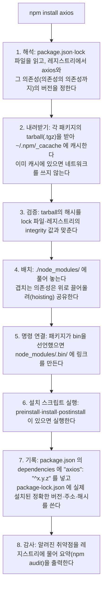

> npm 공식 문서 「[npm install](https://docs.npmjs.com/cli/v11/commands/npm-install)」, 「[folders](https://docs.npmjs.com/cli/v11/configuring-npm/folders)」, 「[scripts](https://docs.npmjs.com/cli/v11/using-npm/scripts)」와 Node.js 「[Loading from node_modules folders](https://nodejs.org/api/modules.html#loading-from-node_modules-folders)」를 바탕으로 정리한 노트다.

## 패키지를 설치한다는 것

npm 패키지는 **다른 사람이 써서 레지스트리(registry.npmjs.org)에 올린 코드 묶음**이다. 설치는 그 코드를 내려받아 내 프로젝트 폴더에 두고, 내 코드가 `import`로 불러 쓸 수 있게 하는 일이다. 앱 스토어의 앱 설치와 달리 **운영체제에 프로그램을 등록하지 않는다.** 대부분은 프로젝트 폴더 안의 파일이 늘어나는 것으로 끝난다.

다만 설치는 **남이 쓴 코드를 내 컴퓨터에 들여와, 경우에 따라 바로 실행하는 일**이기도 하다. 그래서 "파일 몇 개가 생긴다"와 "모르는 코드가 내 권한으로 돈다"를 함께 알아야 한다.

## `npm install <패키지>`가 하는 일

- **의존성은 연쇄된다.** 패키지 하나를 넣어도 그 패키지가 기대는 패키지까지 수십 개가 함께 들어온다. 무엇이 왜 들어왔는지는 `npm ls <이름>`, `npm explain <이름>`으로 본다.
- 인자 없이 `npm install`을 치면 1~8을 `package.json`과 lock 파일 전체에 대해 수행한다. 저장소를 처음 받았을 때 하는 일이 이것이다. CI는 lock 파일을 그대로 따르는 `npm ci`를 쓴다.
- `dependencies`·`devDependencies`·`peerDependencies`의 차이, lock 파일의 동작은 [[package-managers|패키지 매니저]]에 있다.

## 내 컴퓨터에 생기는 변화

### 로컬 설치(기본)

| 위치 | 생기는 것 | 성격 |
| --- | --- | --- |
| `./node_modules/` | 패키지 코드 전체 | 프로젝트 전용. 지워도 `npm install`로 다시 만든다. 커밋하지 않는다 |
| `./node_modules/.bin/` | 패키지가 제공하는 명령(`vite`, `eslint`) | 전역 PATH에는 없다. `npm run`·`npx`가 이 폴더를 PATH에 붙여 실행한다([[npm-scripts\|npm 스크립트]]) |
| `./package.json`, `./package-lock.json` | 의존성 목록과 정확한 버전 기록 | 커밋해서 팀이 같은 설치를 재현한다 |
| `~/.npm/_cacache/` | 내려받은 tarball 캐시 | 모든 프로젝트가 공유한다. 다음 설치가 빨라진다. `npm cache clean --force`로 비운다 |
| `~/.npm/_npx/` | `npx`로 임시 실행한 패키지 | 프로젝트에 남지 않는다 |

로컬 설치는 **그 프로젝트 폴더 밖의 동작을 바꾸지 않는다.** 다른 프로젝트, 시스템 설정, 다른 앱은 그대로다. 디스크는 꽤 쓴다. 작은 앱도 `node_modules`가 수백 MB가 되는 일이 흔하고, 프로젝트마다 따로 생긴다(pnpm은 전역 저장소에 한 벌만 두고 링크해 이 중복을 줄인다).

### 전역 설치(`-g`)

`npm install -g <패키지>`는 프로젝트가 아니라 **Node.js 설치 위치(prefix)**에 넣고, 명령을 셸 PATH에 올려 어느 폴더에서나 쓸 수 있게 한다.

| Node 설치 방식 | 전역 패키지 위치 (`npm config get prefix`로 확인) |
| --- | --- |
| nvm·fnm 같은 버전 관리자 | `~/.nvm/versions/node/<버전>/lib/node_modules` (홈 폴더 안. `sudo` 불필요, Node 버전마다 따로) |
| 공식 설치 프로그램·Homebrew(macOS) | `/usr/local/lib/node_modules` 또는 `/opt/homebrew/lib/node_modules` |
| Windows | `%AppData%\npm\node_modules` |

- 전역 설치는 **이 컴퓨터의 모든 셸**에서 그 명령 이름을 차지한다. 프로젝트마다 다른 버전이 필요한 도구(린터, 번들러)는 전역 대신 `devDependencies` + `npx`로 쓴다. 전역은 프로젝트와 무관한 CLI(예: `vercel`, `corepack`)에만 쓴다.
- `sudo npm install -g`가 필요하다면 Node가 시스템 폴더에 깔려 있다는 뜻이다. 설치 스크립트까지 root 권한으로 돌게 되므로 버전 관리자로 Node를 다시 까는 편이 안전하다.

### 설치 스크립트: 실제로 코드가 실행된다

패키지의 `package.json`에 `preinstall`·`install`·`postinstall`이 있으면 npm은 설치 중에 그 명령을 **내 사용자 권한으로** 실행한다. 원래 용도는 네이티브 모듈 컴파일(node-gyp), 플랫폼별 바이너리 내려받기 같은 준비 작업이다. 하지만 같은 권한으로 홈 폴더의 파일, SSH 키, `.env`, 토큰을 읽고 네트워크로 보낼 수도 있다. 실제 공급망 공격 대부분이 이 통로를 쓴다.

| 대응 | 방법 |
| --- | --- |
| 스크립트를 끄고 설치 | `npm install --ignore-scripts`, 또는 `.npmrc`에 `ignore-scripts=true` |
| 기본으로 막는 매니저 | pnpm 10+, Yarn 4.14+는 의존성 스크립트를 기본 차단하고 허용 목록만 실행한다 |
| 들이기 전에 확인 | 이름 오타(typosquatting), 주간 다운로드, 관리 상태, 최근 소유자 변경을 본다 |

npm 자체는 여전히 기본으로 스크립트를 실행한다. 매니저별 기본값은 [[package-managers|패키지 매니저]]의 「공급망 보안 기본값」, 깊은 의존성 트리가 왜 위험한지는 [[small-modules|작은 모듈 철학과 npm 의존성]]에 있다.

## 앱에 생기는 변화

### 코드가 패키지를 찾는 방식

`import axios from 'axios'`처럼 경로 없는 이름을 쓰면 Node.js(와 번들러)는 **현재 파일의 폴더부터 위로 올라가며** `node_modules/axios`를 찾는다. 찾으면 그 패키지 `package.json`의 `exports`(없으면 `main`)가 가리키는 파일을 불러온다. 그래서 설치만 하고 import하지 않은 패키지는 앱 동작에 아무 영향이 없고, `package.json`에 적지 않았는데 우연히 `node_modules`에 있는 패키지도 불러와진다(유령 의존성, pnpm은 이를 막는다).

### 결과물에 들어가는 것

| 앱 종류 | 배포 결과물에 실리는 것 |
| --- | --- |
| 번들러를 쓰는 프런트엔드(Vite, Next.js 클라이언트) | `node_modules` 전체가 아니라 **실제로 import한 코드만** 번들에 합쳐진다. 트리 셰이킹되는 패키지면 쓰는 함수만 들어간다. 사용자가 내려받는 JS 크기가 이만큼 늘어난다 |
| Node.js 서버 | 서버에서 `npm ci --omit=dev`로 `dependencies`를 설치해 그대로 쓴다. 이미지·함수 크기와 콜드 스타트에 영향을 준다 |
| 라이브러리(내가 배포하는 패키지) | 내 `dependencies`가 내 패키지를 쓰는 사람의 `node_modules`에도 설치된다 |

`devDependencies`(번들러, 테스트 도구, 타입 정의)는 개발 컴퓨터와 CI에서만 쓰이고 사용자에게 가지 않는다. 번들 크기를 보려면 빌드 결과 리포트나 `vite-bundle-visualizer` 같은 분석 도구를 쓴다.

### 함께 떠안는 것

- **유지보수**: 의존성의 버그·취약점·주요 버전 변경이 내 앱의 일이 된다. `npm outdated`, `npm audit`, Dependabot·Renovate로 관리한다.
- **버전 범위**: `^1.2.0`은 1.x 안에서 새 버전을 받아들인다는 뜻이다. lock 파일이 있어야 모두가 같은 버전을 쓴다([[semantic-versioning|유의적 버전]]).
- **라이선스**: 패키지의 라이선스(MIT, Apache-2.0, GPL)가 내 배포 조건에 붙는다. `npx license-checker`로 확인한다.

## 되돌리기

| 하고 싶은 것 | 명령 |
| --- | --- |
| 패키지 제거 | `npm uninstall <이름>`: `node_modules`, `package.json`, lock 파일에서 함께 지운다 |
| 전역 패키지 제거 | `npm uninstall -g <이름>`, 목록은 `npm ls -g --depth=0` |
| 설치 상태를 lock 파일 그대로 다시 만들기 | `rm -rf node_modules && npm ci` |
| 캐시 비우기 | `npm cache clean --force` |

`node_modules`를 지우는 것은 언제나 안전하다. 반대로 `package-lock.json`을 지우면 다음 설치에서 범위 안의 새 버전이 들어올 수 있으니 이유가 있을 때만 지운다. 설치 스크립트가 홈 폴더나 시스템에 따로 써 둔 파일은 `uninstall`로 지워지지 않는다.

## 정리

- 설치는 레지스트리의 코드를 받아 캐시(`~/.npm`)와 프로젝트의 `node_modules`에 두고, `package.json`·lock 파일에 기록하는 일이다.
- 로컬 설치는 그 프로젝트 폴더만 바꾼다. 전역 설치(`-g`)는 Node 설치 위치에 넣고 명령을 PATH에 올린다.
- 설치 스크립트는 내 권한으로 실행된다. 모르는 패키지는 `--ignore-scripts`로 받거나 기본 차단 매니저를 쓴다.
- 앱에는 import한 코드만 영향을 준다. 프런트엔드는 번들 크기로, 서버는 배포 크기로 드러나고, 유지보수·라이선스도 함께 들어온다.
- **패키지 하나를 넣는 것은 남의 코드와 그 의존성 전체를 신뢰하겠다는 결정이다.**

관련 노트: [[package-managers|자바스크립트 패키지 매니저]], [[npm-scripts|npm 스크립트로 작업 자동화하기]], [[small-modules|작은 모듈 철학과 npm 의존성]], [[semantic-versioning|유의적 버전]], [[bundlers-and-vite|번들러의 역사와 Vite]]
