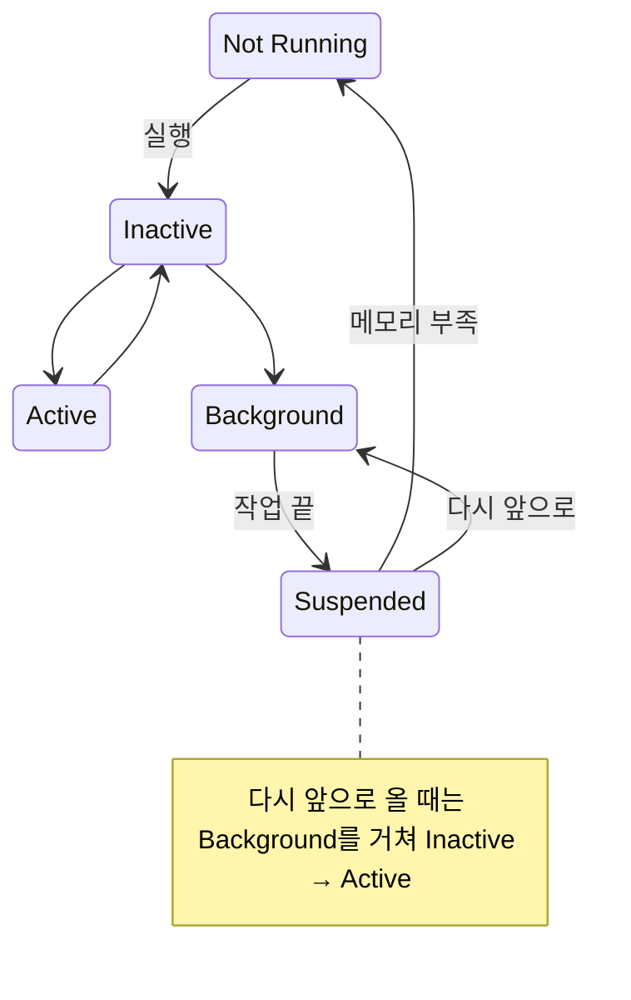

> jbee의 「[Interview Question for Beginner](https://github.com/jbee37142/Interview_Question_for_Beginner)」 저장소 iOS 문서를 바탕으로, Apple 개발자 문서와 Swift 공식 가이드로 확인해 재구성한 노트다.

## 앱의 실행 상태

iOS 앱은 늘 아래 상태 중 하나에 있다. 시스템이 상태를 바꾸며 앱에 알린다.

| 상태 | 뜻 |
| --- | --- |
| Not Running | 실행되지 않았거나 시스템이 종료시킨 상태 |
| Inactive (포어그라운드) | 화면에 있지만 이벤트를 받지 않는다. 전화가 오거나 제어 센터를 내릴 때, 상태가 바뀌는 사이에 잠깐 거친다 |
| Active (포어그라운드) | 화면에 있고 이벤트를 받는 평소 상태 |
| Background | 화면에 없지만 코드를 실행한다. 허용된 작업(오디오, 위치, 다운로드, 짧은 마무리 작업)만 이어 간다 |
| Suspended | 메모리에는 있지만 코드를 실행하지 않는다. 메모리가 부족하면 시스템이 알림 없이 종료한다 |



Suspended에서 곧장 Active로 갈 수는 없다. 다시 열면 Background와 Inactive를 거쳐 Active가 된다.

- **iOS 13부터는 씬(scene) 단위**로 생명 주기를 받는다. iPad에서 같은 앱의 창이 여럿 떠 있을 수 있어, 포어그라운드·백그라운드 전환은 `UISceneDelegate`(`sceneDidBecomeActive`, `sceneDidEnterBackground` 등)가, 앱 전체의 실행·푸시 등록은 `UIApplicationDelegate`가 맡는다.
- SwiftUI는 `@Environment(\.scenePhase)`로 `.active`·`.inactive`·`.background`를 관찰한다.
- 백그라운드로 갈 때 저장할 상태를 저장한다. Suspended 이후에는 코드를 실행할 기회 없이 종료될 수 있기 때문이다.

## 뷰 컨트롤러의 생명 주기

`UIViewController`의 뷰는 만들어지고, 나타나고, 사라지는 순서로 메서드가 불린다. `Will`은 직전, `Did`는 직후다.

| 메서드 | 불리는 때 | 맞는 작업 |
| --- | --- | --- |
| `viewDidLoad` | 뷰 계층을 메모리에 올린 직후. 보통 **한 번** | 서브뷰 구성, 초기 데이터 바인딩 |
| `viewWillAppear` | 화면에 나타나기 직전, **나타날 때마다** | 화면에 보일 때마다 갱신할 내용 |
| `viewIsAppearing` | 뷰가 계층에 붙어 크기·트레잇이 정해진 뒤, 나타나기 전 (iOS 17 SDK, iOS 13까지 역호환) | 크기에 의존하는 초기 배치 |
| `viewWillLayoutSubviews` / `viewDidLayoutSubviews` | 레이아웃을 계산할 때마다 | 크기에 맞춘 수동 배치 |
| `viewDidAppear` | 화면에 나타난 뒤 | 애니메이션 시작, 화면 노출 로깅 |
| `viewWillDisappear` / `viewDidDisappear` | 사라지기 직전 / 직후 | 편집 저장, 관찰 해제, 재생 멈춤 |

나타남·사라짐은 화면 전환마다 반복되므로, 한 번만 할 일은 `viewDidLoad`에, 매번 할 일은 `Appear` 계열에 둔다. SwiftUI 뷰는 `onAppear`·`onDisappear`·`task`(사라지면 자동 취소되는 비동기 작업)로 같은 시점을 다룬다.

## 객체 사이에 이벤트 전하기

| 방식 | 받는 쪽 | 맞는 경우 | 주의 |
| --- | --- | --- | --- |
| 델리게이트(delegate) | 하나 | 이벤트가 여러 종류이거나, 보내는 쪽이 받는 쪽에게 **데이터를 물어야** 할 때(`UITableViewDataSource`). 프로토콜로 계약이 드러나 재사용하기 좋다 | 순환 참조를 막으려고 `weak var delegate`로 둔다 |
| 클로저(블록) | 하나 | 이벤트가 **하나**뿐일 때, 특히 완료 콜백(`completionHandler`) | 클로저가 `self`를 붙잡는다 |
| `NotificationCenter` | **여럿** | 한 이벤트를 여러 곳이 알아야 할 때(키보드 표시, 앱 상태 변경). 보내는 쪽이 받는 쪽을 모른다 | 흐름을 추적하기 어렵다. 남용하면 전역 이벤트 버스가 된다 |

비동기 완료 콜백은 Swift 5.5부터 `async`/`await`로, 값의 흐름은 Combine의 `Publisher`나 Observation 프레임워크(`@Observable`, iOS 17)로 대신하는 경우가 많다.

## 메모리 관리: ARC

Swift(와 현대 Objective-C)는 **ARC(Automatic Reference Counting)** 로 메모리를 관리한다. 컴파일러가 참조를 만들고 없애는 자리에 카운트 증감 코드를 넣고, 강한 참조 수가 0이 되면 인스턴스를 즉시 해제한다. 추적형 GC처럼 멈춤이 없는 대신 **순환 참조는 스스로 풀지 못한다.**

**강한 순환 참조**는 두 객체가 서로를 강하게 참조할 때 생긴다. 바깥 참조가 모두 사라져도 서로의 카운트가 1로 남아 둘 다 해제되지 않는다. 한쪽을 강하지 않은 참조로 바꿔 끊는다.

| 참조 | 카운트 증가 | 대상이 해제되면 | 쓰는 곳 |
| --- | --- | --- | --- |
| `strong`(기본) | O | - | 소유 관계 |
| `weak` | X | 자동으로 `nil`이 된다. 그래서 항상 옵셔널 `var` | 대상이 먼저 사라질 수 있을 때. 델리게이트, 부모를 가리키는 자식 |
| `unowned` | X | 그대로 남아 접근하면 크래시 | 대상이 **나보다 오래 산다고 확신**할 때. 고객을 가리키는 신용카드 |

클로저도 참조 타입이라 `self`를 캡처하면 순환이 생긴다. **캡처 목록**으로 끊는다.

```swift
class ProfileViewModel {
    var onUpdate: (() -> Void)?
    func bind() {
        onUpdate = { [weak self] in
            guard let self else { return }   // 해제됐으면 아무것도 안 한다
            self.render()
        }
    }
    func render() { }
}
```

`[weak self]`가 늘 필요한 것은 아니다. 클로저를 저장하지 않고 바로 실행하는 경우(`map`, `UIView.animate`)나, `self`가 클로저를 소유하지 않는 경우는 순환이 아니다.

Objective-C의 프로퍼티 속성 `assign`도 카운트를 올리지 않지만, 대상이 해제돼도 포인터가 그대로 남아(댕글링 포인터) 접근하면 크래시가 난다. 그래서 `assign`은 `int` 같은 기본형에만 쓰고 객체에는 `weak`를 쓴다. `weak` 참조는 마지막 강한 참조가 사라져 객체가 해제되는 순간 `nil`로 바뀐다.

## frame과 bounds

| 속성 | 기준 좌표계 | 쓰는 곳 |
| --- | --- | --- |
| `frame` | **부모 뷰**의 좌표계에서 본 위치·크기 | 부모 안에서 이 뷰를 어디에 둘지 |
| `bounds` | **자기 자신**의 좌표계. 원점은 보통 (0, 0) | 내 안의 서브뷰·그림을 그릴 영역 |

뷰를 회전하면 `bounds` 크기는 그대로지만 `frame`은 회전한 뷰를 감싸는 사각형으로 커진다. `UIScrollView`의 스크롤은 `bounds.origin`(= `contentOffset`)을 옮기는 것이라, 내용이 움직여 보인다.

## 데이터 저장 방법

| 방법 | 맞는 데이터 |
| --- | --- |
| `UserDefaults` | 설정값 같은 작은 키-값. 민감한 값은 넣지 않는다 |
| 키체인(Keychain) | 토큰·비밀번호 같은 비밀 값. 암호화되어 저장된다 |
| 파일(`FileManager`, `Codable`로 JSON·plist 직렬화) | 문서, 캐시, 내려받은 파일 |
| SwiftData(iOS 17), Core Data | 관계가 있는 구조화된 객체 그래프, 검색·정렬이 필요한 로컬 데이터 |
| SQLite(직접 또는 래퍼 라이브러리) | SQL로 다루고 싶은 데이터 |
| 서버·CloudKit | 기기 사이에 동기화할 데이터 |

과거의 `NSKeyedArchiver` 아카이브는 지금은 `Codable` 직렬화로 대체하는 경우가 많다([[swift-codable|Swift Codable]]).

## 정리

- 앱 상태는 Not Running·Inactive·Active·Background·Suspended이고, iOS 13부터 씬 단위로 전환을 받는다
- 한 번 할 일은 `viewDidLoad`, 화면에 보일 때마다 할 일은 `viewWillAppear`·`viewIsAppearing`에 둔다
- 리스너가 하나면 델리게이트나 클로저, 여럿이면 `NotificationCenter`를 쓴다
- ARC는 순환 참조를 풀지 못하므로 `weak`(옵셔널, 먼저 사라질 수 있음)와 `unowned`(나보다 오래 삶)로 끊는다
- `frame`은 부모 기준, `bounds`는 자기 기준 좌표다

관련 노트: [[swift-codable|Swift Codable]], [[ios-collection-view-layout|UICollectionView 커스텀 레이아웃]], [[mobile-frameworks|모바일 앱 프레임워크 비교]], [[android-fundamentals|Android 핵심 개념]], [[python-internals|Python 언어 동작(참조 카운팅)]]
