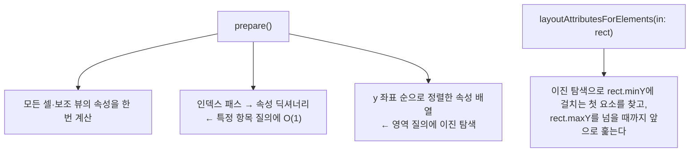

> LINE Engineering 블로그의 「[UICollectionView를 이용한 LINE iOS 대화방 리팩토링](https://engineering.linecorp.com/ko/blog/ios-refactoring-uicollectionview-1/)」을 바탕으로, API는 Apple의 [UICollectionViewLayout 문서](https://developer.apple.com/documentation/uikit/uicollectionviewlayout)로 확인해 재구성한 노트다.

## UITableView와 UICollectionView

| | UITableView | UICollectionView |
| --- | --- | --- |
| 모양 | 세로로 쌓인 행 | 레이아웃 객체가 정하는 아무 배치 |
| 셀 밖 요소 | 날짜 구분선·읽음 표시를 넣으려면 셀 안에 서브뷰를 끼우거나 섹션을 억지로 나눈다 | **보조 뷰(supplementary view)·장식 뷰(decoration view)** 로 셀과 따로 배치한다 |
| 높이 계산 | 테이블이 묻는 높이를 미리 계산해 따로 캐시해야 한다 | 레이아웃 객체가 위치·크기 계산을 맡는다 |

단순하고 균일한 목록은 UITableView로 충분하다. **데이터 모델과 배치 규칙을 분리**해야 하는 복잡한 목록에서 UICollectionView가 유리하다.

## 레이아웃 객체가 하는 일

UICollectionView는 그리기만 하고, **어디에 무엇을 둘지는 레이아웃 객체에 묻는다.** 커스텀 레이아웃은 `UICollectionViewLayout`을 상속해 다음 질문에 답한다.

| 메서드 | 질문 |
| --- | --- |
| `prepare()` | 레이아웃 계산을 시작하라. 여기서 전체 속성을 미리 계산해 캐시한다 |
| `collectionViewContentSize` | 스크롤할 전체 콘텐츠 크기는? |
| `layoutAttributesForElements(in:)` | 이 사각형(보이는 영역)에 들어오는 요소들의 속성은? |
| `layoutAttributesForItem(at:)` | 이 인덱스 패스 셀의 속성은? |
| `layoutAttributesForSupplementaryView(ofKind:at:)` | 이 보조 뷰(날짜 헤더 등)의 속성은? |
| `invalidateLayout()` | 데이터나 크기가 바뀌었으니 다시 계산하라 |

속성(`UICollectionViewLayoutAttributes`)은 프레임, z 순서, 투명도 같은 배치 정보다. **속성 클래스를 상속하면** 메시지 방향(보낸·받은), 말풍선 배경 종류처럼 셀이 그릴 때 필요한 값을 레이아웃에서 셀로 넘길 수 있다(셀의 `apply(_:)`에서 받는다).

## 빠르게 답하기: 미리 계산하고 찾기 쉽게 저장

스크롤하는 동안 `layoutAttributesForElements(in:)`가 계속 불리므로, 여기서 계산하면 끊긴다.

채팅처럼 항목이 위에서 아래로 쌓이면 y 좌표가 정렬되어 있으므로 이진 탐색이 그대로 통한다. 전체를 훑는 O(n) 대신 O(log n + 보이는 개수)로 답한다.

## 셀 구조와 오토 레이아웃

- **기본 셀 + 콘텐츠 뷰**: 프로필, 시간, 읽음 표시처럼 모든 메시지에 공통인 요소는 기본 셀 클래스가 맡고, 텍스트·이미지·스티커 같은 종류별 내용은 하위 클래스가 콘텐츠 뷰로 제공한다.
- **제약은 바뀐 부분만 고친다**: 셀을 재사용할 때 제약(constraint)을 전부 지우고 다시 만들면 스크롤 중 프레임을 놓친다. 무엇이 바뀌었는지 **더티 플래그**로 표시하고 그 부분의 제약만 갱신한다.
- 셀은 재사용하고, 꼭 필요할 때만 `invalidateLayout()`으로 레이아웃을 무효화한다.

## 지금의 선택지

iOS 13부터는 `UICollectionViewCompositionalLayout`(섹션·그룹·아이템을 조합하는 선언형 레이아웃)과 `UICollectionViewDiffableDataSource`(스냅샷 비교로 삽입·삭제 애니메이션 자동 처리)가 기본 도구다. 표준 목록·그리드는 이것으로 충분하고, 채팅방처럼 위치 규칙이 특수하거나 성능을 세밀하게 다뤄야 할 때 위의 커스텀 레이아웃을 쓴다. SwiftUI에서는 `List`·`LazyVStack`과 iOS 16의 `Layout` 프로토콜이 같은 자리를 맡는다.

## 정리

- UICollectionView는 그리기, 레이아웃 객체는 배치 계산으로 역할이 나뉜다.
- `prepare()`에서 전부 계산해 캐시하고, 영역 질의는 정렬 배열 + 이진 탐색으로 답한다.
- 셀 밖 요소는 보조·장식 뷰로, 셀에 넘길 추가 정보는 속성 하위 클래스로.
- 표준 배치는 컴포지셔널 레이아웃과 디퍼블 데이터 소스가 먼저다.

관련 노트: [[ios-app-fundamentals|iOS 앱 기본 개념]], [[swift-codable|Swift Codable: JSON 인코딩과 디코딩]], [[mobile-frameworks|모바일 앱 프레임워크 비교: 네이티브·하이브리드·크로스 플랫폼]], [[binary-search|이분 탐색]]
