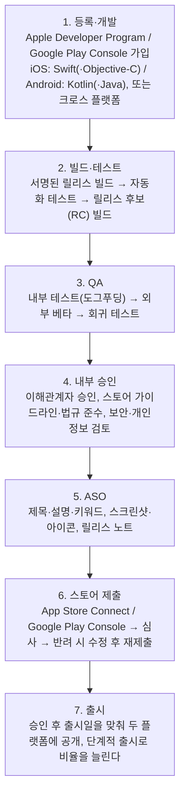

> ByteByteGo의 System Design 101 가이드 「[How To Release A Mobile App](https://bytebytego.com/guides/how-to-release-a-mobile-app)」을 바탕으로, 테스트 트랙과 단계적 출시는 App Store Connect·Google Play Console 도움말로 확인해 재구성한 노트다. 원격 설정은 「[리모트 컨피그 서버 구축기](https://techblog.woowahan.com/2611/)」로 보강했다.
> 첫 앱을 빠르게 내기 위한 원칙은 「[갈피: 나의 첫 모바일 앱 개발기](https://ahnheejong.name/articles/galpi-development-diary/)」, 「[React Native 사이드프로젝트. 보름만에 iOS, 안드로이드 앱 출시하기](https://blog.holy.kiwi/js/190127/)」에서 일반화한 원칙만 뽑아 보강했다.

## 웹 배포와 무엇이 다른가

웹은 서버에 올리면 다음 요청부터 모두가 새 버전을 받는다. 모바일 앱은 다르다.

| 차이 | 결과 |
| --- | --- |
| **스토어 심사**를 통과해야 배포된다 | 출시 시점을 마음대로 정할 수 없다. 심사 반려에 대비해 일정에 여유를 둔다 |
| 사용자가 업데이트해야 새 버전이 깔린다 | 옛 버전이 오래 남는다. 서버 API는 여러 앱 버전을 동시에 지원해야 한다 |
| 한 번 나간 바이너리는 되돌릴 수 없다 | 롤백 대신 새 버전을 다시 심사받아야 한다. 그래서 출시 전 검증과 단계적 출시가 중요하다 |
| 플랫폼이 둘이다 | iOS와 Android의 빌드·서명·정책·심사가 따로 돈다 |

JavaScript 번들만 바꾸는 수정은 심사 없이 OTA로 보낼 수 있는 경우가 있다([[codepush|React Native OTA 업데이트와 CodePush]]).

## 출시 흐름

## 단계별 핵심

| 단계 | 할 일 | 놓치기 쉬운 것 |
| --- | --- | --- |
| 빌드·테스트 | 릴리스 설정으로 빌드하고 서명한다. 성능과 기능을 두 플랫폼에서 모두 확인한다 | 서명 인증서·키 관리. Android 업로드 키를 잃으면 복구 절차가 번거롭다 |
| QA | 사내에서 먼저 써 보고(도그푸딩), 외부 베타 사용자에게 피드백을 받고, 기존 기능이 깨지지 않았는지 회귀 테스트를 한다 | 베타 배포 도구: iOS는 TestFlight, Android는 Play Console의 내부·비공개·공개 테스트 트랙 |
| 내부 승인 | 이해관계자 승인, 스토어 정책과 업계 규제 준수 확인, 보안 검토 | 개인정보 처리 내역 신고(App Store의 개인정보 라벨, Google Play의 데이터 보안 섹션)를 앱 동작과 맞춘다 |
| ASO | 검색에 걸리도록 제목·설명·키워드를 다듬고, 눈에 띄는 스크린샷과 아이콘, 새 기능을 알리는 릴리스 노트를 준비한다 | 스토어 문구도 현지화 대상이다 |
| 제출·심사 | 가이드라인에 맞춰 제출한다. 두 스토어 모두 수정을 요구할 수 있다 | 심사용 테스트 계정, 로그인이 필요한 기능의 설명을 함께 낸다 |
| 출시 | 승인 후 출시일을 정해 두 플랫폼 공개 시점을 맞춘다 | 한 번에 100%로 열지 않는다. iOS의 단계적 출시(phased release), Android의 단계적 출시(staged rollout)로 비율을 늘리며 충돌률을 본다 |

## 출시 후

- 충돌 리포트와 지표를 보고, 문제가 생기면 단계적 출시를 멈춘다.
- 서버 쪽 기능 플래그로 새 기능을 켜고 끌 수 있게 해 두면 바이너리를 다시 내지 않고도 문제를 막을 수 있다.
- 지원 종료할 옛 버전이 생기면 강제 업데이트 안내를 띄운다.

## 원격 설정: 배포 없이 바꾸기

앱은 사용자가 업데이트하지 않으면 새 코드가 반영되지 않는다. 그래서 바뀔 가능성이 있는 값(API 주소, 기능 노출 여부, 문구, 최소 지원 버전)은 앱에 박지 않고 **원격 설정(remote config) 서버**에서 내려받는다. 강제 업데이트를 줄이고, 출시된 앱의 동작을 서버에서 바꿀 수 있다. Firebase Remote Config 같은 관리형 서비스를 쓰거나 직접 만든다.

| 결정 | 선택지와 트레이드오프 |
| --- | --- |
| 갱신 방식 | **폴링**(일정 주기로 조회해 메모리에 캐시)은 단순하고 운영이 쉽지만 반영이 늦다. 즉시 반영이 필요하면 푸시·이벤트 기반으로 간다 |
| 서버 쪽 캐시 | 인스턴스 메모리에만 두면 인프라가 줄지만, 갱신 순간에 인스턴스마다 값이 잠시 다를 수 있다 |
| 서버 구성 | 운영 도구, 내부 제공, 외부(앱) 제공 서버를 나눠 책임과 접근 범위를 분리한다 |
| 장애 대비 | 앱이 설정 서버에 강하게 의존하면 설정 서버 장애가 곧 앱 장애다. **앱 안에 기본값을 두고, 마지막으로 받은 값을 저장**해 서버가 없어도 뜨게 한다 |

이미 있는 저장소·폴링 구조를 확장하는 편이 새 솔루션을 들이는 것보다 빠르고 장애 지점도 적다. 기능 단위로 켜고 끄는 용도라면 기능 플래그 도구와 역할이 겹치므로 하나로 통일한다.

## 첫 앱을 빠르게 내기

혼자나 작은 팀이 첫 앱을 낼 때 흔히 쓰는 원칙이다.

| 원칙 | 내용 |
| --- | --- |
| 기본 기능만으로 먼저 출시 | 코드 품질을 다소 희생하더라도 한 번 출시 과정을 끝까지 겪으면 다음 출시가 훨씬 쉬워진다. 버그 수정과 기능 추가는 출시 뒤 짧은 주기로 이어 간다. 정리(리팩터링)와 상태 관리 도입은 첫 출시 뒤에 한다 |
| 직접 쓸 앱을 만든다 | 사용자가 나 한 명이어도 계속 고칠 동기가 생긴다. 여러 UI 패턴, 로컬 DB, 인증, 외부 API 호출이 들어가는 주제면 배우는 것도 많다 |
| 와이어프레임 → 프로토타입 → 디자인 | 화면 흐름을 프로토타입으로 먼저 검증한 뒤 디자인을 입힌다. 디자이너가 없으면 Material 같은 컴포넌트 라이브러리를 쓴다 |
| 마감을 만든다 | 개발자 계정 등록처럼 비용이 드는 일을 먼저 해 두면 일정이 늘어지지 않는다. iOS 심사는 Android보다 오래 걸릴 수 있어 여유를 둔다 |
| 데이터를 기기에만 두지 않는다 | 로컬 저장만 쓰면 앱을 지우는 순간 사용자 데이터가 모두 사라진다. 백엔드 동기화를 일찍 계획하고, 로컬 DB는 오프라인용 캐시로 남긴다 |
| 출시를 자동화한다 | 빌드·서명·스크린샷·스토어 업로드는 fastlane이나 EAS Build·Submit(Expo)로 자동화한다 |
| 처음부터 계측한다 | 화면 전환·주요 행동 이벤트를 분석 도구(Firebase Analytics 등)로 남겨 이탈 지점을 본다. 초기 사용자의 버그 리포트에 빨리 답하면 신뢰가 쌓인다 |

React Native에서 JS 번들만 바꾸는 OTA 업데이트는 급한 수정에 유용하지만 네이티브 코드 변경은 반영되지 않고 스토어 정책 범위 안에서만 써야 한다([[codepush|React Native OTA 업데이트와 CodePush]]). 위젯 같은 iOS 앱 확장(extension)은 별도 타깃이라 크로스 플랫폼 프레임워크로 만들기 까다롭고, 앱과 데이터를 나누려면 App Group을 쓴다.

## 정리

- 모바일 출시는 스토어 심사와 사용자 업데이트 때문에 웹보다 느리고 되돌리기 어렵다.
- 흐름은 등록 → 빌드·테스트 → QA → 내부 승인 → ASO → 제출·심사 → 출시다.
- 베타 트랙과 회귀 테스트로 출시 전에 걸러 내고, 단계적 출시와 기능 플래그로 출시 후 피해를 줄인다.
- 서버는 여러 앱 버전이 동시에 살아 있다는 전제로 API를 설계한다.

관련 노트: [[codepush|React Native OTA 업데이트와 CodePush]], [[mobile-frameworks|모바일 앱 프레임워크 비교: 네이티브·하이브리드·크로스 플랫폼]], [[ci-cd|CI/CD]], [[deployment-strategies|배포 전략: 롤링, 블루-그린, 카나리, 섀도, 피처 토글]]
