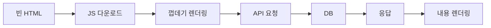
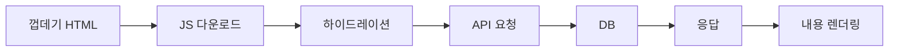
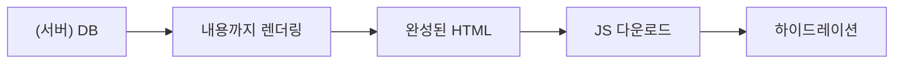
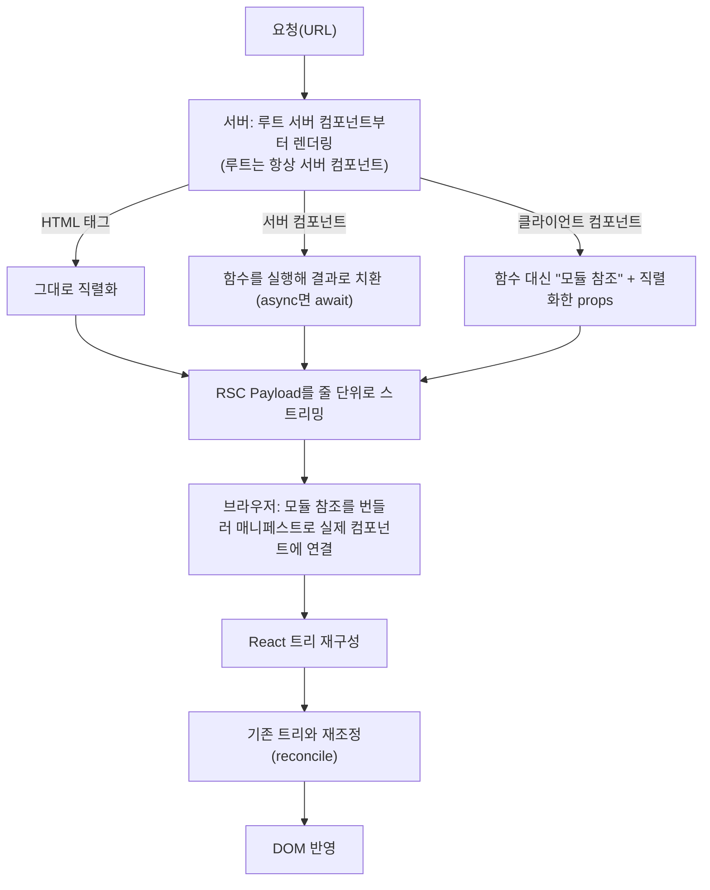

> yceffort의 「[리액트 서버 컴포넌트의 동작 방식](https://yceffort.kr/2022/01/how-react-server-components-work)」(2022.01)을 바탕으로 React 19 문서와 대조해 재구성한 노트다. 「왜 필요했나」, 「서버 컴포넌트는 다시 렌더링되지 않는다」, 「클라이언트 경계」는 Josh W. Comeau의 「[Making Sense of React Server Components](https://www.joshwcomeau.com/react/server-components/)」(2023.09, 2025.05 갱신)로 보강했다. 「서버에서 출발한 컴포넌트 모델」은 Dan Abramov의 X 타래를 @hewonjeong이 번역한 [타래](https://x.com/hewonjeong/status/1743629443346968724)(2024.01)를 바탕으로 했다. Payload의 리소스 힌트 줄은 「[리액트 서버 컴포넌트 톺아보기](https://roy-jung.github.io/250323-react-server-components)」를 바탕으로 더했다. 실시간 갱신의 한계는 「[Frontend_TIL: Next.js(2-2) - RSC 더 깊게 잘이해하기](https://github.com/AI-Dev-Lex-Kim/Frontend_TIL/blob/master/Tool/Next.js%282-2%29%20-%20RSC%20%EB%8D%94%20%EA%B9%8A%EA%B2%8C%20%EC%9E%98%EC%9D%B4%ED%95%B4%ED%95%98%EA%B8%B0%28%EC%8B%AC%ED%99%94%29.md)」를 바탕으로 보강했다.

## React Server Components란

**React Server Components(RSC)** 는 컴포넌트 트리의 일부를 서버에서, 나머지를 브라우저에서 렌더링하게 나누는 React의 구조다. 서버 컴포넌트의 코드는 서버에서만 실행되고 **브라우저 번들에 들어가지 않는다.** 브라우저는 그 실행 결과만 받는다.

| 얻는 것 | 이유 |
| --- | --- |
| 데이터에 바로 접근 | DB·파일 시스템·내부 API를 공개 API 계층 없이 부른다 |
| 번들 축소 | 마크다운 파서·날짜 라이브러리처럼 무거운 의존성이 서버에 남는다 |
| 요청 왕복 감소 | 서로 얽힌 여러 데이터 소스를 데이터 가까이에서 한 번에 푼다 |

역할 분담으로 보면 **서버는 데이터를 가져와 내용을 그리고, 브라우저는 상호작용을 맡는다.**

## 왜 필요했나: 요청 왕복

데이터가 필요한 화면을 그리는 흐름을 비교하면 RSC가 무엇을 줄이는지 보인다.

CSR



SSR



서버 데이터



SSR만으로는 첫 화면에 **껍데기**(헤더·레이아웃·로딩 표시)만 빨리 보인다. 사용자가 보러 온 것은 내용이므로 큰 차이가 아니다. 요청이 어차피 서버에서 시작되는데 브라우저가 다시 API를 부르는 왕복은 낭비다. **첫 요청 안에서 DB를 조회해 내용까지 그려 보내면** 왕복 하나가 사라진다.

Next.js의 `getServerSideProps`(Pages Router) 같은 프레임워크 기능이 먼저 이 일을 했지만 한계가 있었다.

| 한계 | 결과 |
| --- | --- |
| 라우트 최상위에서만 쓸 수 있다 | 트리 깊은 곳의 컴포넌트는 데이터를 props로 내려받아야 한다 |
| 프레임워크마다 방식이 다르다 | Next.js·Gatsby·Remix가 각자 다른 API를 썼다 |
| 모든 컴포넌트가 하이드레이션된다 | 상호작용이 없는 컴포넌트의 코드도 번들에 들어간다 |

RSC는 이 일을 **React의 표준 방식으로, 컴포넌트 단위로** 하게 만든다.

## 서버 컴포넌트는 다시 렌더링되지 않는다

서버 컴포넌트는 서버에서 **한 번** 실행돼 UI를 만들고, 그 결과는 클라이언트에서 바뀌지 않는다(내비게이션이나 새로고침으로 새 Payload를 받기 전까지). 이 한 가지 성질에서 규칙이 따라 나온다.

| 성질 | 결과 |
| --- | --- |
| 다시 렌더링되지 않는다 | state를 쓸 수 없다. 바뀔 값이 없기 때문이다 |
| 브라우저에서 실행되지 않는다 | effect를 쓸 수 없다. effect는 렌더링 뒤 브라우저에서 돈다 |
| 한 번만 실행된다 | `async` 함수로 만들고 렌더링 중에 바로 DB를 조회해도 된다. 렌더마다 반복될 걱정이 없다 |

그래서 서버 컴포넌트에는 의존성 배열, 오래된 클로저, 메모이제이션 같은 「값이 바뀌어서 생기는 문제」가 없다.

이름에 주의한다. 원래의 React 컴포넌트가 **클라이언트 컴포넌트**라는 새 이름을 얻었을 뿐, 클라이언트 컴포넌트도 SSR 때는 **서버와 클라이언트 양쪽에서** 렌더링된다. 서버에서만 렌더링되는 것은 서버 컴포넌트뿐이다.

## RSC와 SSR은 다르다

| | SSR | RSC |
| --- | --- | --- |
| 결과물 | HTML 문자열 | 직렬화된 React 트리(RSC Payload) |
| 대상 | 모든 컴포넌트를 똑같이 한 번 렌더링 | 서버 컴포넌트만 서버에서, 클라이언트 컴포넌트는 참조로 남김 |
| 코드가 브라우저로 가나 | 간다 (하이드레이션에 필요) | 서버 컴포넌트 코드는 안 간다 |
| 언제 | 첫 요청 | 첫 요청과 이후 내비게이션 모두 |

둘은 독립적이고 함께 쓸 수 있다. Next.js App Router는 첫 요청에서 **RSC Payload를 만든 뒤 그것으로 HTML까지 SSR**해 함께 보내고, 이후 내비게이션에서는 RSC Payload만 받는다. HTML 측면은 [[spa-csr-ssr|SPA와 CSR·SSR]], 스트리밍은 [[streaming-ssr|스트리밍 SSR]]에 있다.

## 렌더링 과정



### 1. 클라이언트 컴포넌트는 참조로 직렬화된다

함수는 직렬화할 수 없으므로, 서버는 클라이언트 컴포넌트를 "어느 파일의 어느 export인가"라는 **모듈 참조(client reference)** 로 바꾼다. 경계는 파일 맨 위의 `'use client'`가 긋고, 번들러가 그 파일을 별도 청크로 떼어 내 참조 매니페스트를 만든다. 그래서 RSC는 번들러 통합이 필수이고, 보통 프레임워크(Next.js, React Router, Waku 등)를 통해 쓴다.

### 2. props는 직렬화 가능해야 한다

트리가 통째로 직렬화되므로 서버 → 클라이언트 경계를 넘는 props는 직렬화할 수 있는 값이어야 한다. 원시 값, 평범한 객체·배열, `Date`, `Map`, `Set`, Promise, JSX 엘리먼트, Server Function은 넘어가고, 일반 함수(`onClick`)와 클래스 인스턴스는 못 넘어간다. 클라이언트 컴포넌트끼리 주고받는 props는 Payload에 나타나지 않으므로 이 제약이 없다. 구체적인 조합 규칙은 [[server-client-components|서버 컴포넌트와 클라이언트 컴포넌트 조합 규칙]]에 정리했다.

### 3. Payload는 줄 단위 스트림이다

RSC Payload(내부 이름 Flight)는 `ID:값` 한 줄이 하나의 청크인 텍스트 스트림이다. 정확한 형식은 React 내부 구현이라 버전마다 바뀌지만 모양은 이렇다.

```text
1:I["./app/like-button.tsx",["chunk-a.js"],"default"]
0:["$","main",null,{"children":[["$","h1",null,{"children":"글 목록"}],["$","$L1",null,{"likes":3}],["$","$Sreact.suspense",null,{"fallback":"로딩…","children":"$L2"}]]}]
2:["$","ul",null,{"children":[...]}]
```

| 표기 | 뜻 |
| --- | --- |
| `I` 줄 | 클라이언트 컴포넌트 모듈 참조 (파일, 청크, export 이름) |
| `HL` 줄 | CSS·폰트 같은 리소스 힌트. 브라우저가 내용보다 먼저 받기 시작한다 |
| `$L1` | 1번 청크를 가리키는 지연(lazy) 참조. 아직 안 왔으면 그 자리에서 suspend한다 |
| `$S…` | `react.suspense` 같은 심벌 |
| `$@` | Promise. 클라이언트에서 `use()`로 읽는다 |

HTML 대신 이 형식을 쓰는 이유는 **브라우저의 목표가 React 트리를 다시 만드는 것**이기 때문이다. HTML을 파싱해 엘리먼트로 되돌리는 것보다 단순하고, 새 Payload를 기존 트리에 재조정해 최소한의 DOM만 바꿀 수 있다.

### 4. Suspense로 스트리밍한다

데이터를 기다리는 서버 컴포넌트는 가장 가까운 `<Suspense>` 자리에 `$L2` 같은 구멍을 남기고, 서버는 나머지를 먼저 보낸다. 데이터가 준비되면 `2:` 줄이 뒤따라 오고 브라우저가 구멍을 채운다. 클라이언트 컴포넌트 청크도 필요해질 때 받으므로, **내용과 코드가 모두 점진적으로 도착한다.**

## 클라이언트 경계

RSC 환경에서는 **모든 컴포넌트가 기본적으로 서버 컴포넌트**이고, 클라이언트 컴포넌트는 `'use client'`로 고른다. `'use server'`는 서버 컴포넌트 표시가 아니라 Server Function(Server Action)용 지시어다.

`'use client'`는 컴포넌트 하나가 아니라 **경계**를 긋는다. 그 파일이 import하는 모듈은 모두 클라이언트 번들에 들어가고, 따로 표시하지 않아도 클라이언트 컴포넌트가 된다. 클라이언트 컴포넌트가 다시 렌더링되면 그 안의 컴포넌트도 다시 렌더링돼야 하는데, 서버 컴포넌트는 그럴 수 없기 때문이다. 그래서 `'use client'`는 모든 파일이 아니라 **새 경계를 만드는 파일에만** 붙인다.

경계에서 중요한 것은 트리의 부모·자식이 아니라 **누가 import해서 props를 정하는가(소유자, owner)** 다. 테마 state처럼 트리 꼭대기에 상태가 필요해도, 그 상태만 `children`을 받는 작은 클라이언트 컴포넌트로 빼면 된다. 그 안에 들어가는 `Header`·`Main`은 서버 컴포넌트인 페이지가 import하고 props를 정하므로 서버 컴포넌트로 남는다. 코드 예시는 [[server-client-components|서버 컴포넌트와 클라이언트 컴포넌트 조합 규칙]]의 규칙 4·5에 있다.

어떤 컴포넌트를 클라이언트로 만들지는 단순하다. **서버 컴포넌트가 될 수 있으면 서버 컴포넌트로 둔다.** state·effect·이벤트 핸들러가 필요한 곳만 클라이언트로 만든다. 다만 클라이언트 컴포넌트 수를 최소화하는 것 자체를 목표로 삼을 필요는 없다. RSC 이전에는 모든 컴포넌트가 클라이언트 컴포넌트였다.

## 갱신

새 내용을 보려면(내비게이션, `router.refresh()`, Server Action 이후 재검증) 서버에 새 RSC Payload를 요청한다. 브라우저는 받은 트리를 기존 트리와 재조정하므로 **클라이언트 컴포넌트의 state와 포커스가 유지된다.** Next.js는 바뀐 라우트 구획(레이아웃 아래 페이지 등)만 다시 받아 오고, 받은 Payload는 클라이언트 캐시에 둔다([[nextjs-app-router|App Router의 내비게이션]]).

## 언제 쓰나

| 서버 컴포넌트가 맞다 | 클라이언트 컴포넌트가 맞다 |
| --- | --- |
| 가공된 데이터를 그대로 그리는 화면 | 입력·드래그처럼 즉각 반응해야 하는 UI |
| 렌더링에 무거운 라이브러리가 필요 | `useState`·`useEffect`·브라우저 API가 필요 |
| 여러 데이터 소스를 엮어야 함 | 사용자 입력마다 바뀌는 데이터 (SWR·TanStack Query) |

## 비용과 오해

- **HTML은 커진다.** 브라우저는 서버 컴포넌트 코드 대신 그 렌더링 결과(Payload)를 HTML 안 `<script>`로 받는다. 번들은 작아지는 대신 HTML은 커진다. HTML은 청크로 스트리밍되므로 화면은 먼저 그려진다.
- **서버가 꼭 필요하지는 않다.** 서버 컴포넌트는 요청마다 실행될 수도, 빌드할 때 한 번 실행될 수도 있다. 빌드 시점에 실행하면 정적 HTML로 내보내 어디든 호스팅할 수 있다([[static-site-generator|정적 사이트 생성기와 Jamstack]]). Next.js App Router도 동적 기능을 쓰지 않으면 기본적으로 빌드 때 렌더링한다.
- **가장 큰 이득은 기능과 번들 크기의 거래가 사라지는 것이다.** 모든 언어를 지원하는 구문 강조 라이브러리처럼 번들에 넣기엔 너무 큰 기능도 서버 컴포넌트에서 돌리면 번들에 0KB를 더한다. Shiki·Bright 같은 서버 전용 구문 강조가 그 예다.
- 하이드레이션 시간 단축은 생각보다 작은 이득일 수 있다. 시맨틱 HTML로 만들면 링크·폼·`<details>`는 하이드레이션 전에도 동작한다.

## 한계

- 서버 컴포넌트는 state·이벤트 핸들러를 가질 수 없고, 클라이언트 컴포넌트는 서버 컴포넌트를 import할 수 없다. 우회하는 조합 규칙은 [[server-client-components|서버 컴포넌트와 클라이언트 컴포넌트 조합 규칙]]에 있다.
- 서버 내용이 바뀌려면 네트워크 왕복이 필요하다. 오프라인·즉각 반응이 중요한 부분은 클라이언트에 둔다.
- 서버 컴포넌트는 요청 한 번에 한 번 그리고 끝난다. WebSocket처럼 서버가 계속 밀어 주는 실시간 갱신은 클라이언트 컴포넌트에서 구독하거나 주기적으로 다시 가져온다(폴링, SWR·TanStack Query의 재검증).
- 번들러·서버 통합이 필요해 사실상 프레임워크에 묶인다.

## 역사

### 서버에서 출발한 컴포넌트 모델

React의 조합형 컴포넌트 모델은 서버에서 컴포넌트로 HTML을 만들던 XHP(Hack 언어용)에서 왔다. 코드를 클라이언트로 옮길수록 서버와 클라이언트 사이에 인위적인 경계가 생기고 코드가 엉켰고, RSC는 **요청 하나에 응답하고 버리는** 서버의 상태 없는 모델을 React 안으로 되살린 것이다. 그래서 RSC는 "PHP를 닮아 간다"는 말을 듣는다.

RSC는 2020년 12월 실험 데모로 처음 공개됐다. 초기에는 `*.server.jsx`·`*.client.jsx` 파일 이름으로 경계를 정했고, 브라우저는 `createFromFetch(...).readRoot()`로 Payload를 읽었다. 이후 파일 이름 규칙 대신 `'use client'`·`'use server'` 지시어로 바뀌었고, Next.js 13 App Router(2023, 안정화)가 첫 대중적 구현이 됐다. React 19(2024.12)에서 서버 컴포넌트가 안정 기능이 됐다. 다만 번들러·프레임워크 연동 API는 여전히 마이너 버전 사이에 바뀔 수 있다.

## 정리

- RSC는 서버 컴포넌트를 서버에서 실행해 **결과만** 보내고, 그 코드는 번들에서 뺀다.
- 결과물은 HTML이 아니라 직렬화된 React 트리이고, 클라이언트 컴포넌트는 모듈 참조로 들어간다.
- 경계를 넘는 props는 직렬화 가능해야 한다.
- Suspense 구멍을 두고 줄 단위로 스트리밍하며, 갱신은 새 Payload를 받아 재조정해 클라이언트 state를 지킨다.
- 서버 컴포넌트는 **다시 렌더링되지 않는다.** 그래서 state·effect가 없고, 대신 `async`로 렌더링 중에 데이터를 가져온다.
- `'use client'`는 파일 단위로 **클라이언트 경계**를 긋는다. props를 정하는 소유자가 서버 컴포넌트면 클라이언트 컴포넌트 안에 꽂혀도 서버 컴포넌트로 남는다.
- RSC와 SSR은 별개이고, 프레임워크는 둘을 함께 써서 첫 화면은 HTML로, 이후 이동은 Payload로 처리한다.

관련 노트: [[server-client-components|서버 컴포넌트와 클라이언트 컴포넌트 조합 규칙]], [[nextjs-app-router|Next.js App Router의 내비게이션과 데이터 가져오기]], [[streaming-ssr|스트리밍 SSR]], [[spa-csr-ssr|SPA와 CSR·SSR]], [[react-use-hook|use 훅과 리액트 비동기 처리]]
