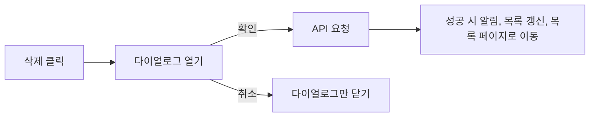

삭제처럼 **되돌릴 수 없는 동작**은 클릭 한 번에 바로 실행하지 않고 확인 창을 거치게 한다. MUI의 `Dialog`로 확인 창을 컴포넌트 하나로 만들어 두면 여러 화면에서 재사용할 수 있다.

## 흐름



## UX: 위험한 버튼은 덜 눈에 띄게

사용자가 실수로 누르기 쉬운 쪽이 **안전한 동작**이 되도록 한다. 삭제 버튼은 빨간색이지만 테두리만 있는 `outlined` 스타일로, 취소 버튼은 채워진 `contained` 스타일로 만든다. "빨간색 = 강조"가 아니라 "빨간색 = 위험 표시"로 쓰는 것이다. 버튼 문구도 "확인"보다 "네, 삭제합니다"처럼 결과를 그대로 적으면 실수가 줄어든다.

## 컴포넌트

```tsx
import Button from "@mui/material/Button"
import Dialog from "@mui/material/Dialog"
import DialogActions from "@mui/material/DialogActions"
import DialogContent from "@mui/material/DialogContent"
import DialogContentText from "@mui/material/DialogContentText"
import DialogTitle from "@mui/material/DialogTitle"

interface DeleteConfirmDialogProps {
  open: boolean
  onClose: () => void
  onConfirm: () => void
}

export default function DeleteConfirmDialog({ open, onClose, onConfirm }: DeleteConfirmDialogProps) {
  return (
    <Dialog
      open={open}
      onClose={onClose}
      aria-labelledby="delete-dialog-title"
      aria-describedby="delete-dialog-description"
    >
      <DialogTitle id="delete-dialog-title">정말 삭제하시겠습니까?</DialogTitle>
      <DialogContent>
        <DialogContentText id="delete-dialog-description">
          삭제한 뒤에는 복구할 수 없습니다.
        </DialogContentText>
      </DialogContent>
      <DialogActions sx={{ minWidth: 300, px: 2, py: 1.5 }}>
        <Button onClick={onClose} variant="contained" color="inherit" disableElevation>
          취소
        </Button>
        <Button onClick={onConfirm} variant="outlined" color="error">
          네, 삭제합니다
        </Button>
      </DialogActions>
    </Dialog>
  )
}
```

- `aria-labelledby`, `aria-describedby`로 제목·설명을 연결해 스크린 리더가 다이얼로그 내용을 읽을 수 있게 한다.
- props는 `open`/`onClose`/`onConfirm`처럼 MUI 관례에 맞춘 이름을 쓰면 다른 MUI 컴포넌트와 사용법이 같아진다. setter를 통째로 넘기는 것보다 의도가 분명하다.

## 사용하는 쪽

```tsx
const [isDeleteDialogOpen, setIsDeleteDialogOpen] = useState(false)

const handleDelete = async () => {
  const res = await removeItem(id)
  if (res.data) {
    setIsDeleteDialogOpen(false)
    refresh?.()
    openAlert({ message: "삭제되었습니다." })
    navigate("/item/list")
  }
}

<Button color="error" onClick={() => setIsDeleteDialogOpen(true)}>삭제</Button>
<DeleteConfirmDialog
  open={isDeleteDialogOpen}
  onClose={() => setIsDeleteDialogOpen(false)}
  onConfirm={handleDelete}
/>
```

## 아이콘 버튼

글자 없이 아이콘만 있는 버튼은 MUI `IconButton`을 쓰고, 화면 낭독기가 읽을 이름이 없으므로 `aria-label`을 꼭 준다.

## 핵심 정리

- 되돌릴 수 없는 동작 앞에는 확인 다이얼로그를 둔다.
- 위험한 버튼은 outlined, 안전한 버튼은 contained로 시각적 무게를 반대로 준다.
- 다이얼로그는 `open`/`onClose`/`onConfirm` props를 받는 재사용 컴포넌트로 만든다.
