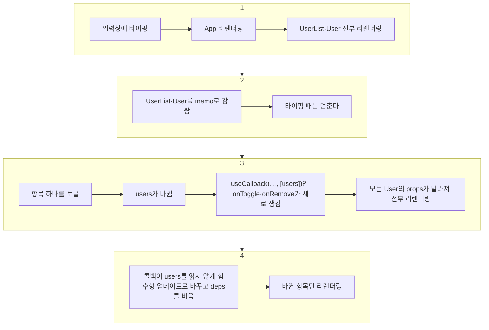

> React 공식 문서를 바탕으로, effect를 동기화로 보는 관점과 deps를 줄이는 법은 Dan Abramov의 「A Complete Guide to useEffect」 번역 「[useEffect 완벽 가이드](https://rinae.dev/posts/a-complete-guide-to-useeffect-ko)」를 바탕으로 더한 노트다.
> useRef의 두 쓰임, useReducer, memo와 함수형 업데이트, useInputs는 벨로퍼트의 「[벨로퍼트와 함께하는 모던 리액트](https://react.vlpt.us/)」 중 「[useRef로 특정 DOM 선택하기](https://react.vlpt.us/basic/10-useRef.html)」~「[커스텀 Hooks 만들기](https://react.vlpt.us/basic/21-custom-hook.html)」를 바탕으로 보강했다.
> 훅을 직접 흉내 낸 구현, 콜백 ref, 이전 값 기억하기는 「[Frontend_TIL: Vanilla Javascript useState](https://github.com/AI-Dev-Lex-Kim/Frontend_TIL/blob/master/React/Vanilla%20Javascript%20useState.md)」·「[Vanilla Javascript useEffect](https://github.com/AI-Dev-Lex-Kim/Frontend_TIL/blob/master/React/Vanilla%20Javascript%20useEffect.md)」·「[Ref](https://github.com/AI-Dev-Lex-Kim/Frontend_TIL/blob/master/React/Ref.md)」·「[이전 state, props 얻는 방법](https://github.com/AI-Dev-Lex-Kim/Frontend_TIL/blob/master/React/%EC%9D%B4%EC%A0%84%20state%2C%20props%20%EC%96%BB%EB%8A%94%20%EB%B0%A9%EB%B2%95.md)」을 바탕으로 보강했다.

**Hook**은 함수 컴포넌트가 클래스 컴포넌트의 기능(state, 생명주기 등)을 쓸 수 있게 해 주는 함수다. React 16.8(2019)에 추가되었고, 지금은 함수 컴포넌트 + Hooks가 React의 표준 작성 방식이다. 기존 클래스 컴포넌트를 굳이 Hooks로 다시 쓸 필요는 없다.

## 왜 필요한가

함수 컴포넌트는 리렌더링될 때마다 **함수 전체가 다시 실행**된다. 안에서 선언한 변수는 매번 새로 만들어지고 초기화되므로, 그대로는 이전 값을 기억할 수 없다(그래서 예전에는 함수 컴포넌트를 stateless component라고 불렀다). 반면 클래스 컴포넌트는 인스턴스가 유지되어 `render()` 외의 메서드와 state가 보존된다.

Hook은 React가 컴포넌트별로 값을 따로 저장해 두고, 리렌더링 때 다시 꺼내 주는 방식으로 함수 컴포넌트가 값을 "기억"하게 한다. 그 덕에 상태 로직을 HOC·render props 같은 중첩 없이 재사용하고, 여러 생명주기 메서드에 흩어지던 관련 로직을 한곳에 모으고, `this` 바인딩 같은 클래스 문법의 함정을 피할 수 있게 됐다.

## Hook의 규칙

1. **최상위에서만 호출한다.** 반복문, 조건문, 중첩 함수 안에서 호출하지 않는다.
2. **React 함수(컴포넌트, 커스텀 훅) 안에서만 호출한다.** 일반 JavaScript 함수에서는 안 된다.
3. 커스텀 훅 이름은 **`use`로 시작**한다. 그래야 규칙이 적용되는 함수인지 한눈에 알 수 있고 린터가 검사할 수 있다.

`eslint-plugin-react-hooks`가 이 규칙을 강제한다. Vite·Next.js 템플릿에 기본으로 들어 있고, 최신 버전의 `recommended` 프리셋(flat config)에는 React Compiler가 쓰는 규칙 검사도 함께 들어 있다.

### 왜 순서가 중요한가

React는 Hook을 **호출 순서**로 구분한다. 렌더링마다 같은 순서로 호출되어야 각 Hook에 맞는 state를 돌려줄 수 있다.

```jsx
function Form() {
  const [name, setName] = useState('Mary')            // 1번
  useEffect(() => { localStorage.setItem('formData', name) }) // 2번
  const [surname, setSurname] = useState('Poppins')   // 3번
  useEffect(() => { document.title = `${name} ${surname}` })   // 4번
}
```

조건문 안에서 2번 Hook을 건너뛰면, 그 다음 렌더링에서 3번 자리의 `useState`가 2번 effect의 데이터를 받아 버리는 식으로 모든 것이 한 칸씩 밀린다. 조건이 필요하면 Hook **안에서** 조건을 건다.

순서에 기대는 이유는 구조를 직접 흉내 내 보면 보인다. 컴포넌트 밖 모듈에 **배열과 커서**를 두고, 렌더링마다 커서를 0으로 되돌린 뒤 훅이 불릴 때마다 한 칸씩 쓴다. 각 훅은 자기 칸 번호를 [[scope-and-closures|클로저]]로 기억한다.

```js
const React = (() => {
  const hooks = []   // 컴포넌트가 다시 호출돼도 사라지지 않는 저장소
  let cursor = 0

  function useState(initial) {
    const i = cursor++                       // 이번 훅의 칸 번호를 클로저에 고정
    if (hooks[i] === undefined) hooks[i] = initial
    const setState = (next) => { hooks[i] = next; render() }
    return [hooks[i], setState]
  }

  function useEffect(callback, deps) {
    const i = cursor++
    const prev = hooks[i]
    const changed = !deps || !prev || deps.some((d, k) => !Object.is(d, prev[k]))
    if (changed) callback()                  // 실제 React는 커밋 뒤에 실행하고 cleanup도 부른다
    hooks[i] = deps
  }

  function render(Component) { cursor = 0; return Component() }
  return { useState, useEffect, render }
})()
```

- deps가 없으면 매번, `[]`면 처음 한 번, `[count]`면 `count`가 `Object.is`로 달라졌을 때만 effect가 돈다. 이 비교가 위 `changed` 한 줄이다.
- 실제 React는 배열 대신 컴포넌트(Fiber)마다 훅 연결 리스트를 두지만, 「호출 순서 = 저장 칸」이라는 원리는 같다.

## 주요 Hooks

| Hook | 용도 |
| --- | --- |
| `useState` | 값이 바뀌면 리렌더링되는 상태 ([State](/knowledge/dictionary/frontend/react/state)) |
| `useEffect` | 렌더링 후 실행할 부수 효과(데이터 요청, 구독, 타이머, DOM 조작) |
| `useContext` | Context 값 읽기 ([Context](/knowledge/dictionary/frontend/react/context)) |
| `useReducer` | 복잡한 state 업데이트 로직을 reducer로 분리 |
| `useCallback` | 함수를 메모이제이션해 재사용 |
| `useMemo` | 계산 결과를 메모이제이션해 재사용 |
| `useRef` | DOM 요소 참조, 또는 리렌더링을 일으키지 않는 값 보관 |
| `useLayoutEffect` | DOM 변경 후 화면에 그리기 **전** 동기 실행(레이아웃 측정) |
| `useTransition`, `useDeferredValue` | 급하지 않은 업데이트를 뒤로 미뤄 입력 반응성 유지 ([[concurrent-rendering\|동시성 렌더링]]) |
| `useId` | 서버·클라이언트에서 같은 고유 id 생성(접근성 속성 연결) |
| `useSyncExternalStore` | 외부 스토어 구독 (상태 관리 라이브러리가 내부에서 쓴다) |
| `useImperativeHandle`, `useDebugValue` | ref로 노출할 값 지정, DevTools 라벨 |
| `useActionState`, `useOptimistic`, `useFormStatus` (React 19) | 폼 액션의 결과·대기 상태, 요청 중 낙관적 UI, 부모 폼의 제출 상태 ([폼](/knowledge/dictionary/frontend/react/forms)) |
| `use` (React 19) | Promise·Context 읽기. 조건문 안에서도 호출 가능 ([use](/knowledge/dictionary/frontend/react/react-use-hook)) |
| `useEffectEvent` (React 19.2) | effect 안에서 최신 props·state를 읽되 effect를 다시 실행시키지 않는 함수 |

## useEffect

state가 바뀔 때마다 컴포넌트의 **모든 코드가 다시 실행**된다. API 호출처럼 "처음 한 번만" 또는 "특정 값이 바뀔 때만" 실행할 코드를 그대로 두면 렌더링마다 반복된다. `useEffect(effect, deps)`는 코드의 **실행 시점을 통제**하는 도구다.

| deps | 실행 시점 | cleanup 시점 |
| --- | --- | --- |
| 생략 | 매 렌더링 후 | 다음 effect 직전, 언마운트 |
| `[]` | 마운트 후 한 번 | 언마운트 때만 |
| `[a, b]` | 마운트 후 + `a`나 `b`가 바뀔 때마다 | 다시 실행되기 직전, 언마운트 |

effect에서 **함수를 반환**하면 그것이 cleanup이다. 흐름은 **리렌더링 → 이전 effect의 cleanup → 새 effect 실행**이다.

```jsx
useEffect(() => {
  const conn = createConnection(roomId)
  conn.connect()
  return () => conn.disconnect() // roomId가 바뀌면 이전 연결을 끊고 새로 연결한다
}, [roomId])
```

- effect 안에서 읽는 state·props는 모두 deps에 넣는다. 빠뜨리면 오래된 값에 갇힌다.
- 개발 모드의 StrictMode는 cleanup 누락을 찾으려고 마운트 직후 한 번 더 정리·실행해 본다. 자세한 내용은 [[lifecycle#StrictMode의 이중 실행|생명주기]]에 있다.

### 렌더마다 자기 값을 가진다

컴포넌트 함수는 렌더마다 다시 호출된다. 그 렌더의 props·state는 **그 렌더 안에서 바뀌지 않는 상수**이고, 그 안에서 만든 이벤트 핸들러·타이머 콜백·effect는 모두 그 상수를 클로저로 붙잡는다. 클릭하고 3초 뒤 `alert(count)`를 띄우면, 그사이 count가 올라도 클릭한 렌더의 값이 나온다. 버그가 아니라 정확한 동작이다.

그래서 effect는 「마운트 때 한 번」, 「업데이트 때」 같은 **생명주기 사건이 아니라 동기화**로 생각한다. 「지금 props·state에 맞춰 React 바깥(문서 제목, 구독, 타이머, 외부 위젯)을 맞춘다」는 선언이다. 몇 번째 렌더이든 같은 props면 같은 결과가 되어야 하고, 첫 렌더만 특별 취급하는 effect는 대개 설계가 어긋났다는 신호다. cleanup도 **자신이 만들어진 렌더의 값**으로 실행된다. `roomId`가 1에서 2로 바뀌면 cleanup은 1번 방 연결을 끊는다.

### deps에 거짓말하지 않는다

deps는 「effect가 쓰는 반응형 값의 목록」이다. 다시 돌기 싫어서 값을 빼면 effect가 첫 렌더의 값에 갇힌다. **deps를 줄이고 싶으면 목록이 아니라 코드를 바꿔 effect가 그 값을 쓰지 않게 만든다.** 누락은 `eslint-plugin-react-hooks`의 `exhaustive-deps` 규칙이 잡는다.

| 상황 | 바꾸는 법 |
| --- | --- |
| 이전 state로 다음 state를 계산한다 (`setCount(count + 1)`) | 함수형 업데이트 `setCount(c => c + 1)`. effect가 `count`를 읽지 않게 된다 |
| 여러 state가 얽혀 갱신된다 | `useReducer`로 바꾸고 effect는 `dispatch({ type: 'tick' })`만 한다. `dispatch`는 렌더마다 같아 deps에 넣어도 다시 돌지 않는다 |
| effect 안에서만 쓰는 함수 | 함수를 effect **안으로** 옮긴다 |
| 컴포넌트 값과 무관한 함수 | 컴포넌트 **밖으로** 뺀다 |
| 여러 곳에서 쓰는 함수·객체 | `useCallback`·`useMemo`로 필요한 값이 바뀔 때만 새로 만든다 |
| 읽기만 하고 반응하지 않을 값 | 아래 `useEffectEvent` |

### 늦게 온 응답이 최신 값을 덮는다

`id`가 1 → 2로 빠르게 바뀌면 두 요청이 겹치고, 1번 응답이 늦게 오면 화면이 1번 데이터로 덮인다(경쟁 상태). cleanup에서 이전 요청을 무효로 만든다.

```jsx
useEffect(() => {
  const controller = new AbortController()
  fetch(`/api/items/${id}`, { signal: controller.signal })
    .then((r) => r.json())
    .then(setItem)
    .catch((e) => { if (e.name !== 'AbortError') setError(e) })
  return () => controller.abort()   // id가 바뀌면 이전 요청 취소
}, [id])
```

취소할 수 없는 비동기 작업이면 `let ignore = false`를 두고 cleanup에서 `ignore = true`로 바꿔 늦은 결과를 버린다. effect 함수 자체를 `async`로 만들지 않는다. cleanup 대신 Promise를 돌려주게 되기 때문이다. 데이터 가져오기를 effect로 직접 짜면 캐시·재시도·중복 제거까지 손으로 해야 하므로 실무에서는 [[tanstack-query|TanStack Query]] 같은 라이브러리나 프레임워크의 데이터 로딩을 쓴다.

### useEffectEvent: 반응하지 않을 값 분리

effect 안에서 읽기만 하고 **바뀌어도 effect를 다시 돌리고 싶지 않은 값**(테마, 로그용 값)이 있다. deps에 넣으면 연결이 불필요하게 끊겼다 다시 맺히고, 빼면 린터가 경고한다. React 19.2의 `useEffectEvent`로 그 부분을 떼어 낸다.

```jsx
const onConnected = useEffectEvent(() => {
  showNotification('연결됨', theme) // 항상 최신 theme을 읽는다
})

useEffect(() => {
  const conn = createConnection(roomId)
  conn.on('connected', () => onConnected())
  conn.connect()
  return () => conn.disconnect()
}, [roomId]) // theme이 바뀌어도 다시 연결하지 않는다. onConnected는 deps에 넣지 않는다
```

## useRef: DOM 참조와 리렌더링 없는 변수

`useRef(initial)`은 `{ current: initial }` 객체를 만들어 컴포넌트가 사라질 때까지 **같은 객체를 유지**한다. 쓰임새는 두 가지다.

| 쓰임 | 예 | 핵심 |
| --- | --- | --- |
| DOM 요소 참조 | 포커스 주기, 크기·스크롤 위치 읽기, Chart.js·D3·Video.js 같은 DOM 기반 라이브러리 연결 | JSX에 `ref={inputRef}`를 주면 마운트 뒤 `inputRef.current`가 그 DOM 노드다 |
| 렌더링과 무관한 값 보관 | `setTimeout`·`setInterval` id, 외부 라이브러리 인스턴스, 새 항목에 붙일 다음 id, 이전 값 | `.current`를 바꿔도 **리렌더링되지 않고**, 바꾼 즉시 읽을 수 있다 |

```jsx
function UserForm({ onCreate }) {
  const nameInput = useRef(null)
  const nextId = useRef(4) // 렌더링에 쓰이지 않는 카운터

  const submit = () => {
    onCreate({ id: nextId.current, name: nameInput.current.value })
    nextId.current += 1
    nameInput.current.focus() // 제출 뒤 이름 칸으로 포커스를 돌려준다
  }
  return <input ref={nameInput} />
}
```

- state는 setter를 부른 뒤 **다음 렌더링부터** 새 값이 보이고 화면을 다시 그린다. ref는 즉시 바뀌고 화면을 다시 그리지 않는다. 화면에 보여야 하는 값이면 state, 아니면 ref다.
- 렌더링 중에는 `ref.current`를 읽거나 쓰지 않는다. 이벤트 핸들러와 effect에서만 다룬다.
- React 19부터 함수 컴포넌트는 `ref`를 일반 prop으로 받는다([[components-and-props#ref도 props다|ref도 props다]]). 클래스 컴포넌트는 `React.createRef()`나 콜백 ref를 썼다.
- TypeScript에서 React 19 타입은 `useRef()`에 **인자가 반드시** 있어야 하고, 반환되는 ref는 모두 변경 가능하다(`useRef<HTMLInputElement>(null)`).
- `ref`에 객체 대신 **함수(콜백 ref)**를 줄 수 있다. 노드가 붙을 때 그 노드로 호출되므로, 목록 항목마다 ref가 필요하거나 붙는 순간 측정할 때 쓴다. React 19부터 콜백이 정리 함수를 반환하면 노드가 떨어질 때 그것을 부른다: `ref={(node) => { observer.observe(node); return () => observer.unobserve(node) }}`.
- 같은 이유로 `id`로 DOM을 찾지 않는다. 컴포넌트를 여러 번 쓰면 id가 겹친다. 레이블 연결처럼 id가 꼭 필요하면 `useId()`로 만든다.
- 부모가 자식 컴포넌트의 DOM 전체가 아니라 **정해진 동작만** 쓰게 하려면 `useImperativeHandle(ref, () => ({ scrollToBottom() { … } }))`로 노출할 메서드를 고른다.

### 이전 렌더링의 값 기억하기

이전 props·state를 돌려주는 내장 훅은 없다. 흔히 쓰던 방법은 effect에서 ref에 현재 값을 저장해, 다음 렌더링에서 「한 번 전」 값으로 읽는 `usePrevious`다.

```jsx
function usePrevious(value) {
  const ref = useRef()
  useEffect(() => { ref.current = value }, [value]) // 커밋 뒤에 저장 → 다음 렌더링에서 이전 값
  return ref.current                                // 렌더링 중에는 아직 이전 값
}
```

이 방법은 렌더링 중에 `ref.current`를 읽으므로 위 규칙에 어긋나고, 값이 바뀌지 않은 리렌더링에서도 결과가 헷갈린다. 지금 공식 문서는 **이전 값을 state에 두고 렌더링 중에 비교**하는 쪽을 권한다.

```jsx
const [prevCount, setPrevCount] = useState(count)
const [trend, setTrend] = useState(null)
if (prevCount !== count) {          // 바뀐 렌더링에서만 한 번 갱신
  setPrevCount(count)
  setTrend(count > prevCount ? '증가' : '감소')
}
```

그나마도 파생 값은 가능하면 렌더링 중 계산만으로 끝낸다.

## useReducer: 업데이트 로직을 컴포넌트 밖으로

**reducer**는 `(현재 state, action) => 새 state`인 순수 함수다. `useReducer(reducer, initialState)`는 `[state, dispatch]`를 돌려주고, 컴포넌트는 "무엇이 일어났나"만 `dispatch({ type: 'TOGGLE', id })`로 알린다. 업데이트 방법은 reducer 한곳에 모여 컴포넌트 밖·다른 파일로 뺄 수 있고, 테스트도 함수 하나만 하면 된다.

```jsx
function todoReducer(state, action) {
  switch (action.type) {
    case 'CREATE':
      return state.concat(action.todo)
    case 'TOGGLE':
      return state.map((t) => (t.id === action.id ? { ...t, done: !t.done } : t))
    case 'REMOVE':
      return state.filter((t) => t.id !== action.id)
    default:
      throw new Error(`Unhandled action type: ${action.type}`) // 오타 난 action을 바로 드러낸다
  }
}

const [todos, dispatch] = useReducer(todoReducer, initialTodos)
```

| | `useState` | `useReducer` |
| --- | --- | --- |
| 잘 맞는 state | 숫자·문자열·boolean 하나, 독립적인 값 몇 개 | 여러 필드가 함께 바뀌는 객체·배열, 다음 state가 이전 state와 action에 따라 갈리는 경우 |
| 업데이트 로직 위치 | 이벤트 핸들러마다 흩어진다 | reducer 한곳 |
| 전환 신호 | 한 핸들러에서 setter를 여러 개 연달아 부르기 시작할 때 | |

action 모양은 자유지만 `{ type, ...payload }` 형태가 관례다. `dispatch`는 렌더링마다 같은 함수라서 effect deps나 `memo` 자식에 넘겨도 다시 실행·렌더링을 일으키지 않는다. 그래서 깊은 자식에 콜백 대신 `dispatch`를 Context로 내려 주는 패턴이 나온다([[context#useReducer와 묶기: Provider 컴포넌트 패턴|Context]]). 이 구조를 앱 전체 스토어로 키운 것이 [[redux|Redux]]다.

## 메모이제이션: useMemo, useCallback, memo

부모가 리렌더링되면 자식도 전부 리렌더링되고, 컴포넌트 안에서 만든 함수·객체는 렌더링마다 **새 참조**가 된다. 메모이제이션은 이 재계산·재생성을 건너뛰게 한다.

| 도구 | 재사용하는 것 | 쓸 때 | 예 |
| --- | --- | --- | --- |
| `useMemo(fn, deps)` | 계산 결과(값) | 비싼 계산, 자식·effect deps로 넘길 객체 | `useMemo(() => heavySort(items), [items])` |
| `useCallback(fn, deps)` | 함수 자체. `useMemo(() => fn, deps)`와 같다 | `memo`로 감싼 자식이나 effect deps에 함수를 넘길 때 | `useCallback(() => save(name), [name])` |
| `memo(Component)` | 컴포넌트의 렌더링 결과 | props가 같으면(얕은 비교) 리렌더링을 건너뛰고 싶을 때 | `const Row = memo(function Row(props) { ... })` |

- `memo`로 감싼 자식에 매번 새로 만든 함수·객체를 넘기면 얕은 비교가 실패해 효과가 없다. 그래서 `useCallback`·`useMemo`와 함께 쓴다.
- deps를 빠뜨리면 처음 만들어질 때의 값을 계속 기억한다(stale closure). 참조하는 값은 모두 deps에 넣는다.
- 메모이제이션도 비교와 저장에 비용이 든다. **Profiler로 실제로 느린 곳을 찾은 뒤** 적용한다. 원인 추적 순서는 [[re-rendering|리렌더링 원인 추적하기]]에 있다.

### 함수형 업데이트로 deps 끊기

목록(`users`)과 입력창, 항목마다 토글·삭제 버튼이 있는 화면에서 흔히 생기는 연쇄다.



```jsx
const onToggle = useCallback((id) => {
  setUsers((users) => users.map((u) => (u.id === id ? { ...u, active: !u.active } : u)))
}, []) // users를 읽지 않으므로 함수가 한 번만 만들어진다
```

- `memo(Component, arePropsEqual)`의 두 번째 인자로 비교를 직접 정할 수 있지만, 위험하다. 예를 들어 `users`만 비교하면 오래된 `users`를 붙잡은 콜백이 그대로 남아 엉뚱한 배열을 수정한다. 함수 props까지 비교하거나, 처음부터 참조를 안정시킨다.
- `memo`로 감싸지 않은 `<button onClick>`에 넘기는 핸들러를 `useCallback`으로 감싸도 막아지는 렌더링이 없다. 받는 쪽이 비교를 할 때만 의미가 있다.

**React Compiler**는 빌드 단계에서 이런 메모이제이션을 자동으로 넣는다. 2025년 10월 1.0이 나왔고 React 17·18·19 코드베이스에서 쓸 수 있으며, Expo·Vite·Next.js 새 프로젝트에서 바로 켤 수 있다. 컴파일러를 쓰면 `useMemo`·`useCallback`·`memo`를 손으로 넣을 일이 크게 줄고, 남는 것은 effect deps로 값의 동일성을 정확히 제어해야 하는 경우 정도다.

## 커스텀 훅

여러 컴포넌트에서 반복되는 **상태 로직**을 `use`로 시작하는 함수로 뽑아낸 것이다. 훅 안에서 다른 훅을 부를 수 있고, HOC나 render props 없이 로직을 재사용한다. 예를 들어 폼마다 반복되는 "state + onChange" 쌍을 `useInput`으로 묶는다.

```typescript
function useInput<T>(initialValue: T) {
  const [value, setValue] = useState(initialValue)
  const onChange = useCallback((e: ChangeEvent<HTMLInputElement>) => {
    setValue(e.target.value as T)
  }, [])
  return [value, onChange, setValue] as const
}

const [email, onChangeEmail] = useInput('') // <input value={email} onChange={onChangeEmail} />
```

입력이 여러 개면 `name` 속성으로 필드를 구분하는 객체 버전을 만든다. 등록 뒤 비우는 `reset`까지 돌려주면 폼 컴포넌트에는 상태 로직이 남지 않는다.

```jsx
function useInputs(initialForm) {
  const [form, setForm] = useState(initialForm)
  const onChange = useCallback((e) => {
    const { name, value } = e.target
    setForm((form) => ({ ...form, [name]: value }))
  }, [])
  const reset = useCallback(() => setForm(initialForm), [initialForm])
  return [form, onChange, reset]
}

const [{ username, email }, onChange, reset] = useInputs({ username: '', email: '' })
```

안쪽 구현을 `useReducer`로 바꿔도 쓰는 쪽 코드는 그대로다. 훅이 감추는 것이 바로 이 구현 세부다. 검증·제출 상태까지 필요하면 직접 만들기보다 [[react-hook-form|React Hook Form]]을 쓴다.

- 커스텀 훅은 **로직**을 공유하지 state를 공유하지 않는다. 부르는 컴포넌트마다 독립된 state를 갖는다.
- 중복이 두세 번 보인다고 성급히 추상화하지 않는다. 정말 같은 이유로 바뀌는 로직인지 확인하고 뽑는다.
- HOC·render props와의 비교, 컨테이너 컴포넌트 대신 훅을 쓸 때 잃는 것은 [[logic-reuse-patterns|로직 재사용 패턴]]에 있다.

## 정리

- Hook은 최상위에서, React 함수 안에서만, 항상 같은 순서로 호출한다.
- `useEffect(fn, deps)`: deps가 없으면 매번, `[]`면 한 번, `[x]`면 x가 바뀔 때. 반환한 함수는 cleanup.
- `useRef`는 DOM 참조와 「바꿔도 다시 그리지 않을 값」, `useReducer`는 여러 필드가 함께 바뀌는 state의 업데이트 로직을 reducer 한곳에 모은다.
- `useMemo`(값), `useCallback`(함수), `memo`(컴포넌트)로 재생성을 막되 측정 후 필요한 곳에만. React Compiler가 있으면 대부분 자동이다.
- 반복되는 상태 로직은 커스텀 훅(`useXxx`)으로 뽑는다.

관련 노트: [[lifecycle|생명주기]], [[state|State]], [[context|Context]], [[re-rendering|리렌더링 원인 추적하기]], [[forms|폼]], [[react-use-hook|use 훅과 리액트 비동기 처리]]
