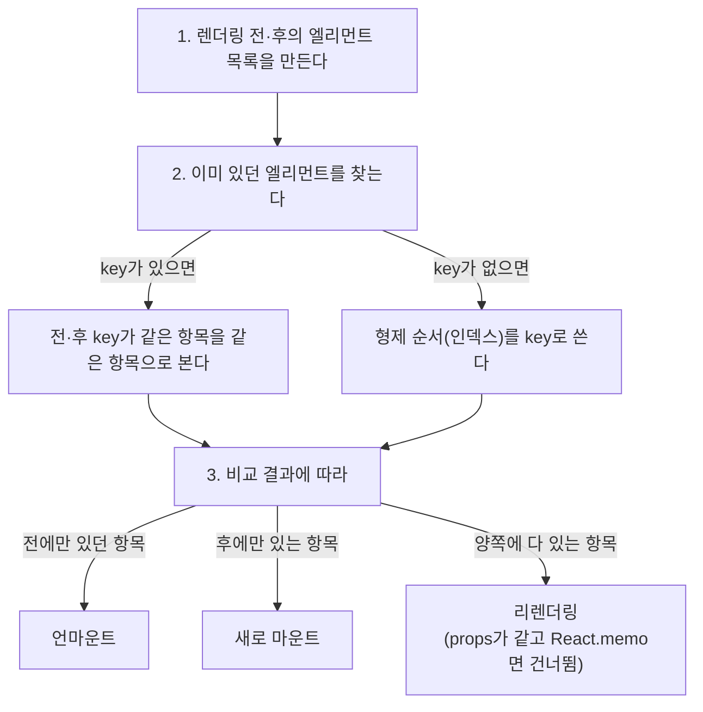

> 개인 TIL을 바탕으로, key가 없을 때의 갱신 방식은 벨로퍼트의 「[벨로퍼트와 함께하는 모던 리액트](https://react.vlpt.us/)」 중 「[배열 렌더링하기](https://react.vlpt.us/basic/11-render-array.html)」를 바탕으로 보강했다.

목록을 그릴 때는 JavaScript 배열의 `map()`으로 각 데이터를 엘리먼트로 바꿔 반환한다. 이때 각 항목에는 **key**를 줘야 한다. key는 React가 리렌더링 때 "어떤 항목이 추가·삭제·이동되었는지"를 알아내는 이름표다.

## map으로 여러 컴포넌트 렌더링

```javascript
const numbers = [1, 2, 3, 4, 5]
const doubled = numbers.map((number) => number * 2) // [2, 4, 6, 8, 10]
```

같은 방식으로 데이터를 엘리먼트로 바꾼다.

```jsx
function NumberList({ numbers }) {
  const listItems = numbers.map((number) => (
    <li key={number.toString()}>{number}</li>
  ))
  return <ul>{listItems}</ul>
}

const root = createRoot(document.getElementById('root'))
root.render(<NumberList numbers={[1, 2, 3, 4, 5]} />)
```

JSX 안에서 바로 쓰는 경우가 더 흔하다.

```jsx
function TodoList({ todos }) {
  return (
    <ul>
      {todos.map((todo) => (
        <li key={todo.id}>{todo.title}</li>
      ))}
    </ul>
  )
}
```

## Key

- 형제 항목 사이에서 **고유하고 안정적인** 값이어야 한다(전체 앱에서 고유할 필요는 없다).
- key가 없으면 콘솔에 경고가 뜬다. React Native에서도 마찬가지다.
- 가장 좋은 key는 데이터의 **id**다.
- 형제 사이에 **같은 key가 두 번** 나오면 콘솔 오류가 나고, React가 어느 쪽을 갱신할지 헷갈려 항목이 중복되거나 사라진다.

key가 없으면 `[a, b, c, d]`의 b와 c 사이에 z를 넣을 때 React는 자리(인덱스)로 비교한다. 그래서 「c 자리를 z로, d 자리를 c로 바꾸고 끝에 d를 새로 붙이는」 식으로 뒤쪽 항목을 전부 고친다. key가 있으면 기존 항목은 그대로 두고 z만 끼워 넣는다.


### 인덱스를 key로 쓰면 안 되는 이유

`map((item, index) => <li key={index}>)`는 항목이 추가·삭제·정렬되면 같은 인덱스가 다른 데이터를 가리키게 된다. React는 key가 같으면 같은 컴포넌트로 보고 재사용하므로, 입력창 값이나 내부 state가 엉뚱한 항목에 붙는 버그가 생긴다. 목록의 개수와 순서가 바뀌지 않는 정적 목록에서는 인덱스를 써도 문제없다. 반대로 목록을 통째로 바꾸는 경우에는 인덱스가 더 빠를 때도 있다(아래 「key가 성능에 미치는 영향」).

마찬가지로 `Math.random()`처럼 렌더링마다 바뀌는 값을 key로 쓰면 매번 모든 항목을 새로 만든다. 고유 id는 **데이터를 만들 때 한 번** 생성해 저장한다(예: `{ text, id: crypto.randomUUID() }`).

### key는 map을 호출하는 곳에

key는 배열을 만드는 위치의 엘리먼트에 준다. 항목을 컴포넌트로 뽑았다면 그 컴포넌트 **안의** `<li>`가 아니라, `map` 안의 `<ListItem key={...} />`에 준다. key는 props로 전달되지 않으므로 자식에서 id가 필요하면 따로 넘긴다.

```jsx
{todos.map((todo) => (
  <TodoItem key={todo.id} id={todo.id} title={todo.title} />
))}
```

## key가 성능에 미치는 영향

> 이 절은 Nadia Makarevich의 「[React key attribute: best practices for performant lists](https://www.developerway.com/posts/react-key-attribute)」(2022.05)를 요약·재구성했다.

### 리렌더링 때 key가 쓰이는 방식

key는 **리렌더링 때, 같은 타입의 형제 엘리먼트 사이에서만** 쓰인다. 즉 평평한 목록에서만 의미가 있다.



**리마운트는 리렌더링보다 훨씬 비싸다.** 컴포넌트를 버리고 처음부터 다시 만들기 때문이다.

### key 값에 따라 일어나는 일

| key | 목록 모양 | 결과 |
| --- | --- | --- |
| 없음 (= 인덱스) | 정적 | 모든 항목이 리렌더링. `React.memo`로 막을 수 있다 |
| `Math.random()` | 아무거나 | 매 렌더링마다 key가 새로워져 **모든 항목이 언마운트 후 다시 마운트**. `memo`도 소용없다 |
| 인덱스 | 정렬·중간 삽입 | key 0번은 늘 첫 항목이라, React는 "같은 항목인데 props만 바뀌었다"고 본다. `memo`를 뚫고 **모든 항목이 리렌더링**되고, 항목의 **state가 엉뚱한 데이터에 남는다** (첫 항목을 선택하고 정렬하면 선택이 그대로 첫 자리에 남음) |
| id | 정렬·중간 삽입 | 항목을 정확히 알아본다. `memo`된 항목은 리렌더링되지 않고, 새 항목만 마운트된다 |
| id | 페이지 전환처럼 **통째로 교체** | 새 페이지의 id가 전부 처음 보는 값이라 **목록 전체가 리마운트** |
| 인덱스 | 페이지 전환처럼 **통째로 교체** | 기존 컴포넌트를 그대로 두고 새 데이터로 리렌더링만 한다. **id보다 빠르다** |

### 인덱스 key가 오히려 나은 경우

페이지네이션 목록, 검색 결과, 자동 완성, 페이지가 있는 표처럼 **같은 크기의 목록을 새 데이터로 통째로 바꾸는** 경우다. 항목 컴포넌트가 무거울수록 차이가 크다. 단, 항목에 **state가 없거나**, state가 props와 동기화돼 있어야 한다. 아니면 위 표의 "state가 엉뚱한 데이터에 남는" 버그가 그대로 생긴다.

## 핵심 정리

- 목록은 `map()`으로 엘리먼트 배열을 만든다.
- key는 형제 사이에서 고유하고 변하지 않는 값(데이터 id). 랜덤 값은 매번 리마운트를 일으키니 쓰지 않는다.
- 인덱스 key는 정적 목록에선 무해하고, 정렬·삽입되는 목록에선 버그와 불필요한 리렌더링을 만든다. 상태 없는 항목을 통째로 바꾸는 목록(페이지네이션·검색 결과)에선 오히려 빠르다.
- key는 `map` 안의 최상위 엘리먼트에 준다.

관련 노트: [[re-rendering|리렌더링 원인과 추적]], [[state|State와 useState]]
