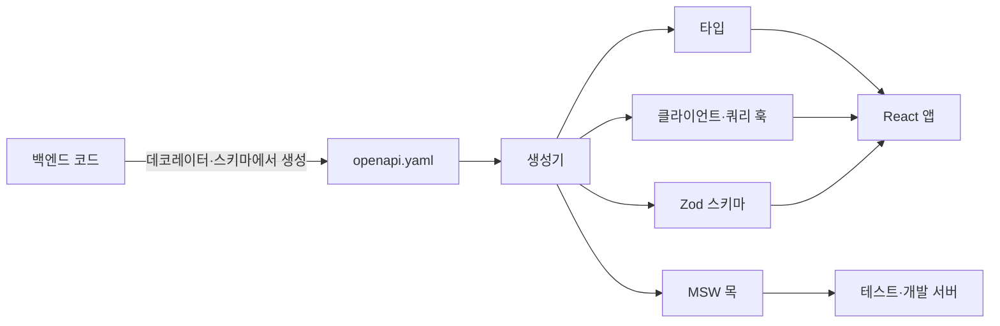
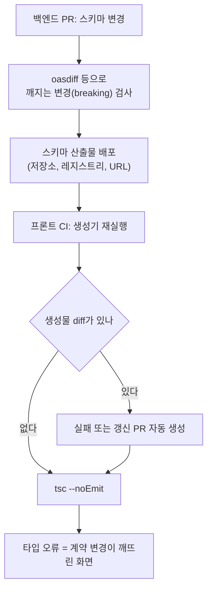

> Evil Martians의 「[Life's too short to hand-write API types: OpenAPI-driven React](https://evilmartians.com/chronicles/lifes-too-short-to-hand-write-api-types-openapi-driven-react)」(2026.02, 한국어 번역 「[API 타입을 직접 손으로 쓰기엔 인생이 너무 짧습니다](https://medium.com/@junghan92/번역-api-타입을-직접-손으로-쓰기엔-인생이-너무-짧습니다-openapi-기반의-리액트-4dca3cfa1721)」)을 바탕으로, 도구 사용법은 openapi-typescript·Hey API·Orval 공식 문서로 확인해 재구성한 노트다.

## 왜 생성하나

프론트엔드가 API 응답 타입을 손으로 쓰면 세 가지가 어긋난다.

| 문제 | 결과 |
| --- | --- |
| 백엔드가 필드를 바꿔도 프론트 타입은 그대로다 | 타입 검사는 통과하고 운영에서 `undefined`가 터진다 |
| 타입은 컴파일 때만 있다 | 서버가 실제로 보낸 값이 타입과 다른지 아무도 확인하지 않는다 |
| fetch 래퍼를 엔드포인트마다 복사한다 | 경로·쿼리 파라미터·인증 헤더 처리가 화면마다 조금씩 다르다 |

이 어긋남을 **계약 드리프트(contract drift)** 라고 한다. 해법은 백엔드가 내는 **OpenAPI 스키마를 단일 출처(source of truth)** 로 두고 타입과 클라이언트를 기계로 만드는 것이다. 그러면 계약이 바뀌었을 때 **운영 오류가 빌드 오류로 바뀐다.** 손으로 쓰는 타입은 컴포넌트 props, 폼 상태, UI 플래그처럼 화면에만 있는 것으로 줄어든다.



백엔드에서 스키마를 만드는 쪽은 [[swagger|Swagger로 API 문서화]]에, REST·GraphQL·gRPC가 계약을 다루는 방식의 차이는 [[api-architectural-styles|API 아키텍처 스타일]]에 있다.

## 도구 고르기

| 도구 | 생성하는 것 | 성격 |
| --- | --- | --- |
| **openapi-typescript** + **openapi-fetch** | 타입 파일 하나(`paths`, `components`)와, 그 타입을 읽는 얇은 `fetch` 래퍼 | 런타임 코드가 거의 없다. 엔드포인트가 늘어도 번들이 커지지 않는다 |
| **openapi-react-query** | openapi-fetch 클라이언트를 TanStack Query 훅으로 감싼다 | 위 조합에 쿼리 훅만 더한다 |
| **Hey API** (`@hey-api/openapi-ts`) | 타입, 엔드포인트별 SDK 함수, 플러그인으로 Zod 스키마·TanStack Query 옵션 등 | 플러그인을 골라 필요한 산출물만 만든다 |
| **Orval** | 타입, 클라이언트 함수, React Query·SWR 훅, MSW 목 핸들러 | 설정 하나로 훅과 목까지 한 번에 만든다 |

**경로 문자열을 그대로 쓰고 싶으면** openapi-fetch, **엔드포인트마다 이름 붙은 함수를 원하면** Hey API·Orval이다. 생성 코드가 많을수록 편하지만 저장소 diff와 번들도 커진다.

## openapi-typescript + openapi-fetch

```bash
npm i openapi-fetch openapi-react-query
npm i -D openapi-typescript typescript
npx openapi-typescript ./openapi.yaml -o ./src/api/schema.d.ts
```

```tsx
import createFetchClient from 'openapi-fetch'
import createClient from 'openapi-react-query'
import type { paths, components } from './api/schema'

export type Hotel = components['schemas']['Hotel'] // 도메인 타입도 스키마에서 꺼낸다

const fetchClient = createFetchClient<paths>({ baseUrl: 'https://api.example.com/v1/' })

// 경로·메서드·파라미터가 모두 스키마로 검사된다
const { data, error } = await fetchClient.GET('/hotels/{hotelId}', {
  params: { path: { hotelId: '42' } },
})

// TanStack Query 훅으로
export const $api = createClient(fetchClient)

function HotelDetail({ id }: { id: string }) {
  const { data, isLoading } = $api.useQuery('get', '/hotels/{hotelId}', {
    params: { path: { hotelId: id } },
  })
  if (isLoading || !data) return 'Loading...'
  return <h1>{data.name}</h1>
}
```

없는 경로를 쓰거나, 필수 파라미터를 빠뜨리거나, 응답에 없는 필드를 읽으면 타입 오류가 난다. 공식 문서는 `noUncheckedIndexedAccess`를 함께 켜기를 권한다.

## Hey API: SDK와 Zod

```typescript
// openapi-ts.config.ts
import { defineConfig } from '@hey-api/openapi-ts'

export default defineConfig({
  input: './openapi.yaml',
  output: 'src/api',
  plugins: ['zod', { name: '@hey-api/sdk' }],
})
```

`npx openapi-ts`가 `types.gen.ts`, `sdk.gen.ts`, `zod.gen.ts`를 만든다. 화면에서는 `getHotels({ query: { page: 1 } })`처럼 함수를 부르고, 폼은 생성된 Zod 스키마를 그대로 검증에 쓴다(`zodResolver(zHotelUpsert)`). 선택지 목록도 `zHotelStatus.options`처럼 계약에서 꺼내므로 백엔드가 상태 값을 늘리면 화면도 따라온다. TanStack Query 플러그인을 더하면 SDK 함수마다 `queryOptions`가 생겨 `useQuery(getHotelsOptions(...))`로 쓴다. 키·함수를 한곳에 모으는 `queryOptions`의 의미는 [[tanstack-query|TanStack Query]]에 있다.

## 타입은 런타임을 지키지 않는다

생성된 타입은 「서버가 스키마대로 보낸다」는 **가정**이다. 스키마가 실제 구현과 다르거나, 배포 순서가 어긋나 옛 서버가 응답하면 타입은 맞는데 값이 다르다.

| 방어 | 방법 |
| --- | --- |
| 응답 검증 | 생성된 Zod 스키마로 경계(클라이언트 함수)에서 `parse`한다. 비용이 드니 핵심 응답이나 개발 환경에 우선 건다 |
| 스키마를 구현에서 생성 | 백엔드가 손으로 쓴 YAML이 아니라 코드(데코레이터, 라우트 정의)에서 스키마를 뽑아야 스키마 자체가 거짓말하지 않는다 |
| 계약 기반 목 | 같은 스키마에서 MSW 핸들러를 만들거나 경로를 스키마 타입으로 검사해, 목이 실제 API와 어긋나지 않게 한다([[api-mocking\|API 모킹]]) |

## CI에서 드리프트 잡기



```json
{
  "scripts": {
    "api:gen": "openapi-typescript ./openapi.yaml -o ./src/api/schema.d.ts",
    "api:check": "npm run api:gen && git diff --exit-code src/api"
  }
}
```

| 결정 | 선택지 |
| --- | --- |
| 생성물을 커밋하나 | 커밋하면 리뷰에서 API 변화가 diff로 보이고 빌드가 생성기에 덜 의존한다. 안 하면 저장소가 가볍지만 빌드마다 생성해야 한다 |
| 스키마를 어디서 가져오나 | 같은 모노레포의 파일이 가장 단순하다. 원격 URL이면 버전을 고정해 빌드가 재현되게 한다 |
| 깨지는 변경을 누가 막나 | 백엔드 CI에서 이전 스키마와 비교해 필드 삭제·타입 변경을 막고, 프론트 CI는 재생성 후 타입 검사로 영향을 드러낸다 |

## 정리

- 손으로 쓴 API 타입은 반드시 어긋난다. OpenAPI 스키마를 단일 출처로 두고 생성한다.
- 가볍게는 openapi-typescript + openapi-fetch(+ openapi-react-query), 함수형 SDK·Zod·목까지는 Hey API나 Orval.
- 타입은 컴파일 때만 지킨다. 런타임은 생성된 Zod로 경계에서 검증하고, 스키마는 구현에서 뽑는다.
- CI에서 재생성 → diff → `tsc`로 계약 변경을 빌드 실패로 바꾸고, 백엔드 쪽에서는 깨지는 변경을 먼저 막는다.

관련 노트: [[tanstack-query|TanStack Query(React Query)]], [[api-mocking|API 모킹: MSW와 json-server]], [[swagger|Swagger로 API 문서화]], [[api-architectural-styles|API 아키텍처 스타일]]
