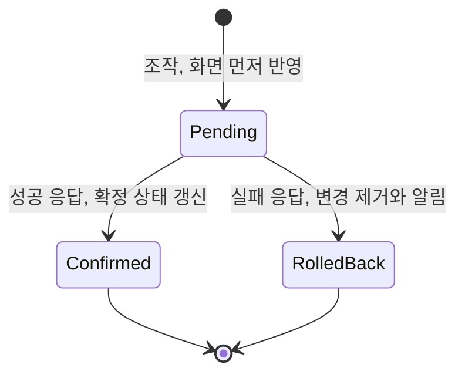

> React Digest(RD#542)가 소개한 Colum Kelly의 「[useOptimistic Won't Save You](https://www.columkelly.com/blog/use-optimistic)」(2026.01)를 바탕으로, 훅의 동작은 React 공식 문서([useOptimistic](https://react.dev/reference/react/useOptimistic), [useActionState](https://react.dev/reference/react/useActionState))로 확인해 재구성한 노트다.

## 낙관적 UI란

**낙관적 UI(optimistic UI)는 사용자의 조작을 서버가 확인하기 전에 성공했다고 가정하고 화면에 먼저 반영하는 기법이다.** 실제 요청은 뒤에서 진행되고, 실패하면 되돌린다. 화면의 반응 속도를 네트워크 지연과 떼어 놓는 것이 목적이다. 좋아요 버튼, 할 일 체크, 채팅 메시지 전송, 목록 순서 바꾸기가 대표적이다.

### 언제 쓰고 언제 쓰지 않나

| 낙관적으로 해도 된다 | 확인을 기다린다 |
| --- | --- |
| 거의 항상 성공한다 (좋아요, 체크, 즐겨찾기) | 실패가 흔하다 (재고·중복 검사, 권한 검사가 자주 걸림) |
| 실패해도 되돌리면 그만이다 | 되돌릴 수 없거나 돈이 오간다 (결제, 송금, 발송) |
| 결과를 클라이언트가 정확히 예측할 수 있다 | 결과를 서버만 안다 (서버가 계산하는 가격, 생성되는 번호) |
| 틀린 값이 잠깐 보여도 해가 없다 | 틀린 값을 보고 사용자가 다음 결정을 내린다 |

확인을 기다리는 쪽은 낙관적 UI 대신 대기 표시(버튼 비활성, 진행 표시)로 빠르게 느끼게 한다([[loading-ui|로딩 UI]]).

## 모델: 확정 상태 + 진행 중인 변경

낙관적 UI를 버그 없이 만들려면 상태를 둘로 나눠 생각한다.

- **확정 상태**: 서버가 마지막으로 알려 준 값.
- **진행 중인 변경**: 보냈지만 아직 답을 받지 못한 조작들.

**화면에 보이는 값 = 확정 상태에 진행 중인 변경을 순서대로 적용한 결과**다. 응답이 오면 그 변경을 목록에서 빼고 확정 상태를 갱신한다. 실패하면 그 변경만 빼면 되므로 되돌리기가 저절로 된다. 화면 값을 따로 들고 손으로 덮어쓰기 시작하면 아래 문제가 생긴다.



## 어려운 부분: 순서와 동기화

| 증상 | 원인 | 해결 |
| --- | --- | --- |
| 좋아요를 빠르게 여러 번 누르면 최종 상태가 운에 달린다 | 요청 A·B가 병렬로 가고, 늦게 보낸 B의 응답이 먼저 오면 A의 응답이 B를 덮는다 | 최신 요청의 응답만 반영하거나, 요청을 한 줄로 세운다 |
| 응답이 올 때마다 화면이 앞뒤로 깜빡인다 | 매 응답으로 화면 값을 덮어써서, 아직 진행 중인 뒤 조작이 잠깐 사라진다 | 화면 값은 「확정 + 진행 중」으로 계산하고, 응답은 확정 상태에만 쓴다 |
| 깜빡임을 없애려고 응답 반영을 지웠더니, 한 번 어긋나면 새로 고침 전까지 안 맞는다 | 서버 값과 다시 맞추는 길이 없어졌다 | 모든 조작이 끝난 뒤 서버 값으로 재검증(refetch·invalidate)한다 |
| 버린 요청은 성공했는데 마지막 요청이 실패해 화면과 서버가 다르다 | 「최신만 반영」은 앞 요청의 결과를 모른다 | 실패 시 이전 화면 값이 아니라 **서버의 현재 값**으로 되돌린다(재조회) |
| 두 탭·두 사용자가 같은 값을 바꿔 서로 덮는다 | 나중 쓰기가 이긴다(lost update) | 서버에서 버전·`ETag`로 충돌을 감지한다([[rest-api\|REST API 설계]]) |

**토글 대신 원하는 최종 값을 보낸다.** `POST /toggle-like`는 같은 요청이 두 번 처리되면 결과가 뒤집힌다. `PUT /likes/:postId { liked: true }`처럼 원하는 상태를 보내면 요청이 멱등해져, 재시도나 순서 뒤바뀜에도 마지막으로 보낸 값이 곧 의도한 값이 된다.

**새로 만드는 항목은 임시 ID로 그린다.** 서버가 ID를 주기 전에는 클라이언트 생성 ID(`crypto.randomUUID()`)로 그리고, 응답이 오면 진짜 항목으로 바꾼다. 서버가 그 ID를 그대로 받아 쓰면 바꿔 끼울 필요도 없다.

**취소는 해결책이 아니다.** `AbortController`로 앞 요청을 끊어도 이미 서버에 도착한 변경은 취소되지 않는다. 읽기 요청에는 맞지만 변경 요청에는 「응답을 무시한다」 이상의 의미가 없다.

### 최신 요청만 반영하기 (수동)

```jsx
function LikeButton({ postId, initialLiked }) {
  const [serverLiked, setServerLiked] = useState(initialLiked)
  const [liked, setLiked] = useState(initialLiked)
  const latest = useRef(0)

  async function handleClick() {
    const next = !liked
    const id = ++latest.current
    setLiked(next) // 낙관적 반영
    try {
      const res = await putLike(postId, next) // 원하는 최종 값을 보낸다
      if (id === latest.current) {
        setServerLiked(res.liked)
        setLiked(res.liked)
      }
    } catch {
      if (id === latest.current) setLiked(serverLiked) // 마지막 요청이 실패했을 때만 되돌린다
    }
  }

  return <button aria-pressed={liked} onClick={handleClick}>좋아요</button>
}
```

동작은 하지만 상태 두 개와 ref, 조건문이 컴포넌트마다 반복된다. 앞 요청이 성공하고 마지막이 실패하면 여전히 어긋나므로 실패 뒤 재조회가 필요하다.

## useOptimistic이 하는 일과 하지 않는 일

```javascript
const [optimisticState, setOptimistic] = useOptimistic(value, reducer) // reducer는 생략할 수 있다
```

`value`는 확정 상태다. **Action(전환)이 진행 중일 때만** `optimisticState`가 `setOptimistic`으로 준 값(또는 `reducer` 결과)이 되고, 전환이 끝나면 다시 `value`를 보여 준다. 위 「확정 + 진행 중」 모델을 React가 들고 있는 셈이다.

| 해 주는 것 | 해 주지 않는 것 |
| --- | --- |
| 전환이 끝나면 낙관적 값을 자동으로 거둔다. 실패해서 부모가 `value`를 바꾸지 않았다면 이전 화면으로 돌아간다 | **요청 순서를 보장하지 않는다.** 공식 문서도 전환 안의 Action은 실행 순서를 보장하지 않는다고 적는다 |
| 성공하면 낙관적 값과 확정 값이 같은 렌더에서 합쳐져 깜빡임이 없다 | 뒤늦게 온 오래된 응답을 걸러 주지 않는다 |
| 진행 중에 `value`가 바뀌면 `reducer`를 새 `value`로 다시 돌려, 낙관적 추가가 최신 데이터 위에 얹힌다 | 서버 재검증, 오류 알림, 재시도를 대신하지 않는다 |

쓸 때 지킬 규칙:

- `setOptimistic`은 **Action 안**(`startTransition` 콜백, `<form action>`, `useActionState`의 액션)에서 부른다. 밖에서 부르면 경고가 나고 낙관적 값이 잠깐 보였다 사라진다.
- `setOptimistic(5)`처럼 절대값을 주면 그사이 바뀐 `value`를 무시한다. 상대 변경(개수 +1, 항목 추가)은 `reducer`로 표현해야 최신 `value`에 다시 적용된다. 업데이터 함수(`prev => ...`)는 전환이 시작된 시점의 상태만 본다.
- 관련된 값(팔로우 여부와 팔로워 수)은 한 `reducer`로 함께 바꿔 어긋나지 않게 한다.

결국 useOptimistic만으로는 위 수동 코드의 경쟁 상태가 그대로 남는다. 훅은 「진행 중 값을 보여 주고 끝나면 거둔다」만 맡는다.

## 순서를 맞추는 방법: useActionState와 함께 쓰기

`useActionState`는 `dispatch`를 여러 번 부르면 **큐에 넣고 차례로 실행**하며, 앞 호출의 결과를 다음 호출의 `previousState`로 넘긴다. 순서 문제를 React가 맡게 하는 가장 간단한 방법이다.

```jsx
import { startTransition, useActionState, useOptimistic } from 'react'

function LikeButton({ postId, initialLiked }) {
  const [liked, dispatch] = useActionState(async (prev, next) => {
    try {
      const res = await putLike(postId, next)
      return res.liked // 확정 상태
    } catch {
      return prev // 실패: 확정 상태 유지, 낙관적 값은 전환이 끝나며 사라진다
    }
  }, initialLiked)
  const [optimisticLiked, setOptimisticLiked] = useOptimistic(liked)

  function handleClick() {
    startTransition(() => {
      setOptimisticLiked(!optimisticLiked)
      dispatch(!optimisticLiked)
    })
  }

  return <button aria-pressed={optimisticLiked} onClick={handleClick}>좋아요</button>
}
```

- 요청이 한 줄로 서므로 마지막 클릭이 마지막에 처리된다. 대신 빠르게 다섯 번 누르면 요청 다섯 개를 차례로 기다린다. 큐가 길어질 수 있는 조작은 클릭을 디바운스하거나 큐를 취소하는 설계를 따로 둔다.
- 액션에서 던진 오류는 에러 바운더리로 가므로, 되돌리기만 할 실패는 안에서 잡아 이전 상태를 돌려주고 사용자에게 알린다.

서버 상태 라이브러리를 쓰면 같은 일을 캐시 단위로 한다. TanStack Query는 `onMutate`에서 진행 중인 재조회를 취소하고 스냅숏을 떠 캐시를 먼저 바꾼 뒤, 실패하면 스냅숏으로 되돌리고 `onSettled`에서 무효화해 서버와 맞춘다([[tanstack-query#낙관적 업데이트|TanStack Query]]). 같은 `scope.id`를 준 뮤테이션은 차례로 실행된다.

## 실패를 다루는 UX

- 되돌릴 때는 조용히 바꾸지 말고 무엇이 실패했는지 알린다(토스트, 항목 옆 오류 표시).
- 사용자가 입력한 내용(댓글, 메시지)은 지우지 말고 「다시 보내기」를 둔다.
- 진행 중인 항목은 반투명이나 작은 표시로 구분해, 아직 확정되지 않았음을 드러낸다. 「보냈다」고 믿고 창을 닫는 사용자를 위해 떠나기 전 경고도 고려한다.

## 정리

- 화면 값은 「확정 상태 + 진행 중인 변경」으로 계산한다. 화면 값을 응답으로 덮어쓰지 않는다.
- 어려운 것은 되돌리기가 아니라 순서다. 최신 요청만 반영하거나, 요청을 큐로 세우거나, 원하는 최종 값을 멱등하게 보낸다.
- 모든 조작이 끝나면 서버 값으로 재검증하고, 실패 뒤에는 서버의 현재 값으로 맞춘다.
- `useOptimistic`은 진행 중 값을 보여 주고 끝나면 거두는 도구일 뿐, 순서를 맞추지 않는다. 순서는 `useActionState`의 큐나 데이터 라이브러리에 맡긴다.
- 실패가 흔하거나 되돌릴 수 없는 조작은 낙관적으로 하지 않는다.

관련 노트: [[forms|폼과 제어 컴포넌트]], [[concurrent-rendering|동시성 렌더링]], [[tanstack-query|TanStack Query]], [[hooks|React Hooks]], [[ui-engineering-problems|UI 엔지니어링의 열두 가지 문제]], [[distributed-data-patterns|데이터 관리 패턴]]
