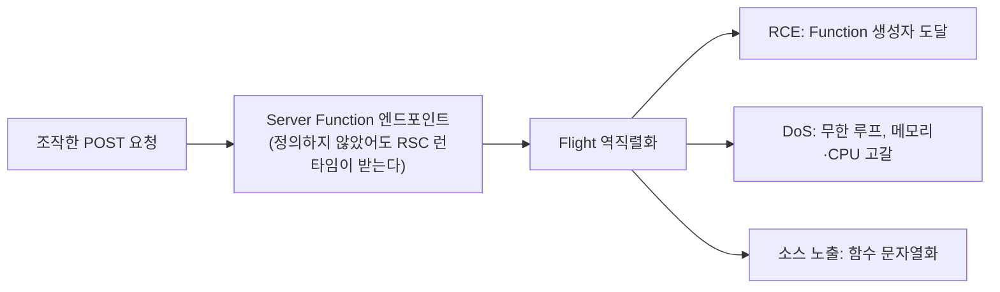

> React Digest(RD#535 「Critical vulnerabilities in React and Next.js」, RD#537 「Lessons learned from React's vulnerabilities」)와 Korean FE Article의 번역 「(번역) 리액트 애플리케이션의 보안」(2026.07, 원문 Aurora Scharff의 「[Security in React Applications](https://certificates.dev/blog/security-in-react-applications)」, 2026.05)을 바탕으로, 취약점 번호·버전은 [React 공식 블로그](https://react.dev/blog/2025/12/03/critical-security-vulnerability-in-react-server-components)와 [Next.js 보안 공지](https://nextjs.org/blog/nextjs-security-update-october-14-2026), 방어 규칙은 [Next.js 데이터 보안 가이드](https://nextjs.org/docs/app/guides/data-security)로 확인해 재구성한 노트다.

## 무엇이 달라졌나

클라이언트만 있는 React 앱의 공격 면은 브라우저였다. 서버 컴포넌트(RSC)와 Server Function(`'use server'`)이 들어오면서 **프론트엔드 코드가 서버에서 돌고, 누구나 호출할 수 있는 HTTP 엔드포인트를 갖게 됐다.**

| 새로 생긴 것 | 보안상 의미 |
| --- | --- |
| Server Function | `'use server'` 함수마다 `POST` 엔드포인트가 생긴다. 앱 UI를 거치지 않고 직접 호출할 수 있다 |
| Flight 프로토콜 | 서버와 클라이언트가 컴포넌트 트리·Promise·함수 참조·인자를 주고받는 직렬화 형식이다([[react-server-components\|React Server Components의 동작 원리]]). 클라이언트가 보낸 인자를 서버가 **역직렬화**한다 |
| 서버 컴포넌트의 직접 데이터 접근 | 컴포넌트가 DB·비밀값에 바로 닿으므로, props로 넘기는 값 하나가 곧 클라이언트 노출이다 |
| 클로저 캡처 | 컴포넌트 안에 정의한 Server Action이 바깥 변수를 캡처하면 그 값이 클라이언트를 왕복한다 |

## React2Shell과 이어진 RSC 취약점

### 무슨 일이 있었나

**React2Shell(CVE-2025-55182, CVSS 10.0)** 은 2025년 12월 3일 공개된 인증 없는 원격 코드 실행(RCE) 취약점이다. React가 Server Function 엔드포인트로 온 페이로드를 디코딩하는 과정에 결함이 있어, 조작한 HTTP 요청 하나로 서버에서 임의 코드를 실행할 수 있었다. Promise 직렬화, 청크 참조, `__proto__` 접근을 엮어 `Function` 생성자에 닿는 방식이다. **Server Function을 하나도 정의하지 않았어도 RSC를 지원하는 프레임워크를 쓰면 영향을 받았고**, 기본 설정으로 만든 Next.js 앱도 해당됐다.

| 영향 범위 | 내용 |
| --- | --- |
| 패키지 | `react-server-dom-webpack`, `react-server-dom-parcel`, `react-server-dom-turbopack` |
| 프레임워크·번들러 | next, react-router, waku, @parcel/rsc, @vitejs/plugin-rsc, rwsdk |
| 영향 없음 | 서버가 없는 앱, RSC를 지원하는 프레임워크·번들러 플러그인을 쓰지 않는 앱 |

패치를 분석하던 연구자들이 같은 역직렬화 경로에서 후속 취약점을 계속 찾아냈다.

| 공개 | 번호 | 종류 |
| --- | --- | --- |
| 2025.12.03 | CVE-2025-55182 (React2Shell) | RCE, Critical (10.0) |
| 2025.12.11 | CVE-2025-55184, CVE-2025-67779 | 역직렬화 무한 루프로 인한 서비스 거부(DoS), High (7.5). 67779는 55184의 불완전한 수정을 보완한 것 |
| 2025.12.11 | CVE-2025-55183 | Server Function 소스 코드 노출, Medium (5.3). 인자를 문자열로 바꾸는 Server Function이 있으면 그 함수의 소스가 응답에 실려 나간다. 코드에 하드코딩한 비밀값만 새고 `process.env` 값은 안전하다 |
| 2026.01.26 | CVE-2026-23864 | 여러 DoS(크래시, 메모리 부족, CPU 과다), High (7.5) |
| 2026.04, 2026.05 | CVE-2026-23869, CVE-2026-23870 | Server Function 엔드포인트 대상 DoS. 23870은 23869 수정본의 우회 |
| 2026.10.14 | GHSA-xqc2-xf4c-x3h3 (React), GHSA-673q-mjm6-r5xr (Next.js) | 같은 버퍼를 공유하는 큰 typed array 여러 개를 직렬화할 때 Flight 스트림 경계가 어긋나, 공격자 바이트가 Server Action 호출로 해석되는 RCE, Critical. Next.js에서는 Cache Components의 `'use cache'` 함수가 typed array를 여러 개 돌려줄 때 해당 |

2026.10.14 RCE를 고친 버전은 `react-server-dom-*` **19.0.9, 19.1.10, 19.2.9, 19.3.1**이고, Next.js는 **16.4.1(16.x), 15.5.28(15.5.x)** 이다. Next.js는 2026년 7월부터 정기 보안 릴리스를 내므로 이 버전에 멈추지 말고 최신 보안 릴리스를 따라간다(2026년 11월 기준 최신은 11월 3일의 16.4.5, 15.5.29로, `use cache` 캐시 누출 문제들을 고쳤다). Next.js는 RSC 패키지를 자기 안에 컴파일해 넣어 두므로 **React만 올려서는 고쳐지지 않고 Next.js 자체를 올려야 한다.**



### 교훈

- **역직렬화는 늘 위험 지점이다.** Flight는 값뿐 아니라 Promise, 참조, 함수 같은 「동작」까지 넓게 직렬화한다. 다른 언어에서 반복된 역직렬화 취약점(Java 직렬화, Python pickle)과 같은 모양이다. 프레임워크가 해 주는 일이라도 공격 면이라는 사실은 남는다.
- **패치는 한 번으로 끝나지 않는다.** 큰 취약점이 나면 같은 코드 경로에서 후속 CVE가 몇 달씩 이어진다. 공지 구독, 의존성 자동 업데이트(Dependabot·Renovate), 잠금 파일 감사(`npm audit`)를 평소에 돌려 둔다. 호스팅 사업자의 WAF 차단 규칙에 기대지 말고 직접 올린다.
- **런타임으로 피해를 줄인다.** Node.js의 `--disallow-code-generation-from-strings`는 `eval`·`new Function`처럼 문자열에서 코드를 만드는 것을 막아 React2Shell 같은 체인을 끊는다. `--disable-proto=delete`는 `__proto__` 접근을 없앤다. 일부 라이브러리를 깨뜨릴 수 있으니 회귀 테스트와 함께 켜고, 배포 환경에서 실제로 켜져 있는지 확인한다.
- 사고 대응 절차(공지 확인 → 영향 판정 → 패치 → 침해 흔적 점검)는 [[devsecops|DevSecOps와 클라우드 보안]]에 있다.

## Server Function은 공개 API다

`'use server'` 함수는 import하지 않는 곳에서도 **직접 `POST`로 부를 수 있는 엔드포인트**다. 페이지에서 로그인 검사를 했어도 그 페이지 안에 정의한 Server Action은 별도의 입구다.

| 규칙 | 이유 | 예 |
| --- | --- | --- |
| 액션 안에서 인증한다 | 페이지의 `redirect`는 어떤 UI를 그릴지만 정한다 | 액션 첫 줄에서 `const session = await auth()` |
| 인가도 한다 | 로그인했다고 남의 자원을 지워도 되는 것은 아니다(IDOR) | `post.authorId !== session.user.id`면 거부 |
| 입력을 스키마로 검증한다 | 클라이언트 검증은 UX일 뿐, 인자는 얼마든지 바꿔 보낼 수 있다 | Zod `safeParse`로 `FormData` 검증 |
| 쿼리는 매개변수화한다 | 문자열로 이어 붙이면 SQL 인젝션 | ORM, 값을 자동으로 바인딩하는 태그드 템플릿 SQL, `$1` 자리표시자 |
| 반환값을 줄인다 | 반환값은 직렬화돼 클라이언트로 간다 | DB 레코드 대신 `{ success: true }` |
| 비싼 작업에 속도 제한 | 공개 엔드포인트라 반복 호출에 노출된다 | 메일 발송·쓰기 작업에 rate limit |
| 비밀값을 클로저에 담지 않는다 | 캡처한 변수는 암호화돼 왕복하지만, 암호화에만 기대지 않는다 | 필요한 값은 액션 안에서 다시 읽는다 |

```typescript
'use server'
import { z } from 'zod'
import { auth } from '@/lib/auth'
import { db } from '@/lib/db'

const schema = z.object({ postId: z.string().uuid(), title: z.string().min(1).max(200) })

export async function renamePost(formData: FormData) {
  const session = await auth()
  if (!session?.user) throw new Error('Unauthorized')

  const parsed = schema.safeParse({
    postId: formData.get('postId'),
    title: formData.get('title'),
  })
  if (!parsed.success) return { ok: false as const }

  const post = await db.post.findUnique({ where: { id: parsed.data.postId } })
  if (!post || post.authorId !== session.user.id) throw new Error('Forbidden')

  await db.post.update({ where: { id: post.id }, data: { title: parsed.data.title } })
  return { ok: true as const } // 레코드 전체를 돌려주지 않는다
}
```

Next.js가 기본으로 더해 주는 방어:

- Server Action은 `POST`로만 호출되고, **`Origin` 헤더를 `Host`(또는 `X-Forwarded-Host`)와 비교해 다르면 중단**한다. 같은 호스트에서만 부를 수 있어 CSRF 대부분이 막힌다. 프록시 뒤라 호스트가 다르면 `experimental.serverActions.allowedOrigins`에 신뢰할 호스트를 적는다.
- 액션 ID는 암호화된 비결정적 값이고 빌드마다 다시 만들어진다. 쓰지 않는 액션은 빌드에서 제거돼 엔드포인트가 생기지 않는다.
- 클로저로 캡처한 변수는 빌드마다 새 키로 암호화된다. 여러 서버에 직접 배포하면 `NEXT_SERVER_ACTIONS_ENCRYPTION_KEY`로 키를 맞춘다.

이 장치들은 인증이 빠졌을 때의 피해를 줄일 뿐이다. **모든 액션은 직접 호출될 수 있다고 보고 안에서 검사한다.** 렌더링 중에 쿠키를 지우거나 DB를 바꾸는 부수 효과도 두지 않는다. 변경은 `POST`인 액션으로만 한다.

## 서버에서 클라이언트로 새는 데이터 막기

| 장치 | 하는 일 |
| --- | --- |
| **Data Access Layer(DAL)** | DB·`process.env` 접근을 서버 전용 모듈 하나에 모으고, 인가 검사를 거친 **최소한의 DTO**만 돌려준다. 새 프로젝트에 권장되는 구조다 |
| `import 'server-only'` | 그 모듈을 클라이언트 쪽에서 import하면 빌드가 실패한다 |
| props 타입을 좁게 | 클라이언트 컴포넌트가 `user: User` 전체를 받게 하면 서버 쪽이 레코드를 통째로 넘기기 쉽다. 필요한 필드만 받는 타입으로 만든다 |
| `NEXT_PUBLIC_` 접두사 | 이 접두사가 붙은 환경 변수만 클라이언트 번들에 들어간다. 비밀값에는 절대 붙이지 않는다 |
| taint API | `experimental_taintObjectReference(message, obj)`는 그 객체가 클라이언트 컴포넌트로 넘어가면 오류를 낸다. 원시 비밀값(토큰·키)은 `experimental_taintUniqueValue`로 표시한다 |

taint API는 아직 **실험 기능**이다. 안정 React에는 없고 `react@experimental`이나 Next.js의 `experimental.taint: true`로 켠다. 표시한 **바로 그 객체**만 막으므로 `{...user}`나 `{ ssn: user.ssn }`처럼 복사·파생한 값은 그대로 샌다. DAL에서 걸러 낸 뒤의 추가 안전망으로만 쓴다.

## React 앱의 기본 방어

서버 기능과 별개로 클라이언트 React 앱에서 반복되는 실수다. XSS·CSRF·CSP의 원리와 일반 방어는 [[web-security|웹 보안: CSRF와 XSS]]에 있다.

| 영역 | React에서의 규칙 |
| --- | --- |
| 기본 이스케이프 | JSX의 `{}`에 넣은 문자열은 텍스트로 이스케이프된다. 사용자 입력을 그대로 렌더링해도 태그로 해석되지 않는다 |
| `dangerouslySetInnerHTML` | 이스케이프를 우회한다. 쓸 수밖에 없으면 `DOMPurify.sanitize()`로 정제한 뒤 넣는다. 마크다운은 HTML 문자열이 아니라 React 요소로 변환하는 라이브러리를 쓴다 |
| `javascript:` URL | React 19는 `href` 등에 들어간 `javascript:` URL을 실행되지 않는 값으로 바꿔 막는다(16.9부터 경고). 그래도 사용자가 준 URL은 `http:`·`https:`만 허용하도록 직접 검사한다 |
| 토큰 저장 | `localStorage`·`sessionStorage`의 토큰은 XSS 하나로 탈취된다. `HttpOnly` 쿠키에 둔다([[web-storage\|Web Storage]], [[cookie-session\|쿠키와 세션]]) |
| 쿠키 속성 | `HttpOnly`(JS 접근 차단), `Secure`(HTTPS만), `SameSite=Lax`·`Strict`(다른 사이트 요청에 싣지 않음)를 명시한다 |
| CSRF | 쿠키 인증으로 바꾸면 상태 변경 요청에 CSRF 방어가 필요하다. `SameSite`에 더해 CSRF 토큰이나 `Origin` 검사를 쓴다. 프레임워크 미들웨어가 실제로 켜져 있는지 확인한다 |
| CSP | 요청마다 새 nonce를 만들어 `script-src 'nonce-…' 'strict-dynamic'`으로 허용하고 `'unsafe-inline'`·`'unsafe-eval'`은 빼며, `object-src 'none'`, `frame-ancestors 'none'`(클릭재킹 방지)을 함께 건다. 먼저 `Content-Security-Policy-Report-Only`로 위반만 기록해 깨지는 곳을 찾은 뒤 강제한다 |
| 공급망 | 의존성 하나가 앱 전체 권한으로 돈다. 잠금 파일, 새 버전 설치 지연(`minimumReleaseAge` 같은 설정), 설치 스크립트 제한으로 막는다 |

## 정리

- RSC 앱은 Flight 역직렬화와 Server Function이라는 서버 공격 면을 갖는다. Server Function을 쓰지 않아도 RSC 런타임이 있으면 영향을 받는다.
- React2Shell 이후 같은 경로의 후속 CVE가 1년 가까이 이어졌다. `react-server-dom-*`와 Next.js를 각각 최신 패치로 올리고, 업데이트를 자동화한다.
- Server Function마다 인증·인가·스키마 검증을 하고, 반환값은 UI에 필요한 만큼만 돌려준다. Origin 검사·암호화된 ID는 보조 장치다.
- 데이터 접근은 `server-only` DAL로 모으고 DTO만 넘긴다. taint API는 실험 기능인 추가 안전망이다.
- 클라이언트 쪽은 `dangerouslySetInnerHTML` 정제, 토큰은 `HttpOnly` 쿠키, nonce 기반 CSP를 Report-Only부터 적용한다.

관련 노트: [[web-security|웹 보안: CSRF와 XSS]], [[server-client-components|서버 컴포넌트와 클라이언트 컴포넌트 조합 규칙]], [[react-server-components|React Server Components의 동작 원리]], [[cookie-session|쿠키와 세션]], [[devsecops|DevSecOps와 클라우드 보안]], [[developer-traps|개발자가 빠지는 함정 모음]]
