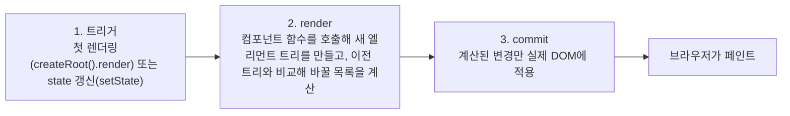

> 「[Frontend_TIL: 재조정 이해하기](https://github.com/AI-Dev-Lex-Kim/Frontend_TIL/blob/master/React/%EC%9E%AC%EC%A1%B0%EC%A0%95%20%EC%9D%B4%ED%95%B4%ED%95%98%EA%B8%B0.md)」와 「[React](https://github.com/AI-Dev-Lex-Kim/Frontend_TIL/blob/master/React/React.md)」를 바탕으로 재구성하고, React 공식 문서 「[Render and Commit](https://react.dev/learn/render-and-commit)」·「[Preserving and Resetting State](https://react.dev/learn/preserving-and-resetting-state)」로 보강한 노트다.

## 재조정이란

React 컴포넌트는 state가 바뀔 때마다 **UI 전체를 새로 그린 것처럼** 엘리먼트 트리를 다시 만든다. 그대로 DOM에 반영하면 느리므로, React는 **이전 렌더링의 엘리먼트 트리와 새 트리를 비교(diff)**해 실제로 달라진 곳만 DOM에 고친다. 이 비교 과정을 **재조정(Reconciliation)**이라 한다. 메모리 속 엘리먼트 트리를 흔히 가상 DOM이라 부른다. 비교 대상은 실제 DOM이 아니라 **이전 엘리먼트 트리**다.

가상 DOM이 늘 빠른 것은 아니다. 다시 그리고 비교하는 비용이 따로 들기 때문에, 갱신이 거의 없는 정적인 페이지라면 직접 DOM을 다루는 쪽이 가볍다. 재조정의 이점은 **「상태 → 화면」을 선언적으로만 쓰고 최소 갱신은 맡긴다**는 데 있다. 다른 프레임워크의 변경 감지 방식과의 비교는 [[ui-change-detection|UI 변경 감지]]에 있다.

## 렌더링의 세 단계



- **render 단계**는 순수 계산이다. 첫 렌더링은 루트부터 전부, 리렌더링은 state가 바뀐 컴포넌트와 그 하위 트리를 다시 호출한다. 동시성 렌더링에서는 이 단계를 멈추고 버리고 다시 할 수 있다.
- **commit 단계**는 한 번에 동기로 끝난다. 변경이 없는 노드는 건드리지 않는다.
- 그래서 **render는 됐지만 commit할 것이 없는** 경우가 흔하다. 부모의 state가 바뀌어 자식이 다시 호출됐지만 결과가 이전과 같으면 DOM은 그대로다. 다시 호출 자체를 줄이는 방법은 [[re-rendering|리렌더링 원인과 추적]]에 있다.

## 비교 규칙

트리를 완전히 비교하는 최적 알고리즘은 O(n³)이라, React는 두 가정을 두고 O(n)으로 비교한다. **타입이 다른 엘리먼트는 다른 트리를 만든다**, **형제 사이에서는 key로 같은 항목을 알아본다**.

| 같은 자리의 이전 → 새 엘리먼트 | React가 하는 일 |
| --- | --- |
| 타입이 다르다 (`<div>` → `<span>`, `<Article>` → `<Comment>`) | 이전 하위 트리를 **통째로 버린다**. DOM 노드를 지우고 하위 컴포넌트를 언마운트(state 소멸, effect 정리)한 뒤 새로 마운트한다 |
| 같은 DOM 타입 (`<div className="before">` → `<div className="after">`) | 노드는 유지하고 **바뀐 속성만** 고친다. `style`도 바뀐 속성(`color`)만 고친다. 그다음 자식으로 재귀 |
| 같은 컴포넌트 타입 | 인스턴스(state)를 **유지**하고 새 props로 다시 렌더링한다 |
| 자식 목록 | 두 목록을 앞에서부터 나란히 비교한다. key가 있으면 key로 짝을 맞춘다 |

```jsx
// 부모 태그만 바뀌어도 Counter는 리마운트되어 state가 사라진다
{isFancy ? <div><Counter /></div> : <section><Counter /></section>}
```

### 자식 목록과 key

key가 없으면 순서대로 짝을 맞추므로, **끝에 추가**는 싸지만 **앞에 추가**하면 모든 자식이 「바뀐 것」으로 보인다.

```jsx
// 이전                    // 다음: 맨 앞에 Connecticut 추가
<li>Duke</li>              <li>Connecticut</li>   ← Duke 자리에 다른 내용: 갱신
<li>Villanova</li>         <li>Duke</li>          ← Villanova 자리: 갱신
                           <li>Villanova</li>     ← 새로 추가
```

`<li key="2015">`처럼 고유한 key를 주면 React는 Duke·Villanova를 **옮기기만** 하고 Connecticut 하나만 만든다. 인덱스를 key로 쓰면 순서가 바뀔 때 엉뚱한 항목끼리 짝이 맞아, 비제어 `<input>`에 입력한 값이 다른 행에 남는 버그가 생긴다. key 값별 결과와 인덱스 key가 오히려 나은 경우는 [[lists-and-keys|리스트와 Key]]에 있다.

## state는 트리의 위치에 묶인다

state는 컴포넌트 함수 안에 있는 것이 아니라 **React가 트리의 자리마다 보관**한다. 그래서 위 비교 규칙이 그대로 state의 운명을 정한다.

| 상황 | state |
| --- | --- |
| 같은 자리에 같은 타입이 계속 렌더링된다 | 유지된다. props가 달라져도 유지 |
| 그 자리의 타입이 바뀌거나, 렌더링에서 빠진다 | 사라진다. 다시 나타나면 초기값부터 |
| 같은 자리, 같은 타입인데 **key가 바뀐다** | 다른 컴포넌트로 보고 **리마운트**한다. state 초기화 |

```jsx
// 수신자가 바뀌면 입력 중이던 메시지를 비우고 싶다 → key로 리셋
<Chat key={contact.id} contact={contact} />

// 같은 자리에서 조건부로 다른 사람을 보여 줄 때도 key로 구분한다
{isPlayerA ? <Counter key="A" person="Taylor" /> : <Counter key="B" person="Sarah" />}
```

- 컴포넌트 **안에서 다른 컴포넌트를 정의하지 않는다.** 부모가 렌더링될 때마다 새 함수, 즉 새 타입이 되어 매번 리마운트되고 state가 날아간다. 같은 이유로 `render` 안에서 [[logic-reuse-patterns|HOC]]를 적용하지 않는다.
- 「props가 바뀌면 state를 초기화」하려고 effect를 쓰기 전에 key부터 검토한다.

## 정리

- 재조정은 **이전 엘리먼트 트리와 새 트리**를 비교해 바뀐 곳만 DOM에 반영하는 과정이다.
- 렌더링은 트리거 → render(계산, 중단 가능) → commit(DOM 반영) 순서다. render만 하고 commit할 것이 없는 경우가 많다.
- 타입이 다르면 하위 트리 전체를 리마운트하고, 같으면 속성만 고치고 state를 유지한다.
- 형제 목록은 key로 짝을 맞춘다. key는 형제 사이에서 고유하고 안정적이어야 한다.
- state는 트리의 위치에 묶인다. 일부러 초기화하려면 key를 바꾼다.

관련 노트: [[jsx|JSX와 엘리먼트 렌더링]], [[lists-and-keys|리스트와 Key]], [[re-rendering|리렌더링 원인과 추적]], [[ui-change-detection|UI 변경 감지]], [[state|State와 useState]]
