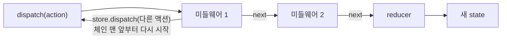

> 벨로퍼트의 「[벨로퍼트와 함께하는 모던 리액트](https://react.vlpt.us/)」 중 「[리덕스 미들웨어](https://react.vlpt.us/redux-middleware/)」 장을 바탕으로 재구성하고, [Redux 공식 문서의 Side Effects Approaches](https://redux.js.org/usage/side-effects-approaches)로 최신화한 노트다.
> saga 효과(`takeLeading`)와 thunk·saga 비교는 「[Frontend_TIL: redux-saga](https://github.com/AI-Dev-Lex-Kim/Frontend_TIL/blob/master/React/redux-saga.md)」·「[Redux Thunk vs Saga](https://github.com/AI-Dev-Lex-Kim/Frontend_TIL/blob/master/React/Redux%20Thunk%20vs%20Saga.md)」·「[redux-thunk](https://github.com/AI-Dev-Lex-Kim/Frontend_TIL/blob/master/React/redux-thunk.md)」를 바탕으로 보강했다.

**미들웨어(middleware)**는 액션이 dispatch된 뒤 reducer에 닿기 전에 끼어드는 함수다. reducer는 순수 함수여야 해서 네트워크 요청, `new Date()`, 난수, 페이지 이동 같은 부수 효과를 넣을 수 없다([[redux|Redux와 react-redux]]의 「세 가지 규칙」). 이런 일을 맡는 자리가 미들웨어다. Context + `useReducer`에는 없는, Redux만의 확장 지점이다.

## 미들웨어가 할 수 있는 일

| 일 | 예 |
| --- | --- |
| 액션 기록 | 콘솔·서버에 액션과 바뀐 state를 남긴다(redux-logger) |
| 액션 무시 | 조건이 맞지 않으면 `next`를 부르지 않는다 |
| 액션 변형 | 내용을 고쳐 reducer에 넘긴다 |
| 다른 액션 일으키기 | 특정 액션이 오면 `dispatch`로 다른 액션을 보낸다 |
| 부수 효과 실행 | API 호출, 라우터 이동, 타이머 |

실무에서 쓰는 이유는 대부분 마지막 줄, **비동기 작업**이다.

## 원리: store => next => action

미들웨어는 함수를 두 번 반환하는 함수(커링)다.

```js
const myLogger = (store) => (next) => (action) => {
  console.log(action)              // reducer 전
  const result = next(action)      // 다음 미들웨어로, 마지막이면 reducer로
  console.log('\t', store.getState()) // reducer를 거친 뒤의 state
  return result                    // dispatch(action)의 반환값이 된다
}
```

| 인자 | 뜻 |
| --- | --- |
| `store` | `dispatch`·`getState`를 가진 store API |
| `next` | 체인의 다음 미들웨어. 마지막 미들웨어의 `next`는 reducer로 가는 원래 dispatch다 |
| `action` | 지금 처리하는 액션 |




- `next(action)`은 **다음 단계로 넘기기**, `store.dispatch(action)`은 **처음부터 다시 보내기**다. 미들웨어 안에서 `store.dispatch`로 같은 액션을 보내면 무한 루프가 된다.
- `next`를 부르지 않으면 액션은 reducer에 닿지 않고 사라진다.
- 등록 순서대로 실행된다. redux-logger처럼 최종 액션을 찍는 미들웨어는 **맨 뒤**에 둔다. 그래야 thunk 함수가 아니라 실제 액션 객체가 기록된다.

### 등록하기

```js
import { configureStore } from '@reduxjs/toolkit'
import logger from 'redux-logger'

const store = configureStore({
  reducer: rootReducer,
  // 기본 미들웨어(thunk + 개발 모드 불변성·직렬화 검사)에 logger를 덧붙인다
  middleware: (getDefaultMiddleware) => getDefaultMiddleware().concat(logger),
})
```

`configureStore`는 thunk를 기본으로 넣고 Redux DevTools도 자동으로 연결한다. 과거에는 `createStore(reducer, composeWithDevTools(applyMiddleware(thunk, logger)))`처럼 `redux-devtools-extension`의 `composeWithDevTools`로 DevTools와 미들웨어를 직접 엮었다.

## thunk: 함수를 dispatch하기

**thunk**는 액션 객체 대신 **함수**를 dispatch하게 해 준다. 원리는 미들웨어 한 줄이다.

```js
const thunk = (store) => (next) => (action) =>
  typeof action === 'function'
    ? action(store.dispatch, store.getState) // 함수면 실행하고
    : next(action)                           // 객체면 그대로 넘긴다
```

```js
// 1초 뒤에 증가
export const increaseAsync = () => (dispatch) => {
  setTimeout(() => dispatch(increase()), 1000)
}

// 요청 시작·성공·실패를 차례로 알린다
export const getComments = () => async (dispatch, getState) => {
  const id = getState().post.activeId
  dispatch({ type: 'comments/pending' })
  try {
    const comments = await api.getComments(id)
    dispatch({ type: 'comments/fulfilled', payload: comments })
  } catch (e) {
    dispatch({ type: 'comments/rejected', error: e })
  }
}
```

thunk는 `getState`로 현재 state를 읽고 여러 액션을 보낼 수 있어서, 복잡한 동기 로직과 적당한 비동기 로직에 맞는다.

### 요청 하나에 액션 셋: createAsyncThunk

Promise 하나를 다루려면 늘 같은 일을 한다. 시작·성공·실패 액션 세 개를 만들고, reducer에서 `loading`·`data`·`error`를 바꾼다. 손으로 쓰면 액션 타입 상수, thunk, `switch` 분기가 API마다 반복되어 `createPromiseThunk`·`handleAsyncActions` 같은 유틸을 직접 만들어 쓰곤 했다. RTK의 `createAsyncThunk`가 그 유틸의 표준판이다.

```js
import { createAsyncThunk, createSlice } from '@reduxjs/toolkit'

export const fetchPosts = createAsyncThunk('posts/fetch', async () => {
  const res = await fetch('/api/posts')
  if (!res.ok) throw new Error('요청 실패')
  return res.json()                       // action.payload가 된다
})

const postsSlice = createSlice({
  name: 'posts',
  initialState: { data: null, loading: false, error: null },
  reducers: {},
  extraReducers: (builder) => {
    builder
      .addCase(fetchPosts.pending, (state) => { state.loading = true; state.error = null }) // data는 남겨 둔다
      .addCase(fetchPosts.fulfilled, (state, action) => { state.loading = false; state.data = action.payload })
      .addCase(fetchPosts.rejected, (state, action) => { state.loading = false; state.error = action.error })
  },
})
```

- `posts/fetch/pending`·`/fulfilled`·`/rejected` 세 액션 타입이 자동으로 생긴다.
- `pending`에서 기존 `data`를 지우지 않으면, 뒤로 가기로 목록에 돌아왔을 때 「로딩 중」 대신 이전 목록을 보여 주면서 새로 가져온다.

### 다시 불러오기 문제와 캐시

목록 → 상세 → 뒤로 가기를 하면 두 가지 문제가 생긴다.

| 증상 | 원인 | 해결 |
| --- | --- | --- |
| 목록으로 돌아올 때마다 「로딩 중」이 다시 뜬다 | 마운트할 때마다 요청하고, 요청 시작에서 `data`를 비운다 | 데이터가 있으면 요청하지 않거나, 요청하되 `data`를 유지한다(`keepData`) |
| 다른 글을 열면 이전 글이 잠깐 보였다가 바뀐다 | 상세 데이터를 `post` 한 칸에 덮어쓴다 | 언마운트 때 비우거나, `post: { [id]: { data, loading, error } }`처럼 **id별로** 저장한다 |

이 표가 곧 서버 상태 캐시의 요구 사항이다. id별 캐시, 오래된 데이터 보여 주며 다시 가져오기(stale-while-revalidate), 중복 요청 제거를 직접 짜기보다 **RTK Query**나 [[tanstack-query|TanStack Query]]에 맡긴다. Redux 공식 문서도 데이터 요청은 RTK Query를 기본으로, 맞지 않을 때만 `createAsyncThunk`를, 손으로 쓴 thunk는 마지막 수단으로 권한다.

### thunk에서 페이지 이동하기

로그인 성공 뒤 홈으로 보내는 일처럼 thunk 안에서 라우터를 써야 할 때가 있다. thunk의 세 번째 인자(`extraArgument`)로 이동 함수를 넣어 두면 된다.

```js
const store = configureStore({
  reducer,
  middleware: (gDM) => gDM({ thunk: { extraArgument: { navigate: router.navigate } } }),
})

export const login = (form) => async (dispatch, getState, { navigate }) => {
  await api.login(form)
  navigate('/')
}
```

과거에는 `createBrowserHistory()`로 history 객체를 직접 만들어 `<Router history>`에 넣고, `ReduxThunk.withExtraArgument({ history })`로 thunk에 넘겨 `history.push('/')`를 불렀다. React Router 데이터 라우터를 쓴다면 이동은 컴포넌트의 `useNavigate`나 action·loader의 `redirect`에서 처리하는 편이 더 단순하다.

## 액션에 반응하기: listener middleware

「이 액션이 오면 저 일을 한다」 같은 **반응형 로직**은 RTK의 `createListenerMiddleware`가 기본이다.

```js
import { createListenerMiddleware } from '@reduxjs/toolkit'

const listener = createListenerMiddleware()
listener.startListening({
  actionCreator: todoAdded,
  effect: async (action, api) => {
    api.cancelActiveListeners()      // 앞서 돌던 같은 리스너 취소(takeLatest 효과)
    await api.delay(500)             // 디바운스
    await saveDraft(api.getState().todos)
  },
})

configureStore({ reducer, middleware: (gDM) => gDM().prepend(listener.middleware) })
```

saga가 하던 일의 대부분(액션 감시, 취소, 지연, 다른 액션 기다리기)을 더 작은 API와 나은 TypeScript 지원으로 한다.

## redux-saga

**redux-saga**는 제너레이터 함수(사가)로 액션을 감시하고 부수 효과를 실행하는 미들웨어다. thunk가 「함수를 dispatch」한다면, saga는 **평범한 액션 객체**를 dispatch하고 사가가 그 액션을 듣고 일을 한다. 제너레이터의 `yield`로 흐름을 멈췄다 이어 가는 원리는 [[iterators-and-generators|이터레이터와 제너레이터]]에 있다.

```js
import { call, put, takeEvery, takeLatest, delay, all } from 'redux-saga/effects'

function* increaseSaga() {
  yield delay(1000)
  yield put(increase())                   // put = dispatch
}

function* getPostSaga(action) {
  try {
    const post = yield call(api.getPostById, action.payload) // call = 함수 호출(테스트하기 쉬운 효과 객체)
    yield put({ type: 'post/fulfilled', payload: post, meta: action.payload })
  } catch (e) {
    yield put({ type: 'post/rejected', error: true, payload: e, meta: action.payload })
  }
}

export function* rootSaga() {
  yield all([
    takeEvery('INCREASE_ASYNC', increaseSaga),   // 올 때마다 모두 실행
    takeLatest('GET_POST', getPostSaga),         // 새로 오면 이전 것을 취소하고 마지막 것만
  ])
}

// const sagaMiddleware = createSagaMiddleware({ context: { navigate } }) → 사가 안에서 yield getContext('navigate')
// sagaMiddleware.run(rootSaga)
```

| 효과 | 하는 일 |
| --- | --- |
| `put(action)` | 액션을 dispatch한다 |
| `call(fn, ...args)` | 함수를 호출하고 Promise면 기다린다 |
| `select(selector)` | state를 읽는다 |
| `delay(ms)` | 기다린다 |
| `takeEvery` · `takeLatest` · `takeLeading` | 액션마다 사가를 실행 · 마지막 것만 실행(앞의 것 취소) · 진행 중이면 새 액션을 무시하고 처음 것만 끝까지 |
| `all([...])` | 여러 사가를 함께 돌린다 |
| `getContext(key)` | 미들웨어를 만들 때 넣은 값(이동 함수 등)을 꺼낸다 |

saga는 요청 취소, 재시도, 웹소켓 채널, 백그라운드 작업 같은 **복잡한 비동기 흐름**에 강하고, 사가가 효과의 「설명」만 반환해 테스트하기 쉽다. 대신 제너레이터와 고유한 effect API를 배워야 하고 TypeScript와 잘 맞지 않는다. Redux 공식 문서는 데이터 요청과 대부분의 반응형 로직에 saga·redux-observable을 쓰지 말라고 권한다.

## 무엇을 고르나

| 하려는 일 | 기본 선택 |
| --- | --- |
| 서버 데이터 가져오기·캐시 | RTK Query (Redux를 안 쓰면 [[tanstack-query\|TanStack Query]]) |
| RTK Query가 맞지 않는 요청 | `createAsyncThunk` |
| `getState`가 필요한 복잡한 동기 로직, 여러 액션 연달아 보내기 | thunk |
| 액션·state 변화에 반응, 디바운스·취소가 있는 흐름 | listener middleware |
| 아주 복잡한 장기 실행 흐름(백그라운드 작업, 채널) | redux-saga 또는 redux-observable |

과거에는 비동기 처리 라이브러리로 redux-thunk(가장 많이 쓰임), redux-saga, redux-observable, redux-promise-middleware를 골라 붙였다. 지금은 RTK에 thunk·listener·RTK Query가 들어 있어 따로 고를 일이 드물다.

## TypeScript로 타이핑하기

과거에는 `ThunkAction<void, RootState, null, GithubAction>`을 손으로 적고 typesafe-actions의 `createAsyncAction`으로 세 액션의 타입을 묶었다. 지금은 RTK가 대부분 추론한다. 앱마다 미리 타입을 붙인 함수를 한 번 만든다.

```ts
// app/hooks.ts
import { createAsyncThunk } from '@reduxjs/toolkit'
import type { AppDispatch, RootState } from './store'

export const createAppAsyncThunk = createAsyncThunk.withTypes<{
  state: RootState
  dispatch: AppDispatch
  rejectValue: string
}>()

export const fetchUser = createAppAsyncThunk('users/fetch', async (id: number, { rejectWithValue }) => {
  const res = await fetch(`/api/users/${id}`)
  if (!res.ok) return rejectWithValue('요청 실패')
  return (await res.json()) as User
})
```

`RootState`·`AppDispatch`를 store에서 추론하는 방법은 [[react-typescript|React와 TypeScript]]의 Redux 부분에 있다.

## 정리

- 미들웨어는 `store => next => action` 함수 체인이다. `next`는 다음 단계로, `store.dispatch`는 처음부터 다시 보낸다.
- thunk는 「함수면 실행, 객체면 통과」 한 줄짜리 미들웨어다. `configureStore`에 기본으로 들어 있다.
- 요청 상태(`loading`·`data`·`error`)와 캐시를 손으로 짜지 말고 RTK Query나 `createAsyncThunk`를 쓴다.
- 액션에 반응하는 로직은 listener middleware, 정말 복잡한 흐름만 saga.
- 로거처럼 최종 액션을 보는 미들웨어는 체인 맨 뒤에 둔다.

관련 노트: [[redux|Redux와 react-redux]], [[tanstack-query|TanStack Query(React Query)]], [[iterators-and-generators|이터레이터와 제너레이터]], [[react-state-management|리액트 상태 관리의 흐름과 고르는 기준]], [[react-typescript|React와 TypeScript]]
