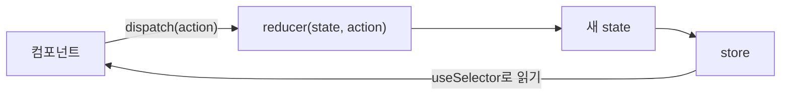

> riverkim.kr에 쓴 글들과 [Redux 공식 문서](https://redux.js.org/introduction/why-rtk-is-redux-today)를 바탕으로 다시 정리한 노트다.
> 벨로퍼트의 「[벨로퍼트와 함께하는 모던 리액트](https://react.vlpt.us/)」 중 「[리덕스](https://react.vlpt.us/redux/)」 장을 바탕으로 보강했다.
> createSelector와 createAction·createReducer는 「[Frontend_TIL: Reselect](https://github.com/AI-Dev-Lex-Kim/Frontend_TIL/blob/master/React/Reselect.md)」·「[Redux toolkit](https://github.com/AI-Dev-Lex-Kim/Frontend_TIL/blob/master/React/Redux%20toolkit.md)」·「[react-redux](https://github.com/AI-Dev-Lex-Kim/Frontend_TIL/blob/master/React/react-redux.md)」·「[redux](https://github.com/AI-Dev-Lex-Kim/Frontend_TIL/blob/master/React/redux.md)」를 바탕으로 보강했다.
> Grab의 「[Front End Guide](https://github.com/grab/front-end-guide)」를 바탕으로 보강했다.

**Redux**는 JavaScript 앱의 상태 관리 라이브러리다. 공유 state를 store 한 곳에 모으고, state를 바꾸는 방법을 reducer에 미리 정해 둔다. 컴포넌트는 store를 직접 고치지 못하고 "이렇게 바꿔 달라"는 요청(action)만 보낸다. 그래서 props를 여러 단계 내려보내지 않아도 되고, 누가 언제 state를 바꿨는지 추적하기 쉽다. **react-redux**는 store를 React 컴포넌트에 연결하는 바인딩 라이브러리다.

## Flux 패턴: 데이터는 한 방향으로만

Redux는 Facebook이 제안한 **Flux 패턴**의 대표 구현이다. 데이터가 한 방향으로만 흐르므로 상태 변화를 따라가기 쉽다.

| Flux 구성 | 역할 | Redux에서는 |
| --- | --- | --- |
| Action | "무엇이 일어났는지"를 담은 객체. `type`과 데이터 | action 객체 `{ type: 'counter/plus' }` |
| Dispatcher | Action 종류에 따라 Store를 업데이트 | `dispatch` + reducer |
| Store | 상태를 관리하는 곳 | store 하나(슬라이스로 나눔) |
| View | Store의 데이터를 UI로 보여 준다 | React 컴포넌트 |



작은 규모라면 라이브러리 없이 `useReducer` + [[context|Context]]로 같은 흐름을 만들 수 있다.

Redux는 Flux에 명령(Command) 패턴과 Elm 아키텍처(MVU)를 섞었다. **state와 action이 모두 직렬화할 수 있는 평범한 객체이고, 바꾸는 길이 순수 함수 reducer 하나뿐**이라는 제약에서 다음이 따라 나온다.

| 가능해지는 것 | 어떻게 |
| --- | --- |
| 서버에서 만든 state를 클라이언트가 이어받기 | 서버가 state를 JSON으로 HTML에 심고, 클라이언트는 `configureStore({ reducer, preloadedState })`로 같은 state에서 시작한다 |
| 변경 추적·재현 | 액션 기록만 있으면 같은 state를 다시 만들 수 있다. 버그 리포트에 액션 로그를 붙이면 재현된다 |
| undo/redo | 이전 state 객체가 그대로 남으므로 `{ past, present, future }` 배열로 감싸기만 하면 된다 |
| 쉬운 테스트 | reducer는 「이전 state + 액션 → 기대 state」만 확인하면 된다 |

## 용어

| 용어 | 뜻 |
| --- | --- |
| 액션(action) | `type` 필드가 꼭 있는 객체. 나머지 필드는 자유이고, RTK는 데이터를 `payload`에 담는다 |
| 액션 생성 함수(action creator) | 인자를 받아 액션 객체를 돌려주는 함수 `(text) => ({ type: 'todos/add', payload: text })`. 필수는 아니지만 컴포넌트에서 쓰기 편하다 |
| 리듀서(reducer) | `(state, action) → 새 state` |
| 루트 리듀서 | 여러 서브 리듀서를 `combineReducers({ counter, todos })`로 합친 것. state도 `{ counter, todos }` 모양이 된다 |
| 스토어(store) | 현재 state와 리듀서를 가진 객체. 앱에 하나 |
| `dispatch(action)` | 액션을 보낸다. 스토어가 리듀서를 실행해 새 state를 만든다 |
| `subscribe(listener)` | dispatch될 때마다 listener를 부른다. React에서는 직접 쓰지 않고 `useSelector`가 대신 구독한다 |

## 세 가지 규칙

### 1. 앱에 store는 하나

store를 여럿 만들 수는 있지만 권장하지 않는다. DevTools로 한눈에 추적하는 장점이 사라진다. 기능별로 나누는 것은 store가 아니라 슬라이스(서브 리듀서)다.

### 2. state는 읽기 전용

state를 직접 고치지 않고 **새 객체로 교체**한다. 배열은 `push` 대신 `concat`·spread·`filter`·`map`으로 새 배열을 만든다. 이유는 두 가지다.

- Redux와 react-redux는 변경 여부를 **얕은 비교(참조 비교)**로 판단한다. 깊은 곳까지 비교하지 않으니 빠르지만, 같은 객체를 고치면 바뀐 줄 모른다.
- 이전 state가 그대로 남아 있어 DevTools에서 액션 단위로 앞뒤로 돌려 볼 수 있다(time travel).

불변 업데이트를 손으로 쓰기 번거로우면 Immer를 쓴다. RTK의 `createSlice`는 Immer를 내장한다.

### 3. reducer는 순수 함수

- 이전 state와 액션만 받아 새 state를 반환한다. 이전 state는 건드리지 않는다.
- **같은 입력이면 늘 같은 출력**이어야 한다. `new Date()`, `Math.random()`, 네트워크 요청처럼 매번 결과가 다른 일은 reducer 밖, 즉 액션을 만드는 쪽이나 [[redux-middleware|미들웨어]]에서 한다.
- 모르는 액션이면 state를 **그대로 반환**한다. `useReducer`의 reducer는 `default`에서 에러를 던지는 경우가 많지만, Redux reducer는 모든 액션이 모든 서브 리듀서를 지나가므로 에러를 던지면 안 된다.

```js
function counter(state = { number: 1 }, action) { // 첫 인자의 기본값이 초기 state
  if (action.type === 'counter/plus') return { ...state, number: state.number + 1 }
  return state
}
```

## Redux Toolkit으로 쓰기

Redux Toolkit(RTK)이 지금의 표준 작성법이다. `createSlice`가 reducer와 action 생성 함수를 한 번에 만들고, `configureStore`가 DevTools·미들웨어 기본 설정을 넣는다.

```js
// store.js
import { configureStore, createSlice } from '@reduxjs/toolkit'

const counterSlice = createSlice({
  name: 'counter',
  initialState: { number: 1 },
  reducers: {
    plus: (state) => { state.number += 1 },               // Immer 덕분에 불변 업데이트가 된다
    add: (state, action) => { state.number += action.payload },
  },
})

export const { plus, add } = counterSlice.actions
export const store = configureStore({ reducer: { counter: counterSlice.reducer } })
```

- `createSlice`의 reducer 안에서는 state를 직접 바꾸는 것처럼 써도 된다. Immer가 새 객체를 만들어 준다. 직접 바꾸거나 새 값을 반환하거나 둘 중 하나만 한다.
- action type은 `슬라이스 이름/리듀서 이름`(`counter/plus`)으로 자동 생성된다.
- `createSlice`는 안에서 `createAction`과 `createReducer`를 쓴다. 슬라이스 밖에서도 쓸 수 있다. `createAction('todos/add', prepare)`는 타입 상수와 액션 생성 함수를 한 번에 만들고(생성 함수의 `.type`이 곧 타입), 두 번째 인자 `prepare`로 payload를 가공한다(`(text) => ({ payload: { id: nanoid(), text } })`). `createReducer(initialState, (builder) => builder.addCase(add, (state, action) => { … }))`는 switch 문 대신 액션별 케이스를 등록한다. 다른 슬라이스의 액션이나 thunk 결과에 반응할 때는 슬라이스의 `extraReducers`에 같은 builder를 쓴다.

과거에는 `createStore(reducer)`로 store를 만들고 `switch` 문 reducer와 action type 상수를 손으로 썼다. 이를 줄이려고 redux-actions의 `createAction`·`handleActions`(값은 늘 `action.payload`로 꺼낸다)를 쓰기도 했다. 지금 `createStore`는 deprecated 표시가 붙어 `legacy_createStore`로만 남았다.

### 파일 구성: Ducks에서 슬라이스로

액션 타입, 액션 생성 함수, 리듀서를 `actions/`·`reducers/` 폴더에 따로 두면 한 기능을 고칠 때 여러 폴더를 오가야 한다. 그래서 셋을 **한 파일(모듈)**에 모으는 **Ducks 패턴**이 널리 쓰였다. 액션 타입에 `'counter/INCREASE'`처럼 모듈 이름 접두사를 붙여 다른 모듈과 겹치지 않게 했다.

`createSlice` 파일 하나가 곧 Ducks 모듈이다. 접두사(`name`)도 자동으로 붙는다. 지금 권장 구조는 기능 폴더(`features/counter/counterSlice.ts`, 같은 폴더에 컴포넌트)다.

### DevTools

브라우저 확장 Redux DevTools로 현재 state, dispatch된 액션 기록, 액션별 state 변화를 보고, 액션을 직접 dispatch하거나 시점을 되돌린다. `configureStore`는 개발 모드에서 자동으로 연결한다. 과거에는 `redux-devtools-extension`의 `composeWithDevTools()`를 `createStore`에 직접 넣었다.

## react-redux로 연결하기

| API | 역할 |
| --- | --- |
| `<Provider store={store}>` | 감싼 트리 안에서 store를 쓸 수 있게 한다. 보통 앱 최상단 |
| `useSelector(selector)` | state에서 필요한 값을 꺼낸다 |
| `useDispatch()` | `dispatch` 함수를 돌려준다 |

```jsx
root.render(<Provider store={store}><App /></Provider>)

function Counter() {
  const number = useSelector((state) => state.counter.number)
  const dispatch = useDispatch()
  return <button onClick={() => dispatch(plus())}>{number}</button>
}
```

- 읽는 컴포넌트와 바꾸는 컴포넌트가 트리에서 멀어도 props 전달이 필요 없다.
- TypeScript에서는 `useSelector`·`useDispatch` 대신 store에서 타입을 추론한 `useAppSelector`·`useAppDispatch`를 만들어 쓴다([[react-typescript|React와 TypeScript]]).

### useSelector 리렌더링 최적화

`useSelector`는 action이 dispatch될 때마다 selector를 다시 실행하고, **이전 결과와 `===`로 비교**해 다를 때만 컴포넌트를 다시 그린다.

| selector | 결과 |
| --- | --- |
| `(state) => state.todos` | todos가 바뀔 때만 리렌더링 |
| `(state) => state` | 아무 값이 바뀌어도 리렌더링 |
| `(state) => ({ number: state.counter.number, diff: state.counter.diff })` | **매번 새 객체**라 `===`가 늘 실패해, 관계없는 액션에도 리렌더링 |
| `(state) => state.todos.filter((t) => t.done)` | 매번 새 배열이라 마찬가지 |

새 객체를 돌려주는 selector는 다음 중 하나로 고친다.

```js
// 1) 값마다 useSelector를 따로 부른다 (가장 단순)
const number = useSelector((state) => state.counter.number)
const diff = useSelector((state) => state.counter.diff)

// 2) 비교 함수로 shallowEqual을 넘긴다: 객체의 한 단계 아래 값만 비교
const { number, diff } = useSelector(
  (state) => ({ number: state.counter.number, diff: state.counter.diff }),
  shallowEqual,
)

// 3) 파생 데이터는 createSelector(Reselect, RTK 내장)로 입력이 같으면 이전 결과를 재사용
const selectDone = createSelector([(state) => state.todos], (todos) => todos.filter((t) => t.done))
const done = useSelector(selectDone)
```

`shallowEqual`은 `{ a, b, c }`의 `a`·`b`·`c`만 `===`로 비교하고 `a.x`처럼 더 깊은 곳은 보지 않는다. React Redux 9는 개발 모드에서 같은 입력에 다른 참조를 돌려주는 selector를 콘솔 경고로 알려 준다.

`createSelector(입력 selector들, 결과 함수)`는 **입력 selector의 결과가 모두 이전과 같으면 결과 함수를 다시 돌리지 않고 이전 결과(같은 참조)를 돌려준다.** 그래서 필터·합계처럼 계산이 드는 파생 데이터의 재계산과, 새 배열 때문에 생기는 리렌더링을 함께 막는다.

```js
// selectors/photos.js: 컴포넌트 밖, 모듈에서 한 번 만든다
const selectCategory = (state) => state.category
const selectPhotos = (state) => state.photos.data

export const selectVisiblePhotos = createSelector(
  [selectCategory, selectPhotos],
  (category, photos) => (category === 'all' ? photos : photos.filter((p) => p.category === category)),
)

// 컴포넌트: const photos = useSelector(selectVisiblePhotos)
```

- 입력 selector는 state에서 값을 **꺼내기만** 하고, 가공은 결과 함수에서 한다. 입력 selector가 새 객체를 만들면 메모가 매번 깨진다.
- **컴포넌트 안에서 `createSelector`를 부르지 않는다.** 렌더링마다 새 selector(새 캐시)가 생겨 메모가 소용없다. 컴포넌트 props에 따라 달라지는 selector는 `useMemo`로 컴포넌트마다 하나 만든다.
- selector를 `selectors/` 폴더나 슬라이스 파일에 모아 두면 여러 컴포넌트가 같은 파생 로직을 재사용한다. Reselect 5부터 기본 메모 방식이 `weakMapMemoize`라 인자 조합별로 결과를 기억한다(과거에는 마지막 한 번만 기억했다).

### 컨테이너와 프레젠테이셔널 컴포넌트

Hooks 이전의 Redux 앱은 컴포넌트를 둘로 나눴다. **프레젠테이셔널** 컴포넌트는 store를 모르고 값과 함수를 props로만 받아 UI를 그린다. **컨테이너** 컴포넌트는 store에서 값을 꺼내고 dispatch하는 함수를 만들어 프레젠테이셔널에 넘긴다. Hooks가 생긴 뒤로는 필요한 컴포넌트에서 바로 `useSelector`를 쓰는 편이 일반적이고, 이 구분은 필수가 아니다. 컨테이너를 커스텀 훅(`useCount()`)으로 바꾸면 로직은 재사용되지만 훅을 부르는 UI는 store에 묶인다. 무엇을 재사용할지에 따른 선택은 [[logic-reuse-patterns#컨테이너 컴포넌트와 커스텀 훅|로직 재사용 패턴]]에, 컴포넌트를 나누는 기준은 [[component-splitting|컴포넌트 분리 기준]]에 있다.

### connect (역사)

`connect`는 Hooks 이전의 연결 방법이다. 컴포넌트를 감싸 store 값과 dispatch 함수를 **props로 주입**하는 고차 컴포넌트(HOC)다. 지금도 동작하고 클래스 컴포넌트에서는 이것만 쓸 수 있지만, 새 코드는 Hooks를 쓴다. 옛 코드를 읽을 때 알아 둘 모양은 다음과 같다.

```js
const mapStateToProps = (state, ownProps) => ({ number: state.counter.number }) // ownProps: 부모가 넘긴 props
const mapDispatchToProps = { increase, decrease }  // 객체면 bindActionCreators로 dispatch를 감싸 준다
export default connect(mapStateToProps, mapDispatchToProps)(Counter)
```

세 번째 인자 `mergeProps`(기본은 `{ ...ownProps, ...stateProps, ...dispatchProps }`)와 네 번째 인자 `options`도 있지만 거의 쓰지 않는다.

## 언제 Redux를 쓰나

| 상황 | 선택 |
| --- | --- |
| 몇 단계만 내려가는 값 | props |
| 테마·로그인 사용자처럼 드물게 바뀌는 전역 값 | [[context\|Context]] |
| 서버에서 받아 온 데이터(목록, 상세) | [[tanstack-query\|TanStack Query]]나 [[swr\|SWR]] 같은 서버 상태 라이브러리 |
| 여러 화면이 함께 쓰는 클라이언트 state, 작거나 중간 규모 | Zustand(스토어 하나를 훅으로, selector로 필요한 값만 구독) 또는 Jotai(atom 조합) |
| 여러 화면이 함께 고치는 복잡한 클라이언트 state, 액션 기록·미들웨어·DevTools 추적이 중요 | Redux Toolkit. 서버 데이터까지 한 도구로 다루려면 RTK Query |

Context + `useReducer`도 같은 흐름을 만들지만, Redux가 더하는 것은 세 가지다.

| 차이 | Redux | Context + `useReducer` |
| --- | --- | --- |
| 미들웨어 | 액션이 reducer에 닿기 전에 기록·변형·비동기 처리([[redux-middleware\|Redux 미들웨어와 비동기 처리]]) | 없다 |
| 리렌더링 | `useSelector`가 고른 값이 바뀐 컴포넌트만 | value가 바뀌면 그 Context를 읽는 컴포넌트 전체 |
| 구조 | 전역 state가 객체 하나, Provider도 하나 | 기능마다 Context·Provider·전용 훅을 새로 만든다 |

라이브러리별 접근(스토어·atom·proxy) 비교는 [[react-state-management|리액트 상태 관리의 흐름과 고르는 기준]]에 있다.

## 정리

- store 하나에 공유 state를 두고, reducer가 정한 방식으로만 바꾼다. 데이터는 한 방향으로 흐른다.
- reducer는 순수 함수다. 기존 state를 고치지 않고 새 state를 반환한다.
- 새 코드는 Redux Toolkit의 `createSlice`·`configureStore`로 쓴다.
- 컴포넌트는 `useSelector`로 필요한 값만 읽고 `useDispatch`로 action을 보낸다. selector가 매번 새 객체를 만들지 않게 한다.
- 비동기·부수 효과는 reducer가 아니라 미들웨어(thunk, listener)에서 처리한다.
- 서버 데이터는 Redux에 넣기보다 서버 상태 라이브러리에 맡기는 편이 단순하다.

관련 노트: [[redux-middleware|Redux 미들웨어와 비동기 처리]], [[react-typescript|React와 TypeScript]], [[context|Context]], [[state|State]], [[vuex|Vue 상태 관리: Pinia(옛 Vuex)]], [[frontend-mv-architecture|프론트엔드 MV* 아키텍처의 흐름]], [[react-state-management|리액트 상태 관리의 흐름과 고르는 기준]], [[functional-programming|함수형 프로그래밍]]
