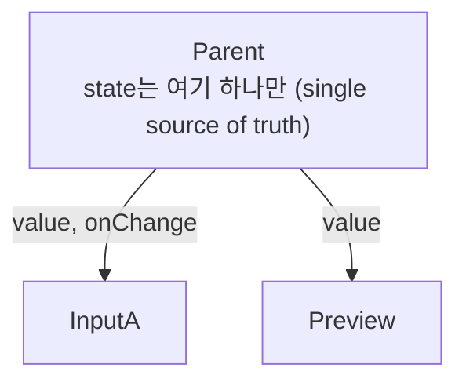

> 개인 TIL을 바탕으로, state 내리기와 라이브러리 전에 해 볼 순서는 「[React에서 Redux 전에 배워야 할 8가지](https://edykim.com/ko/post/learn-react-before-using-redux/)」를 바탕으로 더한 노트다.
> 배열 불변 업데이트와 Immer는 벨로퍼트의 「[벨로퍼트와 함께하는 모던 리액트](https://react.vlpt.us/)」 중 「[배열에 항목 추가하기](https://react.vlpt.us/basic/13-array-insert.html)」~「[배열 항목 수정하기](https://react.vlpt.us/basic/15-array-modify.html)」, 「[Immer를 사용한 더 쉬운 불변성 관리](https://react.vlpt.us/basic/23-immer.html)」를 바탕으로 보강했다.
> 일괄 처리와 지연 초기화는 「[Frontend_TIL: React Hook useState](https://github.com/AI-Dev-Lex-Kim/Frontend_TIL/blob/master/React/React%20Hook%20useState.md)」를 바탕으로 보강했다.

**State**는 컴포넌트 안에서 관리되는, 시간에 따라 변하는 데이터다. props가 바깥에서 넘겨받는 값(함수의 매개변수)이라면, state는 컴포넌트 내부에 선언한 변수에 해당한다. 일반 변수와 달리 state를 바꾸면 **React가 컴포넌트를 다시 렌더링**해 화면에 반영한다. "데이터가 바뀔 때마다 직접 다시 그리는" 대신 "데이터를 React에 맡겨 두고 바뀌면 알아서 그리게" 하는 것이 React의 핵심이다.

## useState

```jsx
import { useState } from 'react'

function Counter() {
  const [counter, setCounter] = useState(0) // [현재 값, 변경 함수] = useState(초기값)

  const onClick = () => {
    setCounter(counter + 1) // 값을 바꾸고 리렌더링을 요청
  }

  return (
    <div>
      <h3>Total clicks: {counter}</h3>
      <button onClick={onClick}>Click me</button>
    </div>
  )
}
```

- 배열 구조 분해로 이름을 자유롭게 짓는다. 관례는 `[something, setSomething]`.
- state가 바뀌면 컴포넌트 함수가 **처음부터 다시 실행**된다. 그래서 렌더링마다 실행되면 안 되는 코드(API 호출 등)는 `useEffect`로 분리한다([Hooks](/knowledge/dictionary/frontend/react/hooks)).
- **직접 대입은 금지**: `counter = counter + 1`처럼 바꾸면 React가 변경을 알지 못해 화면이 바뀌지 않는다. 반드시 setter를 쓴다.

### 함수형 업데이트

새 값이 **이전 값에 의존**할 때는 setter에 함수를 넘긴다. React는 업데이트를 모아서(batching) 처리하기 때문에, 렌더링 시점의 `counter`를 그대로 쓰면 최신 값이 아닐 수 있다.

```jsx
// 이전 값 기반 → 함수형 업데이트
setCounter((current) => current + 1)

// 토글
setFlipped((current) => !current)

// 배열에 추가 (원본을 바꾸지 않고 새 배열 생성)
setGoals((currentGoals) => [...currentGoals, newGoal])

// 배열에서 삭제
setGoals((currentGoals) => currentGoals.filter((goal) => goal.id !== id))
```

### 일괄 처리(batching)

setter를 불러도 그 자리에서 변수 값이 바뀌지 않는다. React는 **한 이벤트 안의 setter 호출을 모아 두었다가 렌더링 한 번으로** 처리한다. 부모와 자식이 같은 클릭에서 각각 setState를 불러도 자식은 한 번만 다시 그려진다. 지금 렌더링의 `count`는 그 렌더링 동안 고정된 값(스냅숏)이다.

```jsx
function onClick() {
  setCount(count + 1)   // 0 + 1
  setCount(count + 1)   // 여전히 0 + 1
  setCount(count + 1)   // 결과는 1
}

function onClickQueued() {
  setCount((c) => c + 1) // 큐에 쌓인 업데이트를 차례로 적용 → 결과는 3
  setCount((c) => c + 1)
  setCount((c) => c + 1)
}
```

React 18부터는 이벤트 핸들러뿐 아니라 `setTimeout`·Promise·네이티브 이벤트 안의 업데이트도 자동으로 모은다(automatic batching). 과거에는 React 이벤트 핸들러 안에서만 모았다. 즉시 DOM에 반영해야 하는 드문 경우에만 `flushSync`로 감싼다.

### 지연 초기화

`useState(초기값)`의 인자는 **렌더링마다 평가**된다. 초기값은 첫 렌더링에만 쓰이고 버려지는데도 계산은 매번 일어난다. 계산이 비싸면 **함수 자체**를 넘긴다. React는 첫 렌더링 때만 그 함수를 부른다.

```jsx
const [todos, setTodos] = useState(createInitialTodos())  // 렌더링마다 호출된다
const [todos, setTodos] = useState(createInitialTodos)    // 첫 렌더링에만 호출된다
const [count, setCount] = useState(() => pow(10, 10))     // 인자가 필요하면 화살표 함수로
```

`localStorage`에서 읽은 값처럼 초기값을 만드는 데 비용이 드는 경우에 쓴다.

### 불변성

객체·배열 state는 **원본을 수정하지 않고 새 객체·배열을 만들어** setter에 넘긴다. React는 참조가 바뀌었는지(`Object.is`)로 변경을 감지하기 때문에, `inputs[name] = value`나 `push`로 원본을 바꾸고 같은 참조를 넘기면 리렌더링되지 않는다. `memo`·`useMemo`의 얕은 비교도 참조가 바뀌어야 "달라졌다"고 판단하므로, 불변성은 최적화의 전제이기도 하다.

| 작업 | 원본을 바꾸는 메서드 (쓰지 않는다) | 새 배열을 만드는 방법 |
| --- | --- | --- |
| 추가 | `push`, `unshift` | `[...arr, item]`, `arr.concat(item)` |
| 삭제 | `splice`, `pop`, `shift` | `arr.filter((x) => x.id !== id)` |
| 수정 | `arr[i] = v`, `arr[i].active = true` | `arr.map((x) => (x.id === id ? { ...x, active: !x.active } : x))` |
| 정렬·뒤집기 | `sort`, `reverse` | `arr.toSorted(cmp)`, `arr.toReversed()` |
| 중간 삽입·교체 | `splice` | `arr.toSpliced(i, 0, item)`, `arr.with(i, v)` |
| 객체 필드 변경 | `obj.name = v` | `{ ...obj, [name]: v }` |

`toSorted`·`toReversed`·`toSpliced`·`with`는 ES2023에 들어온 「복사본을 돌려주는」 배열 메서드로, 모든 주요 브라우저가 지원한다. 그 전에는 `[...arr].sort()`처럼 먼저 복사하고 정렬했다. spread는 **한 단계만 복사**(얕은 복사)하므로, 중첩된 객체를 바꿀 때는 바뀌는 경로의 모든 단계를 새로 만들어야 한다.

### Immer: 중첩 state를 쉽게 바꾸기

중첩이 깊어지면 spread가 겹겹이 쌓여 읽기 어렵다. 게시글 1번에 댓글을 하나 다는 코드를 비교하면 차이가 드러난다.

```javascript
// spread로 직접
const next = {
  ...state,
  posts: state.posts.map((post) =>
    post.id === 1 ? { ...post, comments: post.comments.concat({ id: 3, text: '새 댓글' }) } : post,
  ),
}

// Immer
import { produce } from 'immer'
const next = produce(state, (draft) => {
  draft.posts.find((post) => post.id === 1).comments.push({ id: 3, text: '새 댓글' })
})
```

**Immer**의 `produce(base, recipe)`는 `recipe` 안에서 원본을 바꾸듯 `draft`를 수정하면, 그 기록을 바탕으로 바뀐 경로만 새로 만든 **불변 사본**을 돌려준다. 내부는 [[proxy-and-reflect|Proxy]]로 draft에 대한 쓰기를 가로챈다.

- **커리 형태**: 첫 인자를 빼고 `produce(recipe)`만 부르면 「state를 받아 새 state를 돌려주는 함수」가 나온다. 그대로 함수형 업데이트에 넣을 수 있다: `setTodo(produce((draft) => { draft.done = !draft.done }))`.
- **React 전용 훅**: `use-immer` 패키지의 `useImmer`(setter에 바로 draft 함수를 넘긴다)와 `useImmerReducer`(reducer 안에서 draft를 직접 수정)가 있다.
- **Redux Toolkit**의 `createSlice` reducer가 `state.value += 1`처럼 써도 되는 이유도 내부에서 Immer를 쓰기 때문이다([[redux|Redux와 react-redux]]).
- **언제 쓰나**: 한두 단계짜리 배열 추가·삭제는 `concat`·`filter`가 더 짧다. Immer는 깊은 경로를 바꾸는 업데이트에만 쓰고, 먼저 state 구조를 평평하게(정규화) 만들 수 있는지 본다.
- **비용**: 네이티브 `map`보다 느리다. 5만 개 중 5천 개를 바꾸는 벤치마크에서 수십 ms 수준이라 보통은 문제가 되지 않는다. 과거에는 Proxy가 없는 환경(IE, 옛 React Native)을 위한 ES5 폴백이 있었고 훨씬 느렸지만, Immer 10에서 폴백을 없애고 Proxy만 쓴다.

과거에는 state를 클래스 컴포넌트에서만 쓸 수 있었다. `constructor`에서 `this.state = {...}`로 초기화하고 `this.setState({...})`로 바꿨다.

## State 끌어올리기(Lifting State Up)

여러 컴포넌트가 **같은 데이터**를 보여 줘야 한다면, 각자 state를 갖지 말고 **가장 가까운 공통 부모**에 state를 하나만 두고 props로 내린다. 자식은 값과 변경 함수만 받는다.



```jsx
function Parent() {
  const [text, setText] = useState('')
  return (
    <>
      <TextInput value={text} onChange={setText} />
      <Preview text={text} />
    </>
  )
}

// 자식: 자기 state 없이 props로 값을 받고, 변경은 부모에게 알린다
function TextInput({ value, onChange }) {
  return <input value={value} onChange={(e) => onChange(e.target.value)} />
}
function Preview({ text }) {
  return <p>{text.length}자</p>
}
```

데이터의 출처가 하나가 되어 두 컴포넌트의 값이 어긋날 수 없다. 섭씨·화씨 입력창처럼 같은 값을 다른 단위로 보여 줄 때도, 부모는 값 하나만 갖고 다른 단위는 렌더링 중에 계산한다.

## State 내리기와 고르는 순서

끌어올리기의 반대도 있다. state를 **실제로 쓰는 가장 아래 컴포넌트로 내리면**(colocation) 중간 컴포넌트가 쓰지도 않는 props를 전달하지 않고, 바뀔 때 다시 그려지는 범위도 좁아진다. 모달의 열림 여부를 페이지 최상단에 두었다면 모달을 여는 버튼 근처로 내린다.

전역 상태 라이브러리를 꺼내기 전에 React만으로 해 볼 순서가 있다.

| 순서 | 방법 | 쓰는 때 |
| --- | --- | --- |
| 1 | 지역 state, 필요한 곳으로 내리기 | 한 컴포넌트와 그 자식만 쓴다 |
| 2 | 가장 가까운 공통 부모로 끌어올리기 | 형제가 같은 값을 쓴다 |
| 3 | 합성으로 전달 단계 줄이기 | 중간 컴포넌트가 props를 넘기기만 한다. `children`으로 바로 끼운다([[composition\|합성]]) |
| 4 | [[context\|Context]] | 트리 곳곳에서 같은 값(테마, 로그인 사용자)을 읽는다 |
| 5 | 서버 상태 라이브러리, 전역 스토어 | 서버 데이터 캐시, 멀리 떨어진 컴포넌트가 자주 바꾸는 값([[react-state-management\|상태 관리]]) |

Redux·MobX 같은 라이브러리도 내부는 이 위에 서 있다. 스토어를 Context로 트리에 내려 주고, 컴포넌트를 구독시켜 바뀔 때 다시 그린다. 그래서 지역 state와 끌어올리기를 먼저 익혀야 라이브러리가 무엇을 대신하는지 보인다.

## 정리

- state = 컴포넌트가 관리하는 변하는 값. 바꿀 때는 항상 setter.
- 이전 값에 의존하면 함수형 업데이트, 객체·배열은 새로 만들어서 넘긴다(추가 spread·`concat`, 삭제 `filter`, 수정 `map`, 정렬 `toSorted`). 깊게 중첩된 값만 Immer로 바꾼다.
- 여러 컴포넌트가 공유하는 값은 가장 가까운 공통 부모로 끌어올리고, 한 곳에서만 쓰는 값은 쓰는 곳으로 내린다. 더 멀리 공유해야 하면 [[context|Context]].

관련 노트: [[hooks|Hooks]], [[forms|폼]], [[context|Context]], [[redux|Redux와 react-redux]]
