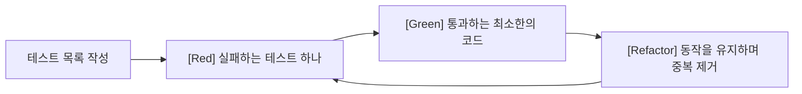

> 레거시 교체 부분은 「[댓글 모듈 레거시 걷어내기 with TDD](https://zuminternet.github.io/zum-comment-component/)」를 바탕으로 보강했다. TDD 논쟁 부분은 「[Is TDD Dead?](https://martinfowler.com/articles/is-tdd-dead/)」를 바탕으로 정리했다. 「TDD와 BDD」는 「[fru1tworld/cs-basic 모의 면접 질문 목록](https://github.com/fru1tworld/cs-basic/blob/main/interview/cs/etc.md)」의 질문을 계기로 Dan North의 「[Introducing BDD](https://dannorth.net/introducing-bdd/)」와 Cucumber의 Gherkin 문서를 바탕으로 보강했다.

## TDD란

**TDD(Test Driven Development, 테스트 주도 개발)** 는 기능 코드보다 **테스트를 먼저 작성**하고, 그 테스트를 통과하는 코드를 만드는 개발 방식이다. 켄트 벡이 정리한 목표는 **"작동하는 깔끔한 코드(Clean code that works)"** 다. 먼저 테스트로 **작동하는** 코드를 만들고, 그다음 리팩터링으로 **깔끔한** 코드를 만든다.



| 단계 | 할 일 |
| --- | --- |
| 목록 | 필요한 동작과 사용 예를 적는다 |
| Red | 실패하는 테스트를 하나 추가한다. 실패 메시지가 무엇이 빠졌는지 말해 줘야 한다 |
| Green | 테스트를 통과하는 가장 단순한 코드를 쓴다 |
| Refactor | 테스트가 통과하는 상태에서 중복을 없애고 이름을 다듬는다 |

"두려움이 지루함으로 바뀔 때까지 테스트를 작성하라"는 말처럼, 코드에 대한 불안이 사라질 만큼 신뢰가 쌓일 때까지 반복한다.

## 왜: 이점과 오해

| TDD가 주는 것 | TDD가 아닌 것 |
| --- | --- |
| 코드를 쓰기 전에 요구사항과 인터페이스를 먼저 생각하게 해 **좋은 설계를 유도**한다 | 오류 없는 완벽한 프로그램의 보장. 테스트를 통과하면서도 설계 원칙에 어긋난 코드는 얼마든지 있다 |
| 테스트가 **예제로 표현된 스펙**이 되어 협업과 유지보수를 돕는다 | 설계 방법론 자체. 설계를 대신하지 않고, 잘못 디딘 곳을 알려 주는 **지뢰 탐지기**에 가깝다 |
| **미래의 큰 버그를 현재의 작은 실패로** 끌어온다. 덩어리가 작을 때 고치는 편이 싸다 | 공짜. 단기적으로는 도입 비용이 크고, 효과는 늦게 나타난다 |

테스트가 일정에서 가장 먼저 밀려나는 이유도 마지막 줄에 있다. 그래서 도입은 전략이 필요하다(아래 「도입 전략」).

## TDD와 BDD

**BDD(Behavior Driven Development, 행위 주도 개발)** 는 TDD에서 갈라져 나온 방식이다. TDD를 하던 개발자들이 「무엇을 테스트해야 하나」, 「테스트 이름을 어떻게 짓나」에서 막히자, 테스트를 **시스템이 해야 할 행위의 명세**로 보고 개발자가 아닌 사람도 읽을 수 있는 말로 쓰자는 제안(Dan North, 2006)에서 시작했다.

| | TDD | BDD |
| --- | --- | --- |
| 출발점 | 코드 단위의 기대값: 이 함수에 이 입력을 주면 이 출력 | 사용자·비즈니스 관점의 행위: 이 상황에서 이렇게 하면 이렇게 된다 |
| 읽는 사람 | 개발자 | 기획자·QA·개발자 모두 |
| 쓰는 말 | 프로그래밍 언어의 단언(`expect(sum(1, 2)).toBe(3)`) | 도메인 용어로 쓴 시나리오. **Given(전제) · When(행동) · Then(결과)** |
| 주된 수준 | 단위 테스트 | 인수(acceptance) 테스트, 기능 단위 시나리오 |
| 목적 | 작은 단계로 설계를 이끌고 리팩터링 안전망을 만든다 | 무엇을 만들지 팀이 같은 이해를 갖고, 그 합의를 실행 가능한 명세로 남긴다 |
| 대표 도구 | Vitest, Jest, JUnit | Cucumber(Gherkin), playwright-bdd, RSpec·Jasmine 스타일의 `describe`·`it` |

```gherkin
Feature: 할 일 목록
  Scenario: 할 일을 추가한다
    Given 할 일이 하나도 없다
    When "장보기"를 입력하고 추가 버튼을 누른다
    Then 목록에 "장보기"가 보인다
```

Gherkin 문장 하나하나는 단계 정의(step definition) 코드와 연결되어 실제로 실행된다. 같은 생각을 테스트 코드 안에서만 쓰면 `describe('할 일이 없으면')`·`it('추가한 할 일을 보여 준다')`처럼 맥락과 행위로 이름을 짓는 **BDD 스타일**이 된다.

둘은 경쟁 관계가 아니다. 바깥에서 실패하는 인수 테스트(BDD 시나리오)를 하나 쓰고, 그것을 통과시키려고 안쪽에서 단위 테스트로 Red → Green → Refactor를 여러 번 도는 **이중 루프(double loop)** 로 함께 쓴다. BDD 시나리오로 기획을 태스크로 나누는 방법은 [[bdd-sdd-task-design|BDD·SDD로 기획서를 태스크로 나누기]]에 있다.

## 테스트하기 좋은 코드

사이클은 단순하지만 실제로 어려운 것은 **테스트 가능한(testable) 코드**를 만드는 일이다. 여러 단계의 처리가 한 함수에, UI가 한 컴포넌트에 몰리면 테스트를 쓰기도, 버그 위치를 찾기도 어렵다.

- **관심사의 분리**: 각 부분이 하나의 관심사만 다루게 나눈다([[separation-of-concerns|관심사의 분리]]).
- **단일 책임 원칙(SRP)**: 하나의 모듈은 하나의 바뀔 이유만 가진다.
- **보여 주는 로직과 상태 로직을 나눈다.** 상태 로직은 커스텀 훅이나 순수 함수(reducer)로 빼면 "이 상태에 이 액션을 주면 이 상태가 나온다"를 그대로 테스트할 수 있다.
- 상태 저장소와 연결된 컴포넌트는 훅을 모킹하지 않고 **실제 store를 넣어 렌더링하는 통합 테스트**로 검증한다. 과거에는 Presentational/Container 컴포넌트로 나누고 Container의 `useSelector`를 모킹했지만, 지금은 커스텀 훅이 같은 분리를 맡는다.

좋은 설계가 있어야 TDD가 잘 되고, TDD를 하면 좋은 설계로 유도된다. 테스트하기 어려운 입출력을 얇게 떼어 내는 방법은 [[humble-object-pattern|험블 객체 패턴]]에 있다.

## 예제: 할 일 항목

도구(Vitest·Jest, Testing Library, user-event)의 API는 [[frontend-test-types|프론트엔드 테스트의 종류와 도구]]에 정리했다. 예제는 Vitest 기준이고, Jest라면 `vi.fn()`을 `jest.fn()`으로 바꾼다.

**Red.** 할 일 제목과 "완료" 버튼이 보이고, 버튼을 누르면 완료 처리 함수가 그 id로 한 번 호출되어야 한다. 아직 `Item`이 없으므로 실패한다.

```jsx
// Item.test.jsx
import { render, screen } from '@testing-library/react'
import userEvent from '@testing-library/user-event'
import Item from './Item'

test('완료 버튼을 누르면 해당 할 일의 id로 onComplete를 호출한다', async () => {
  const user = userEvent.setup()
  const onComplete = vi.fn()
  render(<Item task={{ id: 1, title: '청소하기' }} onComplete={onComplete} />)

  expect(screen.getByText('청소하기')).toBeInTheDocument()
  await user.click(screen.getByRole('button', { name: '완료' }))

  expect(onComplete).toHaveBeenCalledWith(1)
})
```

**Green.** 테스트를 통과하는 최소한의 코드를 쓴다.

```jsx
// Item.jsx
export default function Item({ task, onComplete }) {
  return (
    <li>
      {task.title}
      <button type="button" onClick={() => onComplete(task.id)}>완료</button>
    </li>
  )
}
```

**Refactor.** 테스트가 초록인 상태에서 이름·구조를 다듬는다. 다음 테스트("할 일이 없으면 안내 문구를 보여 준다")로 넘어가 같은 사이클을 반복한다.

- 요소는 `getByRole`·`getByText`처럼 **사용자가 화면을 찾는 방식**으로 찾는다. 역할로 찾을 수 있게 마크업하는 법은 [[a11y-driven-testing|접근성 기반 UI 테스트 자동화]]에 있다.
- 상황별로 묶고 싶으면 `describe('할 일이 없으면', ...)`처럼 맥락을 이름으로 쓴다(BDD 스타일, 위 「TDD와 BDD」).

## 도입 전략

1. 먼저 **단일 책임 원칙**부터 지켜서 평소 디버깅 시간을 줄인다. 테스트하기 좋은 구조가 먼저다.
2. 모든 코드에 TDD를 적용하지 않는다. **규칙이 복잡하고 깨지면 아픈 로직**(계산, 상태 전이, 검증)부터 적용한다.
3. UI 전체는 중요한 사용자 흐름의 E2E·통합 테스트로 덮고, 비즈니스 상황에 맞춰 천천히 넓힌다.

### 레거시를 걷어낼 때

전역 이벤트와 거대한 클래스로 얽힌 레거시(예: `document`에 리스너를 단 jQuery 모듈)를 새 컴포넌트로 옮길 때 TDD는 「기능을 빠뜨리지 않았다」는 확신을 준다.

1. **기능 목록부터 만든다.** 코드를 읽어 사용자가 할 수 있는 일을 시나리오로 적는다. 이 목록이 곧 테스트 목록이다.
2. 작은 기능부터 하나씩: 시나리오 테스트 작성 → 통과하는 최소 구현 → 리팩터링. 옮기는 김에 쓰이지 않는 상태는 버리고 상수는 따로 모은다.
3. 반복되는 UI는 공통 컴포넌트로, 상태는 기능(모듈) 단위 스토어로 나눈다.
4. 테스트가 남아 있으면 다음 사람이 코드를 뜯어보지 않고도 기능을 파악할 수 있다.

| 대상 | 검증할 것 |
| --- | --- |
| 상태 변경 함수(리듀서·뮤테이션) | 호출 뒤 상태가 기대한 값인가 |
| 비동기 액션 | 올바른 엔드포인트와 payload로 요청했는가, 결과로 올바른 상태 변경을 일으켰는가 |
| 컴포넌트 | 클릭 같은 사용자 동작 뒤 화면·데이터가 바뀌는가. 비동기 갱신은 `await`로 기다린다 |
| 외부 HTTP | 실제로 호출하지 않는다. 실데이터를 바꿀 위험이 있고 느리다. 네트워크 계층에서 모킹한다(MSW 등) |

공통 목(mock) 데이터와 스토어 목은 한 폴더에 모아 중복을 줄인다. 무엇을 진짜로 두고 무엇을 대역으로 바꿀지는 [[component-test-dependencies|컴포넌트 테스트의 의존성]]에 있다.

## TDD 논쟁: 「TDD는 죽었나」

TDD의 효용을 두고 켄트 벡, 마틴 파울러, 데이비드 하이네마이어 핸슨(DHH)이 2014년에 공개 대담을 벌였다. 논점과 합의는 지금도 TDD를 도입할 때의 기준이 된다.

| 논점 | 비판 | 반론·합의 |
| --- | --- | --- |
| **테스트가 망친 설계(test-induced design damage)** | 테스트하기 쉽게 만들려고 간접 계층이 늘어 코드가 오히려 바꾸기 어려워진다 | 손상은 TDD가 아니라 설계 결정에서 온다. 다만 간접 계층에는 비용이 있고, 응집도와 결합도는 서로 맞바꾸는 관계라는 데 모두 동의한다 |
| **목(mock) 남용** | 목에 기대는 TDD가 「진짜로 교체할 일 없는」 계층을 만든다 | 목은 TDD의 필수 요소가 아니다. 목이 많은 코드는 리팩터링을 어렵게 한다. 메모리 저장소를 웹 서비스로 바꾸는 것은 실패 방식이 달라 진짜 분리가 아니다 |
| **자기 검증 코드(self-testing code)** | TDD와 「테스트가 있는 코드」를 같은 것으로 취급한다 | 둘은 다르다. TDD는 자기 검증 코드에 이르는 **한 가지 길**이다. 셋 모두 자기 검증 코드의 가치는 높게 본다 |
| **어디에 맞나** | MVC 웹 앱의 상당 부분에는 잘 맞지 않는다 | 인터페이스가 분명하거나 중간 결과를 검사할 수 있는 곳(파서, 계산 규칙)에 잘 맞는다. 나머지는 회귀 테스트와 짧은 피드백 루프를 섞는다 |
| **테스트의 양** | 코드 대비 테스트 줄 수 비율 | 줄 수 비율은 의미 없는 지표다. 고유한 커버리지를 더하지 않는 테스트는 지운다. 「이 줄이 깨지면 실패할 테스트가 있나」를 묻는다 |

- 테스트는 QA를 대체하지 않는다. 탐색적 테스트와 운영 피드백(온콜)이 함께 필요하다.
- 테스트의 비용은 실행 빈도, 실제와의 충실도(fidelity), 작성·유지 부담, 수명, 그리고 대상의 중요도로 따진다.
- 결론은 도그마를 따르지 말고 **직접 써 보고, 과하게도 써 보고, 자기 맥락에 맞게 조절하라**는 것이다.

## 참고 자료

- [Is TDD Dead?](https://martinfowler.com/articles/is-tdd-dead/) (켄트 벡·마틴 파울러·DHH 대담, 2014)
- 켄트 벡, 『테스트 주도 개발』 ([요약 정리](https://www.rinae.dev/posts/tdd-by-example-summary))
- [FEConf: 프론트엔드에서 TDD가 가능하다는 것을 보여드립니다](https://www.youtube.com/watch?v=L1dtkLeIz-M)

## 정리

- TDD = Red(실패하는 테스트) → Green(통과) → Refactor. 목표는 작동하는 깔끔한 코드.
- BDD는 테스트를 Given-When-Then으로 쓴 행위 명세로 보고 팀 전체가 읽게 한다. 바깥 BDD 루프와 안쪽 TDD 루프로 함께 쓴다.
- TDD는 설계를 유도하는 지뢰 탐지기이지 완벽함의 보장이 아니다.
- 핵심은 테스트 가능한 코드다. 관심사를 나누고, 상태 로직은 커스텀 훅·순수 함수로 뺀다.
- 컴포넌트는 `user-event`와 `getByRole`로 사용자처럼 테스트하고, store 연결은 실제 store로 통합 테스트한다.
- 깨지면 아픈 로직부터 점진적으로 도입한다.

관련 노트: [[software-testing|소프트웨어 테스트(테스트 레벨과 기법)]], [[bdd-sdd-task-design|BDD·SDD로 기획서를 태스크로 나누기]], [[frontend-test-types|프론트엔드 테스트의 종류와 도구]], [[humble-object-pattern|험블 객체 패턴]], [[evaluation-driven-development|평가 주도 개발(EDD)]]
