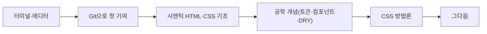

> 웹액츄얼리가 번역한 폴 하나오카(Paul Hanaoka)의 「[디자이너는 어떻게 코드를 배우나? Part Ⅰ](https://webactually.com/2020/05/20/%EB%94%94%EC%9E%90%EC%9D%B4%EB%84%88%EB%8A%94-%EC%96%B4%EB%96%BB%EA%B2%8C-%EC%BD%94%EB%93%9C%EB%A5%BC-%EB%B0%B0%EC%9A%B0%EB%82%98%3F/)」(2020.05)와 「[Part Ⅱ](https://webactually.com/2020/06/18/%EB%94%94%EC%9E%90%EC%9D%B4%EB%84%88%EB%8A%94-%EC%96%B4%EB%96%BB%EA%B2%8C-%EC%BD%94%EB%93%9C%EB%A5%BC-%EB%B0%B0%EC%9A%B0%EB%82%98%3F2/)」(2020.06)를 바탕으로 재구성한 노트다.

## 왜 디자이너가 코드를 배우나

디자인은 예쁜 목업이 아니라 **사용자에게 잘 작동하는 경험을 전달하는 수단**을 만드는 일이다. 건축가가 재료를 모르면 좋은 건물을 설계하기 어렵듯, 디자이너도 화면의 재료인 코드를 알면 결과물이 좋아진다.

코딩과 소프트웨어 공학은 구분한다.

| | 코딩 | 소프트웨어 공학 |
| --- | --- | --- |
| 뜻 | 일을 끝내는 데 필요한 언어에 익숙해지는 것 | 운영체제·알고리즘·아키텍처를 포함한 체계적 설계 |
| 디자이너에게 | 권장 (필수 조건은 아님) | 엔지니어의 영역 |

코드 지식은 디자이너의 필수 자격이 아니라 **팀에 기여하는 폭을 넓히는 능력**이다. 노코드·로코드 도구와 AI 코딩 도구가 늘어도 이 판단은 같다. 생성된 코드를 읽고 고칠 줄 알아야 도구를 제대로 쓴다.

## 학습 순서

### 1. 터미널: 키보드로 파일을 다룬다

터미널(CLI)은 파인더·탐색기 대신 명령어로 파일과 폴더를 다루는 인터페이스다. 디자이너에게 쓸모 있는 것부터 익힌다.

- 많은 파일 이름 바꾸기, 이동, 일괄 처리
- 정규표현식(regex)으로 패턴 검색: "따옴표로 정확히, 마이너스로 제외"하는 검색을 훨씬 강하게 한 것
- 패키지 매니저(macOS·Linux의 Homebrew, Windows의 winget)로 앱과 글꼴 설치를 스크립트로 남기면 새 컴퓨터 세팅이 몇 분이면 끝난다
- zsh 자동 제안·문법 강조 같은 셸 플러그인으로 입문 장벽을 낮춘다

### 2. 코드 에디터: 텍스트 작업을 빠르게

VS Code가 사실상 표준 에디터다. 내장 터미널, Git 통합, 확장 생태계를 갖췄다. 개발이 아니어도 일상 텍스트 작업에 쓸모 있는 기능이 세 가지다.

| 기능 | 예시 |
| --- | --- |
| 다중 커서 | 이름 목록 각 줄에 동시에 커서를 두고 `@company.com`을 한 번에 붙여 이메일 목록으로 만든다 |
| 커맨드 팔레트 | Cmd/Ctrl+Shift+P로 "소문자로", "정렬" 같은 기능을 이름으로 찾아 실행한다 |
| 정규표현식 찾기·바꾸기 | 여러 파일에 걸친 패턴을 한 번에 바꾼다 |

설치와 개발 환경 설정이 첫 장벽이라면 **브라우저에서 바로 돌아가는 온라인 편집기**로 시작한다. CodePen은 HTML·CSS·JS만으로 화면을 만들어 보기 좋고, CodeSandbox·StackBlitz는 React·Vue 같은 프레임워크 환경이 미리 갖춰져 있다. 자기 시안을 직접 코드로 옮겨 보면 Auto Layout과 Flexbox의 관계가 손에 잡힌다([[design-tools-handoff#Figma 디자인을 코드로 옮길 때|Figma 디자인을 코드로 옮길 때]]).

### 3. Git: 첫 기여까지 한 바퀴

버전 관리는 하나의 기준 소스(보통 `main` 브랜치)를 두고 여러 사람이 각자 환경에서 협업하는 방법이다. 버전 "기록"과 다르다.

| 단계 | 하는 일 |
| --- | --- |
| 포크 | 남의 저장소를 내 GitHub 계정으로 복사 |
| 클론 | 내 컴퓨터로 내려받기 |
| 설치·실행 | 의존성 설치 후 로컬에서 띄우기 |
| 커밋 | 고친 내용을 저장 |
| 푸시 | 내 원격 저장소(origin)로 올리기 |
| 풀 리퀘스트 | 원래 저장소(upstream)에 병합을 요청 |
| 업스트림 연결 | 원래 저장소를 remote로 추가해 최신 변경을 받아 오기 |

준비물은 GitHub 계정, Node.js, 그리고 막혔을 때 도움을 청할 용기다. 자세한 개념은 [[git-basics|Git 기초]]에 있다.

### 4. HTML과 CSS: 시맨틱부터

- HTML은 문서에 **구조와 의미**를 주는 태그의 조합이다. `<head>`는 메타데이터와 불러올 파일, `<body>`는 화면에 그릴 내용이다.
- CSS는 그 문서의 모양을 정하는 규칙이고, 충돌하는 규칙은 **캐스케이드** 순서로 정해진다.
- 모든 속성을 외우지 않는다. 선택자, 상속, 박스 모델, **개발자 도구로 디버깅하는 법**이 기본이다. 나머지는 검색과 에디터 자동완성으로 충분하다. 브라우저 개발자 도구는 적용되지 않는 CSS 규칙과 그 이유까지 표시해 준다.

시맨틱 마크업을 쓰면 공짜로 얻는 것이 많다.

| 얻는 것 | 이유 |
| --- | --- |
| 기본 스타일 | `<h1>`은 따로 꾸미지 않아도 제목처럼 보인다 |
| 접근성 | 스크린 리더와 키보드 탐색이 기본으로 동작한다 |
| SEO | 기계가 구조를 읽기 쉽다 |
| 성능 | 깔끔한 HTML이 깔끔한 CSS와 적은 코드로 이어진다 |

### 5. 공학 개념: 추상화

추상화는 **형태와 기능을 분리**하는 공학의 기본 패러다임이다. 디자이너가 이미 쓰는 도구 개념과 그대로 이어진다.

| 개념 | 디자인 도구의 대응물 | 핵심 |
| --- | --- | --- |
| 토큰 | 색·글꼴 스타일, 변수 | `$blue-500` 같은 원시 토큰 위에 `$color-primary` 같은 **의미 토큰**을 두면 테마 교체가 한 줄 수정으로 끝난다 |
| 컴포넌트 | 심볼, 컴포넌트 | 같은 마크업을 옵션·파라미터로 바꿔 재사용한다. 미디어 오브젝트(이미지 + 텍스트 블록)가 대표 예 |
| DRY (Don't Repeat Yourself) | 라이브러리 | 반복을 줄인다. 같은 것을 세 번 복사하면 재사용 단위로 바꾸라는 **3의 법칙**은 규칙이 아니라 가이드다 |

### 6. CSS 작성 방법론

| 방법론 | 방식 | 장점 | 단점 |
| --- | --- | --- | --- |
| 유틸리티(애터믹) CSS | 한 가지 일만 하는 작은 클래스 조합. Tailwind CSS가 대표 | 빠르게 스타일을 입히고 일관성을 지킨다 | 마크업에 클래스가 길게 쌓인다 |
| BEM | 블록·요소·수정자(`.menu`, `.menu__item`, `.menu--open`) | 컴포넌트 단위로 사고하게 한다 | 이름이 길고 반복적이다 |

팀은 대개 하나를 고집하지 않고 섞어 쓴다. 컴포넌트 기반 프레임워크의 사고방식은 BEM과 닮았다.

### 7. 그다음

HTML·CSS가 익숙해지면 JavaScript와 TypeScript, React·Vue 같은 프레임워크, REST·GraphQL로 데이터를 다루는 법으로 넓힌다.

## 정리

- 디자이너의 코드 학습 목적은 **재료 이해**다. 엔지니어가 되는 것이 아니다.
- 터미널과 에디터는 개발이 아니어도 일상 작업을 빠르게 한다.
- Git은 포크부터 풀 리퀘스트까지 한 바퀴 돌아 보는 것이 최고의 입문이다.
- HTML·CSS는 시맨틱과 디버깅법만 확실히 하면 나머지는 찾아 쓰면 된다.
- 토큰·컴포넌트·DRY는 디자인 시스템과 같은 개념이다.
- 새 능력은 겸손하게 쓴다. **공학적 결정은 엔지니어에게 맡긴다.**

관련 노트: [[design-tools-handoff|디자인 도구와 개발자 핸드오프]], [[design-system|디자인 시스템: 구성, 도입, 구축과 배포]], [[semantic-html|시맨틱 HTML과 문서 구조]], [[frontend-roadmap|프론트엔드 학습 로드맵]]
