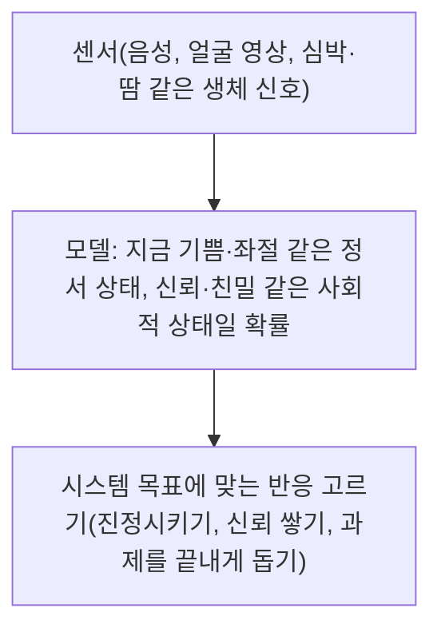

> CrashCourse의 「Crash Course Computer Science」 #38 「Psychology of Computing」(2017)을 바탕으로 재구성한 노트다.

## 사용성이란

사용성(usability)은 사람이 만든 도구로 **목표를 얼마나 효과적이고 효율적으로 이룰 수 있나**다. ISO 9241-11은 여기에 만족도를 더해 효과성·효율성·만족도 세 축으로 정의한다(각 축을 재고 문제를 찾는 방법은 [[user-research#사용성 평가|사용성 평가]]). 사람은 알려진 사양대로 설계된 부품이 아니다. 논리적이다가도 비합리적이고, 내비게이션에 화를 내고, 로봇 청소기에 이름을 붙인다. 그래서 좋은 시스템 설계는 컴퓨터뿐 아니라 사람의 강점과 약점을 함께 고려하고, 지각·인지·행동·사회 심리학의 원리를 빌려 온다.

| 층 | 다루는 것 | 아래 절 |
| --- | --- | --- |
| 지각 | 눈이 무엇을 쉽게 구별하나 | 밝기와 색상 |
| 인지 | 기억과 이해의 한계 | 청킹, 어포던스, 재인과 회상, 숙련 |
| 감정 | 사용자의 정서 상태 | 감성 컴퓨팅 |
| 사회 | 사람끼리, 사람과 기계 사이의 관계 | 컴퓨터 매개 소통, 시선, 의인화 |

## 지각: 순서는 밝기로, 범주는 색상으로

사람은 **밝기(명도)의 순서**는 바로 매긴다. 옅은 파랑, 중간 파랑, 짙은 파랑을 늘어놓으면 고민 없이 정렬한다. 반면 **색상(hue)의 순서**는 잘 매기지 못한다. 주황이 파랑 앞인지 뒤인지, 초록이 어디 들어가는지는 무지개를 떠올려야 겨우 답한다.

| 데이터 | 맞는 인코딩 | 이유 |
| --- | --- | --- |
| 연속값·순서 있는 값(온도, 매출, 밀도) | 한 색상의 밝기 단계 | 눈이 순서를 바로 읽는다 |
| 순서 없는 범주(지역, 제품군) | 서로 다른 색상 | 구별은 잘하지만 크기 순서를 암시하지 않는다 |
| 연속값을 무지개 색으로 | 피한다 | 범례를 계속 오가며 대조해야 하고 실수가 잦다 |

색만으로 의미를 전하면 색각 이상 사용자에게 정보가 사라지므로 모양·라벨을 함께 쓴다([[wcag-guidelines|WCAG]]의 「색만으로 전달하지 않는다」).

## 인지: 기억과 이해의 한계에 맞춘다

### 청킹

사람은 정보를 **작고 의미 있는 묶음(chunk)** 으로 나눌 때 더 잘 읽고 기억한다. 단기 기억에 한 번에 붙잡는 개수는 밀러의 「7±2」가 고전적인 수치이고, 이후 연구는 약 4개 묶음으로 더 작게 본다. 그래서 묶음은 다섯 개 이하로 잡는 편이 안전하다.

- 전화번호 `01012345678`보다 `010-1234-5678`이 외우기 쉽다. 숫자 열한 개가 묶음 세 개가 된다.
- 메뉴와 툴바를 구분선과 그룹으로 나눈다. 버튼을 빈틈없이 붙이면 화면 공간은 아끼지만 훑어보고 찾기가 어려워진다.

컴퓨터에게는 구분자와 여백이 낭비지만 사람에게는 효율이다. 인터페이스는 거의 항상 **사람 쪽 효율**을 고른다. 게슈탈트 원리로 묶음을 만드는 법은 [[ui-density|UI 밀도]]에 있다.

### 어포던스

어포던스(affordance)는 **사물의 생김새가 어떻게 다룰지를 알려 주는 성질**이다. 도널드 노먼이 디자인 분야에 퍼뜨린 개념으로, 판은 밀고 손잡이는 돌리고 틈은 무언가를 넣으라고 말한다. 어포던스를 잘 쓰면 그림·라벨·설명 없이 보기만 해도 무엇을 할지 안다.

- **깨진 어포던스**: 당기게 생긴 손잡이가 달렸는데 미는 문. 문에 「미세요」를 써 붙여야 한다면 설계가 잘못된 것이다. 밀 수밖에 없는 평판을 달면 문제가 사라진다.
- **화면의 어포던스**: 버튼은 튀어나와 보여 누를 수 있다고 말한다. GUI가 명령줄보다 쉬워진 이유 중 하나다. 끌 수 있는 요소에 넣는 오톨도톨한 질감(knurling, 그립 무늬)은 실제 공구의 손잡이에서 빌려 온 것이다.
- 노먼은 나중에 화면 요소의 시각적 단서를 따로 **기표(signifier)** 라 부르자고 했다. 화면에서는 무엇이든 클릭할 수 있으니, 실제로 중요한 것은 「누를 수 있다」는 신호다. 플랫 디자인에서 버튼과 글자가 구별되지 않는 문제가 여기에 해당한다([[visual-design-tips|시각 디자인 요령]]).

### 재인과 회상

**떠올리기(회상, recall)보다 알아보기(재인, recognition)가 훨씬 쉽다.** 빈칸 채우기보다 객관식이 쉬운 것과 같다. 기억은 단어·그림·소리 같은 감각 단서가 있을 때 잘 되살아난다.

| 회상에 기대는 UI | 재인으로 바꾼 UI |
| --- | --- |
| 명령줄: 지우기가 `delete`인지 `remove`인지 `rm`인지 외워야 한다 | 메뉴와 휴지통 아이콘: 보고 고른다 |
| 빈 검색창 | 자동 완성, 최근 검색어 |
| 형식을 외워야 하는 입력 | 날짜 선택기, 예시 플레이스홀더 |

아이콘은 재인을 돕지만 뜻이 모호하면 오히려 부담이 된다([[icon-usability|아이콘 사용성]]).

### 초보자와 숙련자: 여러 경로

모든 것을 찾기 쉽고 배우기 쉽게 만들면 느려진다. 익숙해진 사람은 효율적인 정신 모형(mental model)을 쌓아 더 빨리 하고 싶어 한다. 그래서 좋은 인터페이스는 같은 목표에 **여러 경로**를 둔다.

- 복사·붙여넣기는 편집 메뉴(초보자: 보고 찾는다)와 단축키(숙련자: 손이 기억한다) 둘 다로 된다. 메뉴 항목 옆에 단축키를 적어 두면 초보자가 숙련자로 넘어가는 다리가 된다.
- 명령 팔레트(`Cmd+K`)는 검색(재인)과 키보드 속도를 함께 준다.

## 감정: 감성 컴퓨팅

감성 컴퓨팅(affective computing)은 **사용자의 정서 상태(affect)를 인식하고 그에 맞게 반응하는** 시스템을 다룬다. 로절린드 피카드가 1995년 같은 이름의 보고서로 시작한, 심리학·사회과학·컴퓨터 과학이 섞인 분야다. 감정은 학습·소통·의사결정에서 지각과 인지 자체에 영향을 주기 때문에 중요하다.

부정적인 사용자에게 밝게 응답하면 거슬리고, 분위기를 바꾸려 들면 어색할 수 있다. 어떤 반응이 「맞는지」는 아직 열린 문제다. 얼굴 표정으로 감정을 읽는 기술의 한계는 [[computer-vision-basics|컴퓨터 비전 기초]]에 있다.

## 사회: 사람 사이, 사람과 기계 사이

### 컴퓨터 매개 소통

컴퓨터 매개 소통(computer-mediated communication, CMC)은 컴퓨터를 거친 사람 사이의 소통이다. 모두가 동시에 접속하는 **동기식**(영상 통화)과, 각자 편할 때 답하는 **비동기식**(이메일, 메시지, SNS 글)이 있다. 이모티콘, 발언 순서 같은 규칙, 채널별 말투가 연구 대상이다.

한 가지 일관된 발견은 사람들이 **얼굴을 마주할 때보다 CMC에서 자기 정보를 더 많이 털어놓는다**(자기 노출, self-disclosure)는 것이다. 민감한 정보를 물어야 하는 시스템이라면 얼굴 있는 가상 캐릭터보다 텍스트 챗봇이 더 솔직한 답을 얻을 수 있다.

### 시선

서로 눈을 보며 말하는 **상호 응시(mutual gaze)** 는 설득·교육·주의 끌기에 큰 영향을 준다. 녹화 강의의 강사는 현장 학생을 보느라 카메라를 거의 보지 않아 온라인 시청자의 몰입이 떨어진다. 영상 통화에서도 사람은 화면 속 상대를 보지 화면 위 웹캠을 보지 않아, 상대에게는 늘 눈을 내리깐 것처럼 보인다. 머리와 눈을 영상 처리로 살짝 돌려 카메라를 보는 것처럼 만드는 **시선 보정(gaze correction)** 은 지금 여러 영상 통화 앱과 카메라 소프트웨어에 기능으로 들어가 있다.

### 의인화와 불쾌한 골짜기

사람은 사물을 쉽게 의인화하고, 움직이는 로봇이면 더 그렇다. 사람-로봇 상호작용(human-robot interaction, HRI)은 사람이 로봇의 모양과 행동을 어떻게 받아들이는지, 로봇이 사람의 사회적 신호를 어떻게 읽어 어색하지 않게 어울릴지를 연구한다.

- **불쾌한 골짜기(uncanny valley)**: 로봇이 사람을 닮을수록 호감이 오르다가, 거의 사람 같지만 완전히 같지는 않은 지점에서 섬뜩함으로 뚝 떨어진다. 일본의 로봇 공학자 모리 마사히로가 1970년에 제시했다. 인공 눈알과 합성 피부를 씌운 로봇이 여기에 빠진다.
- **사람처럼 굴지 않아도 사회 규칙을 기대한다.** 로봇이 앞을 가로막거나 발을 밟고 사과하지 않으면 사람들은 크게 화낸다. 겉모습과 무관하게 사람은 기계를 사회적 행위자로 대한다.

## 설계의 영향과 윤리

심리학을 아는 설계는 사람의 행동을 바꿀 수 있고, 그만큼 책임이 따른다.

- 2012년 페이스북은 수십만 명의 피드에서 긍정·부정 게시물 비율을 1주일간 바꿨고, 긍정 글을 더 본 사람은 긍정 글을, 부정 글을 더 본 사람은 부정 글을 더 썼다(감정 전염 실험). 동의 없이 감정을 조작했다는 점에서 크게 논란이 됐다.
- 체류 시간을 늘리려 콘텐츠를 고르는 추천, 사용자를 더 효율적이거나 행복하게 한다는 이유로 컴퓨터가 사용자에게 거짓말을 해도 되는가 같은 질문에는 쉬운 답이 없다. 사용자를 속여 원치 않는 행동을 하게 하는 설계는 다크 패턴이다([[ux-writing|UX 라이팅]]).
- 반대로 같은 원리는 **접근성**을 넓힌다. 직관적인 인터페이스 덕분에 더 많은 사람이 컴퓨터를 쓰고, 원격 수업과 영상 회의가 덜 불편해진다.

## 정리

- 사용성은 목표를 효과적·효율적으로, 만족스럽게 이루게 하는 정도이고, 사람의 지각·인지 특성에 맞출 때 생긴다.
- 순서 있는 값은 밝기로, 순서 없는 범주는 색상으로 보여 준다.
- 정보는 작은 묶음으로 나누고, 생김새로 조작법을 알리고, 외우게 하지 말고 알아보게 한다.
- 초보자용 경로(메뉴)와 숙련자용 경로(단축키)를 함께 둔다.
- 사람은 기계를 사회적 존재로 대하고 감정에 영향을 받는다. **사람을 움직이는 설계일수록 그 힘을 어디에 쓰는지가 윤리의 문제가 된다.**

관련 노트: [[icon-usability|나쁜 아이콘과 좋은 아이콘]], [[ui-density|UI 밀도]], [[visual-design-tips|개발자를 위한 시각 디자인 요령]], [[ux-writing|UX 라이팅]], [[user-research|사용자 리서치]], [[computer-vision-basics|컴퓨터 비전 기초]]
