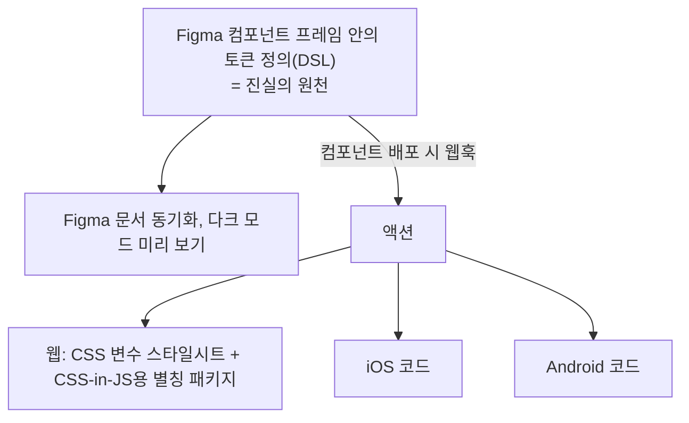

> FEConf 2023 발표 「[크로스 플랫폼 디자인 시스템, 1.5년의 기록](https://www.youtube.com/watch?v=obQvttzgSzY)」(당근 디자인 시스템 팀)을 바탕으로 재구성한 노트다. 공통 언어로서의 제품 언어와 iOS 구현 방식은 뱅크샐러드 기술 블로그의 「[Banksalad Product Language를 소개합니다](https://blog.banksalad.com/tech/banksalad-product-language-ios/)」로 보강했다.

## 범용 디자인 시스템과 제품 언어

같은 레인지 슬라이더라도 Chakra UI와 Adobe Spectrum의 API는 다르다. 추구하는 가치가 달라서다.

| | 범용 디자인 시스템 | 제품 언어 |
| --- | --- | --- |
| 예 | Chakra UI | Spectrum(Adobe), Material, Carbon, Polaris |
| 쓰는 사람 | 오픈 소스를 가져다 쓰는 불특정 개발자 | 그 회사의 제품 |
| 우선 가치 | **유연성** | **일관성** |
| 책무 | 잘 만든 UI 라이브러리 | UI 라이브러리 + **디자인 결정의 집합 관리** |

회사마다 디자인 시스템 조직을 따로 두고 제품 언어를 만드는 이유는 UI에 브랜딩, 앱의 특성 같은 그 회사만의 결정이 반영돼야 하기 때문이다. 디자인 결정의 집합이 제품 언어의 본질이고, UI 라이브러리는 그것을 구현하는 수단이다. 외부 라이브러리는 결정과 무관하거나 결정을 그대로 반영할 수 있을 때만 쓸 수 있다. 디자인 시스템이 무엇으로 이루어지고 어떻게 도입하는지는 [[design-system|디자인 시스템: 구성, 도입, 구축과 배포]]에 있다.

### 목표 설정의 함정

| 함정 | 내용 |
| --- | --- |
| 벤치마킹 대상을 잘못 고른다 | 제품의 조건(예: 모바일 우선, 웹·iOS·Android 동시 구현)과 다른 시스템(반응형 웹용)을 참고하면 그 제품에는 틀린 접근을 하게 된다 |
| 하나로 모든 제품을 덮으려 한다 | 모바일 앱·웹사이트·어드민을 브랜딩이 같다는 이유로 범용 시스템 하나로 덮으려 하면, 불가능하거나 제품 언어를 따로 만드는 것보다 비싸다 |

그래서 중요한 것은 완벽한 범용 시스템이 아니라 **어떤 제품 언어든 반복해서 만들 수 있는 방법론**이고, 그 핵심이 디자인 결정을 모든 영역에 동기화하는 장치, 디자인 토큰이다.

## 디자인 토큰: 결정을 인코딩한다

디자인 시스템을 만드는 일은 결정의 연속이다. 「버튼 높이는 40px」, 「브랜드 색은 이 색」. 결정은 제품이 자라며 바뀐다. 바뀐 결정을 가장 빠르게 모든 제품에 반영하려면 결정을 기계가 읽을 수 있게 인코딩하고 제품이 그것을 읽게 한다. 디자인 토큰은 결정을 사람과 기계가 모두 읽을 수 있게 인코딩한 것이다.

| 인코딩 | 예 | 담긴 뜻 |
| --- | --- | --- |
| **값** | `carrot-500 = (색 값)` | 「이 색의 이름은 carrot-500」이 아니라 「**우리는 제품에 이 색을 쓰고**, 이름은 carrot-500이다」. 선언하지 않은 색은 쓰지 않겠다는 뜻이 함께 들어 있어 결정을 유한한 집합으로 유지한다 |
| **의도**(계층) | `primary = carrot-500` | 「주요 브랜드를 드러내는 곳에 carrot-500을 쓴다」. 지금은 같은 색이어도 나중에 달라질 수 있는 결정을 표현하고, 값이 아니라 의도로 디자인하게 한다 |
| **맥락** | 라이트/다크 모드에서 다른 값 | 다크 모드, 고대비 선호, 모션 줄이기(prefers-reduced-motion), 플랫폼별 시스템 폰트에 따른 타이포그래피 조정 |

유한한 토큰이 유연성을 떨어뜨린다는 걱정에는 이렇게 답한다. 세상에는 무한한 개념이 있지만 우리는 유한한 단어로 충분히 소통한다. 디자인 값도 무한하지만 유한한 토큰으로 소통할 수 있다. 값·의도·맥락 계층을 CSS 커스텀 속성으로 짜는 법은 [[css-color-variables|CSS 커스텀 속성으로 색상 체계 짜기]]에 있다.

### 토큰을 플랫폼마다 동기화하기



- 토큰 정의는 **Figma 변수**(Variables)와 개념이 같다. 새로 토큰을 만든다면 Figma 변수를 먼저 고려한다. 토큰 파일 표준(DTCG)은 [[design-system|디자인 시스템]] 노트에 있다.
- 웹 스타일시트는 **데이터 속성**(`data-*`)으로 맥락을 분기하고, CSS 변수로 토큰과 계층을 구현한다.
- 조직마다 쓰는 CSS-in-JS가 달라, CSS 변수를 가리키는 별칭 패키지를 함께 생성한다. Emotion에서는 보간으로, vanilla-extract에서도 같은 방식으로 쓴다. 특정 CSS-in-JS에 묶이지 않으려는 정적인 접근이다.

### 섣부른 시맨틱 토큰

토큰 운영에서 흔한 실수는 **시맨틱 토큰을 성급하게 정의하는 것**이다.

- 플로팅 액션 버튼(FAB) 하나만 보고 그 배경색에 「floating」 같은 의미를 붙이면 쓸모보다 혼란이 크다.
- 쓸모 있는 시맨틱 토큰은 **여러 사용 사례를 가로지르는 관심사**에서 나온다. 텍스트 입력, 텍스트 영역, 숫자 입력이 모두 같은 배경을 써야 한다면 `field-background`는 쓸모 있을 가능성이 높다.
- 자명하지 않은 의도를 서둘러 부여하지 않는다. **추상은 관찰에서 얻는다.**

## 컴포넌트를 기능과 형태로 나눈다

### 아토믹 단위는 하나로 정해지지 않는다

[[atomic-design|Atomic Design]]은 몇 년 전까지 자주 언급되다 잘 들리지 않게 됐다. 그대로 적용하기 어렵기 때문이다. 라디오 그룹에서 무엇이 원자일까?

| 기준 | 원자 |
| --- | --- |
| 형태 | 동그라미 하나 |
| 기능 | 라디오 하나로는 의미가 없으므로 라디오 그룹 전체 |
| 접근성 | 폼 요소는 라벨을 제공해야 하므로 라디오 + 라벨 |

원자인 기능, 원자인 형태는 있을 수 있지만 **원자인 컴포넌트는 하나로 정해지지 않는다.** 컴포넌트만 분류해 최소 단위를 찾으려 하면 실패한다. 형태의 최소 단위를 주는 **스타일시트**와 기능의 최소 단위를 주는 **헤드리스 컴포넌트**를 나눠 봐야 혼란이 사라진다.

- 체크박스의 **형태**: 현재 상태에 맞는 스타일을 그린다. 선택 안 됨은 빈 상자, 선택됨은 체크된 상자.
- 체크박스의 **기능**: 렌더링을 지우고 상태만 남겨도 남는 것. 클릭하면 선택 여부가 바뀐다. 생김새는 상관없다. 즉 **사용자 입력에 따라 상태가 어떻게 전이되는가**다.

### 해부도

| | 기능 | 형태 |
| --- | --- | --- |
| **구조** | 어떤 부품으로 이뤄지고 각 부품이 상호작용에서 어떤 역할을 하는가 | 어떤 부품으로 이뤄지고 각 부품이 어떤 레이아웃을 갖는가. Figma 프레임 구조를 이에 맞춘다 |
| **상태·맥락** | 상태: 사용자 입력으로 바뀌는 것(hover, focus, checked). 맥락: 코드에서 주입하는 옵션(disabled) | 상태 옵션: 상태와 맥락에 따라 형태가 바뀌는 것(hovered, focused, checked) |
| 고유 관심사 | **상호작용**: 상태를 바꾸는 단위(클릭 → checked 전환, Tab → focus) | **시각 옵션**(size, variant), **디자인 결정**: 상태 옵션 × 시각 옵션의 모든 조합에서 부품별 속성 값. 토큰으로 표현한다 |

두 구조는 겹치는 부분이 크지만 같지는 않다. 아이콘은 기능에는 없고 형태에만 있다. 상태와 맥락의 차이는 **누가 바꾸는가**다. 상태는 사용자 입력이, 맥락은 코드만이 바꾼다.

### 상태 압축

디자이너가 보는 상태 옵션이 다섯 가지여도 개발자가 보는 상태와 맥락의 조합은 16가지가 될 수 있다. 모든 조합을 Figma에 그리면 형태가 늘수록 조합이 폭발한다.

상태 사이에는 **우선순위**가 있다. disabled일 때 hover를 고려할 필요는 없다. 렌더링이 실제로 달라져야 하는 조합은 제한적이고, 그 수는 디자이너가 보는 경우의 수와 일치한다. 그래서 상태·맥락 조합을 조건과 우선순위에 따라 1차원 목록으로 압축하면, 빠짐없이 파악하면서 디자이너와 같은 언어로 소통할 수 있다.

## 디자인과 개발의 순환 참조 끊기

디자인을 먼저 하고 구현하는 방식에서 생기는 **순환 참조**다. 디자인은 어떤 상태가 생길지 미리 알기 어려워 개발에 의존하고, 개발은 디자인이 나와야 코드를 쓸 수 있다고 여겨 디자인에 의존한다. 코드에서 의존 방향을 인터페이스로 뒤집듯, 일하는 방식에도 **공통 인터페이스**를 둔다. 앞의 해부에서 공통 관심사는 구조, 상태, 맥락이다.

```text
① 디자이너 + 개발자: 간단한 스케치로 구조와 상태 옵션을 함께 정한다 (= 공통 인터페이스)
② 개발자: 구조에서 기능·접근성에 의미 있는 것만 남기고 상태 전이를 정리
         → 헤드리스 컴포넌트 구현 (또는 기존 라이브러리)
③ 디자이너: 상태 옵션에 맞춰 구조대로 컴포넌트를 디자인
④ 개발자: 디자인으로 스타일을 쓰고 헤드리스 컴포넌트와 결합 → Figma와 동기화된 컴포넌트
```

「Figma → 개발」 순서를 「공통 인터페이스 → Figma와 개발」로 바꾸는 것이다. 즉 Figma도 개발과 같은 하나의 구현체로 취급한다. 디자이너와 협업하는 일반적인 방법은 [[working-with-designers|디자이너와 함께 일하기]]에 있다.

### 이름과 단위를 맞추는 공통 언어

제품 언어는 디자인팀만의 규칙이 아니라 제품을 만드는 모든 직군이 함께 쓰는 언어다. 직군마다 UI를 쪼개는 단위와 부르는 이름이 다르면 같은 것을 다르게 부르고 다른 것을 같은 이름으로 불러 소통 비용이 커진다.

| 방법 | 효과 |
| --- | --- |
| 명세가 부족하면 **동작하는 코드(PoC)부터** 만들어 플랫폼별 결과를 나란히 비교한다 | 합의할 지점(예: 컨테이너가 어떤 속성·메서드를 가져야 하나)이 문서보다 빨리 드러난다 |
| 개발자가 디자인 파일의 편집용 사본을 직접 열어 본다 | 자동 생성된 스펙 화면에 가려진 의도(오토 레이아웃, 컴포넌트 변형)를 정확히 읽는다 |
| 디자인 도구 개념과 플랫폼 개념을 대응시킨다 | Figma 컴포넌트 ↔ 클래스·컴포넌트, 오토 레이아웃 ↔ 스택 뷰·Flexbox |
| 코드 구조가 디자인 계층을 그대로 따르게 한다 | 디자인이 바뀔 때 고칠 범위를 예측하기 쉽다. 선언적 API(SwiftUI·Compose·React)가 이 목적에 맞는다 |
| 레이아웃만 맡는 컨테이너와 내용을 그리는 자식을 나눈다 | 구조가 명확하고 조합이 쉽다 |
| 비슷해 보여도 쓰임이 다르면 성급히 상속·추상화하지 않는다 | 일부 중복을 허용해 의존을 끊는 편이 나을 때가 많다 |

검증용 앱을 둘로 나누면 좋다. 하나는 컴포넌트별 카탈로그와 스냅샷 테스트용(웹의 Storybook에 해당), 다른 하나는 실제 조합 화면을 가짜 데이터로 재현하는 용도다. 빌드가 오래 걸리는 본 앱 대신 여기서 UI를 짧은 주기로 고친 뒤 옮긴다.

## 일관성과 유연성을 함께 주는 API

제품 언어는 일관성을 우선하므로 Spectrum 같은 API를 주고 싶다. 하지만 일관된 형태가 제품의 90%를 덮어도, 나머지 10%가 사용자의 개발을 늦춘다. 그래서 패키지를 세 층으로 나눈다.

| 층 | 역할 |
| --- | --- |
| **사전 조합 컴포넌트**(composed) | 일관성을 기본값으로 준다. 스타일 속성은 margin 같은 레이아웃용으로만 연다 |
| **조합 가능한 패키지**(composable) | 그 이상의 유연성이 필요할 때 직접 조립한다. 사전 조합 컴포넌트를 쓰는 것보다 크게 어렵지 않게 만드는 것이 목표다 |
| **코어**(core) | 상태 차트 + DOM 바인딩. React에 의존하지 않는다 |

### 기능: 상태 차트와 DOM 바인딩

체크 여부 상태가 있고, 클릭하면 전환되며, disabled가 주입되면 전환되지 않는 체크박스를 예로 든다.

| 해부 요소 | DOM 바인딩에서 |
| --- | --- |
| 구조 | 부품 네 개(예: root, input, control, label)마다 펼칠 속성 객체를 선언한다. 최종적으로 JSX에 스프레드한다 |
| 상태 | 상태 차트가 준 상태로 요소 속성을 정한다. checked 상태를 input의 `checked`에 바인딩 |
| 상호작용 | 이벤트 핸들러가 상태 차트에 이벤트를 보낸다. input의 change → `TOGGLE` 이벤트. 상태 차트는 이벤트와 맥락(disabled)을 보고 전환할지 정해 새 상태를 돌려준다 |
| 맥락 | 상태 차트의 상태가 아니라 외부에서 주입한 prop을 그대로 바인딩한다. `disabled` |

이 로직은 React에 의존하지 않으므로 React 통합은 얇은 래퍼다. 상태·맥락 인터페이스와 상태 변화 콜백으로 헤드리스 체크박스의 props를 선언하고, 상태 차트 → DOM 바인딩 결과를 그대로 반환한다. 실제로는 React와 상태를 맞추기 위해 `useSyncExternalStore` 같은 기법이 더 들어간다.

### 형태: 하나의 스키마에서 CSS와 CSS-in-JS를 생성

CSS와 JavaScript는 언어가 달라 훅처럼 래퍼를 쓸 수 없다. 대신 하나의 스키마에서 CSS와 CSS-in-JS 코드를 함께 생성해 둘이 어긋나지 않게 한다.

```text
스키마
  구조:     부품 네 개 (예: root, control, icon, label)
  시각 옵션: size = large → root.height 32px / medium → 24px   (Stitches·cva의 variants와 비슷한 표현)
  상태 옵션: [data-checked] → control.background = primary
     ↓ 생성
  CSS:      구조와 시각 옵션에서 규칙대로 만든 클래스명, 상태는 PostCSS 중첩으로 선택자 생성
  JS:       CheckboxVariantProps 타입 + 시각 옵션을 부품별 클래스명으로 바꾸는 함수
```

`data-checked` 같은 선택자는 HTML이 알아서 넣어 주지 않으므로, DOM 바인딩에서 control에 상태를 데이터 속성으로 내보내는 코드를 더한다. 상태 옵션이 기능과 형태의 공통 관심사였음을 생각하면 당연히 생기는 코드다.

### 합성

마지막으로 기능 인터페이스와 형태 인터페이스를 확장해 컴포넌트 props를 만들고, 기능 훅과 클래스명 함수를 각각 불러 JSX에 스프레드한다. 이 코드는 단순하고 반복적이라 사용자가 조합 가능한 패키지로 직접 다시 만들어도 부담이 적다. React에 의존하는 부분이 단순 바인딩뿐이라 다른 프레임워크로 옮기기도 쉽다.

컴포넌트를 이렇게 정의하면 렌더링될 수 있는 모든 경우의 수를 미리 계산할 수 있어, 스냅샷 테스트·QA 자동화와 코드에 동기화된 스펙 문서의 바탕이 된다. 같은 계열의 접근은 Adobe Spectrum(React Aria), Zag.js(상태 기계 기반 헤드리스 컴포넌트), class-variance-authority(cva), [SEED Design](https://github.com/daangn/seed-design)에서 볼 수 있다. 헤드리스 라이브러리가 접근성 테스트에서 하는 역할은 [[a11y-driven-testing|접근성 기반 UI 테스트 자동화]]에 있다.

## 정리

- 디자인 시스템의 목표와 벤치마킹 대상을 먼저 정한다. 회사의 디자인 시스템은 범용 라이브러리가 아니라 **디자인 결정을 관리하는 제품 언어**다.
- 디자인 토큰은 결정을 값·의도·맥락으로 인코딩한다. 시맨틱 토큰은 섣불리 만들지 말고 여러 사례를 가로지르는 관심사를 관찰해 뽑는다.
- 컴포넌트는 기능(헤드리스)과 형태(스타일시트)로 나눠 최소 단위를 정한다.
- 상태·맥락 조합은 우선순위로 압축해 상태 폭발을 없앤다.
- 구조·상태·맥락을 공통 인터페이스로 삼아 디자인과 개발의 순환 참조를 끊는다.
- 사전 조합 컴포넌트로 일관성을, 쉽게 조립할 수 있는 패키지로 유연성을 준다.

관련 노트: [[design-system|디자인 시스템: 구성, 도입, 구축과 배포]], [[atomic-design|Atomic Design과 컴포넌트 폴더 구조]], [[css-color-variables|CSS 커스텀 속성으로 색상 체계 짜기]], [[working-with-designers|디자이너와 함께 일하기]], [[a11y-driven-testing|접근성 기반 UI 테스트 자동화]]
