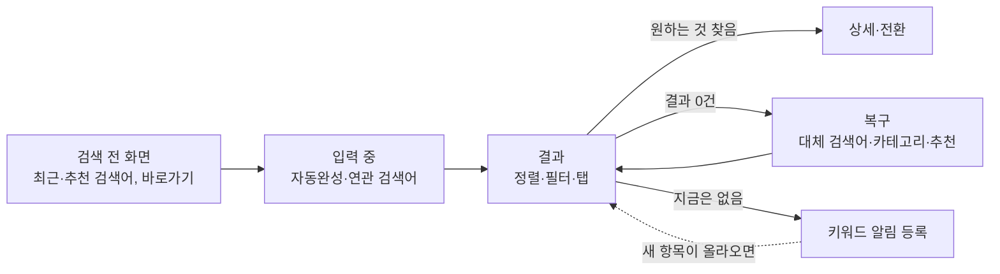

> 팁스터 뉴스레터 「여러분이 생각하는 ‘좋은 검색’의 핵심은 무엇인가요?」(2026.05)의 번개장터·당근·후루츠패밀리 검색 사례를 바탕으로, 설계 기준은 Baymard Institute의 「[Autocomplete Design](https://baymard.com/blog/autocomplete-design)」·「[No Results Page](https://baymard.com/blog/no-results-page)」와 Nielsen Norman Group의 「[Site Search Suggestions](https://www.nngroup.com/articles/site-search-suggestions/)」·「[Search: No Results](https://www.nngroup.com/articles/search-no-results-serp/)」로 보강해 재구성한 노트다.

## 좋은 검색이란

좋은 검색의 기준은 두 가지다. **최소한의 탐색으로 정확한 결과에 닿게 하는 것**, 그리고 **무엇을 원하는지 아직 모르는 사용자에게 방향을 잡아 주는 것**이다. 빠르고 정확한 결과는 검색 엔진(색인, 랭킹)이 맡고, 방향 잡기는 화면 설계가 맡는다. 검색 엔진의 원리는 [[search-engine-basics|검색엔진의 원리]]에 있다.

검색이 서비스에서 맡는 역할도 정해야 한다. 중고 거래 앱은 검색으로 거래를 빠르게 잇고, 지역 커뮤니티 앱은 검색창에 동네 소식을 두어 머무르게 하고, 패션 앱은 스타일 필터로 취향을 탐색하게 한다. **같은 검색창이라도 서비스의 방향에 따라 검색 전 화면, 필터, 결과 구성이 달라진다.**

## 1. 검색 전 화면

검색창을 눌렀는데 빈 화면만 뜨면 기회를 버리는 것이다.

| 요소 | 쓰임 |
| --- | --- |
| 최근 검색어 | 같은 것을 다시 찾는 사용자의 입력을 없앤다. 항목별 삭제와 전체 삭제, 저장 끄기를 함께 둔다 |
| 인기·추천 검색어 | 무엇을 칠지 모르는 사용자에게 출발점을 준다 |
| 서비스 바로가기 | 「검색하려는」 사람과 특정 기능으로 「바로 가려는」 사람을 모두 받는다 (예: 알바·부동산·중고차 바로가기) |
| 콘텐츠 | 검색 전 단계에 동네 소식 같은 콘텐츠를 두면, 살 것이 없는 날에도 앱을 열 이유가 된다. 대신 검색이라는 본래 목적을 가리지 않게 한다 |

## 2. 자동완성

자동완성은 사용자가 효과적인 검색어를 고르고, 덜 치고, 오타를 피하게 돕는다. 제안을 직접 고르지 않더라도 어떤 상품이 있는지, 철자가 어떤지, 사람들이 무엇을 찾는지 보여 주는 효과가 있다.

| 원칙 | 내용 |
| --- | --- |
| 개수를 줄인다 | 데스크톱 10개 이하, 모바일 4~8개. 많으면 선택이 마비되고, 대부분은 위쪽 몇 개만 고른다. 「drumsticks」와 「drum sticks」 같은 중복은 합친다 |
| 입력하지 않은 부분을 강조한다 | 사용자가 친 글자를 굵게 하면 모든 줄에 같은 강조가 반복돼 훑기 어렵다. **예측한 나머지 부분**을 강조해 빈칸을 채우듯 읽게 한다 |
| 범위 제안은 다르게 보인다 | 「러그 → 욕실 카테고리에서」 같은 범위(scope) 제안은 들여쓰기·색·기울임으로 일반 검색어와 구분한다. 안 그러면 못 보고 지나친다 |
| 결과가 있는 것만 제안한다 | 결과 0건이나 엉뚱한 결과로 가는 제안은 제안이 없는 것보다 나쁘다 |
| 키보드로 쓸 수 있게 | 위·아래 화살표로 이동하고 Enter로 제출한다. 포커스된 제안을 입력란에 채워 넣어, 「Nikon D7100」에 「렌즈」를 덧붙여 좁힐 수 있게 한다. 마지막에서 처음으로 돌아간다 |
| 스크롤바를 두지 않는다 | 목록 안 스크롤은 잘못 누르기와 숨은 항목을 만든다. 개수를 줄여 자연스러운 높이로 둔다 |
| 시각적 소음을 줄인다 | 데스크톱은 공간이 넓어 상품·트렌드까지 끼워 넣기 쉽다. 사용 연구에서 상품 같은 리치 제안은 잘 선택되지 않았다. 모바일은 텍스트 제안만 둔다 |
| 모바일에서 공간을 지킨다 | 검색창과 키보드 사이가 좁은데, 고정 헤더·채팅 버튼·앱 설치 배너가 남은 공간을 먹으면 제안이 1~2개밖에 안 보인다. 탭 영역과 간격을 충분히 준다 |

**연관 검색어**는 자동완성을 넘어 탐색의 첫 단추가 된다. 「킥보드」를 치면 「유아 킥보드」, 「두발 킥보드」처럼 실제로 많이 찾는 세부 키워드를 보여 주면, 종류가 많아 어디서 시작할지 모르는 사용자가 방향을 잡는다. 자동완성의 접근성 패턴(콤보박스 역할, 활성 항목 알림)은 [[aria-widget-patterns|ARIA 위젯 패턴]]을 따른다.

## 3. 오타와 표현 차이 받아 주기

사용자는 오타를 내고, 서비스와 다른 말로 찾는다. 검색 엔진이 그대로 빗나가면 사용자는 「없는 상품」이라고 판단하고 떠난다.

| 차이 | 처리 |
| --- | --- |
| 오타 | 편집 거리 기반 퍼지 검색으로 비슷한 단어까지 찾고, 「○○(으)로 검색한 결과입니다」를 알린다 |
| 동의어·약어·외래어 표기 | 동의어 사전으로 묶는다 (예: 아이폰·iPhone, 노트북·랩톱) |
| 띄어쓰기 | 한국어는 형태소 분석이나 n-gram으로 붙여 쓴 말과 띄어 쓴 말을 같이 찾는다([[search-engine-basics#한국어 색인\|한국어 색인]]) |
| 모델 번호·코드 | 하이픈·공백 유무에 상관없이 맞춘다 |

자동으로 고친 검색어로 결과를 보여 줄 때는 **원래 검색어로 다시 찾는 링크**를 함께 둔다. 사용자가 일부러 친 낯선 단어일 수 있다.

## 4. 결과: 정렬과 필터

필터의 역할은 사용자가 원하는 정보에 닿는 데 드는 에너지를 줄이는 것이다. 매물이 많고 같은 상품도 상태·가격이 제각각인 중고 거래처럼 결과가 많을수록 필터 설계가 탐색 피로를 좌우한다.

| 원칙 | 예 |
| --- | --- |
| 결과 개수를 미리 보여 준다 | 「적용하기」 대신 「128개 상품 보기」. 조건을 고르는 동안 결과가 얼마나 남는지 알 수 있어 0건으로 가는 조합을 피한다 |
| 조건 목록과 옵션을 나란히 | 왼쪽에 필터 종류, 오른쪽에 그 옵션을 두면 긴 스크롤 없이 원하는 조건만 고른다. 필터 종류가 늘어도 존재를 알아차리기 쉽다 |
| 고민을 줄이는 선택지 | 최소·최대 가격 입력과 함께 추천 가격대 칩을 둔다 |
| 걸러 내는 필터 | 「제외 키워드」처럼 원하지 않는 결과를 빼는 조건은 상품명·설명까지 걸러 결과의 정확도를 높인다 |
| 핵심 조건은 꺼내 둔다 | 패션의 사이즈처럼 모든 탐색에 걸리는 조건은 다른 필터와 묶지 말고 언제든 꺼낼 수 있는 버튼으로 둔다 |
| 도메인에 맞는 필터 | 스타일(빈티지, 스트릿), 네고 가능 여부, 상품 상태 등급처럼 그 분야 사용자가 실제로 따지는 조건을 필터로 만든다. 상태처럼 가격만큼 중요한 조건이 빠지면 상세 페이지를 일일이 열어 봐야 한다 |
| 쉬운 말 | 「저가순」·「고가순」보다 「낮은 가격순」·「높은 가격순」 |
| 목적에 따라 밀도를 달리한다 | 「좋은 거 없나」 하는 열린 탐색에는 상단 고정 빠른 필터와 단순한 정렬을, 브랜드를 이미 정한 탐색에는 조건을 한곳에 모은 바텀 시트와 세밀한 정렬(할인율순, 찜 많은순)을 준다 |
| 적용한 필터를 보여 준다 | 결과 위에 걸린 조건을 칩으로 보여 주고 하나씩 해제하게 한다 |

통합 검색에서 결과를 탭(전체, 중고 거래, 커뮤니티, 업체)으로 나눌 때는 탭 이름만으로 무엇이 들었는지 알 수 있어야 한다. 「업체 소식」과 「동네 업체」처럼 비슷한 이름은 처음 쓰는 사람이 구분하지 못한다. 결과 사이에 광고를 섞으면 광고 표시가 실제로 인지되는지 확인한다.

정렬 기준의 기본값(관련도순, 최신순)과 랭킹 신호(최신성, 인기, 판매자 신뢰도, 거리)는 검색 엔진의 문제이면서 동시에 UX다. 사용자가 「왜 이게 위에 있지」를 이해할 수 있어야 결과를 믿는다. 필터·정렬·검색 결과는 공유하고 뒤로 가기로 돌아올 수 있게 URL에 둔다([[url-as-state|URL을 상태로 쓰기]]). 가격 범위 슬라이더 설계는 [[ecommerce-ui|전자상거래 UI 디자인]]에 있다.

## 5. 결과 0건

결과 0건 페이지는 사용자가 이탈하기 가장 쉬운 곳이다. 이커머스 사이트의 절반가량이 이 페이지를 잘못 만들어 사용자가 다른 검색 엔진으로 떠난다.

| 원칙 | 내용 |
| --- | --- |
| 0건임을 분명히 | 작은 안내문은 놓치고, 아래 추천 상품을 검색 결과로 착각한다. 글자 크기와 여백으로 눈에 띄게 한다 |
| 검색어를 다시 보여 주고 고칠 수 있게 | 무엇으로 찾았는지 보여 주고, 수정할 수 있는 검색창을 둔다 |
| 대체 검색어 | 검색어를 줄이거나 바꾼 대안을 제안하고 각각의 상위 결과 몇 개를 미리 보여 준다. 대안이 하나뿐이면 그 결과를 바로 보여 주고 바꿨다고 알린다 |
| 관련 카테고리 | 더 넓은 카테고리로 가는 길을 준다 |
| 추천·인기 상품 | 개인화 추천이나 인기 상품으로 둘러볼 거리를 준다 |
| 사람에게 묻는 길 | 상담 채팅·전화처럼 직접 도움받는 경로를 둔다 |
| 놀리지 않는다 | 이미 답답한 사용자에게 농담과 우스꽝스러운 그림은 비웃음으로 읽힌다 |

「철자를 확인하세요」 같은 검색 팁만 두는 것은 효과가 없다. 사용자는 팁을 거의 읽지 않는다. 팁은 위 방법들의 보조로만 쓴다. 필터 조합 때문에 0건이 났다면 어느 필터를 풀면 결과가 생기는지 알려 준다.

## 6. 다시 돌아오게 하기: 키워드 알림

지금 원하는 매물이 없어도 끝이 아니다. 검색 결과 화면에서 **키워드 알림**을 걸게 하면, 사용자는 새로 고침을 반복하지 않고도 조건에 맞는 글이 올라올 때 돌아온다. 키워드만이 아니라 카테고리·최대 가격까지 조건으로 걸게 해야 원하지 않는 알림에 지쳐 알림을 끄는 일이 줄어든다. 맥락이 다른 영역(거래 매물과 커뮤니티 글)은 알림을 따로 설정하게 한다.

## 7. 사진으로 검색하기

패션처럼 말로 설명하기 어려운 분야는 이미지 검색이 강력한 입구다. 「이런 느낌의 재킷」을 사진 한 장으로 찾고, 카테고리를 골라 범위를 좁힌다.

## 정리

- 검색은 검색창 하나가 아니라 검색 전 화면 → 자동완성 → 결과·필터 → 0건 복구 → 알림으로 이어지는 흐름이다.
- 자동완성은 짧게(데스크톱 10개, 모바일 4~8개), 예측한 부분을 강조하고, 키보드로 쓸 수 있게 한다.
- 오타·동의어·띄어쓰기를 받아 주고, 자동 교정했다면 원래 검색어로 돌아가는 길을 둔다.
- 필터는 결과 개수를 미리 보여 주고, 탐색 목적에 따라 밀도를 달리하며, 도메인 사용자가 실제로 따지는 조건을 담는다.
- 결과 0건에는 대체 검색어·카테고리·추천·사람의 도움으로 길을 내고, 지금 없는 것은 알림으로 다시 부른다.

관련 노트: [[search-engine-basics|검색엔진의 원리]], [[ecommerce-ui|전자상거래 UI 디자인]], [[url-as-state|URL을 상태로 쓰기]], [[aria-widget-patterns|ARIA 위젯 패턴]], [[ux-writing|UX 라이팅]], [[user-research|사용자 리서치]]
