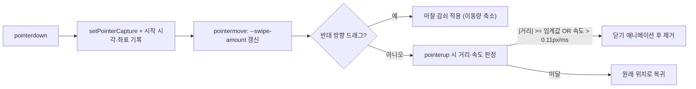

> Emil Kowalski의 「[Building a toast component](https://emilkowal.ski/ui/building-a-toast-component)」(오원종 번역 「[토스트 컴포넌트 만들기](https://devowen.com/518)」, 2026.02)를 바탕으로 재구성한 노트다.

## 토스트 컴포넌트의 역할과 호출 구조

**토스트(Toast)** 는 사용자 행동의 결과("저장됨", "클립보드에 복사됨")를 화면 구석에 잠깐 띄웠다가 자동으로 사라지게 하는 비차단(non-blocking) 알림 UI다. 모달(`alertdialog`)과 달리 포커스를 빼앗지 않아 작업 흐름을 끊지 않는다.

React 앱에서 토스트를 Context로만 구현하면 컴포넌트 트리 안쪽에서만 `useToast()`를 호출할 수 있어, API 인터셉터나 유틸리티 함수처럼 React 바깥에서는 띄우기 어렵다. Sonner 같은 실무 라이브러리는 **구독자 패턴(Observer) 기반 외부 스토어**를 둔다.

- 외부 모듈에 `toasts` 배열과 `listeners` 집합을 두고 `toast("저장됨")` 함수가 상태를 갱신해 리스너를 깨운다.
- `<Toaster />` 컴포넌트는 스토어를 구독해 현재 토스트 목록을 포털이나 고정 컨테이너에 그린다.
- 덕분에 컴포넌트 안팎 어디서나 같은 함수 한 줄로 토스트를 띄울 수 있다.

## 중단 가능한 애니메이션: `@keyframes` 대신 `transition`

토스트가 0.5초 간격으로 연달아 들어오면 기존 토스트는 위나 아래의 새 슬롯으로 밀려나야 한다. CSS `@keyframes`는 시작과 끝이 고정돼 있어, **이전 애니메이션이 끝나기 전에 목표 위치가 바뀌면 요소가 뚝 끊기며 점프**한다.

반면 CSS `transition`은 **중단 가능(interruptible)** 하다. 전환 도중에 인라인 스타일이나 CSS 변수(`--y`)가 새 목표값으로 바뀌면 브라우저는 현재 렌더링 위치에서 새 목표 위치로 부드럽게 방향을 꺾는다.

- **등장 연출**: 첫 마운트 시 `translateY(100%)`에서 `useEffect`로 `data-mounted="true"`를 켜 `translateY(0)`으로 전환하거나, 최신 브라우저에서는 `@starting-style` 규칙으로 진입 전 초기 스타일을 선언한다.
- **확장 호버 틈 메우기**: 접힌 스택이 마우스 호버로 펼쳐질 때 토스트 사이 간격(`gap`) 위로 커서가 지나가면 `mouseleave`가 발생해 스택이 도로 접힐 수 있다. 토스트의 `::after` 가상 요소로 카드 사이 빈 간격을 투명하게 덮으면 커서가 이동해도 호버 상태가 유지된다.

## 스택 배치와 높이 정렬

접힌 상태에서 토스트가 겹쳐 보이게 하려면 각 토스트를 `position: absolute`로 두고, 가장 앞(`index = 0`)에서의 순번을 기준으로 Y 오프셋과 축소 비율을 계산한다.

```css
.toast {
  position: absolute;
  transition: transform 400ms ease, height 400ms ease, opacity 400ms ease;
  transform:
    translateY(calc(var(--lift) * var(--gap) * var(--index)))
    scale(calc(1 - var(--index) * 0.05));
}
```

이때 토스트마다 텍스트 줄 수가 달라 **높이가 제각각**이면 뒤쪽 카드가 앞쪽 카드 위로 삐죽 튀어나온다. 이를 막으려면 접힌(`data-expanded="false"`) 상태에서는 뒤쪽 토스트의 높이를 **맨 앞 토스트의 높이(`--front-toast-height`)로 통일**하고, 마우스를 올려 펼쳤을 때만 각자의 실제 높이(`heights` 배열 누적합 + 간격)로 복원한다.

## 모멘텀 기반 스와이프 제스처

터치 기기와 데스크톱 모두에서 토스트를 쓸어 넘겨 닫을 수 있게 하려면 거리 임계값만이 아니라 **속도(momentum)** 를 함께 본다.



- `setPointerCapture`를 걸어야 드래그 도중 포인터가 토스트 영역 밖으로 나가도 `pointermove`·`pointerup` 추적이 끊기지 않는다.
- 속도는 `|드래그 거리| / 경과 시간(ms)`으로 계산한다. 짧게 튕기듯(flick) 밀어도 속도가 빠르면 닫혀야 자연스럽다.
- 자동 닫힘 타이머는 사용자가 토스트 스택에 마우스를 올리거나 포커스를 옮기면 일시 정지하고, 벗어날 때 남은 시간만큼만 다시 재야 읽는 도중 사라지는 일을 막는다.

## 접근성과 사용성 함정

| 항목 | 잘못된 구현 | 권장 방식 |
| --- | --- | --- |
| 스크린 리더 알림 | 토스트마다 `role="alert"`(`assertive`) 남발 | 일반 알림은 `role="status"` / `aria-live="polite"`, 긴급 오류만 `assertive` |
| 자동 닫힘과 행동 버튼 | "실행 취소(Undo)" 버튼이 든 토스트를 3초 뒤 강제 종료 | 키보드 포커스가 들어오면 타이머 정지, 중요 행동은 화면 내 배너·인라인 UI로 제공 |
| 오류·긴 문구 전달 | 폼 검증 실패나 긴 가이드를 토스트에 담음 | 토스트는 1~2줄 상태 확인용으로 한정하고, 검증 오류는 해당 입력 필드 옆에 표시 |
| 움직임 감소 설정 | 호버·스와이프·슬라이드 강제 재생 | `@media (prefers-reduced-motion: reduce)`에서 이동 대신 즉시 표시/페이드로 축소 |

## 정리

- 토스트 스토어를 React 트리 밖에 두면 컴포넌트·비동기 모듈 어디서든 호출할 수 있다.
- 연속 알림과 스택 재배치가 자연스러우려면 `@keyframes` 대신 중단 가능한 `transition`을 쓰고, 접힌 상태에서는 앞 토스트 높이에 맞춰 삐죽 튀어나옴을 막는다.
- 스와이프는 거리와 속도를 함께 판정하고, 중요 오류나 필수 액션은 자동 사라짐이 있는 토스트에 맡기지 않는다.

관련 노트: [[ui-motion-principles|UI 모션 디자인: 애니메이션 원칙, 모션 커브, 안무]], [[loading-ui|로딩 UI: 스피너, 로딩 애니메이션, 스켈레톤, 프로그레스 바]], [[form-usability|더 나은 폼을 만드는 팁]]
