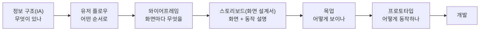

> 고려사이버대학교 「UI/UX 디자인」(2024-2학기) 강의 내용을 바탕으로 정리했다. 와이어프레임 도구 기준은 웹액츄얼리의 「[원활한 커뮤니케이션을 위한 와이어프레임을 찾아서](https://webactually.com/2015/05/21/%ec%9b%90%ed%99%9c%ed%95%9c-%ec%bb%a4%eb%ae%a4%eb%8b%88%ec%bc%80%ec%9d%b4%ec%85%98%ec%9d%84-%ec%9c%84%ed%95%9c-%ec%99%80%ec%9d%b4%ec%96%b4%ed%94%84%eb%a0%88%ec%9e%84%ec%9d%84-%ec%b0%be%ec%95%84/)」(2015.05)로 보강했다.

## 산출물의 흐름

화면을 만들기 전에 거치는 산출물들은 이름이 비슷해 섞어 부르기 쉽다. 구분 기준은 **충실도(fidelity)**, 즉 최종 결과물과 얼마나 닮았나다. 충실도가 낮을수록 빨리 만들고 쉽게 버린다. 높을수록 실제에 가까운 피드백을 받는 대신 고치기 비싸다.

| 산출물 | 답하는 질문 | 담는 것 | 담지 않는 것 | 주로 만드는 사람 |
| --- | --- | --- | --- | --- |
| 정보 구조(IA) | 서비스에 무엇이 있고 어떻게 묶이나 | 메뉴 계층, 화면 목록 | 화면 모양 | 기획자 |
| 유저 플로우 | 사용자가 어떤 경로로 목표에 가나 | 화면 간 이동, 분기 | 화면 내부 | 기획자, UX 디자이너 |
| 와이어프레임 | 화면마다 무엇을 어디에, 무엇을 먼저 | 요소 배치, 우선순위, 기능 | 색, 이미지, 실제 글꼴 | 기획자, UX 디자이너 |
| 목업 | 실제로 어떻게 보이나 | 색, 타이포그래피, 아이콘, 간격, 실제 문구 | 동작 | UI 디자이너 |
| 프로토타입 | 실제로 쓰면 어떤가 | 클릭·전환·입력 같은 상호작용 | (보통) 실제 데이터와 백엔드 | 디자이너, 개발자 |

한마디로 **와이어프레임은 구조, 목업은 생김새, 프로토타입은 사용성**을 다룬다.

## 와이어프레임

UI의 대표 화면을 선과 상자로 그린 **설계도**다. 정보를 어디에 놓고 무엇을 먼저 보여 줄지, 어떤 기능이 있는지를 구조적으로 정한다. 유저 플로우가 화면 사이의 흐름을 다룬다면, 와이어프레임은 화면 하나하나의 내부 구조에 집중한다.

와이어프레임을 기준으로 UI 디자인, 개발, 데이터 설계가 동시에 시작되므로 팀 전체가 같은 그림을 보게 하는 역할이 크다.

### 충실도 세 단계

| 단계 | 모습 | 쓰임 |
| --- | --- | --- |
| 저충실도 | 손 스케치나 회색 상자. 이미지 자리는 X 표시, 제목은 "헤더" 같은 텍스트 | 아이디어를 여러 개 빠르게 비교한다. 세부가 없어서 오히려 구조 논의에 집중된다 |
| 중충실도 | 회색조 디지털 도구. 글자 크기·굵기로 제목과 본문을 구분하고, 명암으로 요소의 중요도를 드러낸다 | 요소별 기능과 특징을 구체적으로 정한다. 실무에서 가장 많이 쓴다 |
| 고충실도 | 픽셀 단위의 레이아웃, 메뉴 체계와 컴포넌트 상호작용까지 | 설계 확정용 논의 자료. 목업이나 프로토타입의 바로 앞 단계 |

예전에는 손으로 그린 저충실도가 대부분이었지만, Figma 같은 도구로 처음부터 고충실도에 가깝게 그리고 화면을 이어 플로우까지 붙이는 경우가 늘었다.

### 그리는 순서

1. **초안**: IA에 있는 모든 화면을 간략히 그리고, 유저 플로우로 전체 동선만 잇는다. 익숙한 도구면 무엇이든 된다.
2. **화면별 기능 정의**: 특정 기능이 필요한 화면을 골라 하나씩 자세히 그린다. 사용자 입장에서 흐름을 따라가며 버튼, 입력, 목록 같은 조작 요소를 놓는다.
3. **배치 다듬기**: 서비스의 쓸모를 기준으로 요소의 위치와 빠진 것을 반복 검토한다. 화면 전체와 부분을 번갈아 보며 상호작용에 맞게 정교하게 만든다.

### 비슷한 산출물

| 이름 | 무엇 |
| --- | --- |
| 플로우차트 | 표준 기호(시작·처리·판단)로 그린 동선 순서도. 조건 분기를 정확히 표현한다 |
| 와이어플로우 | 와이어프레임 썸네일을 화살표로 이은 것. 한 화면 안에서 상태가 많이 바뀌는 앱에서 화면과 흐름을 함께 보여 준다 |
| 워크플로우 | 사용자가 앱을 어떻게 시작하고 어떤 순서로 작업하는지를 정의한 설계서. 과업 분석에서 우선순위가 높은 과업을 중심으로 화면 단계를 짠다. 형식은 정해져 있지 않다 |
| 유스케이스 | 사용자 관점에서 시스템을 쓰는 사례와 기능을 짧게 적은 시나리오나 다이어그램. 워크플로우가 "어떤 순서로"라면 유스케이스는 "누가 무엇을" |
| 스토리보드(화면 설계서) | 국내 실무에서 와이어프레임 옆에 화면 번호, 동작 설명(디스크립션), 예외 처리를 붙인 문서. 개발 착수 기준이 된다 |

워크플로우를 그릴 때는 사용자 입장에서 쉬운지, 복잡한 상호작용이 한눈에 파악되는지, 이해관계자 누구나 읽을 수 있는지를 본다. 유스케이스 다이어그램 그리는 법은 [[use-case-diagram|유스케이스 다이어그램]]에 있다.

## 목업

와이어프레임에 **실제 시각 디자인을 입힌 정적인 화면**이다. "클릭만 안 되는 프로토타입"이라고 보면 된다. 와이어프레임이 계획이라면 목업은 결과물의 사진이다.

목업에서 정하는 것: 이미지, 아이콘 스타일, 색, 간격과 여백, 글꼴 종류와 크기, 실제 문구와 버튼 이름, 용어.

목업을 따로 만드는 이유는 **룩앤필(look & feel)을 결정할 기회**를 주기 때문이다. 구조 논의와 생김새 논의를 한 번에 하면 "버튼 색이 별로"라는 의견에 구조 문제가 묻힌다. 단계를 나누면 각 단계에서 한 종류의 결정만 한다.

같은 서비스 안에서도 화면 성격에 따라 시각 처리를 달리한다. 상품 이미지가 화려한 화면에서는 메뉴를 회색으로 눌러 상품을 돋보이게 하고, 사용자가 직접 무언가를 만드는 화면에서는 작업 영역을 최대한 키우고 도구를 아래로 모으는 식이다.

## 프로토타입

**상호작용이 구현된, 실제와 가까운 모형**이다. 버튼과 메뉴를 실제로 눌러 보며 사용자 경험을 확인하고 개발 요건을 확정한다.

| 장점 | 한계 |
| --- | --- |
| 개발 전에 사용자 피드백을 받는다 | 일부 화면만 재현하므로 사용성을 실제보다 좋게 평가할 수 있다 |
| 빨리 만들고 반복해 다듬는다 | 테스트 참가자의 요구를 모으고 통제하기 어렵다 |
| 설계 초기에 사용성 문제를 찾는다 | 부분 프로토타입이면 테스트 범위와 결과도 좁아진다 |
| 테스트 비용과 위험이 작다 | 문서처럼 읽히는 산출물이 아니라 설계 근거가 남지 않는다 |

### 유형

충실도와 범위, 두 축으로 나눈다.

| 유형 | 내용 | 맞는 상황 |
| --- | --- | --- |
| 저충실도(종이) | 스케치를 오려 손으로 화면을 바꿔 가며 테스트 | 아이디어 단계. 시간과 장소 제약이 거의 없다 |
| 고충실도 | 완성품에 가까운 디자인과 상호작용 | 출시 전 마지막 검증, 투자자·경영진 시연 |
| 디지털(코드) | 확정된 UI를 실제 코드나 도구로 구현 | 전체 사용성 점검. 만들기 오래 걸리고 고치기 어렵다 |
| 수평적 | 전체 기능을 얕게. 메뉴와 첫 화면은 다 있지만 깊이 들어가면 동작하지 않는다 | 서비스 전체 범위와 내비게이션 검증 |
| 수직적 | 핵심 기능 몇 개만 끝까지 깊게 | 특정 기능의 실제 사용감, 기술적 실현 가능성 |
| 시나리오 | 중요한 과업 몇 개의 정해진 경로만 완전히 동작 | 사용성 테스트용. 과제 시나리오와 정확히 맞춰 만든다 |

수평과 수직을 합쳐 전체는 얕게, 핵심 경로 하나만 깊게 만드는 방식(T자형)도 흔하다.

### 충실도 고르기

| 지금 궁금한 것 | 충분한 충실도 |
| --- | --- |
| 이 기능이 필요한가, 흐름이 맞나 | 종이 스케치, 저충실도 와이어프레임 |
| 화면에 무엇을 어떤 순서로 놓나 | 중충실도 와이어프레임 |
| 브랜드와 어울리나, 읽기 좋은가 | 목업 |
| 사용자가 과업을 해내나 | 클릭되는 프로토타입(시나리오형) |
| 애니메이션·제스처 감각, 성능 | 코드 프로토타입 |

궁금한 것보다 높은 충실도로 만들면 시간을 버리고, 받는 피드백도 지엽적인 것(색, 글꼴)으로 쏠린다. 프로토타입·PoC·MVP를 제품 검증 관점에서 구분한 내용은 [[project-process|새 서비스 개발 프로젝트 진행 순서]]에 있다.

## 도구

| 용도 | 도구 예 | 특징 |
| --- | --- | --- |
| 빠른 와이어프레임 | Balsamiq, 슬라이드 도구 | 손그림 같은 스타일이라 세부 논쟁을 막는다 |
| UI 디자인 + 프로토타입 | Figma, Sketch | Figma는 브라우저 기반 실시간 협업이 강점, Sketch는 macOS 전용 |
| 설계 문서 + 복잡한 상호작용 | Axure RP | 조건 분기, 변수, 화면 설명을 한 파일에. 기획 산출물에 많이 쓴다 |
| 고급 상호작용 | ProtoPie, Framer | 센서, 제스처, 실제와 가까운 애니메이션 |

Adobe XD는 2023년부터 신규 기능 개발을 멈춘 상태라 새로 배운다면 Figma가 무난하다. 지금은 Figma·FigJam 안에서 와이어프레임부터 고해상도 시안·프로토타입까지 이어 가는 경우가 많다.

슬라이드로 만든 화면 기획서는 "이 버튼을 누르면 어디로 가나요?", "탭과 버튼은 뭐가 달라요?", "이건 팝업인가요?" 같은 질문에 답하지 못하고, 긴 스크롤 한 페이지가 슬라이드 여러 장으로 쪼개지기도 한다. **와이어프레임은 클릭되게** 만들면 이 소통 문제가 준다. 와이어프레임 도구를 고를 때 보는 기준은 다음과 같다.

| 기준 | 이유 |
| --- | --- |
| 공통 요소(GNB, 푸터)를 한 번에 고치는 마스터·컴포넌트 | 수정 사항이 모든 화면에 반영된다 |
| 인터랙션과 화면 전환 | 정적 화면으로는 동작을 설명할 수 없다 |
| 리뷰·피드백 | 위치를 짚는 댓글, 알림, 링크 공유 |
| 산출물 | 고객에게 넘길 명세 문서가 필요한 환경이면 주석·내보내기 기능 |

개발자가 Figma 파일에서 무엇을 보고 코드로 옮기는지는 [[design-tools-handoff|디자인 도구와 개발자 핸드오프]]에 있다.

## 정리

- 와이어프레임은 구조와 우선순위, 목업은 생김새, 프로토타입은 사용성. 단계마다 한 종류의 결정만 한다.
- 와이어프레임은 저·중·고충실도로 나뉘고, 실무에서는 중충실도가 기본이다.
- 프로토타입은 충실도(저/고)와 범위(수평/수직/시나리오)로 고른다. 사용성 테스트에는 과제에 맞춘 시나리오 프로토타입이 효율적이다.
- 지금 답하려는 질문보다 높은 충실도로 만들지 않는다.

관련 노트: [[user-research|사용자 리서치]], [[design-tools-handoff|디자인 도구와 개발자 핸드오프]], [[working-with-designers|디자이너와 함께 일하기]], [[ai-frontend-design-prompting|AI 모델로 프론트엔드 디자인 뽑기]]
