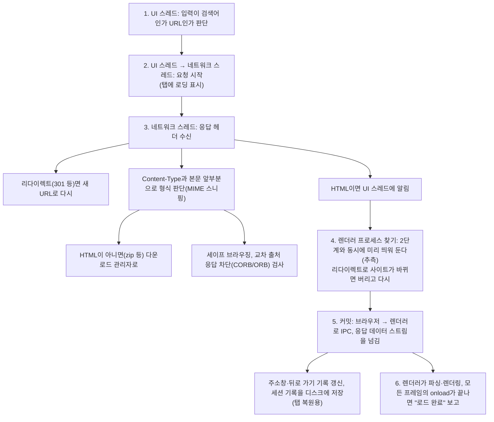
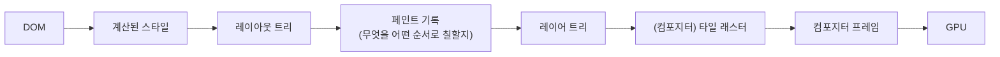

> Mariko Kosaka의 「Inside look at modern web browser」 시리즈를 NAVER D2가 번역한 「[브라우저의 내부 살펴보기 1](https://d2.naver.com/helloworld/2922312)」, 「[2](https://d2.naver.com/helloworld/9274593)」, 「[3](https://d2.naver.com/helloworld/5237120)」, 「[4](https://d2.naver.com/helloworld/6204533)」를 바탕으로 재구성한 노트다. DOM·CSSOM부터 페인트까지 렌더링 단계 자체는 [[browser-rendering|브라우저 렌더링 과정]]에 있다. 레이어 승격의 비용은 「[CSS GPU Animation: Doing It Right](https://www.smashingmagazine.com/2016/12/gpu-animation-doing-it-right/)」와 「[An Introduction to Hardware Acceleration with CSS Animations](https://www.sitepoint.com/introduction-to-hardware-acceleration-css-animations/)」로 보강했다.

## 프로세스와 스레드

**프로세스**는 운영체제가 메모리를 따로 떼어 주는 실행 단위이고, **스레드**는 프로세스 안에서 그 메모리를 공유하며 일하는 실행 흐름이다. 프로세스끼리는 메모리를 공유하지 않으므로 **IPC(프로세스 간 통신)** 로 메시지를 주고받는다. 한 프로세스가 죽어도 다른 프로세스는 살아남는다. 브라우저 아키텍처는 이 성질을 이용한다. 개념은 [[process-and-thread|프로세스와 스레드]]에 있다.

웹 브라우저를 어떻게 프로세스로 나눌지는 표준이 정하지 않는다. 브라우저마다 다르고, 아래는 Chrome(Chromium 계열)의 구조다.

## Chrome의 다중 프로세스 구조

| 프로세스 | 맡는 일 |
| --- | --- |
| 브라우저(Browser) | 주소창·탭·뒤로 가기 같은 바깥 UI, 네트워크 요청과 파일 접근 같은 권한이 필요한 일을 조정한다. 안에 UI 스레드, 네트워크 스레드, 저장소 스레드가 있다 |
| 렌더러(Renderer) | 탭 안의 웹 페이지를 그린다. HTML 파싱, JS 실행, 스타일·레이아웃·페인트. **샌드박스** 안에서 돈다 |
| GPU | 여러 프로세스의 그리기 요청을 받아 GPU로 화면을 합성한다. 하나만 있다 |
| 네트워크·저장소 등 유틸리티 | 서비스 단위로 떼어 낸 기능 |
| 확장 프로그램 | 확장마다 따로 |

Chrome 메뉴의 「작업 관리자」에서 탭·확장·GPU 프로세스별 메모리와 CPU를 볼 수 있다.

### 왜 나누나

| 이점 | 내용 |
| --- | --- |
| 안정성 | 한 탭의 렌더러가 멈추거나 죽어도 다른 탭과 브라우저 UI는 산다 |
| 보안 | 신뢰할 수 없는 웹 콘텐츠를 다루는 렌더러를 샌드박스에 가둬 파일 시스템 등 임의 접근을 막는다 |
| 응답성 | 한 탭의 무거운 JS가 다른 탭을 멈추지 않는다 |

대가는 **메모리**다. 프로세스마다 JS 엔진 같은 공통 기반을 따로 들고 있다. 그래서 Chrome은 기기 메모리에 따라 프로세스 수를 조절한다. 같은 사이트의 여러 탭이 렌더러 하나를 공유하기도 한다.

### 서비스화

Chrome은 기능을 **서비스(service)** 단위로 나눠, 메모리가 넉넉한 기기에서는 서비스마다 별도 프로세스로 띄워 안정성을 얻고, 메모리가 부족한 기기에서는 한 프로세스에 모아 메모리를 아낀다. 같은 코드로 두 가지 배치를 고르는 구조다.

### 사이트 격리

**사이트 격리(Site Isolation)** 는 사이트마다 렌더러 프로세스를 따로 쓰는 정책이다. 탭 단위를 넘어 **iframe 단위**로도 적용된다. `a.com` 페이지 안의 `b.com` iframe은 다른 렌더러 프로세스에서 돈다.

- 동일 출처 정책(SOP)은 프로세스가 갈라져 있어야 확실히 지켜진다. Spectre·Meltdown 같은 CPU 부채널 공격은 **같은 프로세스 메모리**는 읽어 낼 수 있기 때문이다.
- 데스크톱 Chrome에서는 기본으로 켜져 있다. 대가로 iframe이 다른 프로세스에 있을 때 DevTools·페이지 내 찾기 같은 기능이 여러 렌더러를 가로질러 동작하도록 고쳐야 했다.
- 페이지가 직접 거는 격리는 `Cross-Origin-Opener-Policy`·`Cross-Origin-Embedder-Policy` 헤더(교차 출처 격리)다. `SharedArrayBuffer` 같은 고정밀 기능을 쓸 때 필요하다.

## 내비게이션: 주소를 입력한 뒤

내비게이션의 앞부분은 **브라우저 프로세스**가 한다. 렌더러는 응답이 HTML로 확인된 뒤에야 맡는다. DNS·TCP·TLS 같은 네트워크 쪽 흐름은 [[url-to-page|브라우저에 URL을 입력하면 일어나는 일]]에 있다.



**렌더러를 미리 띄우는 것**이 핵심 최적화다. 네트워크 응답을 기다리는 동안 렌더러 시작 비용을 겹쳐 숨긴다.

### 다른 사이트로 떠날 때

- 현재 페이지에 `beforeunload` 리스너가 있으면 브라우저 프로세스가 **현재 렌더러에 먼저 물어봐야** 떠날 수 있다. 무조건 등록하면 모든 내비게이션이 느려진다. 저장하지 않은 입력이 있을 때만 등록한다.
- 렌더러가 시작한 내비게이션(`location.href` 변경, 링크 클릭)도 결국 브라우저 프로세스가 진행한다.
- 새 사이트는 새 렌더러가 맡고, 이전 렌더러는 `unload`를 처리한 뒤 정리된다. 페이지 수명 주기 이벤트는 [[page-lifecycle-events|페이지 생명주기 이벤트]]에 있다.

### 서비스 워커가 있을 때

서비스 워커는 렌더러 프로세스에서 도는 JS다. 내비게이션 요청이 들어오면 네트워크 스레드가 **이 URL 범위(scope)에 등록된 서비스 워커**가 있는지 확인하고, 있으면 렌더러에서 워커를 띄워 응답을 맡긴다. 워커를 깨우는 시간만큼 네트워크 요청이 늦어지므로, **내비게이션 프리로드(navigation preload)** 를 켜면 워커 시작과 네트워크 요청을 병렬로 돌린다. 캐시 전략은 [[pwa-service-worker|PWA와 서비스 워커 캐시 전략]]에 있다.

## 렌더러 안의 스레드

| 스레드 | 하는 일 |
| --- | --- |
| 메인 스레드 | HTML 파싱, 스타일 계산, 레이아웃, 페인트 기록, **대부분의 JS 실행** |
| 워커 스레드 | Web Worker·서비스 워커의 JS |
| 컴포지터 스레드 | 레이어를 타일로 나눠 래스터를 맡기고, 결과를 모아 프레임을 만든다. 스크롤·`transform` 애니메이션을 메인 스레드 없이 처리 |
| 래스터 스레드 | 타일을 픽셀로 칠한다(GPU 래스터) |

### 메인 스레드의 산출물



- **레이아웃 트리는 DOM과 다르다.** `display: none`은 빠지고, `::before` 같은 의사 요소는 DOM에 없지만 들어간다.
- **페인트 기록**은 그리기 순서 목록이다. `z-index`를 무시하고 HTML 순서대로 칠하면 겹침이 틀리므로 레이아웃만으로는 부족하다.
- 파이프라인의 각 단계는 앞 단계 결과로 만들어진다. 레이아웃이 바뀌면 그 뒤가 전부 다시 돈다. 그래서 프레임마다 레이아웃을 건드리는 애니메이션은 비싸다.

### 합성(compositing)

페이지를 여러 **레이어**로 나눠 따로 래스터하고, 컴포지터 스레드가 겹쳐 프레임을 만든다.

- 레이어로 나뉘는 기준은 엔진이 정한다. `will-change: transform`으로 힌트를 줄 수 있지만 레이어마다 메모리와 합성 비용이 들어 남발하면 오히려 느려진다.
- 컴포지터는 레이어를 **타일**로 나눠 래스터 스레드에 보내고, 뷰포트 근처 타일을 먼저 칠한다. 다 모이면 **드로 쿼드**(타일 위치 정보)로 컴포지터 프레임을 만들어 GPU에 보낸다.
- 스크롤이나 `transform`·`opacity` 애니메이션은 이미 칠한 레이어의 위치만 바꾸면 되므로 **메인 스레드를 기다리지 않는다.** 메인 스레드가 JS로 바빠도 부드러운 이유다.

### 레이어 승격의 비용

합성 레이어(composited layer)는 표준에 없는 **엔진 내부 최적화**다. 합성만으로 애니메이션하려면 속성이 문서 흐름에 영향을 주지도, 받지도 않고, 다시 칠할 필요도 없어야 한다. 이 조건을 늘 만족하는 속성이 `transform`과 `opacity`뿐이다. `left`·`top`은 `%` 값이 부모 크기에 기대므로 해당하지 않는다.

| 레이어가 생기는 흔한 이유 | 예 |
| --- | --- |
| 명시적 | 3D 변환(`translate3d`, `translateZ`), `will-change`, `<video>`·`<canvas>`·`<iframe>`, `position: fixed`, `filter`, CSS·`element.animate()`로 `transform`·`opacity`를 애니메이션하는 중 |
| **암시적 합성(implicit compositing)** | 레이어가 된 요소보다 쌓임 순서상 **위에 그려져야 하는** 요소. 순서를 지키려고 엔진이 함께 승격시킨다 |

레이어는 공짜가 아니다.

- **메모리**: 레이어는 압축 이미지가 아니라 RGBA 비트맵으로 GPU에 올라간다. 크기는 `너비 × 높이 × 4바이트`이고 고밀도 화면이면 기기 픽셀 비율의 제곱만큼 커진다. 800×600 사진 10장에 `will-change: transform`을 미리 걸면 약 19MB다. 메모리가 적은 모바일에서는 탭이 죽을 수 있다.
- **승격 순간의 페인트·전송**: 레이어가 생기거나 사라질 때 그 영역을 다시 칠하고 텍스처를 GPU로 보낸다. 애니메이션 시작·끝에 깜빡임이 보이는 원인이다.
- **레이어 폭발**: 암시적 합성으로 레이어가 수십·수백 개로 불어난다.

| 줄이는 방법 | 이유 |
| --- | --- |
| 움직이는 요소를 쌓임 순서의 위쪽에 둔다(가능하면 `body` 바로 아래) | 위에 겹친 요소가 없으면 암시적 합성이 생기지 않는다 |
| 작게 그리고 `transform: scale()`로 키운다 | 10×10 레이어를 `scale(10)`하면 100×100 레이어보다 메모리가 100분의 1이다. 단색·흐린 배경에 쓴다 |
| `background-color` 대신 위에 겹친 의사 요소의 `opacity`를 바꾼다 | 색 전환도 합성만으로 처리한다 |
| 선언형(CSS·`element.animate()`)으로 애니메이션한다 | 시작·끝을 미리 알려 주므로 컴포지터가 메인 스레드 없이 프레임을 만든다. `requestAnimationFrame` JS 애니메이션은 매 프레임 메인 스레드가 필요하다 |

레이어 목록과 승격 이유, 레이어별 메모리는 Chrome DevTools의 **Layers** 패널(More tools)과 Safari Web Inspector의 Layers 사이드바에서 본다. Rendering 탭의 Layer borders는 화면에 레이어 경계를 그린다.

과거에는 `transform: translateZ(0)`을 붙여 레이어를 억지로 만드는 「하드웨어 가속 핵」이 흔했다. 지금은 의도를 밝히는 `will-change`를 쓰되 꼭 필요한 요소에만 쓴다([[css-animation|CSS 애니메이션]]).

### 프레임 예산

화면은 주사율(보통 60Hz, 프레임당 약 16.7ms)에 맞춰 갱신된다. 메인 스레드의 긴 JS가 렌더링 단계를 밀어내면 프레임을 놓쳐 버벅인다(jank).

| 방법 | 효과 |
| --- | --- |
| `requestAnimationFrame` | 시각 변경을 다음 프레임 직전에 실행 |
| 긴 작업 쪼개기 | 메인 스레드에 입력·렌더링 틈을 준다. [[inp-optimization\|INP 최적화]] |
| Web Worker | DOM이 필요 없는 계산을 메인 스레드 밖으로. [[web-workers\|웹 워커]] |
| 합성 전용 속성 애니메이션 | `transform`·`opacity`만 바꾼다 |

## 입력 이벤트가 처리되는 길

사용자의 터치·클릭은 먼저 **브라우저 프로세스**가 받는다. 브라우저는 좌표와 종류만 알 뿐 탭 안에 무엇이 있는지 모르므로 렌더러에 넘긴다. 렌더러에서는 **컴포지터 스레드**가 먼저 받는다.

| 위치 | 컴포지터의 처리 |
| --- | --- |
| 이벤트 리스너가 없는 영역 | 메인 스레드를 기다리지 않고 바로 스크롤·새 프레임 합성 |
| **비고속 스크롤 영역**(non-fast scrollable region): 리스너가 달린 영역 | 메인 스레드에 보내고, 리스너가 `preventDefault()`를 할지 몰라 **결과를 기다린다** |

### 이벤트 위임과 passive

`document`나 `body`에 `touchstart`·`wheel` 리스너를 하나 달면(이벤트 위임) **페이지 전체가 비고속 스크롤 영역**이 된다. 스크롤마다 메인 스레드를 기다리게 되어, 메인 스레드가 바쁘면 스크롤이 끊긴다.

```javascript
document.body.addEventListener('touchstart', (e) => {
  if (e.target === area) { /* ... */ }
}, { passive: true }) // preventDefault를 하지 않겠다는 약속
```

- `passive: true`면 컴포지터는 리스너 결과를 기다리지 않고 바로 스크롤한다. 리스너는 메인 스레드에서 따로 돈다.
- Chrome·Firefox는 `window`·`document`·`body`에 단 `touchstart`·`touchmove`·`wheel` 리스너를 **기본으로 passive**로 다룬다. 그 리스너의 `preventDefault()`는 무시된다.
- 스크롤을 일부 방향만 막고 싶다면 리스너 대신 CSS `touch-action`(예: `pan-x`)을 쓴다. 브라우저가 이벤트 전에 판단할 수 있다. 자세한 것은 [[ui-input-events|마우스·포인터·키보드 이벤트]]에 있다.
- 취소 가능 여부는 `event.cancelable`로 확인한다.

### 이벤트 병합

`touchmove`·`pointermove`·`mousemove`·`wheel` 같은 **연속 이벤트**는 화면 주사율보다 자주(초당 60~120회 이상) 생긴다. Chrome은 이를 모아(coalesce) 다음 `requestAnimationFrame` 직전에 **한 번만** 디스패치한다. `keydown`·`mouseup`·`touchend` 같은 이산 이벤트는 바로 보낸다.

그림판처럼 궤적이 다 필요하면 병합된 원본 이벤트를 꺼낸다.

```javascript
canvas.addEventListener('pointermove', (e) => {
  for (const ev of e.getCoalescedEvents()) {
    drawPoint(ev.clientX, ev.clientY)
  }
})
```

## 정리

- Chrome은 브라우저·렌더러·GPU·유틸리티 프로세스로 나눈다. 안정성과 보안(샌드박스)을 얻고 메모리를 낸다. 메모리 상황에 따라 서비스를 프로세스로 나누거나 합친다.
- **사이트 격리**는 iframe까지 사이트마다 프로세스를 나눠 SOP를 프로세스 경계로 보장한다.
- 내비게이션은 브라우저 프로세스가 진행하고, 응답이 HTML이면 미리 띄워 둔 렌더러로 **커밋**한다. `beforeunload`는 필요할 때만 단다.
- 렌더러에서 JS·스타일·레이아웃·페인트는 메인 스레드가, 레이어 합성과 스크롤은 컴포지터 스레드가 맡는다.
- 입력은 컴포지터를 먼저 거친다. 리스너가 스크롤을 막지 않는다면 **`passive: true`**, 연속 이벤트는 프레임 단위로 병합된다는 점을 기억한다.

관련 노트: [[browser-rendering|브라우저 렌더링 과정]], [[url-to-page|브라우저에 URL을 입력하면 일어나는 일]], [[event-loop|이벤트 루프]], [[ui-input-events|마우스·포인터·키보드 이벤트]], [[inp-optimization|INP 최적화]], [[web-workers|웹 워커]], [[js-engine-v8|JS 엔진과 V8 파이프라인]]
