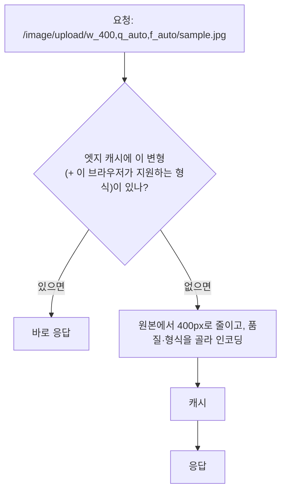

> web.dev의 「[Learn Images](https://web.dev/learn/images)」 강좌 중 「Image content delivery networks」 모듈을 바탕으로, `Accept`·`Vary` 헤더는 MDN으로 확인해 재구성한 노트다.

## 이미지 CDN이란

일반 [[cdn|CDN]]은 파일을 전 세계 엣지 서버에 복제해 사용자 가까운 곳에서 응답한다. 지연이 줄고, 장애에 강하고, 트래픽 폭주를 나눠 받는다. **이미지 CDN은 여기에 변환을 더한다.** 고해상도 원본 한 장을 올리면, 요청 URL에 적힌 매개변수대로 크기·자르기·압축·형식을 바꾼 변형을 만들어 준다.



첫 요청에서 만든 변형은 캐시되어, 같은 조건의 다음 요청은 다시 만들지 않는다.

## URL로 변환하기

문법은 업체마다 다르지만 **크기, 형식, 압축**은 어디서나 바꿀 수 있다. 아래는 Cloudinary 예다.

| 매개변수 | 뜻 |
| --- | --- |
| `w_400`, `h_300` | 폭·높이(px) |
| `c_fill` 등 | 크기를 맞추는 방식(자르기·채우기) |
| `q_60` | 품질을 직접 지정 |
| `q_auto` | 그림 내용을 분석해 압축 수준을 자동으로 고른다 |
| `f_auto` | 브라우저가 지원하는 가장 효율적인 형식을 자동으로 고른다 |

여러 변환은 쉼표로 이어 파일 이름 앞에 둔다. `q_auto`만 붙여도 1400px 이미지가 250KB에서 134KB로 주는 식의 차이가 난다.

URL 규칙이 예측 가능하므로 `srcset`을 별도 도구 없이 만들 수 있다.

```html

```

프레임워크의 이미지 컴포넌트(Next.js `<Image>`의 로더 등)나 워드프레스 플러그인(Jetpack Site Accelerator)도 이 URL을 대신 만들어 준다.

## Accept 헤더 협상

### 동작

브라우저는 이미지를 요청할 때 `Accept` 요청 헤더에 **자기가 디코딩할 수 있는 MIME 타입**을 적는다. `<source type>`에 쓰는 값과 같은 타입이다. 서버는 이를 보고 가장 효율적인 형식으로 인코딩해 응답하고, `Content-Type`에 실제 형식을 적는다. **URL이 `.jpg`로 끝나도 응답은 AVIF일 수 있다.** 브라우저는 확장자가 아니라 `Content-Type`과 파일 내용으로 해석한다.

```http
GET /image/upload/w_800,f_auto/sample.jpg HTTP/1.1
Accept: image/avif,image/webp,image/apng,image/*,*/*;q=0.8

HTTP/1.1 200 OK
Content-Type: image/avif
Vary: Accept
Cache-Control: public, max-age=31536000
```

### 브라우저별 기본 Accept (이미지 요청, MDN 목록 기준)

| 브라우저 | 값 |
| --- | --- |
| 크롬·엣지 121 이상 | `image/avif,image/webp,image/apng,image/*,*/*;q=0.8` |
| 파이어폭스 158 이상 | `image/avif,image/jxl,image/webp,image/png,image/svg+xml,image/*;q=0.8,*/*;q=0.5` |
| 사파리(macOS Big Sur 이후) | `image/webp,image/png,image/svg+xml,image/*;q=0.8,video/*;q=0.8,*/*;q=0.5` |

**지원하는 형식이 모두 `Accept`에 적히지는 않는다.** 사파리는 AVIF와 JPEG XL을 디코딩하지만 이 목록의 값에는 둘 다 없고, 크롬 155도 JPEG XL을 지원하지만 `Accept`에는 적지 않는다. `Accept`만 보는 서버는 이런 브라우저에 다음 순위 형식(WebP 등)을 준다. 깨지지는 않고 덜 최적일 뿐이다.

### Vary: Accept

같은 URL이 요청 헤더에 따라 다른 응답이 되므로, 중간 캐시가 AVIF 응답을 AVIF를 모르는 브라우저에 주면 안 된다. 응답에 `Vary: Accept`를 넣으면 캐시가 `Accept` 값별로 따로 저장한다. 다만 `Accept` 문자열은 브라우저·버전마다 조금씩 달라서, 그대로 키로 쓰면 캐시가 잘게 쪼개져 적중률이 떨어진다. 이미지 CDN은 문자열 전체가 아니라 **형식 지원 수준**("AVIF 가능 / WebP 가능 / 그 외")별로 변형을 만들어 캐시하고, 같은 수준의 다른 사용자에게 재사용한다. 직접 서버에서 협상을 구현할 때도 `Accept`를 이런 몇 단계로 정규화해 캐시 키로 쓴다. 캐시 헤더 자체는 [[http-cache|HTTP 캐시]]에 있다.

### picture + type과 비교

| | `<picture>` + `<source type>` | `Accept` 협상(이미지 CDN) |
| --- | --- | --- |
| 판단 위치 | 브라우저(마크업) | 서버 |
| 미리 만들 파일 | 형식 × 크기마다 전부 | 원본 한 장 |
| 마크업 | 형식마다 `<source>` | ``만 |
| 캐시 | URL이 형식마다 달라 단순 | `Vary`와 캐시 키 정규화가 필요 |
| 아트 디렉션 | 가능(`media`) | 별개. 자르기가 다르면 여전히 `<picture media>` |

형식 대체만이 목적이면 협상 쪽이 마크업이 훨씬 짧다. 화면별로 다르게 자른 그림이 필요하면 `<picture media>`와 함께 쓴다([[responsive-images|반응형 이미지]]).

## 한계

- **비용**: 원본 저장, 변환 처리, 변형 캐시 저장, 전송량에 모두 돈이 든다. 개인용 무료 요금제는 넉넉한 편이지만 트래픽이 많은 서비스는 유료 요금제가 필요하다.
- **첫 요청 지연**: 캐시에 없는 변형은 만드는 시간만큼 늦다. LCP 이미지는 배포 직후 미리 데워 두거나, 변형 수를 줄여 캐시 적중률을 높인다.
- **업체 의존**: URL 문법이 업체마다 달라 바꾸기 어렵다. 프레임워크 로더처럼 URL 생성을 한 곳에 모아 두면 교체가 쉽다.
- **자동 품질은 만능이 아니다**: `q_auto` 결과도 중요한 이미지는 눈으로 확인한다.

## 정리

- 이미지 CDN = CDN + URL 매개변수 변환(크기·자르기·품질·형식) + 변형 캐시.
- `f_auto` 같은 자동 형식은 `Accept` 헤더 협상이다. `Content-Type`이 실제 형식을 알린다.
- 협상하는 응답에는 `Vary: Accept`가 필요하고, 캐시 키는 몇 단계로 정규화한다.
- `Accept`에 없는 형식은 지원해도 받지 못한다. 대체 형식이 늘 함께 있어야 한다.
- 원본 한 장만 관리하고 나머지는 CDN이 만든다. 대신 `sizes`와 아트 디렉션은 여전히 마크업의 몫이다.

관련 노트: [[cdn|CDN]], [[http-cache|HTTP 캐시]], [[image-formats|웹 이미지 형식]], [[image-compression|이미지 압축과 인코딩 자동화]], [[responsive-images|반응형 이미지: srcset·sizes와 picture]], [[lcp-optimization|LCP 최적화: 네 구간으로 나눠 줄이기]]
