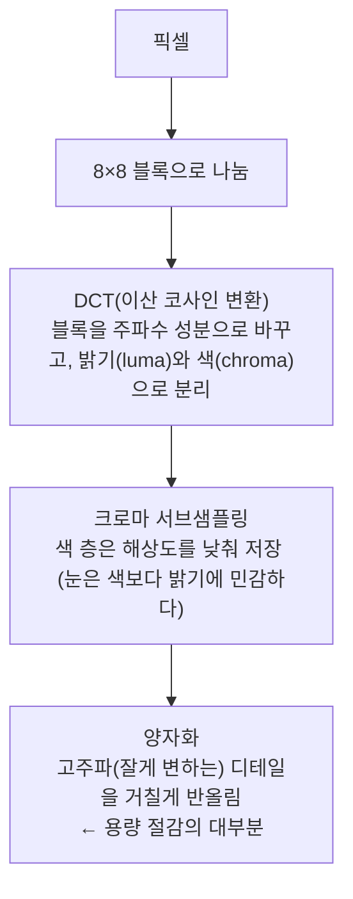

> web.dev의 「[Learn Images](https://web.dev/learn/images)」 강좌 중 JPEG·WebP·AVIF 형식 모듈과 「Automating compression and encoding」, 「Site Generators, frameworks, and CMSs」 모듈을 바탕으로 재구성한 노트다.

## 압축은 무엇을 버리나

손실 압축은 **사람 눈이 덜 민감한 정보부터 버린다.** 형식의 차이는 무엇을 어떻게 버리느냐에 있다. 형식의 종류와 지원 현황은 [[image-formats|웹 이미지 형식]]에 있다.

### JPEG



| 단계 | 버리는 것 | 지나치면 |
| --- | --- | --- |
| 크로마 서브샘플링 | 색 해상도 | 선명한 색 경계가 번진다 |
| 양자화 | 미세한 디테일 | 8×8 블록 경계가 보이고(블로킹) 면이 뭉개진다 |

GIF의 팔레트 축소는 눈에 바로 띄지만, JPEG의 양자화는 **눈에 안 띄게 설계된** 손실이다.

**프로그레시브 JPEG**는 위에서 아래로 한 줄씩 그리는 기본(baseline) JPEG와 달리, 흐린 전체 그림을 먼저 보여 주고 여러 번의 스캔으로 선명해진다. 아주 작은 이미지가 아니면 파일도 조금 더 작다. 디코딩이 조금 더 복잡하지만 성능이 아주 낮은 기기가 아니면 차이를 느끼기 어렵다. **JPEG를 만들 때는 프로그레시브가 무난한 기본값이다.**

### WebP

VP8 동영상 코덱이 키프레임을 압축하는 방식을 가져왔다. JPEG처럼 밝기와 색을 나누고 블록 단위로 다루지만(밝기 16×16, 색 8×8, 그 안을 4×4로 더 쪼갠다), 두 가지가 다르다.

| 기법 | 내용 | 효과 |
| --- | --- | --- |
| 블록 예측 | 이미 부호화한 **위쪽·왼쪽 블록으로 현재 블록을 예측**하고, 여러 예측 모드 중 가장 가까운 것을 고른 뒤 실제 값과의 차이(잔차, residual)만 저장한다. 디코더는 같은 예측을 하고 잔차를 더한다 | 비슷한 영역이 이어지면 저장할 것이 거의 없다 |
| 적응형 양자화 | 그림을 비슷한 성격의 **최대 4개 영역**으로 나눠 영역마다 압축 강도를 달리한다. JPEG는 모든 블록에 같은 양자화를 쓴다 | 디테일이 많아 아티팩트가 숨는 곳은 세게, 흐린 배경처럼 티가 나는 곳은 약하게 |

그래서 크기를 맞춰 세게 압축하면 JPEG는 흐린 배경에 블록이 드러나고, WebP는 거의 드러나지 않는다.

### AVIF

AV1 동영상 코덱 기반이다. 넷플릭스·클라우디너리·크롬 코덱 팀의 비교에서 JPEG·WebP보다 같은 품질에서 크게 작았다. 다만 인코딩에 시간이 더 걸리므로, 업로드할 때나 빌드할 때 미리 만들어 두거나 결과를 캐시하는 이미지 CDN에 맡긴다.

## 품질 값 다루기

JPEG·WebP·AVIF 인코더는 내부가 복잡해도 보통 **0~100의 품질(quality) 정수 하나**로 압축을 조절한다.

- 같은 숫자라도 **도구마다 뜻이 다르고**, 그림 내용에 따라 결과도 다르다. 숫자를 외우지 말고 눈으로 비교한다.
- 품질 곡선의 대부분 구간에서 차이는 잘 안 보인다. 예를 들어 JPEG 품질 60으로 용량이 80% 가까이 줄어도 구분이 어려운 경우가 흔하다.
- **확대해서 들여다보지 않는다.** 아티팩트가 먼저 생기는 곳을 확대하면 실제 사용자가 보지 못할 결함까지 찾게 된다.
- 아티팩트가 보일 것 같은 지점보다 **조금 더 낮게** 잡는다. 이미지가 원래 크기보다 작게 표시되면 더 안전하다.

| 도구 | 쓰임 |
| --- | --- |
| Squoosh | 크롬 팀의 브라우저 도구. 원본과 결과를 나란히 놓고 품질·크로마 설정·형식(JPEG, WebP, AVIF 등)을 바꿔 보며 용량을 비교한다 |
| `cwebp` | 구글의 WebP 명령줄 인코더. 파일 하나나 디렉터리 전체를 변환한다 |
| ImageOptim | PNG·JPEG 무손실 최적화 |

```bash
cwebp -q 80 butterfly.jpg -o butterfly.webp
```

`cwebp`는 결과와 함께 블록 종류 비율, 영역(segment) 4개 각각의 양자화 값까지 출력해서 적응형 양자화가 어떻게 적용됐는지 볼 수 있다.

## 자동화: 사람이 이미지를 내보내지 않는다

이미지마다 품질을 손으로 맞추는 방식은 오래가지 못한다. **맥락마다 합리적인 기본값을 정해 두고 도구가 원본에서 만들게 한다.** 한 장당 몇 바이트를 더 짜내는 것보다 유연하고 믿을 만한 과정이 낫다.

| 자동화할 것 | 내용 |
| --- | --- |
| 파일 만들기 | 형식 변환(AVIF·WebP·JPEG), 압축, `srcset`용 여러 폭 |
| 마크업 만들기 | `<picture>`, `<source type>`, `srcset`, `width`·`height`. `sizes`만은 사람이 준다 |

### 이미지 처리 라이브러리

| 라이브러리 | 특징 |
| --- | --- |
| Sharp | Node.js. 크기 조절·변환·압축이 빠르다. 여러 빌드 도구·플러그인이 내부에서 쓴다 |
| ImageMagick | 여러 플랫폼, 기능이 많다. 워드프레스가 PHP 확장으로 쓴다(없으면 GD) |
| imagemin | Node.js. 압축 중심, 플러그인으로 확장 |

원본을 건드리지 않고 결과를 새로 만드는 방식이라, 설정을 바꾸면 언제든 다시 만들 수 있다.

### 두 갈래 파이프라인

| 갈래 | 대상 | 처리 위치 |
| --- | --- | --- |
| 개발 자산 | 저장소에 있는 배경·아이콘·로고 | 빌드 도구, 정적 사이트 생성기, 번들러 |
| 콘텐츠 자산 | 편집자·사용자가 올린 사진, 프로필 이미지 | CMS의 업로드 처리, 이미지 CDN |

둘 다 개발 팀이 정한 형식·품질 설정을 따르게 한다.

### 빌드 도구와 정적 사이트 생성기

빌드 도구는 파일만 만들고 마크업은 모른다. 정적 사이트 생성기는 이미지가 어디에 어떻게 쓰이는지 알기 때문에 **마크업까지 만든다.** 예를 들어 Eleventy의 공식 이미지 플러그인(`@11ty/eleventy-img`, 내부는 Sharp)은 다음처럼 설정한다.

```js
const Image = require("@11ty/eleventy-img");

async function imageShortcode(src, alt, sizes) {
  const metadata = await Image(src, {
    formats: ["avif", "webp", "jpeg"],   // 앞이 우선
    widths: [400, 800, 1000],
    outputDir: "_site/img/",
    urlPath: "/img/",
  });
  return Image.generateHTML(metadata, { alt, sizes, loading: "lazy", decoding: "async" });
}
```

결과는 형식마다 `<source type srcset>`이 붙은 `<picture>`와, `src`·`width`·`height`·`alt`를 갖춘 대체 ``다. 번들러에서는 webpack의 `responsive-loader`처럼 `import img from './a.jpg?sizes[]=400,sizes[]=800&format=webp'` 형태로 크기·형식을 지정해 `srcSet`을 받아 쓰는 로더가 있다. Next.js의 `<Image>`처럼 프레임워크 컴포넌트가 요청 시점에 변환해 주는 방식도 흔하다.

**`sizes`는 어떤 도구도 정확히 알 수 없다.** 이미지가 레이아웃에서 몇 픽셀로 그려질지는 렌더링해 봐야 안다. 그래서 도구에 인자로 넘기고, RespImageLint 같은 도구로 렌더링된 페이지에서 검사한다. 지연 로딩 이미지는 `sizes="auto"`로 브라우저에 맡길 수 있다([[responsive-images|반응형 이미지]]).

### CMS

워드프레스는 업로드할 때 테마가 정한 크기마다 파일을 만들고 `srcset`을 자동으로 붙인다. 품질과 출력 형식은 필터로 정한다.

```php
// 기본 품질
add_filter( 'wp_editor_set_quality', fn() => 70 );

// 업로드한 JPEG를 WebP로 출력
add_filter( 'image_editor_output_format', function ( $mappings ) {
  $mappings['image/jpeg'] = 'image/webp';
  return $mappings;
} );
```

기본 `sizes`는 레이아웃을 모르므로 테마에서 고친다(자세한 내용은 [[responsive-images|반응형 이미지]]의 CMS 항목). Shopify 같은 호스팅형 CMS도 `srcset` 생성과 `<picture>` 아트 디렉션용 훅을 준다. 형식 선택까지 서버에 맡기려면 이미지 CDN을 붙인다([[image-cdn|이미지 CDN과 Accept 헤더 협상]]).

## 결과 확인

- 원본과 결과의 용량을 비교한다. 3MB가 넘는 PNG 원본이 1000px JPEG 150KB, 400px WebP 30KB 남짓이 되는 정도의 차이가 흔하다.
- 형식·크기별 결과물에 아티팩트가 없는지 눈으로 본다. 문제가 있으면 설정을 바꿔 다시 만든다.
- 실제 페이지에서 받은 형식과 크기는 DevTools Network 패널의 Type·Size 열로 확인한다.

## 정리

- JPEG는 색과 고주파 디테일을 버리고, WebP는 예측과 영역별 압축으로 더 작다. AVIF는 더 작지만 인코딩이 느리다.
- 품질 값은 도구마다 뜻이 달라 눈으로 맞추고, 아티팩트가 보이기 직전보다 조금 낮게 잡는다.
- JPEG는 프로그레시브로 만든다.
- 원본은 그대로 두고 빌드 도구·정적 사이트 생성기·CMS·이미지 CDN이 형식과 크기를 만든다.
- `sizes`만은 자동으로 알 수 없다. 레이아웃을 아는 사람이 주거나 `sizes="auto"`에 맡긴다.

관련 노트: [[image-formats|웹 이미지 형식]], [[image-cdn|이미지 CDN과 Accept 헤더 협상]], [[responsive-images|반응형 이미지: srcset·sizes와 picture]], [[static-site-generator|정적 사이트 생성기와 Jamstack]], [[wordpress|워드프레스: 철학, 테마·플러그인 고르기, 속도, 생태계]], [[bundlers-and-vite|번들러의 역사와 Vite]]
