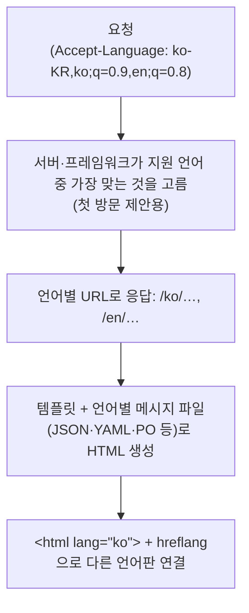

> Front End Interview Handbook의 「[HTML 질문](https://www.frontendinterviewhandbook.com/kr/html-questions)」 중 다국어 페이지 문항 두 개를 바탕으로, W3C 국제화 문서와 Google 검색 센터 문서로 확인해 재구성한 노트다. 인용 부호·방향 격리·루비 요소는 web.dev의 「[Learn HTML](https://web.dev/learn/html)」 강좌를 바탕으로 보강했다.
> 시간대·통화·법인 같은 시스템 쪽 국제화는 ByteByteGo의 System Design 101 가이드 「[How do we design a system for internationalization?](https://bytebytego.com/guides/how-do-we-design-a-system-for-internationalization)」를 바탕으로 보탰다.
> 대상 지역 네트워크와 문화 차이는 「[Frontend_TIL: 다국어 페이지를 만들때 고려해야할 사항](https://github.com/AI-Dev-Lex-Kim/Frontend_TIL/blob/master/HTML/%EB%8B%A4%EA%B5%AD%EC%96%B4%20%ED%8E%98%EC%9D%B4%EC%A7%80%EB%A5%BC%20%EB%A7%8C%EB%93%A4%EB%95%8C%20%EA%B3%A0%EB%A0%A4%ED%95%B4%EC%95%BC%ED%95%A0%20%EC%82%AC%ED%95%AD.md)」을 바탕으로 보강했다.

## 두 가지 일: 국제화와 현지화

| 용어 | 뜻 | 예 |
| --- | --- | --- |
| 국제화(i18n, internationalization) | 어떤 언어·지역에도 맞출 수 있게 **코드와 디자인을 준비**하는 일 | 문자열을 코드에서 빼기, 날짜를 로캘별로 포맷하기 |
| 현지화(l10n, localization) | 특정 언어·지역에 맞게 **실제로 옮기는** 일 | 번역, 통화·단위·이미지 교체 |

i18n을 먼저 해 두지 않으면 언어를 하나 늘릴 때마다 화면을 다시 만든다.

## 언어별 페이지를 내보내는 구조



| 결정 | 권장 |
| --- | --- |
| URL | **언어마다 다른 URL**(`/ko/`, `ko.example.com`, `example.kr`). 쿠키나 헤더로만 언어를 바꾸면 같은 URL에 여러 언어가 섞여 검색 엔진이 한 언어판만 본다 |
| 언어 고르기 | `Accept-Language`는 첫 제안에만 쓴다. **자동으로 다른 언어판으로 넘기지 않고**, 어디서든 언어를 바꿀 수 있는 선택기를 둔다. 브라우저 언어와 사용자가 원하는 언어는 다를 수 있다 |
| 선택기 | 언어 이름을 그 언어로 쓴다(「English」, 「日本語」). 국기는 나라를 뜻하지 언어를 뜻하지 않으므로 쓰지 않는다 |
| 같은 페이지의 섞인 언어 | 한 페이지는 한 언어가 기본이다. 일부 다른 언어 문장에는 그 요소에 `lang`을 따로 준다 |

Next.js 같은 프레임워크는 로캘별 라우팅을 지원하고, `Accept-Language` 감지는 `proxy.ts`(Next.js 16 이전 이름은 middleware)에서 한다. 메시지 관리는 i18next·FormatJS 같은 라이브러리가 맡는다.

## HTML로 언어 표시하기

```html
<html lang="ko" dir="ltr">
<head>
  <meta charset="utf-8">
  <link rel="alternate" hreflang="ko" href="https://example.com/ko/">
  <link rel="alternate" hreflang="en" href="https://example.com/en/">
  <link rel="alternate" hreflang="x-default" href="https://example.com/">
</head>
<body>
  <p>이 문서의 원제는 <span lang="en">Open Web Platform</span>이다.</p>
  <p>제품명 <span translate="no">riverlog</span></p>
```

| 표시 | 하는 일 |
| --- | --- |
| `lang` | 요소 내용의 언어(BCP 47 태그: `ko`, `en-GB`, `zh-Hant`). 스크린 리더 발음, 맞춤법 검사, 하이픈 나누기, 글꼴 선택, 번역 제안, CSS `:lang()`이 이 값을 쓴다. `<html>`에 꼭 둔다 |
| `dir` | 글 방향. `ltr`, `rtl`(아랍어·히브리어), 사용자 입력처럼 모를 때 `auto`. CSS `direction`이 아니라 HTML 속성으로 준다 |
| `translate="no"` | 브랜드명·코드처럼 자동 번역에서 빼야 할 부분 |
| `hreflang` | 같은 내용의 다른 언어·지역판을 검색 엔진에 알린다 |
| `Content-Language` 헤더 | 대상 독자의 언어 정보일 뿐, 문서 언어 선언은 `lang`이 맡는다. 같은 뜻의 `<meta http-equiv="content-language">`도 쓰지 않는다 |
| `<q>` | 인용 부호를 `lang`에 맞게 그린다(영어 “ ”, 프랑스어 « »). 다른 언어 인용에는 `lang`을 단다 |
| `<bdi>` / `<bdo dir>` | 방향을 모르는 글(사용자 이름)을 주변과 격리 / 방향을 강제로 뒤집기 |
| `<ruby>`·`<rt>` | 한자·가나 위의 읽는 법 주석 |

`hreflang`의 규칙:

- `<link>`, HTTP `Link` 헤더, XML 사이트맵 중 하나로 넣는다. 셋은 효과가 같다.
- **양방향**이어야 한다. 각 언어판이 자기 자신과 다른 모든 판을 나열한다. 한쪽만 가리키면 무시된다.
- 값은 ISO 639-1 언어 코드에 선택적으로 지역 코드를 붙인다(`en`, `en-GB`). 지역 코드만 쓸 수는 없다.
- `x-default`는 맞는 언어가 없을 때 보낼 페이지다. 언어 선택 페이지나 자동 분기하는 첫 화면에 쓴다.
- Google은 페이지 언어를 `lang`이나 `hreflang`이 아니라 **보이는 본문**으로 판단한다. 번역은 본문까지 실제로 옮겨야 한다.

CSS에서는 `:lang(fr)`이나 `[lang|="fr"]`로 언어별 스타일을 준다. `:lang()`은 조상에게서 물려받은 언어까지 맞춘다. 검색 쪽 다른 메타 태그와 canonical은 [[seo-basics|SEO 기초]]에, head의 `<link rel="alternate">`는 [[html-head-metadata|문서 head와 메타데이터]]에 있다.

## 설계·개발할 때 주의할 것

| 주의 | 이유와 방법 |
| --- | --- |
| **문자열을 이어 붙이지 않는다** | `"오늘은 " + date + "입니다"`는 어순이 다른 언어에서 깨진다. 자리 표시자가 있는 메시지 전체를 번역 단위로 둔다(`"오늘은 {date}입니다"`, `"Today is {date}"`). 복수형은 ICU MessageFormat이나 `Intl.PluralRules`로 다룬다 |
| 날짜·숫자·통화는 로캘로 포맷한다 | 같은 날짜도 `5/31/2026`(미국), `31/05/2026`(영국), `2026. 5. 31.`(한국)으로 쓴다. `Intl.DateTimeFormat`, `Intl.NumberFormat`, `Intl.RelativeTimeFormat`을 쓴다(→ [[date-libraries\|날짜 라이브러리]]) |
| 텍스트 길이가 달라진다 | 영어보다 독일어·핀란드어가 길고, 한·중·일어는 짧지만 글자가 높다. 버튼·제목·레이블은 고정 폭 대신 늘어날 공간을 두고, 넘침을 줄임표·줄바꿈 중 무엇으로 처리할지 정한다. 본문처럼 흐르는 글은 문제가 적다 |
| 글 방향이 바뀐다 | RTL 언어에서는 레이아웃 전체가 뒤집힌다. `margin-left` 대신 `margin-inline-start` 같은 [[logical-properties\|논리적 속성]]을 쓰면 `dir`만 바꿔도 맞는다. 세로쓰기는 `writing-mode`로 한다 |
| 이미지에 글자를 넣지 않는다 | 언어마다 이미지를 따로 만들어야 하고 검색·번역·스크린 리더가 읽지 못한다. 글자는 텍스트와 웹 폰트로 올린다 |
| 글꼴과 글자 크기 | 언어마다 필요한 글꼴과 알맞은 크기가 다르다. `:lang()`으로 나눈다(→ [[responsive-design\|반응형 디자인과 다국어 타이포그래피]]) |
| 색·아이콘·이름의 문화 차이 | 색과 손짓 아이콘의 의미는 문화마다 다르다. 이름·주소·전화번호 입력 폼은 한 형식을 강제하지 않는다 |
| 인코딩 | 모든 문서와 데이터는 UTF-8로 저장·전송한다 |
| 대상 지역의 네트워크 | 나라마다 회선 속도와 데이터 요금이 크게 다르다. 본사 사무실 회선이 아니라 대상 지역의 느린 망을 기준으로 이미지·폰트 용량을 줄이고, 지역 가까이 배포한 CDN으로 내보낸다(→ [[web-font-performance\|웹폰트 성능]], [[image-cdn\|이미지 CDN]]) |

### 시스템 쪽 국제화: 텍스트 밖의 것들

해외 시장에 서비스를 내면 화면 번역만으로 끝나지 않는다. 백엔드와 사업 구조도 나라별 차이를 받아야 한다.

| 영역 | 설계 |
| --- | --- |
| 문구 관리 | 모든 문구를 코드 밖 번역 시스템(리소스 파일, 번역 관리 도구)에 둔다. 코드에 안내 문구를 직접 쓰지 않는다. 서버가 만드는 이메일·알림·오류 메시지도 같은 원칙이다 |
| 시간대 | **저장과 표시를 분리한다.** DB와 백엔드는 UTC 타임스탬프로 저장·계산하고, 화면에서만 사용자 시간대로 바꿔 보여 준다. "매일 오전 9시" 같은 예약은 UTC가 아니라 사용자 시간대 기준으로 저장한다 |
| 통화 | **표시 통화와 정산 통화를 나눠 정의한다.** 가격 표시는 현지 통화로, 정산은 법인의 기준 통화로 한다. 환율을 조회·고정하는 환전(FX) 서비스를 두고, 금액은 부동소수점이 아니라 최소 단위 정수나 고정 소수로 다룬다 |
| 법인과 회계 | 나라별로 법인을 따로 세우면 세금·회계 기준이 다르다. 여러 장부 방식과 법인 간 자금 관리를 지원해야 한다 |
| 지역별 업무 규칙 | 결제 수단, 주소 형식, 영업일, 규제가 나라마다 다르다. 이런 규칙을 코드 곳곳의 `if (country == ...)`로 흩뜨리지 말고 지역별 설정·전략으로 분리한다 |

## 정리

- 언어마다 다른 URL을 주고, `<html lang>`과 `hreflang`으로 표시한다.
- `Accept-Language`는 제안에만 쓰고, 언어 선택은 사용자가 언제든 바꿀 수 있게 둔다.
- 번역 단위는 문장 전체다. 문자열을 조각내 이어 붙이지 않는다.
- 날짜·숫자는 `Intl`, 방향은 `dir`과 논리적 속성, 길이는 늘어날 여백으로 대비한다.

관련 노트: [[seo-basics|SEO 기초]], [[html-head-metadata|문서 head와 메타데이터]], [[html-text-elements|텍스트 의미 요소와 문자 참조]], [[html|HTML 기초와 HTML5]], [[logical-properties|쓰기 모드와 논리적 속성]], [[responsive-design|반응형 디자인과 다국어 타이포그래피]], [[date-libraries|날짜 라이브러리: date-fns와 Day.js]]
