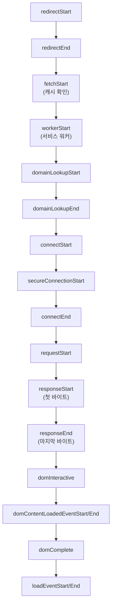

> web.dev의 「[Navigation Timing and Resource Timing](https://web.dev/articles/navigation-and-resource-timing)」, 「[User timing API](https://web.dev/articles/usertiming)」, Google Developers Blog의 「[Measuring network performance with Resource Timing API](https://developers.googleblog.com/measuring-network-performance-with-resource-timing-api/)」를 바탕으로, 현재 지원 범위는 MDN의 [Performance API](https://developer.mozilla.org/en-US/docs/Web/API/Performance_API) 문서로 확인해 재구성한 노트다.

## 성능 항목과 타임라인

DevTools와 Lighthouse는 **실험실 데이터**다. 실제 사용자의 기기·회선에서 얼마나 걸렸는지는 브라우저가 페이지마다 기록하는 **성능 항목(performance entry)** 을 읽어 서버로 보내야 안다(RUM, Real User Monitoring). 모든 항목은 같은 모양이다.

| 공통 필드 | 뜻 |
| --- | --- |
| `entryType` | 항목 종류(`navigation`, `resource`, `mark`, `measure`, `paint`, `largest-contentful-paint`, `layout-shift`, `event`, `longtask`, `long-animation-frame` 등) |
| `name` | URL이나 직접 붙인 이름 |
| `startTime`, `duration` | 페이지의 시간 원점(`performance.timeOrigin`, 보통 내비게이션 시작)으로부터의 밀리초 |

시간은 `DOMHighResTimeStamp`로, `Date.now()`와 달리 소수점 아래까지 재고 시스템 시계 조정에 흔들리지 않는다. 현재 시각은 `performance.now()`다. 정밀도는 Spectre 같은 타이밍 공격을 막으려고 일부러 낮춰 두었고, 교차 출처 격리(cross-origin isolated) 페이지에서만 더 정밀해진다.

## Navigation Timing: 문서 요청

HTML 문서 하나의 일생을 단계별 시각으로 준다. `performance.getEntriesByType('navigation')[0]`이 `PerformanceNavigationTiming` 객체다.



| 구하려는 값 | 계산 |
| --- | --- |
| DNS 조회 | `domainLookupEnd - domainLookupStart` |
| 연결(TLS 포함) | `connectEnd - connectStart`. TLS만은 `secureConnectionStart > 0`일 때 `connectEnd - secureConnectionStart` |
| 서버 대기(TTFB에 가까운 값) | `responseStart - requestStart` |
| 다운로드 | `responseEnd - responseStart` |
| 서비스 워커 + 응답 | `workerStart > 0`일 때 `responseEnd - workerStart` |
| 리디렉션 | `redirectEnd - redirectStart`, 횟수는 `redirectCount` |

- 값이 **0일 수 있다.** DNS를 로컬 캐시로 풀었거나, 연결을 재사용했거나, 서비스 워커가 없으면 해당 필드가 0이다. 0을 걸러 내고 계산한다.
- `unloadEvent*`, `dom*`, `loadEvent*`는 문서에만 있다.
- 과거에는 `performance.timing`(Navigation Timing Level 1)으로 같은 값을 읽었다. 이 객체는 폐기 예정이며 Level 2 항목을 쓴다.

TTFB를 실제로 줄이는 방법과 서버 내부 구간을 `Server-Timing` 헤더로 노출하는 법은 [[ttfb-optimization|TTFB 줄이기]]에 있다.

## Resource Timing: 하위 자원

CSS, JS, 이미지, 폰트, `fetch` 요청마다 `PerformanceResourceTiming` 항목이 생긴다. 필드는 Navigation Timing의 네트워크 부분과 같고, 추가로 다음을 준다.

| 필드 | 뜻 |
| --- | --- |
| `initiatorType` | 무엇이 요청했나(`link`, `script`, `img`, `css`, `fetch`, `xmlhttprequest` 등) |
| `transferSize`, `encodedBodySize`, `decodedBodySize` | 전송 바이트(헤더 포함), 압축된 본문, 푼 본문. `transferSize`가 0이면 캐시에서 왔다 |
| `nextHopProtocol` | `h2`, `h3` 같은 프로토콜 |
| `responseStatus` | HTTP 상태 코드. 아직 Baseline이 아니다 |
| `renderBlockingStatus` | 렌더링을 막았는지(`blocking`/`non-blocking`). Chromium 계열 |

**교차 출처 자원은 기본으로 세부 시간을 숨긴다.** 서드파티 서버가 `Timing-Allow-Origin: *`(또는 특정 출처) 응답 헤더를 보내야 DNS·연결·크기 값이 채워진다. 없으면 `startTime`·`duration`·`responseEnd` 정도만 남고 나머지는 0이다. 웹 폰트·CDN 라이브러리처럼 자주 쓰는 서드파티는 대개 이 헤더를 보낸다.

자원 항목 버퍼는 기본 250개다. 넘치면 `resourcetimingbufferfull` 이벤트가 오고, `performance.setResourceTimingBufferSize()`로 늘리거나 옵저버로 그때그때 가져간다.

## User Timing: 내가 정한 구간

브라우저가 모르는 앱 고유의 시점(「검색 결과가 그려졌다」, 「에디터 초기화 끝」)은 직접 찍는다.

```js
performance.mark('search:start')
await renderResults(query)
performance.mark('search:end', { detail: { query } })   // detail에 임의 데이터

performance.measure('search', 'search:start', 'search:end')
// 시작 표시 없이 내비게이션 시작부터: performance.measure('to-search-end', { end: 'search:end' })
```

- `mark()`는 이름 붙은 시각을, `measure()`는 두 시각 사이의 구간을 항목으로 남긴다. 시작·끝에는 mark 이름이나 숫자 타임스탬프를 쓴다.
- `clearMarks(name)`, `clearMeasures(name)`로 지운다. 이름을 빼면 전부 지운다.
- 찍은 표시는 DevTools Performance 패널의 Timings 트랙에 그대로 보인다([[devtools-performance|DevTools로 성능·메모리 분석하기]]). 실험실과 필드에서 같은 이름으로 비교할 수 있다.
- 2017년부터 모든 주요 브라우저가 지원한다.

## PerformanceObserver로 모으기

`performance.getEntriesByType()`·`getEntriesByName()`은 그 순간의 버퍼를 한 번 읽는다. 나중에 생기는 항목을 놓치고, 반복해서 부르면 메인 스레드를 쓴다. 권장 방법은 **옵저버로 구독**하는 것이다.

```js
const po = new PerformanceObserver((list) => {
  for (const entry of list.getEntries()) queue.push(entry)
})
po.observe({ type: 'resource', buffered: true })   // buffered: 옵저버를 만들기 전 항목도 받는다
po.observe({ type: 'navigation', buffered: true })

// 이 브라우저가 지원하는 항목 종류
PerformanceObserver.supportedEntryTypes
```

- `type` 하나에 `buffered: true`로 등록하는 것이 기본형이다. `entryTypes: [...]` 배열로도 등록할 수 있지만 그때는 `buffered`를 쓸 수 없다.
- 지원하지 않는 종류를 넣으면 조용히 무시된다. `supportedEntryTypes`로 확인한다.
- 모은 값은 페이지가 숨겨질 때(`visibilitychange`) `navigator.sendBeacon()`으로 보낸다. 같은 방식으로 Core Web Vitals를 재는 `web-vitals` 라이브러리는 [[web-vitals|웹 성능 지표와 Lighthouse]]에 있다.
- 2020년부터 모든 주요 브라우저가 지원한다.

## 메인 스레드를 막은 작업 찾기

| 항목 | 기록하는 것 | 지원 |
| --- | --- | --- |
| `longtask` | 50ms 넘게 메인 스레드를 잡은 작업. 어떤 스크립트였는지는 거의 알려 주지 않는다 | Chromium 계열 |
| `long-animation-frame` (LoAF) | 50ms 넘게 걸린 **렌더링 프레임** 전체. 프레임 안에서 돈 스크립트마다 출처 URL·함수·소요 시간(`scripts`)과 렌더링 시작 시각을 준다 | Chromium 계열(Chrome 123+) |
| `event` | 입력 이벤트의 지연·처리·표시 시간. INP의 원자료 | 2025년 Baseline(모든 주요 브라우저) |

느린 상호작용의 원인을 필드에서 찾을 때는 INP 항목과 같은 시간대의 LoAF를 묶어 보면 어떤 스크립트가 막았는지 알 수 있다. 줄이는 방법은 [[inp-optimization|INP 최적화]]에 있다.

## 정리

- 실험실 도구가 아니라 실제 사용자의 시간을 재려면 성능 항목을 읽어 보낸다.
- 문서는 Navigation Timing, 하위 자원은 Resource Timing, 앱 고유 구간은 `mark`·`measure`로 잰다.
- 읽기는 `PerformanceObserver` + `buffered: true`로 한다.
- 0인 필드와 `Timing-Allow-Origin`이 없는 교차 출처 자원을 걸러 계산한다.

관련 노트: [[web-vitals|웹 성능 지표와 Lighthouse]], [[ttfb-optimization|TTFB 줄이기]], [[inp-optimization|INP 최적화]], [[devtools-performance|DevTools로 성능·메모리 분석하기]], [[frontend-performance-strategy|프론트엔드 성능 최적화: 언제, 무엇을]]
