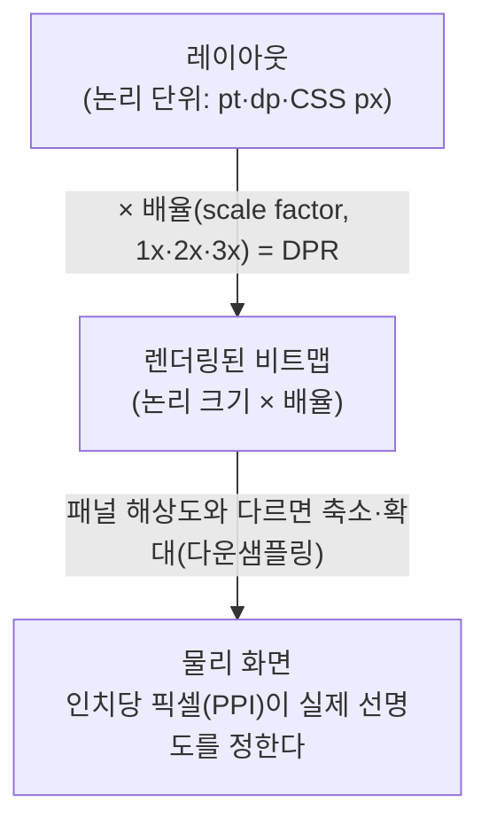

> CSS-Tricks의 「HTML 반응형 이미지 문법 가이드」(웹액츄얼리 번역, 2020.07)를 중심으로 Tim Kadlec·Tim Evko·Stéphanie Walter·Benjie Moss의 반응형 이미지 관련 글(웹액츄얼리 번역, 2013~2016)을 더해 재구성한 노트다. 브라우저의 후보 선택 과정은 Front End Interview Handbook의 「[HTML 질문](https://www.frontendinterviewhandbook.com/kr/html-questions)」 문항으로, 픽셀 밀도·`sizes` 계산·`<picture>` 규칙은 web.dev 「[Learn Images](https://web.dev/learn/images)」 강좌의 반응형 이미지 모듈로 보강했다. 브라우저 지원은 MDN으로 확인했다. CSS 배경 이미지의 한계는 「[안티 패턴으로서의 CSS background-image 속성](https://velog.io/@chris/the-css-background-image-property-as-an-anti-pattern)」(번역)으로, 논리 단위에서 물리 화면까지의 렌더링 과정은 PaintCode의 「[The Ultimate Guide To iPhone Resolutions](https://www.paintcodeapp.com/news/ultimate-guide-to-iphone-resolutions)」로 보강했다.

## 왜 필요한가

이미지는 페이지 무게의 가장 큰 몫이다. CSS로 `max-width: 100%`를 주면 이미지가 화면에 맞게 줄어 보이지만, **내려받는 파일은 그대로 크다.** 반응형 사이트 수백 곳을 측정한 결과, 360px 화면에서 이미지를 표시 크기에 맞게 줄이기만 해도 이미지 용량이 70% 넘게 줄었다. 무손실 최적화만으로는 5% 안팎이었다. 한 가지 기법으로 이만큼 줄어드는 경우는 드물다.

``가 `src` 하나만 받던 시절에는 300~2000px로 그려지는 이미지라면 2000px 파일 하나를 모두에게 줘야 했다. 고밀도 화면이 나오자 2배 크기 파일을 CSS로 절반 크기에 그리는 방식이 퍼졌고, 저밀도 작은 화면의 사용자는 쓸모없는 픽셀까지 받게 됐다. 큰 파일을 줄여 그리는 것은 티가 나지 않지만, 작은 파일을 키우면 흐려진다. 그래서 CSS는 `width: 100%`가 아니라 `max-width: 100%`로 둔다.

반응형 이미지 문법은 목적이 둘이다.

| 목적 | 도구 | 성격 | 누가 고르나 |
| --- | --- | --- | --- |
| 성능: 같은 그림을 알맞은 크기로 | `` | 서술형(descriptive) | 브라우저가 기기·설정·네트워크를 보고 고른다 |
| 디자인 제어: 다른 그림·다른 형식 | `<picture>` + `<source>` | 지시형(prescriptive) | 개발자의 규칙을 브라우저가 따른다 |

브라우저는 사용자의 하드웨어, 데이터 절약 설정, 연결 속도를 개발자보다 잘 안다. **대부분의 이미지는 서술형으로 충분하다.** 지시형은 그림 내용이나 형식처럼 브라우저가 파일을 받기 전에는 알 수 없는 정보를 줘야 할 때만 쓴다.

## srcset: 크기만 다른 같은 이미지

`srcset`은 "이 중단점에서 이 파일로 바꿔라"는 명령이 아니다. **후보 목록과 각 후보의 성질을 알려 주는 설명**이다.

### 기기 픽셀 비율(DPR)

기기 픽셀 비율(device pixel ratio)은 화면의 물리 픽셀 수를 CSS 픽셀 수로 나눈 값이다. DPR 2 화면에서 CSS 400px로 그려지는 이미지가 선명하려면 실제 폭 800px 파일이 필요하다. 반대로 DPR 1 기기에 고밀도 파일을 주면 보이는 차이 없이 대역폭과 처리 시간만 쓴다. 저밀도 기기는 대개 오래되고 느린 기기라 손해가 더 크다.

기기가 화면을 그리는 과정을 나눠 보면 세 값이 서로 다르다는 것이 보인다. iOS의 포인트(point)와 Android의 dp는 CSS 픽셀과 같은 **논리 단위**다.



| 값 | 무엇인가 | 예 |
| --- | --- | --- |
| 논리 크기 | 레이아웃 단위의 화면 크기 | 375×667pt |
| 배율(DPR) | 논리 1단위에 쓰는 픽셀 수 | 2 → 750×1334px로 렌더링 |
| PPI | 물리 화면의 밀도 | 같은 2x라도 화면 크기에 따라 326ppi일 수도 다를 수도 있다 |

**렌더링 해상도가 패널 해상도와 같다는 보장은 없다.** 예를 들어 iPhone 6~8 Plus는 414×736pt를 3x로 그린 1242×2208px 이미지를 실제 패널 1080×1920px에 맞춰 약 1.15배 줄여 보여 줬다. 그래서 「픽셀 단위로 딱 맞춘」 1px 선이 흐려질 수 있다. 이미지 후보를 고를 때는 DPR만 보면 되고, PPI나 패널 해상도는 브라우저가 알아서 처리한다.

### x 서술자: 픽셀 밀도

```html

```

이미지가 늘 같은 CSS 크기로 보일 때 쓴다. `2x`는 "DPR 2 화면에서 이걸 써라"가 아니라 "**이 파일은 2배 밀도 이미지다**"라는 설명이다. 기본 `src`는 가장 작고 빠른 1x 파일로 두며, `srcset`을 모르는 브라우저의 대체가 된다.

### w 서술자 + sizes: 레이아웃에 따라 폭이 변할 때

반응형 이미지 사용의 대부분이 이 형태다.

```html

```

- `300w`는 파일의 실제 가로 픽셀이다.
- `sizes`는 **이미지가 레이아웃에서 차지할 폭**이다. 뷰포트 폭이 아니다. 여백·사이드바·열 간격을 뺀 값이다.
- 브라우저는 `sizes` × 픽셀 밀도로 필요한 폭을 계산하고 `srcset`에서 가까운 후보를 고른다. 1200px 뷰포트, 2x 화면, `40vw`면 960px짜리를 찾는다.
- `sizes`를 빼면 `100vw`로 본다. 작은 칸에 들어가는 이미지인데 `sizes`가 없으면 필요 이상으로 큰 파일을 받는다. `w` 서술자를 쓰면서 `sizes`를 빼는 것은 명세 위반이기도 하다. 반대로 `sizes`는 `w` 서술자를 쓸 때만 의미가 있다.
- `w` 후보들은 **크기만 다르고** 내용·자르기·가로세로 비율이 같아야 한다.

`sizes`에는 `calc()`와 `em`·`px`·`%`를 섞어 쓸 수 있고, 미디어 조건을 쉼표로 이어 중단점별 폭을 줄 수 있다. 조건은 **앞에서부터 처음 맞는 것 하나**만 쓰고, 조건 없는 마지막 값이 기본값이다.

```html

```

CSS의 `calc()`처럼 `+`·`-` 양옆에 공백이 있어야 한다(`calc(100vw - 2em)`).

선택 과정을 숫자로 보면, `sizes`가 `320px`이고 후보가 `500w`·`1000w`·`2000w`일 때 각 후보의 실효 밀도는 500/320 ≈ 1.6x, 1000/320 ≈ 3.1x, 2000/320 ≈ 6.3x다. 1x 화면이면 1 이상 중 가장 작은 500w를, 2x 화면이면 2 이상 중 가장 작은 1000w를 고르는 것이 보통이다. 명세는 이 선택을 브라우저 재량으로 남겨 둔다.

**왜 브라우저가 아는 폭을 굳이 알려 주나?** 브라우저는 CSS를 다 받기 전에, ``를 보자마자 다운로드를 시작한다. `sizes`는 그 시점에 쓸 정보다.

### sizes를 맞추는 현실적인 방법

| 방법 | 설명 |
| --- | --- |
| 근삿값 | `96vw`, `(min-width: 1000px) 33vw, 96vw`처럼 "대략 이 정도"로 적는다. 가장 권할 만하다 |
| 도구로 계산 | RespImageLint 같은 도구가 실제 렌더링 폭을 재서 정확한 값을 만들어 준다. 손으로 유지보수하기는 어렵다 |
| 추상화 | 템플릿 변수·CMS 필터로 한 곳에서 정의해 모든 이미지에 쓴다. 레이아웃이 바뀌어도 한 곳만 고친다 |
| 자동 | `loading="lazy"` 이미지는 레이아웃이 끝난 뒤 로드되므로 `sizes="auto"`로 브라우저에 맡길 수 있다. 아래 참고 |
| JS 라이브러리 | lazysizes처럼 요청을 레이아웃 뒤로 미루고 JS로 `sizes`를 계산한다. 서버가 준 마크업의 신뢰성과 브라우저의 선제 요청을 잃고, 첫 화면 이미지에 쓰면 LCP가 늦어진다 |

개발 중에는 `sizes="100vw"`를 임시로 둬도 되지만 그대로 배포하지 않는다. 레이아웃이 굳으면 실제 값으로 바꾼다.

### sizes="auto"

`sizes="auto"`는 브라우저가 **레이아웃이 끝난 뒤의 실제 표시 폭**으로 후보를 고르게 한다. 레이아웃 정보가 있어야 하므로 `loading="lazy"`와 함께일 때만 유효하다. 크롬·엣지 126, 파이어폭스 150, 사파리 27부터 지원한다(사파리는 `object-fit`을 준 SVG를 왜곡하는 버그가 있다). 모르는 브라우저를 위해 `auto` 뒤에 평소의 `sizes` 값을 이어 쓰고, `width`·`height`에는 가장 큰 후보의 실제 크기를 넣어 비율로 자리를 잡게 한다.

```html

```

첫 화면 이미지는 지연 로딩하지 않으므로(아래 「함께 챙길 것」) `sizes="auto"`도 쓸 수 없다. 그런 이미지는 직접 쓴 `sizes`가 필요하다.

### 브라우저의 재량

`srcset`의 후보는 반드시 **같은 그림**이어야 한다. 브라우저는 네트워크 상태나 캐시에 이미 있는 큰 파일을 이유로 계산과 다른 후보를 고를 수 있다. 그게 이 문법의 장점이다.

확대 보기처럼 이미지를 크게 띄울 때는 `src`를 바꾸지 말고 `sizes`를 `200vw`처럼 키우면 브라우저가 고해상도 후보를 받아 온다.

## picture: 규칙을 강제할 때

### 아트 디렉션

화면 크기마다 **다르게 자른 이미지**를 보여 준다. 큰 화면에선 전경, 작은 화면에선 인물만 확대한 사진 같은 경우다.

```html
<picture>
  <source media="(min-width: 1000px)" srcset="baby-wide.jpg">
  <source media="(min-width: 600px)" srcset="baby.jpg">
  
</picture>
```

`<picture>`는 스스로 아무것도 그리지 않는다. 안의 ``가 무엇을 보여 줄지 정하는 결정 장치다. 규칙은 다음과 같다.

| 규칙 | 이유 |
| --- | --- |
| ``는 맨 뒤에 둔다 | 맞는 `<source>`가 없을 때의 기본값이다. `alt`도 여기서 온다 |
| 순서대로 보고 **처음 맞는 `<source>` 하나**를 쓴다 | `min-width` 조건이면 큰 것부터, `max-width` 조건이면 작은 것부터 쓴다 |
| 고른 `<source>`의 `srcset`은 ``에 있던 것처럼 쓰인다 | 그래서 ``의 `sizes`가 `<source>` 후보에도 적용된다 |
| `<picture>`를 모르는 브라우저는 `<picture>`·`<source>`를 무시한다 | ``만 보이므로 안전하게 대체된다 |

CSS로 잘라 보여 주면 보이지 않는 부분까지 내려받는다. 아트 디렉션은 잘린 파일 자체를 따로 준다.

```html
<picture>
  <source media="(min-width: 800px)"
          srcset="wide-1600.jpg 1600w, wide-1000.jpg 1000w"
          width="1600" height="800">
  
</picture>
```

`<source>`마다 가로세로 비율이 다르면 ``의 `width`·`height` 하나로는 자리를 맞게 잡을 수 없다. **`<source>`에도 `width`·`height`를 주면** 고른 소스의 비율로 자리를 잡는다(크롬 90, 파이어폭스 108, 사파리 15부터).

브라우저는 미디어 쿼리를 반드시 지킨다. 다크 모드용 이미지, `prefers-reduced-motion`일 때 GIF 대신 정지 이미지, 인쇄용 흑백 이미지도 같은 방식이다. 각 `<source>`에 `srcset` 밀도·폭 후보를 함께 넣을 수도 있다.

아트 디렉션이 없으면 넓은 배너에 넣은 인물 사진이 태블릿에선 귀 한쪽만, 모바일에선 배경만 남는 식으로 잘린다. CMS 입력자가 화면별 초점을 정할 수 없을 때 흔히 생긴다. **이미지의 초점은 마크업이나 CMS에서 화면별로 지정할 수 있어야 한다.**

### 새 형식의 대체(fallback)

```html
<picture>
  <source srcset="party.avif" type="image/avif">
  <source srcset="party.webp" type="image/webp">
  
</picture>
```

브라우저는 `type`을 지원하는 **첫 번째** `<source>`를 쓴다. 지원 여부를 **요청 전에** 판단하므로 파일은 한 번만 받는다. 효율 좋은 형식을 앞에 두고, 모든 브라우저가 아는 JPEG는 `<source>`가 아니라 ``에 둔다. 크기 후보도 함께 줄 때 ``에는 가장 큰 JPEG를 둔다. 반응형 문법을 모르는 아주 오래된 브라우저가 받을 파일이고, 줄여 그리는 것은 티가 나지 않기 때문이다. 주요 브라우저는 WebP와 AVIF를 모두 지원하고, JPEG XL(`image/jxl`)은 엣지가 아직 지원하지 않아 반드시 이 방식으로 대체를 둔다. 형식별 특징과 지원 현황은 [[image-formats|웹 이미지 형식]]에 있다. 과거에는 Safari용 JPEG 2000, IE용 JPEG XR까지 `<source>`로 늘어놓았다.

형식 대체를 서버의 `Accept` 헤더 협상에 맡기면 `<picture>` 없이 ``만으로도 된다([[image-cdn|이미지 CDN과 Accept 헤더 협상]]).

### 앞으로

`<picture>`의 선택 기준은 뷰포트다. 컴포넌트가 들어 있는 부모 크기로 고르는 컨테이너 기반 선택이 논의되고 있지만 아직 쓸 수 없다. 지금은 `sizes`에 부모 폭을 근삿값으로 적는다.

## 이미지 변형은 사람이 만들지 않는다

여러 크기·형식을 손으로 내보내는 것은 오래가지 못한다. `srcset`은 만들어 둔 파일 목록이라 자동화하기 쉽다. 후보를 많이 적어도 쓸데없는 요청은 생기지 않는다.

| 수단 | 예 | 노트 |
| --- | --- | --- |
| 빌드 도구·정적 사이트 생성기 | Sharp 기반 플러그인, Eleventy 이미지 플러그인, webpack `responsive-loader` | [[image-compression\|이미지 압축과 인코딩 자동화]] |
| 프레임워크 컴포넌트 | Next.js `<Image>` | [[image-compression\|이미지 압축과 인코딩 자동화]] |
| 이미지 CDN | Cloudinary, imgix, Cloudflare 등. URL 매개변수로 변환 | [[image-cdn\|이미지 CDN과 Accept 헤더 협상]] |
| CMS | WordPress는 4.4(2015)부터 업로드한 이미지마다 여러 크기를 만들어 `srcset`·`sizes`를 자동으로 붙인다 | 아래 |

CMS가 자동으로 넣는 기본 `sizes`는 테마 레이아웃을 모른다. WordPress의 기본값 `(max-width: Npx) 100vw, Npx`는 "원본보다 큰 파일은 받지 않는다"는 보장만 한다. 테마 개발자가 필터 훅(`wp_calculate_image_sizes`)으로 실제 레이아웃에 맞는 값을 넣어야 제 효과가 난다.

## CSS 배경 이미지와 임베드

**콘텐츠 이미지는 `background-image`로 넣지 않는다.** 장식이 아닌 이미지를 CSS 배경으로 넣으면 잃는 것이 많다.

| 잃는 것 | 이유 |
| --- | --- |
| 접근성 | 대체 텍스트를 줄 방법이 없고 스크린 리더가 무시한다 |
| 검색 노출 | 이미지 검색이 CSS 배경 이미지를 콘텐츠로 색인하지 않는다 |
| 로딩 속도 | CSS를 받고 파싱하고 그 요소의 스타일을 계산해야 요청이 시작된다. 프리로드 스캐너가 찾지 못해 LCP 이미지라면 특히 늦다([[lcp-optimization\|LCP 최적화]]) |
| 반응형·지연 로딩 | `srcset`·`sizes`·`loading="lazy"`·`fetchpriority`를 쓸 수 없다 |
| 운영 | 이미지 URL이 CSS에 박혀 CMS·CDN 주소가 바뀌면 다시 빌드해야 한다 |

`background-size: cover`로 자르던 효과는 `` + `object-fit: cover`로 같게 낼 수 있다. 의미 없는 순수 장식(패턴, 질감)만 배경으로 둔다.

- 배경 이미지는 미디어 쿼리로 `background-image`를 바꾸면 조건에 맞는 하나만 받는다(`<picture>`의 CSS판). 밀도별 선택은 `image-set()`으로 한다.
- 박스 안에서 자르거나 채우는 것은 `object-fit`·`object-position`으로 한다.
- 동영상·지도 같은 `<iframe>` 임베드는 고정 폭·높이를 갖는다. 예전엔 `padding-top: 56.25%` 컨테이너로 비율을 지켰지만 지금은 `aspect-ratio: 16 / 9; width: 100%`면 된다.

## 함께 챙길 것

| 항목 | 내용 |
| --- | --- |
| 압축 품질 | 보기 좋음과 가벼움의 균형점을 찾는다. 2x 크기로 만들고 압축률을 높이면 1x보다 가벼우면서 고밀도 화면에서도 선명할 수 있다. 자세한 내용은 [[image-compression\|이미지 압축과 인코딩 자동화]] |
| 크기 명시 | `width`·`height`에 실제 크기를 넣고 CSS는 `max-width: 100%; height: auto`. 로딩 중 레이아웃 이동을 막는다([[cls-optimization\|CLS 최적화]]) |
| 지연 로딩 | 첫 화면 밖 이미지는 `loading="lazy"`. 첫 화면 큰 이미지에는 쓰지 않고 `fetchpriority="high"`를 준다([[lazy-loading\|지연 로딩]], [[lcp-optimization\|LCP 최적화]]) |
| 디코딩 | `decoding`은 이미지 디코딩을 기다렸다 함께 그릴지(`sync`), 다른 내용을 먼저 그리고 나중에 붙일지(`async`)에 대한 힌트다. 기본값은 브라우저가 정하는 `auto`다. 정적인 ``에서는 차이가 잘 안 보이고, JS로 이미지를 넣을 때 차이가 난다. JS에서는 `await img.decode()`로 디코딩이 끝난 뒤 DOM에 붙이면 빈 칸이 깜빡이지 않는다 |
| 캐싱·CDN | `Cache-Control`로 재방문 요청을 없애고, 사용자 가까운 서버에서 보낸다 |

## 정리

- 크기만 다르면 `srcset` + `sizes`, 그림이나 형식이 다르면 `<picture>`.
- `sizes`는 뷰포트가 아니라 레이아웃에서의 이미지 폭이다. 근삿값으로 충분하다.
- 형식 대체는 효율 좋은 `<source>`를 먼저 둔다.
- 이미지 변형은 CDN·프레임워크·CMS에 맡기되, 자동 `sizes`는 레이아웃에 맞게 고친다.
- 크기만 맞춰도 작은 화면의 이미지 용량이 크게 준다. 반응형 레이아웃이면 반응형 이미지도 기본이다.

관련 노트: [[image-formats|웹 이미지 형식]], [[image-compression|이미지 압축과 인코딩 자동화]], [[image-cdn|이미지 CDN과 Accept 헤더 협상]], [[responsive-design|반응형 디자인과 다국어 타이포그래피]], [[web-vitals|웹 성능 지표와 Lighthouse]], [[pwa-service-worker|PWA와 서비스 워커 캐시 전략]], [[html|HTML 기초와 HTML5]], [[html-media-elements|이미지·오디오·비디오 임베드]], [[lcp-optimization|LCP 최적화]], [[cls-optimization|CLS 최적화]]
