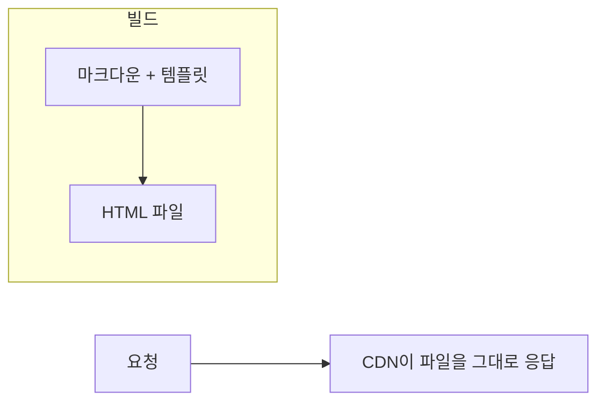

> Scott Dawson의 「정적 사이트 생성기 Eleventy로 워드프레스 사이트 옮기기」(웹액츄얼리 번역, 2021.01)를 바탕으로 재구성한 노트다. 「[Jekyll에서 Gatsby로 떠나는 마이그레이션 여정](https://wormwlrm.github.io/2022/02/25/Migration-Journey-from-Jekyll-to-Gatsby.html)」의 내용을 더해 보강했다.

## 정적 사이트 생성기란

정적 사이트 생성기(Static Site Generator, SSG)는 **콘텐츠(주로 마크다운)와 템플릿을 빌드 때 합쳐 완성된 HTML 파일을 만드는 도구**다. 요청이 올 때마다 페이지를 조립하는 CMS와 반대다.

CMS (WordPress)

SSG

대부분의 방문자가 같은 콘텐츠를 본다면, 매 요청마다 DB를 거칠 이유가 없다. 렌더링 방식 전체(CSR·SSR·SSG·ISR)의 비교는 [[spa-csr-ssr|SPA와 CSR·SSR]]에 있다.

## Jamstack

SSG로 만든 정적 파일(Markup)에 JavaScript와 외부 API를 더해 동적 기능을 붙이는 구조를 Jamstack이라 부른다. 댓글·폼·검색·결제는 서버를 직접 운영하지 않고 서드파티 API나 서버리스 함수로 처리한다.

| 장점 | 단점 |
| --- | --- |
| CDN에서 바로 내려가 빠르다 | 콘텐츠가 바뀌면 다시 빌드해야 한다. 페이지가 수만 개면 빌드가 길다 |
| 서버·DB·플러그인이 없어 공격 면이 작다 | 비개발자가 마크다운과 Git으로 편집하기 어렵다 |
| Git push가 곧 배포. 변경 이력이 남는다 | 사용자별 콘텐츠, 실시간 데이터는 API나 서버 렌더링이 따로 필요하다 |
| 호스팅이 싸고 HTTPS가 기본이다 | 특수한 경우(복잡한 검색·권한)마다 외부 서비스를 붙여야 한다 |

편집 문제는 **헤드리스 CMS**로 푼다. WordPress·Contentful·Sanity 등에서 콘텐츠를 편집하고, SSG가 빌드 때 API로 가져온다. 기존 CMS를 편집기로 남겨 둔 채 출력만 정적으로 바꾸는 점진적 전환도 가능하다.

## 도구 고르기

| 도구 | 기반 | 성격 |
| --- | --- | --- |
| Eleventy (11ty) | Node.js | 템플릿 언어를 가리지 않고(Nunjucks·Liquid·마크다운·WebC), 기본으로 클라이언트 JS를 0바이트 보낸다 |
| Hugo | Go | 빌드가 매우 빠르다. 대형 문서 사이트에 강하다 |
| Jekyll | Ruby | 오래된 블로그용 SSG. GitHub Pages 기본 |
| Astro | Node.js | 정적 HTML이 기본이고, 필요한 부분만 React·Vue 컴포넌트로 hydration하는 아일랜드 구조 |
| Next.js | React | 정적 생성과 서버 렌더링·RSC를 페이지 단위로 섞는다. 앱 같은 상호작용에 맞다 |

**콘텐츠 사이트에 SPA 프레임워크를 쓰면 JS 비용을 치른다.** 실측 데이터에서 Gatsby·Next.js처럼 React 런타임을 싣는 SSG는 Hugo·Jekyll보다 JS를 수백 KB 더 보내고 Core Web Vitals 통과율도 낮았다. 블로그·문서·소개 사이트라면 JS를 기본으로 보내지 않는 도구부터 고려한다([[responsible-javascript|책임감 있는 자바스크립트]]). Next.js도 서버 컴포넌트를 쓰면 상호작용이 없는 부분의 JS는 보내지 않는다([[server-client-components|서버 컴포넌트와 클라이언트 컴포넌트 조합 규칙]]).

## Eleventy의 구성 요소

| 개념 | 역할 |
| --- | --- |
| front matter | 마크다운 파일 맨 위 YAML. 제목·날짜·레이아웃·태그·내비게이션 순서 같은 메타데이터 |
| 레이아웃 | `_includes/layouts/base.njk`처럼 페이지를 감싸는 템플릿. front matter 값을 꺼내 쓴다 |
| 컬렉션 | 태그나 경로로 묶은 페이지 목록. 블로그 글·이벤트 목록을 만든다 |
| 필터 | 템플릿에서 값을 가공하는 함수(날짜 포맷 등). 설정 파일에 등록한다 |
| 숏코드·플러그인 | 반복되는 마크업(유튜브 임베드, 반응형 이미지)을 짧은 문법으로 넣는다 |
| 데이터 파일 | `_data/*.json`·`*.js`. 사이트 전역 메타데이터나 빌드 때 API에서 받은 데이터 |

## WordPress에서 옮기는 흐름

1. **스타터 고르기**: Eleventy 공식 스타터나 보일러플레이트 저장소로 시작하고, Netlify·Vercel·Cloudflare Pages 같은 호스팅에 Git 저장소를 연결한다. push할 때마다 빌드·배포된다.
2. **콘텐츠 내보내기**: WordPress의 도구 → 내보내기로 XML을 받고, 미디어 라이브러리 이미지도 받는다.
3. **마크다운 변환**: `wordpress-export-to-markdown` 같은 변환기로 XML을 front matter가 붙은 `.md` 파일로 바꾼다.
4. **템플릿 맞추기**: 레이아웃에 공통 헤더·내비게이션·대표 이미지 자리를 만들고, 페이지마다 front matter로 값을 넣는다.
5. **반복 콘텐츠는 컬렉션으로**: 공연 일정처럼 제목·날짜·설명을 가진 항목은 블로그 글처럼 다루고, 필터로 날짜를 사람이 읽는 형식으로 바꾼다.
6. **임베드·이미지는 플러그인으로**: 유튜브 URL을 플레이어로 바꾸는 플러그인, 빌드 때 여러 크기·형식을 만들어 `srcset`을 붙이는 이미지 플러그인을 쓴다([[responsive-images|반응형 이미지]]).
7. **폼·도메인·HTTPS**: 문의 폼은 호스팅의 폼 기능이나 서버리스 함수로, 커스텀 도메인과 인증서는 호스팅이 자동으로 처리한다.
8. **URL 유지**: 옛 주소가 바뀌면 301 리다이렉트를 설정해 검색 순위와 외부 링크를 지킨다([[seo-basics|SEO 기초]]).

### SSG끼리 갈아탈 때 지킬 것

WordPress가 아니라 SSG에서 다른 SSG로 옮길 때도(Jekyll → Astro·Eleventy·Next.js 등) 같은 함정이 있다.

| 지킬 것 | 방법 |
| --- | --- |
| **공개 URL** | 외부 링크와 검색 순위는 URL에 묶여 있다. 새 폴더 구조를 쓰더라도 빌드 설정(라우트 생성, slug 가공)으로 옛 URL 형식을 그대로 재현하고, 바꿀 수밖에 없으면 301 리다이렉트를 건다 |
| 글과 자산의 위치 | 글마다 이미지를 같은 폴더에 두면 관리가 쉽다. 대신 옮길 때 경로가 모두 바뀌므로 이동과 링크 치환을 스크립트로 자동화한다 |
| 사용자별 설정 | 정적 빌드는 모든 방문자에게 같은 HTML을 준다. 다크 모드 같은 개인 설정은 클라이언트에서 적용한다 |
| 테마 깜박임(FOUC) | 설정을 읽어 적용하는 짧은 인라인 스크립트를 `<head>`에 넣어 본문이 그려지기 전에 실행한다. 색은 CSS 변수로 두고 `data-theme` 속성 하나로 바꾸면 컴포넌트마다 분기할 필요가 없다([[dark-mode-theming\|다크 모드와 테마]]) |
| 빌드 결과 검증 | 개발 서버와 프로덕션 빌드는 동작이 다를 수 있다. 배포 전에 빌드 산출물을 직접 띄워 본다 |
| 완료 기준 | 접근성·SEO·성능 점수(Lighthouse)를 옮기기 전과 비교한다. 무거운 이미지 최적화는 CI에서 돌린다 |

## 정리

- SSG는 빌드 때 HTML을 만들어 두고 CDN에서 그대로 보낸다. 빠르고 안전하고 싸다.
- 단점은 재빌드와 편집 경험이다. 헤드리스 CMS와 증분 빌드로 보완한다.
- 콘텐츠 사이트에는 JS를 기본으로 보내지 않는 Eleventy·Hugo·Astro가, 앱에 가까우면 Next.js가 맞다.
- Eleventy의 뼈대는 front matter·레이아웃·컬렉션·필터·플러그인이다.
- 콘텐츠가 대부분 같은 사람에게 같은 모습이라면, 미리 만들어 두는 것이 가장 빠른 렌더링이다.

관련 노트: [[spa-csr-ssr|SPA와 CSR·SSR]], [[responsible-javascript|책임감 있는 자바스크립트]], [[nextjs|Next.js를 쓰는 이유]], [[markdown|Markdown 문법]]
