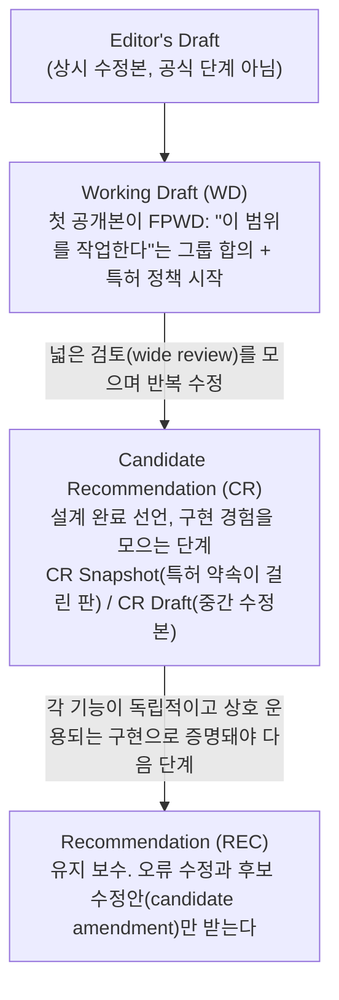

> fantasai의 「[An Inside View of the CSS Working Group at W3C](http://fantasai.inkedblade.net/weblog/2011/inside-csswg/)」(2011) 연재, WHATWG의 「[FAQ](https://whatwg.org/faq)」, 「[W3C vs. WHATWG HTML5 Specs – The Differences Documented](http://developer.telerik.com/featured/w3c-vs-whatwg-html5-specs-differences-documented/)」(2014)를 바탕으로, 권고안 단계는 현행 「[W3C Process Document](https://www.w3.org/policies/process/)」(2025.08)로 확인해 재구성한 노트다.

## 누가 무엇을 만드나

웹 플랫폼에는 표준 기구가 하나가 아니다. 기술마다 집이 다르고 절차도 다르다.

| 기구 | 맡는 것 | 문서 모양 | 결정 방식 |
| --- | --- | --- | --- |
| **W3C** 워킹 그룹 | CSS, WAI-ARIA·WCAG, Web Audio, WebAuthn, WebGPU 등 | 성숙 단계가 붙은 판(snapshot) | 그룹 합의(consensus). 이의는 Formal Objection으로 W3C Council이 판정 |
| **WHATWG** | HTML, DOM, Fetch, URL, Streams, Encoding, Console 등 | 버전 없는 **리빙 스탠더드(Living Standard)** | 편집자가 논의를 보고 판단. 다툼은 브라우저 엔진 회사들로 된 Steering Group이 최종 정리 |
| **WICG** (W3C 커뮤니티 그룹) | 아직 표준 트랙에 오르기 전의 새 API 제안 | 인큐베이션 문서(Explainer + 초안) | 누구나 제안. 둘 이상의 구현 의사가 모이면 워킹 그룹이나 WHATWG로 옮긴다 |
| **TC39** (Ecma International) | JavaScript 언어(ECMA-262) | 매년 나오는 판(ES2025 …) | Stage 0~4 단계별 합의([[ecmascript-tc39\|ECMAScript 표준과 TC39 프로세스]]) |
| IETF | HTTP, TLS, QUIC 같은 프로토콜 | RFC | 대략적 합의와 동작하는 코드(rough consensus and running code) |

**표준은 브라우저가 구현할 때 의미가 생긴다.** 그래서 어느 기구든 결국 「여러 엔진이 실제로 구현하는가」를 진입 조건으로 삼는다.

## W3C 권고안 트랙

W3C 문서는 성숙 단계(maturity stage)를 거쳐 권고안(Recommendation)이 된다.

| 단계 | 의미 | 알아 둘 점 |
| --- | --- | --- |
| WD | 설계 단계. 그룹이 피드백을 받아 고친다 | WD라고 합의된 내용은 아니다. 안정성은 문서의 상태 절을 본다 |
| CR | 기술적으로 완성됐고 넓은 검토도 받았다. 이제 **명세를 시험**한다 | CR의 시험 대상은 구현이 아니라 **명세가 구현할 수 있을 만큼 명확한가**다. 테스트 스위트와 구현 보고서를 만든다 |
| REC | 완성. 정오표를 관리한다 | 권고안도 후보 수정안으로 기능을 더해 다시 낼 수 있다 |

- **구현 경험이 관문이다.** 기능마다 서로 독립적인 상호 운용 구현이 있어야 CR을 벗어난다. 관례적인 기준은 「독립적인 구현 둘」이다.
- 단계는 앞으로만 가지 않는다. 피드백에 따라 CR에서 WD로 되돌아가는 일이 흔하다.
- 과거에는 WD 끝에 **Last Call Working Draft**, CR 뒤에 **Proposed Recommendation**(자문 위원회 승인 단계)이 있었다. Last Call은 2014년 프로세스에서, PR은 2025년 프로세스에서 없어졌다. 이전에는 Director가 단계 전환을 승인했지만 지금은 W3C Team이 확인하고 이의는 Council이 다룬다.

## CSS: 하나의 명세에서 레벨 단위 모듈로

CSS 2까지는 한 권짜리 명세였다. CSS 3부터는 장(chapter)마다 **모듈**로 쪼갰다. Selectors, Color, Backgrounds and Borders, Grid Layout이 각각 별도 명세다.

| 처음 설계 | 문제 | 바뀐 원칙 |
| --- | --- | --- |
| CSS 3 모듈들이 서로 의존 링크로 엮인 하나의 체계 | 핵심 모듈이 끝나야 기능 모듈이 끝나고, 기능 모듈이 끝나야 핵심이 끝난다. **아무것도 먼저 끝날 수 없는 의존 지옥** | 모듈은 CSS 2.1과 이미 완성된 모듈에만 기댄다. **모듈마다 레벨이 따로 오른다** |

- 그래서 「CSS 3」, 「CSS 4」라는 단일 버전은 없다. Selectors Level 4와 Color Level 5가 동시에 작업 중일 수 있다. 한 모듈에서 아직 불안정한 기능은 다음 레벨로 미루고, 구현이 준비된 부분부터 CR로 보낸다.
- 한 모듈이 REC(완성), CR(시험), WD(신기능 설계)로 동시에 존재할 수 있다. 소프트웨어의 안정 브랜치와 개발 브랜치처럼 운영한다.
- 지금 쓸 수 있는 CSS 전체 모습은 **CSS Snapshot** 문서가 해마다 묶어 발표한다.
- 결정은 회의록에 기록된 그룹 합의로만 확정된다. 다만 초기 단계 모듈은 편집자 재량을 넓게 두고, 성숙한 모듈일수록 작은 변경도 그룹 승인을 받는다.

CSS 모듈 하나가 겪는 단계를 더 잘게 보면 이렇다.

| 단계 | 공식 단계 | 변경을 누가 정하나 |
| --- | --- | --- |
| 탐색(Exploring) | FPWD 전후 | 편집자가 이견 없는 피드백은 바로 반영 |
| 다듬기(Revising) | WD 중반 | 설계 수준 변경만 그룹으로 |
| 마무리(Refining) | WD 후반 | 명백한 오류 수정 말고는 모두 그룹 결정 |
| 시험(Testing) | CR 초기 | 편집상 수정 외 모든 변경은 그룹 승인, 절 번호 고정 |
| 안정(Stable) | CR 후반 | CSS Snapshot에 들어간다 |
| 완료(Completed) | REC | 정오표만 관리 |

## WHATWG와 리빙 스탠더드

WHATWG는 2004년 Apple·Mozilla·Opera가 만들었다. 당시 W3C가 XHTML에 집중하고 HTML과 실제 웹 개발자의 요구에 관심이 없다는 불만이 계기였다. HTML5라 불린 기능 대부분이 여기서 나왔다.

- 2011년 WHATWG는 HTML에서 버전 번호를 빼고 **HTML Living Standard**로 바꿨다. 명세는 소프트웨어처럼 계속 고쳐지고, 기능은 구현과 함께 들어온다.
- 한동안 W3C도 HTML5(2014 권고)·5.1·5.2를 따로 내며 두 명세가 갈라졌다. `main` 요소를 한 문서에 몇 번 쓸 수 있는지처럼 세부가 달랐고, 브라우저는 대체로 WHATWG를 따랐다.
- **2019년 W3C와 WHATWG가 합의했다.** HTML과 DOM의 원본은 WHATWG 리빙 스탠더드 하나이고, W3C는 WHATWG의 리뷰 드래프트를 권고안으로 승인하는 역할만 한다.
- 2017년부터 Apple·Google·Microsoft·Mozilla가 Steering Group을 이룬다. 편집자의 판단은 「구현자가 실제로 구현할 것과 맞는가」로 견제된다.

### 새 기능을 제안하는 법

1. 해결책이 아니라 **문제와 사용 사례**부터 쓴다. 사용 사례마다 요구사항을 적는다.
2. 이슈로 올려 다른 개발자와 구현자의 의견을 모은다.
3. 브라우저 구현자의 관심(구현 의사)이 생기면 명세 변경 PR을 만든다. WHATWG는 **구현 둘 이상의 지지**와 테스트(web-platform-tests)를 요구한다.

기능을 **빼는 것은 훨씬 어렵다.** 웹 페이지를 깨뜨리지 않으려면 원격 측정(telemetry)으로 사용률을 재고 모든 엔진이 함께 지워야 한다. AppCache, `<applet>`, `<keygen>`이 이렇게 빠졌다.

## 상태 확인하기

명세 단계와 실제 구현은 다르다. 쓸 수 있는지는 구현 상태로 판단한다.

| 확인할 것 | 어디서 |
| --- | --- |
| 기능이 모든 주요 브라우저에서 되는가 | [web.dev Baseline](https://web.dev/baseline), [Can I use](https://caniuse.com/), MDN 호환성 표 |
| 엔진별 구현·출시 계획 | [Chrome Platform Status](https://chromestatus.com/features), [WebKit Feature Status](https://webkit.org/status/), Firefox 릴리스 노트, Edge는 Chromium을 따른다 |
| 엔진의 공식 입장 | Mozilla·WebKit의 standards-positions 저장소 |
| 명세 문서의 단계 | W3C TR 페이지(문서 상단 상태 절), WHATWG 명세 목록 |
| 표준 간 상호 운용 점수 | 해마다 정하는 Interop 프로젝트의 대시보드 |

## 정리

- HTML·DOM은 WHATWG, CSS와 접근성은 W3C, JavaScript는 TC39가 맡는다. 새 API는 WICG에서 키운 뒤 옮긴다.
- W3C 권고안 트랙은 지금 WD → CR → REC의 세 단계다. CR을 벗어나는 조건은 기능마다 독립적인 상호 운용 구현이다.
- CSS에는 버전이 없다. 모듈마다 레벨이 따로 오른다.
- 명세의 단계보다 브라우저의 구현 상태가 실무 판단 기준이다. Baseline과 엔진별 상태 페이지로 확인한다.

관련 노트: [[ecmascript-tc39|ECMAScript 표준과 TC39 프로세스]], [[css-progressive-enhancement|CSS 점진적 향상: 폴백과 피처 쿼리]], [[css-history|CSS의 역사로 본 CSS가 어려워진 이유]], [[html|HTML 기초와 HTML5]], [[frontend-history|프론트엔드의 등장 배경]]
