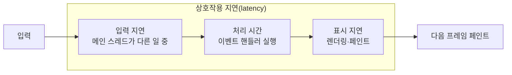

> web.dev의 지표 문서(「[Web Vitals](https://web.dev/articles/vitals)」, 「[LCP](https://web.dev/articles/lcp)」, 「[INP](https://web.dev/articles/inp)」, 「[CLS](https://web.dev/articles/cls)」)와 「[Learn Performance](https://web.dev/learn/performance)」 강좌의 「왜 속도가 중요한가」 모듈을 바탕으로 재구성한 노트다. 「속도를 정하는 요인」은 jiseung의 「[Why Site Speed Matters](https://velog.io/@jiseung/Why-Site-Speed-Matters)」(Cloudflare 학습 센터 정리)로 보강했다. 「그 밖의 로딩 지표」는 ByteByteGo의 System Design 101 가이드 「[Top 9 Website Performance Metrics You Cannot Ignore](https://bytebytego.com/guides/top-9-website-performance-metrics-you-cannot-ignore)」를 바탕으로 보강했다. 이전 모델은 web.dev의 「[Measure performance with the RAIL model](https://web.dev/articles/rail)」과 「[Why Web Developers Need to Care about Interactivity](https://philipwalton.com/articles/why-web-developers-need-to-care-about-interactivity/)」, 점수 계산은 「[Lighthouse performance scoring](https://developer.chrome.com/docs/lighthouse/performance/performance-scoring)」으로 보강했다.

웹 성능 지표는 「빠르다」를 숫자로 말하기 위한 측정값이다. 기준값은 구글 web.dev가 정한다. 용어의 짧은 정의는 [[web-glossary|용어집]]에 있다.

## 왜 속도를 재나

느린 페이지는 사용자를 잃는다. web.dev 사례 연구에서 The Economic Times는 Core Web Vitals 기준을 통과한 뒤 이탈률이 43% 좋아졌고, Rakuten 24는 전환율이 33.13% 올랐다([Economic Times](https://web.dev/case-studies/economic-times-cwv), [Rakuten 24](https://web.dev/case-studies/rakuten)). 콘텐츠가 그려지기 전까지 사용자가 겪는 경험은 「기다림」뿐이고, 느린 회선과 저사양 휴대폰에서는 그 시간이 몇 배로 늘어난다. 큰 코드는 사용자의 데이터 요금도 쓴다. 그래서 「내 노트북에서 빠르다」가 아니라 **실제 사용자 분포에서 빠른지**를 재야 한다.

### 속도가 움직이는 것

| 대상 | 뜻 | 속도와의 관계 |
| --- | --- | --- |
| 전환율(conversion rate) | 방문자 중 구매·가입 같은 목표 행동을 한 비율 | 빨리 뜰수록 목표 행동까지 가는 사람이 많다. 전환율 최적화(CRO)에서 속도는 디자인·문구와 별개로 늘 챙기는 축이다 |
| 이탈률(bounce rate) | 한 페이지만 보고 떠난 비율 | 몇 초 안에 뜨지 않으면 창을 닫거나 뒤로 간다 |
| 검색 순위 | 검색 결과에서의 위치 | Core Web Vitals가 페이지 경험 신호로 쓰인다. 다만 순위는 **관련성이 먼저**이고, 속도는 비슷한 후보 사이를 가르는 신호에 가깝다([[seo-basics\|SEO 기초]]) |

### 속도를 정하는 요인

| 요인 | 무엇이 문제인가 | 줄이는 방법 |
| --- | --- | --- |
| 페이지 무게(page weight) | 큰 JS·CSS·이미지·영상. 기능이 늘며 평균 페이지 무게는 계속 커졌다 | 코드 분할, 압축, 이미지 최적화, 지연 로딩 |
| 네트워크 상태 | 가볍게 만들어도 느린 모바일 회선에서는 느리다 | 최소화(minify)·압축, 요청 수 줄이기 |
| 서버와의 거리 | 요청 하나의 왕복 시간(RTT)이 길고, 페이지 하나에 왕복이 여러 번 필요하다 | CDN으로 사용자 가까이에서 응답, 연결 재사용, 리디렉션 줄이기 |

페이지 하나를 그리려면 HTML 말고도 수십 개의 요청이 필요하므로, **RTT × 왕복 횟수**가 곧 기다림이다. 서버 쪽 대기는 [[ttfb-optimization|TTFB 줄이기]]에서 다룬다.

## 지표

| 지표 | 무엇을 재나 | 좋음 | 나쁨 |
| --- | --- | --- | --- |
| TTFB (Time to First Byte) | 요청 후 HTML 첫 바이트가 올 때까지. 서버·네트워크 속도 | 0.8초 이하 | 1.8초 초과 |
| FCP (First Contentful Paint) | 텍스트·이미지 같은 **첫 콘텐츠**가 그려질 때까지 | 1.8초 이하 | 3초 초과 |
| **LCP** (Largest Contentful Paint) | 화면에서 **가장 큰** 이미지·텍스트 블록이 그려질 때까지. 「주요 내용이 보였다」의 대리 지표 | 2.5초 이하 | 4초 초과 |
| **INP** (Interaction to Next Paint) | 클릭·탭·키 입력 뒤 다음 화면이 그려질 때까지. 반응성 | 200ms 이하 | 500ms 초과 |
| **CLS** (Cumulative Layout Shift) | 요소가 예고 없이 밀리는 정도 | 0.1 이하 | 0.25 초과 |

굵게 표시한 셋이 구글의 **Core Web Vitals**다. 실제 페이지 로드의 **75번째 백분위**를 모바일·데스크톱으로 나눠 판정하고, 세 지표가 모두 기준을 넘어야 통과다. 검색 순위 신호에도 쓰인다. TTFB·FCP는 LCP를, TBT(Total Blocking Time)는 INP를 진단하는 보조 지표이며 Core Web Vitals가 아니다.

- 2024년 3월에 INP가 FID(First Input Delay)를 대신했다. FID는 **첫 입력의 대기 시간**만 쟀고, INP는 페이지를 쓰는 동안 일어난 **모든 상호작용**의 대기·처리·표시 시간 전체를 잰다.
- LCP와 INP는 2025년 12월 Safari 26.2가 지원하면서 주요 브라우저 모두에서 잴 수 있게 됐다(Baseline). CLS는 아직 Chromium 계열에서만 잰다.

### 그 밖의 로딩 지표

Core Web Vitals 말고도 원인을 좁힐 때 보는 지표가 있다. 대부분 DevTools 네트워크 탭과 Lighthouse 보고서에 나온다.

| 지표 | 무엇을 재나 | 읽는 법 |
| --- | --- | --- |
| 로드 시간 (`load` 이벤트) | 이미지·스타일시트를 포함해 모든 리소스를 받을 때까지 | 사용자가 체감하는 시점과 거리가 있어 단독으로는 약하다 |
| DOMContentLoaded (DCL) | HTML을 받아 파싱하고 DOM을 다 만들 때까지. 이미지·스타일시트를 기다리지 않는다(동기 스크립트는 기다린다) | 동기 스크립트가 많으면 늦어진다([[page-lifecycle-events\|페이지 생명주기 이벤트]]) |
| 첫 화면(above the fold) 로드 시간 | 스크롤 없이 보이는 영역이 다 그려질 때까지 | 사용자가 계속 볼지를 정하는 구간. LCP가 이를 대신하는 표준 지표다 |
| 요청 수 | 페이지를 다 띄우는 데 필요한 HTTP 요청 개수 | 적을수록 왕복이 준다. HTTP/2 이후로는 개수보다 **요청 체인(워터폴)의 깊이**가 더 중요하다 |
| 페이지 크기 | 모든 리소스의 전송 바이트 합 | 느린 회선에서 대역폭 병목을 드러낸다 |
| RTT (왕복 시간) | 요청이 서버에 갔다가 응답이 돌아오는 시간 | 거리와 회선 품질. CDN과 연결 재사용으로 줄인다 |
| 렌더링 차단 리소스 수 | 첫 페인트 전에 반드시 받아야 하는 CSS·동기 스크립트 | 많을수록 FCP가 늦어진다([[script-loading\|스크립트·스타일 로딩 순서]]) |

### 지표의 생애 주기

| 단계 | 의미 |
| --- | --- |
| 실험(experimental) | 시험하고 다듬는 중. 피드백을 받는 단계 |
| 대기(pending) | 쓸모가 검증됐고, 안정 단계로 가기 전 최소 6개월을 둔다 |
| 안정(stable) | 현재의 Core Web Vitals. 정의는 많아야 1년에 한 번 바뀌고 변경 기록이 공개된다 |

### 이전 모델: RAIL과 TTI·FID

Core Web Vitals 전에는 **RAIL** 모델이 목표를 정했다. 사용자의 행동을 응답(Response)·애니메이션(Animation)·유휴(Idle)·로드(Load)로 나누고, 사람의 지연 인지에 맞춰 시간 예산을 둔다.

| 사람이 느끼는 지연 | 인상 |
| --- | --- |
| 0~16ms | 애니메이션이 매끄럽다(60fps) |
| 0~100ms | 즉각 반응한다 |
| 100~1000ms | 자연스러운 작업 흐름 |
| 1초 이상 | 주의가 흩어진다 |
| 10초 이상 | 짜증 내고 떠난다 |

| 영역 | 목표 | 지침 |
| --- | --- | --- |
| Response | 입력 후 100ms 안에 눈에 보이는 반응 | 핸들러는 **50ms 안에** 끝낸다. 입력이 그 직전에 시작된 50ms짜리 작업을 기다릴 수 있기 때문이다 |
| Animation | 프레임당 10ms | 16ms 중 약 6ms는 브라우저 렌더링 몫이다. 스크롤·드래그도 애니메이션이다 |
| Idle | 유휴 시간을 최대로 | 미뤄 둔 일은 **50ms 단위**로 나눠 한다. 사용자 입력이 오면 유휴 작업보다 먼저 처리한다 |
| Load | 중급 모바일·느린 3G에서 5초 안에 상호작용 가능, 재방문은 2초 | 실제 사용자의 기기·회선으로 잰다 |

**50ms 긴 작업** 기준과 「메인 스레드가 바쁘면 링크 클릭·텍스트 선택·체크박스, 경우에 따라 스크롤까지 멈춘다」는 관점이 여기서 나왔고, 이것이 TTI(5초 동안 긴 작업이 없는 시점)와 FID(첫 입력 지연) 같은 상호작용 지표로 이어졌다. 콘텐츠 사이트도 예외가 아니다. 광고·위젯 같은 서드파티 스크립트도 메인 스레드를 막는다. 지금은 RAIL 대신 Core Web Vitals의 기준값을 목표로 쓰고, 상호작용은 INP로 잰다. 인지 시간 숫자는 [[frontend-latency-numbers|프론트엔드 지연 시간 숫자]]에도 있다.

## LCP: 무엇이 「가장 큰 요소」인가

LCP는 사용자가 이동을 시작한 순간부터 잰다. 이전 페이지 언로드, 리디렉션, 연결 설정, TTFB가 모두 들어간다.

| 후보가 되는 것 | 후보가 아닌 것 |
| --- | --- |
| ``(애니메이션이면 첫 프레임) | 단독 `<svg>` 요소 |
| `<svg>` 안의 `<image>` | CSS 그라디언트 |
| `<video>`(포스터 이미지나 첫 프레임 중 먼저 그려진 것) | 투명도 0인 요소 |
| `url()` 배경 이미지가 있는 요소 | 뷰포트 전체를 덮는 요소, 정보량이 적은 자리 표시 이미지(Chromium 휴리스틱) |
| 텍스트를 담은 블록 요소 | |

- 크기는 **뷰포트 안에 보이는 부분**만 센다. 잘리거나 넘친 영역, margin·padding·border는 빼고, 늘려 그린 이미지는 표시 크기와 원본 크기 중 작은 쪽을 쓴다.
- 브라우저는 첫 프레임 뒤 후보를 하나 보고하고, 더 큰 요소가 그려질 때마다 새 후보를 보고한다. 아직 안 받은 이미지, 웹 폰트를 기다리는 텍스트는 그려지기 전까지 후보가 아니다.
- **첫 사용자 입력(탭·스크롤·키)이 일어나면 보고를 멈춘다.** 분석 도구에는 마지막 후보 하나만 보낸다.
- 이미 있는 요소의 크기·위치가 바뀌는 것은 새 후보를 만들지 않는다.
- 다른 출처 이미지에 `Timing-Allow-Origin` 헤더가 없으면 과거에는 렌더 시각 대신 로드 시각만 노출됐다. Chrome 133부터는 약간 뭉갠 렌더 시각을 준다. 정확도를 위해 헤더는 여전히 붙이는 편이 낫다.
- 중요하지만 가장 크지는 않은 요소의 렌더 시각은 Element Timing API로 잰다.

## INP: 상호작용의 세 구간

INP는 클릭, 터치 탭, 키 입력(물리·화면 키보드)만 센다. 스크롤·호버·확대는 세지 않는다.



| 구간 | 내용 |
| --- | --- |
| 입력 지연(input delay) | 핸들러가 시작되기까지. 긴 작업(long task)이 메인 스레드를 잡고 있으면 길어진다 |
| 처리 시간(processing duration) | 이벤트 핸들러가 도는 시간 |
| 표시 지연(presentation delay) | 핸들러가 끝나고 다음 프레임이 그려지기까지 |

- 상호작용 하나에 이벤트가 여럿 묶인다(`keydown`·`keypress`·`keyup`). 그중 가장 긴 것이 그 상호작용의 지연이다.
- 페이지의 INP는 **가장 느린 상호작용**이다. 상호작용이 많은 페이지는 50번마다 가장 느린 것 하나를 이상값으로 빼고 고른다.
- 클릭·탭·키 입력이 한 번도 없었으면(스크롤만 했거나 봇) INP 값이 없다.

## CLS: 세션 창과 점수

레이아웃 이동(layout shift)은 **보이던 요소의 시작 위치가 두 프레임 사이에 바뀌는 것**이다. 새 요소가 추가되거나, 다른 요소를 밀지 않고 크기만 바뀌는 것은 이동이 아니다.

```text
이동 점수 = 영향 비율(impact fraction) × 거리 비율(distance fraction)

영향 비율: 움직인 요소들이 두 프레임에 걸쳐 차지한 영역 ÷ 뷰포트
거리 비율: 가장 많이 움직인 거리 ÷ 뷰포트의 긴 변
예) 영향 0.75 × 거리 0.25 = 0.1875
```

- 거리 비율이 있어서 큰 요소가 조금 움직였을 때 과하게 벌점을 받지 않는다.
- 이동은 **세션 창(session window)** 으로 묶는다. 이동 사이 간격이 1초 미만이면 같은 창이고, 창 하나는 최대 5초다. **CLS는 가장 점수가 큰 창의 합**이다. 과거에는 페이지 전체의 이동을 모두 더했고, 일부 도구는 아직 그 방식도 지원한다.
- 탭·클릭·키 입력 뒤 **500ms 안의 이동**은 예상한 이동으로 보고 뺀다(`hadRecentInput`). 스크롤·드래그·핀치 줌은 입력으로 치지 않는다.
- 애니메이션은 `top`·`width` 대신 `transform`으로 하면 이동으로 세지 않는다.

## 실험실 데이터와 필드 데이터

| | 실험실(lab) | 필드(field) |
| --- | --- | --- |
| 출처 | 정해진 기기·네트워크에서 한 번 측정 | 실제 사용자 브라우저에서 수집. 구글 공개 데이터(CrUX)는 크롬 사용자 기준 |
| 도구 | Lighthouse, DevTools Performance 패널, WebPageTest | CrUX를 쓰는 PageSpeed Insights·서치 콘솔, `web-vitals` 라이브러리로 만든 자체 RUM |
| 장점 | 바로 재현하고 원인을 찾기 좋다 | 진짜 체감이다. 순위에 쓰이는 것은 이쪽이다 |
| 한계 | 내 사용자 환경과 다르다. 로딩 중만 보므로 CLS를 덜 잡는다 | 데이터가 쌓일 때까지 기다려야 한다. CrUX는 원인 정보가 없다 |

- Lighthouse는 실제 입력이 없어 INP를 못 잰다. 대신 TBT를 보여 준다. DevTools Performance 패널은 직접 조작하며 LCP·INP·CLS를 모두 잰다.
- 어떤 상호작용·요소가 문제인지까지 알려면 페이지 뷰 단위로 모으는 **RUM(Real User Monitoring)** 이 필요하다.

### web-vitals 라이브러리로 재기

원시 API([[performance-timing-apis|성능 측정 API]]인 `PerformanceObserver`의 `largest-contentful-paint`, `event`, `layout-shift` 항목)를 직접 쓰면 처리할 예외가 많다. 구글의 `web-vitals` 라이브러리가 이를 대신한다.

```js
import { onCLS, onINP, onLCP } from 'web-vitals'

function send(metric) {
  const body = JSON.stringify(metric)
  // 페이지를 떠나는 중에도 전송되도록
  if (!navigator.sendBeacon?.('/analytics', body)) {
    fetch('/analytics', { body, method: 'POST', keepalive: true })
  }
}

onCLS(send)
onINP(send)
onLCP(send)
```

| 직접 잴 때의 함정 | 처리 |
| --- | --- |
| 백그라운드 탭에서 열린 페이지 | LCP·CLS를 보고하지 않는다 |
| 모바일은 `unload`가 잘 안 불린다 | `visibilitychange`로 숨겨질 때 보고한다 |
| 뒤로·앞으로 캐시(bfcache) 복원 | API는 새 항목을 안 주지만 사용자에겐 새 방문이다. 값을 다시 잰다 |
| iframe 안의 요소·이동 | API는 못 보지만 지표(CrUX)에는 들어간다 |
| 프리렌더된 페이지 | 이동 시작이 아니라 `activationStart`부터 잰다 |
| INP의 Event Timing | 기본으로 104ms 미만 항목은 버린다. `durationThreshold` 최솟값은 16ms다 |

## Lighthouse

구글이 만든 오픈 소스 페이지 품질 검사 도구다. 크롬 DevTools의 Lighthouse 탭, PageSpeed Insights, CLI로 돌린다. **성능, 접근성, 권장사항, SEO** 네 영역을 점수로 매기고 개선 항목을 알려 준다.

- 성능 점수는 지표 점수의 **가중 평균**이다. 진단·개선 기회 항목은 점수에 직접 들어가지 않는다. Lighthouse 10 이후 가중치는 TBT 30%, LCP 25%, CLS 25%, FCP 10%, Speed Index 10%다(TTI는 10에서 빠졌다).
- 각 지표 값은 HTTP Archive의 실제 사이트 데이터로 만든 로그 정규 곡선에 대어 점수로 바꾼다. HTTP Archive 사이트 중 상위 25%에 드는 값이 50점, 상위 8%에 드는 값이 90점이다. 0~49 빨강, 50~89 주황, 90~100 초록이다. 90점 근처부터는 곡선이 완만해져 99→100이 90→94만큼 어렵다. 데스크톱은 Lighthouse 6부터 별도 곡선을 쓴다.
- 점수는 실행할 때마다 흔들린다. 시크릿 창에서 확장 프로그램을 끄고 여러 번 재서 본다.
- 모바일 측정은 느린 기기와 네트워크를 흉내 내므로 데스크톱보다 점수가 낮다.
- 점수보다 항목별 진단(렌더링을 막는 요청, LCP 요소와 구간 분석, 중요 요청 체인 등)이 실제 할 일이다.

DevTools에서 Lighthouse를 돌리는 법, 같은 진단을 트레이스 위에서 더 자세히 보여 주는 Performance 패널의 실시간 지표·인사이트 사용법은 [[devtools-performance|DevTools로 성능·메모리 분석하기]]에 있다.

## 지표별 개선 방법

| 지표 | 흔한 원인 | 개선 | 자세히 |
| --- | --- | --- | --- |
| TTFB | 리디렉션, 느린·먼 서버, 캐시 미스 | 리디렉션 줄이기, 압축, 캐시, [[cdn\|CDN]], SSG | [[ttfb-optimization\|TTFB 줄이기]] |
| FCP | 렌더링을 막는 CSS·JS | CSS 줄이기·중요 CSS 인라인, 스크립트 `defer` | [[script-loading\|스크립트·스타일 로딩 순서]] |
| LCP | 늦게 발견되는 큰 히어로 이미지 | 이미지를 HTML에 두기, `fetchpriority="high"`, 지연 로딩 금지, 이미지 압축 | [[lcp-optimization\|LCP 최적화]] |
| INP | 메인 스레드를 오래 잡는 JS | 긴 작업 쪼개기, 코드 분할, 웹 워커, DOM 줄이기 | [[inp-optimization\|INP 최적화]] |
| CLS | 크기 없는 이미지·광고, 늦게 뜨는 배너, 웹 폰트 교체 | `width`·`height`나 `aspect-ratio`로 자리 확보, 폰트 지표 맞추기 | [[cls-optimization\|CLS 최적화]] |

**공통으로 쓰는 기법**

- **압축(Minification)**: 공백, 주석, 긴 변수명을 줄여 파일을 작게 만든다. 빌드 도구(webpack, Vite 등)가 배포 빌드에서 자동으로 한다. 전송할 때는 서버가 gzip·Brotli로 한 번 더 압축한다.
- **캐시**: 바뀌지 않는 파일은 파일명에 해시를 붙이고 오래 캐시한다 ([[http-cache|HTTP 캐시]]).
- **코드 분할**: 지금 화면에 필요한 JS만 먼저 보낸다 ([[code-splitting|코드 분할]]).
- **자원 종류별 최적화**: [[responsive-images|이미지]], [[video-performance|동영상]], [[web-font-performance|웹 폰트]], [[lazy-loading|지연 로딩]], [[resource-hints|리소스 힌트]].

## 정리

- 로딩은 LCP, 반응성은 INP, 안정성은 CLS로 보고, 75번째 백분위로 판정한다.
- LCP는 첫 입력 전까지 가장 큰 요소, INP는 가장 느린 상호작용, CLS는 가장 큰 이동 묶음이다.
- Lighthouse와 DevTools Performance 패널로 원인을 찾고, 필드 데이터로 효과를 확인한다.
- 숫자의 감각은 [[frontend-latency-numbers|프론트엔드 지연 시간 숫자]]와 함께 보면 좋다.

관련 노트: [[performance-timing-apis|성능 측정 API]], [[browser-rendering|브라우저 렌더링 과정]], [[frontend-latency-numbers|프론트엔드 개발자가 알아야 할 지연 시간 숫자]], [[lcp-optimization|LCP 최적화]], [[inp-optimization|INP 최적화]], [[cls-optimization|CLS 최적화]], [[ttfb-optimization|TTFB 줄이기]], [[seo-basics|SEO 기초]], [[responsible-javascript|책임감 있는 자바스크립트]], [[responsive-images|반응형 이미지: srcset·sizes와 picture]], [[devtools-performance|DevTools로 성능·메모리 분석하기]], [[script-loading|스크립트·스타일 로딩 순서와 점진적 렌더링]], [[frontend-performance-strategy|프론트엔드 성능 최적화: 언제, 무엇을]]
