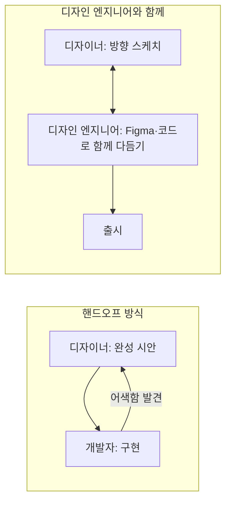

> Korean FE Article 뉴스레터가 소개한 오원종(DevOwen)의 번역 「[디자인 엔지니어란 무엇인가?](https://devowen.com/521)」(2026.03)를 바탕으로, Vercel 디자인 팀의 「[Design Engineering at Vercel](https://vercel.com/blog/design-engineering-at-vercel)」(2024.03)과 Paraform의 「[What is a design engineer?](https://www.paraform.com/blog/what-is-a-design-engineer-and-how-they-re-different-from-product-engineers)」로 보강해 재구성한 노트다.

## 디자인 엔지니어란

**디자인 엔지니어(Design Engineer)는 디자인과 프론트엔드 개발 사이를 잇는 역할이다.** 미적 감각과 기술을 함께 갖춰, 문제를 깊이 이해하고 해결책을 설계하고 직접 코드로 만들어 출시하는 데까지 혼자 끌고 갈 수 있다. 「코드를 짜는 디자이너」 또는 「디자인 시스템을 만들 줄 아는 엔지니어」로도 설명한다.

정해진 정의는 아직 없다. 같은 일을 UX 엔지니어, UI 엔지니어, 디자인 테크놀로지스트, 크리에이티브 테크놀로지스트라는 이름으로 불러 왔고, Vercel·Linear·Stripe 같은 회사가 「디자인 엔지니어」를 직함으로 내걸면서 이름이 퍼졌다. 하드웨어 분야의 디자인 엔지니어(기계·제품 설계)와는 다른 직무다.

**핵심은 「잘 작동하는 것」을 넘어 「잘 만들었다고 느껴지는 것」을 책임진다는 점이다.** 버튼을 눌렀을 때의 반응 속도, 애니메이션의 곡선, 키보드로 쓸 때의 흐름, 빈 상태와 오류 상태의 모습처럼 시안 한 장에 담기지 않고 코드에서 결정되는 품질을 맡는다.

## 하는 일

| 영역 | 구체적인 일 |
| --- | --- |
| 인터랙션·모션 | 시안으로는 판단하기 어려운 애니메이션, 키보드 조작, 터치 제스처를 코드로 프로토타이핑하고 그대로 제품에 넣는다([[ui-motion-principles\|UI 모션 디자인]]) |
| 디자인 시스템 | 재사용 컴포넌트와 프리미티브, 토큰을 만들고 문서화한다([[design-system\|디자인 시스템]]) |
| 품질의 바닥 | 페이지 속도, 크로스 브라우저 지원, 터치·포인터 같은 다양한 입력, 사용자 설정(모션 줄이기, 다크 모드) 존중, 보조 기술 접근성 |
| 마케팅·브랜드 | 제품 소개 페이지, 행사 사이트, 브랜드 시안의 개념 증명 |
| 작은 문제의 단독 처리 | 며칠~몇 주짜리 사용자 불편은 스스로 스케치하고, 피드백을 받고, 출시까지 한다 |
| 제품 팀 안에서 | 큰 기능에서 UI를 맡고, 다른 엔지니어는 API와 인프라를 맡는다 |

## 왜 이 역할이 생겼나

**핸드오프에서 품질이 샌다.** 디자이너가 완성 시안을 넘기고 개발자가 구현하는 방식에서는, 시안에 없는 상태(로딩, 오류, 긴 텍스트, 좁은 화면)와 움직임을 구현자가 추측으로 채운다. 결과물은 「어딘가 어색하게」 느껴지고, 이를 바로잡는 왕복이 길어진다. 모든 상태를 시안과 문서로 미리 그리는 방법도 비용이 크다([[design-tools-handoff|디자인 도구와 개발자 핸드오프]]).

디자인 엔지니어는 이 왕복을 한 사람 안에서 끝낸다. 디자이너가 방향을 스케치하면 디자인 엔지니어가 Figma나 코드에서 함께 다듬고, 「이 효과가 구현 비용만큼 가치가 있나」, 「이 컴포넌트는 한 번 쓰고 말 것인가 재사용할 것인가」를 그 자리에서 판단한다.

제품 주기가 짧아지고 사용자의 기대 수준이 올라간 것도 이유다. 기능이 비슷해진 시장에서는 **완성도(polish)가 차별점**이 되고, 그 완성도는 코드에서 만들어진다.

## 다른 역할과의 차이

| 역할 | 주로 책임지는 것 | 산출물 | 디자인 엔지니어와 다른 점 |
| --- | --- | --- | --- |
| 프로덕트 디자이너 | 사용자 문제 정의, 흐름, 정보 구조, 시각 디자인 | 리서치, 와이어프레임, 시안, 프로토타입 | 결과를 코드로 출시하지 않는다 |
| 프론트엔드 엔지니어 | 기능 구현, 상태·데이터 흐름, 성능, 아키텍처 | 동작하는 기능 | 명세를 구현하는 쪽에 무게가 있고, 디자인 판단을 맡지 않는 경우가 많다 |
| 프로덕트 엔지니어 | 기능 전체를 넓게(프론트·백엔드), 제품 지표 | 핵심 기능 | 범위가 넓은 대신 시각·인터랙션 깊이는 덜하다 |
| **디자인 엔지니어** | 디자인 판단 + 그 판단을 코드로 끝까지 | 출시된 UI, 코드 프로토타입, 디자인 시스템 컴포넌트 | 디자이너와 가장 일찍부터 함께 일한다 |

프론트엔드 안에서 보면, 사용자 눈앞의 마크업·CSS·인터랙션·접근성 쪽(「프론트엔드의 앞쪽」)에 무게를 둔 사람이다. 데이터 흐름·빌드·인프라 쪽(「프론트엔드의 뒤쪽」)에 무게를 두는 길과는 성장 방향이 다르다. 프론트엔드 엔지니어의 성장 트랙 구분은 [[frontend-career-tracks|프론트엔드 엔지니어의 세 가지 성장 트랙]]에 있다.

## 필요한 역량

| 범주 | 내용 |
| --- | --- |
| 시각 디자인 | 타이포그래피, 간격, 색, 레이아웃을 보는 눈. 다양한 경험으로 쌓은 좋은 취향 |
| 구현 | 시맨틱 HTML, 현대 CSS, JavaScript, 컴포넌트 프레임워크, 디자인 토큰, 접근성. 브라우저 성능 디버깅 |
| 프로토타이핑 | 와이어프레임에서 동작하는 코드까지 충실도를 오가며 빠르게 시험한다([[wireframe-mockup-prototype\|와이어프레임, 목업, 프로토타입]]) |
| 시스템 사고 | 한 컴포넌트의 변경이 제품 전체와 여러 기기에 어떻게 번지는지 본다 |
| 소통 | 디자이너에게는 구현 비용을, 엔지니어에게는 디자인 의도를 설명한다 |
| 균형 | 완벽주의와 실용 사이. 한 번에 완벽하게가 아니라 계속 개선해 완성도를 높인다 |

팀 단위로는 셰이더(GLSL), Three.js, 3D·영상 편집, 카피라이팅까지 넓게 걸치기도 한다. 정해진 도구 세트는 없고, **과정보다 결과를 기준으로** 맞는 도구를 고른다. 디자이너 출신이 코드를 배우는 순서는 [[designers-learning-code|디자이너는 어떻게 코드를 배우나]]에 있다.

## 팀에 디자인 엔지니어가 필요해지는 신호

- 시안과 출시된 화면이 늘 조금씩 다르고, 그 차이를 맞추는 리뷰·수정 왕복이 길다.
- 애니메이션·제스처·키보드 조작처럼 시안으로 합의하기 어려운 인터랙션이 제품 경쟁력의 중심이다.
- 디자인 시스템을 만들거나 유지해야 하는데 디자이너도 엔지니어도 주인이 아니다.
- MVP를 넘어 완성도를 끌어올리는 단계로 들어섰다. 미뤄 둔 「디자인 부채」는 제품이 커질수록 고치기 비싸진다.
- 마케팅·브랜드 페이지를 엔지니어링 일정과 별개로 빠르게 내야 한다.

초기 스타트업은 별도 직군 대신 디자인 감각이 있는 프로덕트 엔지니어나 창업 멤버 엔지니어가 이 역할을 겸하는 경우가 많다.

## 주의할 점

- **한 사람에게 두 직군을 다 기대하지 않는다.** 리서치·정보 구조 같은 디자인의 앞단과 데이터·인프라 같은 엔지니어링의 뒷단까지 모두 맡기면 어느 쪽도 깊어지지 않는다. 디자이너와 엔지니어를 대체하는 자리가 아니라 그 사이를 메우는 자리다.
- **직함의 의미가 회사마다 다르다.** 채용 공고의 실제 업무(마케팅 사이트 중심인가, 제품 UI 중심인가, 디자인 시스템 중심인가)를 확인한다.
- 디자인 엔지니어가 있어도 디자이너와의 협업은 필요하다. 혼자 실행할 수 있다는 것과 혼자 결정하는 것은 다르다.

## 정리

- 디자인 엔지니어는 디자인 판단과 그 판단의 코드 구현을 한 사람이 끝까지 맡는 역할이다.
- 핸드오프에서 새는 품질(상태, 움직임, 접근성, 성능)을 코드에서 직접 책임진다.
- 프로덕트 디자이너와는 출시까지 하느냐로, 프론트엔드 엔지니어와는 디자인 판단을 맡느냐로 갈린다.
- 시안과 결과물의 차이가 반복되거나, 인터랙션·디자인 시스템이 경쟁력의 중심일 때 필요해진다.

관련 노트: [[frontend-career-tracks|프론트엔드 엔지니어의 세 가지 성장 트랙]], [[designers-learning-code|디자이너는 어떻게 코드를 배우나]], [[design-tools-handoff|디자인 도구와 개발자 핸드오프]], [[design-system|디자인 시스템]], [[ui-motion-principles|UI 모션 디자인]]
