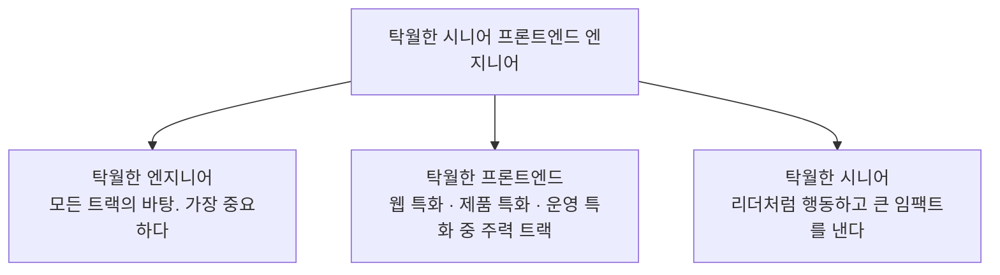
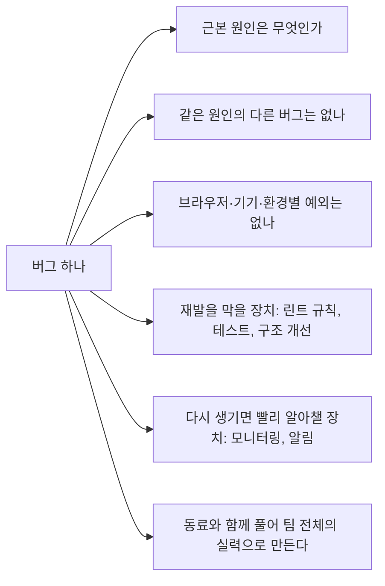

> Steady Study의 「[프론트엔드 엔지니어 커리어 로드맵: 주니어를 위한 3가지 전문성 트랙](https://steady-study.super.site/frontend-engineer-career-roadmap)」(2022.12, 2024.02 수정)을 바탕으로 재구성한 노트다. 「프론트엔드 전문성만으로 충분한가」는 Front End Interview Handbook 블로그의 「[Are Front End Development Skills Enough for a Career?](https://www.frontendinterviewhandbook.com/blog/are-front-end-development-skills-enough-for-a-career)」(2019.11)와 「[Front End vs. Back End System Design Interviews](https://www.frontendinterviewhandbook.com/blog/front-end-vs-back-end-system-design-interviews)」(2021.12)로 보강했다.

## 왜 트랙이 필요한가

3년 차쯤 된 프론트엔드 엔지니어는 비슷한 벽에 부딪힌다.

| 고민 | 모습 |
| --- | --- |
| 학습 동기 | 요구받는 화면은 대부분 만들 수 있다. 다음에 무엇을 공부할지 모호하다 |
| 롤모델 부재 | 프론트엔드 출신 시니어의 경로가 잘 안 보여 백엔드 전향을 고민한다 |
| 이른 리더십 | 시니어가 부족해 미들급이 주니어를 이끌어야 한다 |

프론트엔드는 역사가 짧고, 백엔드 출신 리더가 많은 조직에서는 시니어 프론트엔드의 역할이 흐릿하다. 엔지니어링 래더는 추상적이고 기술 로드맵은 실무와 멀다. 그래서 **어떤 전문성으로 깊어질지**를 트랙으로 나눠 보면 방향이 잡힌다.

## 바탕: 탁월한 엔지니어의 다섯 역량

마이크로소프트 엔지니어 연구 「What Makes a Great Software Engineer?」(ICSE 2015)에서 추린 역량이다.

| 역량 | 뜻 |
| --- | --- |
| 좋은 코드 | 일관된 품질, 요구 사항 충족, 빠른 속도, 적은 버그, 읽기 쉬움 |
| 지금 일의 가치 극대화 | 빠른 실행과 장기적인 시스템 사고를 상황에 맞게 조절한다 |
| 데이터 기반 판단 | 직관과 데이터를 함께 쓰고, 반대 증거를 배울 신호로 받아들인다 |
| 동료의 판단 돕기 | 정보를 나누고 투명하게 일하며, 모르는 것을 드러낼 수 있는 문화를 만든다 |
| 꾸준한 학습 | 최신 흐름을 따르되 원리와 설계 고전도 함께 읽는다 |

AI를 비서처럼 부리는 능력도 바탕 역량이 됐다. 원하는 것을 정확히 말하는 글쓰기, 좋은 질문을 던지는 인터뷰 기법이 곧 좋은 프롬프트다.

## 세 트랙 한눈에

| 항목 | 웹 특화 | 제품 특화 | 운영 특화 |
| --- | --- | --- | --- |
| 다른 이름 | 소프트웨어 엔지니어 | 프로덕트 엔지니어 | 풀스택 엔지니어 |
| 핵심 | 브라우저와 HTML·CSS·JS를 깊이 알고 도구 문제를 풀어낸다 | 적은 코드로 제품 성과를 낸다. 시장과 고객을 안다 | 프로젝트 구조, 배포, 인프라, 프로세스를 개선한다 |
| 장점 | 혼자서도 실력을 키우기 쉽다 | 초기 스타트업에서 환영받는다 | 업무 범위와 협업 기회가 넓다 |
| 함정 | 제품이 성숙하지 않으면 실력을 쓸 기회가 적다 | 익숙한 도구에 안주하면 도태된다 | 반복 업무와 번아웃, 기술이 뒤처질 위험 |
| 키우는 법 | 로드맵 학습, 사이드 프로젝트, 오픈소스, 성능 개선 | 고객 관찰, 제품 감각, 도구 상자 갱신, 레거시 교체 | 백엔드·API로 확장, 대규모 트래픽·장애 대응, 운영 프로세스 도입 |
| 시니어 이후 | 강사, 개발 도구 회사 엔지니어, 테크 리드 | 그로스 엔지니어, 테크 리드, TPM, PM·PO, CPO | 테크 리드, 플랫폼 팀, TPM, EM, 애자일 코치, VP of Engineering, CTO |

세 트랙은 배타적이지 않다. **주력 트랙 하나를 깊게, 나머지는 조금씩** 쌓는다. 대부분의 시니어는 세 트랙 모두에 어느 정도 걸쳐 있다.

## 트랙 1: 웹 특화

웹 플랫폼 자체의 전문가다. 경험칙으로, 엔지니어링 팀이 두 자릿수를 넘으면 개발자 열 명당 한 명 정도는 웹 전문가가 있어야 서비스 품질과 성능을 끌어올릴 수 있다.

| 영역 | 알아야 할 것 | 관련 노트 |
| --- | --- | --- |
| HTTP와 브라우저 | CORS, 캐시, Cookie·localStorage·IndexedDB의 차이 | [[cors\|CORS]], [[http-cache\|HTTP 캐시]] |
| 렌더링과 성능 | 크리티컬 렌더링 패스, Core Web Vitals, Lighthouse·성능 프로파일러·번들 분석기 | [[browser-rendering\|브라우저 렌더링 과정]] |
| DOM과 실행 환경 | DOM API와 이벤트, 폴리필·폴백, 모바일 웹뷰·Node.js·jsdom의 차이 | [[dom\|DOM]] |
| 문서와 렌더링 전략 | 시맨틱 HTML, 접근성, CSR·SSR·SSG 선택 기준 | [[semantic-html\|시맨틱 HTML]], [[Accessibility\|웹 접근성]] |
| CSS | 모던 셀렉터, CSS Modules·CSS-in-JS·Tailwind CSS, Storybook 기반 디자인 시스템 | [[design-system\|디자인 시스템]] |
| JS와 도구 체인 | ES2015 이후 문법, ESM과 CommonJS, TypeScript, 빌드·린트·테스트·배포 도구 | [[typescript-basics\|TypeScript 학습]] |
| 새 기술 | Rust 기반 도구, WebAssembly, 엣지 컴퓨팅이 프론트엔드에 주는 영향 | |

도구 체인은 계속 바뀐다. 번들러는 webpack에서 Vite·Turbopack처럼 Rust·Go로 만든 도구로, 테스트는 Jest에서 Vitest·Playwright로 무게가 옮겨 왔다. 특정 도구보다 **각 도구가 푸는 문제**를 이해하는 것이 이 트랙의 핵심이다.

이 트랙의 성장 경로는 **자기가 겪은 문제를 도구로 만들어 공개하는 것**이다. Testing Library, TanStack Query 같은 오픈소스가 그렇게 나왔다.

## 트랙 2: 제품 특화

코드는 수단이고 **제품 성과가 목표**다. 초기 스타트업일수록 이 트랙의 가치가 크다.

| 영역 | 알아야 할 것 |
| --- | --- |
| 노코드·로우코드 조합 | 프로토타이핑, 랜딩 페이지, A/B 테스트, 고객 데이터, 설문, 이메일, 고객 지원 도구를 엮어 빠르게 성과를 낸다 |
| SEO | 검색 엔진의 동작, 사이트맵, title·description, Open Graph 같은 기본기 ([[seo-basics\|SEO 기초]]) |
| 고객 이해 | 고객 여정 설계, 인터뷰, 행동 이벤트 설계, 핵심 지표 정의 ([[user-research\|사용자 리서치]]) |
| 도메인 분석 | 잘되는 제품을 분석하며 써 보고 흐름을 가져온다 |
| 마지막 10% | 제품을 마지막까지 다듬고, 기술 부채를 현명하게 관리한다 |
| 이해관계자 소통 | 영업·마케팅과 이야기하고 기능 로드맵을 공유한다 |

**두 가지 함정**이 있다.

1. 맥락을 묻지 않고 기획을 빠르게 구현만 한다. 이러면 제품 엔지니어가 아니라 구현 담당자가 된다.
2. 익숙한 도구에 머물며 공부를 멈춘다. 도구 상자를 주기적으로 갈아야 한다.

제품 관점으로 일하는 법은 [[product-minded-engineer|제품 중심 개발자와 PO의 사고방식]]에 있다.

## 트랙 3: 운영 특화

팀이 **더 빠르고 안전하게 일하게 만드는** 사람이다. 조직이 커질수록 영향력이 커진다.

| 영역 | 알아야 할 것 |
| --- | --- |
| 프로젝트 구조 | 모노레포와 멀티레포의 장단점, pnpm·Yarn Berry 같은 패키지 매니저, 마이크로 프론트엔드 |
| 모니터링 | Sentry·Datadog 같은 도구로 에러와 성능을 보고 장애에 대응한다 |
| 인프라 | Docker, Kubernetes, 클라우드 하나 이상, Terraform ([[dockerfile\|Dockerfile]], [[ci-cd\|CI/CD]]) |
| API | GraphQL, BFF, 간단한 어드민 백엔드 ([[bff\|BFF]]) |
| 내부 도구 | 비개발 동료의 수작업을 줄이는 도구와 자동화 |

이 트랙은 책이나 사이드 프로젝트보다 **현장의 문제**(트래픽 장애, 수작업 자동화, 길어진 배포 리드 타임)를 풀면서 자란다. 다른 회사의 운영 사례는 참고하되, 그대로 베끼지 말고 우리 조직에 맞게 고친다.

**글루 워크**(glue work)를 주의한다. 회의 정리, 문서화, 온보딩, 프로세스 조율처럼 팀을 굴러가게 하는 일은 꼭 필요하지만 눈에 잘 안 띈다. 도맡기만 하면 기술이 정체되고 평가에서 불리해진다. **한 일을 드러내고**, 근본 개선에 쓸 시간을 따로 확보한다.

## 프론트엔드 전문성만으로 충분한가

스캐폴딩 도구와 컴포넌트 라이브러리로 진입 장벽이 낮아지면서 「프론트엔드 기술만으로 커리어가 유지되나」라는 질문이 반복된다. 답은 두 갈래다. 수요와 복잡도는 충분하지만, **소프트웨어 엔지니어링 기본기 없이 화면만 다루는 프론트엔드**에는 한계가 있다.

### 수요가 줄지 않는 이유

| 근거 | 내용 |
| --- | --- |
| 복잡도가 계속 커진다 | 대형 웹 앱은 빨리 뜨고, 안전하고, 보기 좋아야 한다. 정적 HTML이 아니라 애플리케이션이라 구조 설계가 필요하다. HTML, CSS, JavaScript, 브라우저 API, 보안, 성능, 애니메이션, SEO, 네트워크까지 알아야 할 범위가 넓고 계속 늘어난다 |
| 모바일도 클라이언트 앱이다 | 모바일 앱과 웹 앱은 둘 다 클라이언트 애플리케이션이라 핵심 기술이 옮겨 간다. React Native·Flutter로 웹 프론트엔드 지식을 네이티브 앱에 쓸 수 있다([[react-native-basics\|React Native 기초]], [[mobile-frameworks\|모바일 프레임워크]]) |
| 데스크톱도 웹으로 만든다 | 오피스·디자인 도구처럼 큰 화면이 유리한 작업은 데스크톱에 남는다. 그 데스크톱 앱도 Electron으로 웹 코드를 실행 파일로 묶어 만든다. Slack, Discord, VS Code가 그렇다([[electron\|Electron]]) |

웹을 위협하는 것은 모바일이 아니라 **상호작용 방식 자체가 화면 밖으로 옮겨 가는 패러다임 전환**이다. 그런 전환은 하룻밤에 일어나지 않으므로 대응할 시간이 있다.

### 소프트웨어 엔지니어가 먼저, 도메인 전문가가 다음

- 좋은 도구가 있어도 프론트엔드 개발자에게 엔지니어링 능력이 필요 없어지지 않는다. **도구를 만드는 사람**이 되면 그 능력이 그대로 요구된다. 좋은 개발자는 추상화 아래로 내려가 도구가 어떻게 동작하고 어떤 문제를 풀려고 나왔는지 이해한다.
- 대규모 조직의 프론트엔드 일은 브라우저 화면에 그치지 않는다. 코드베이스와 조직이 커지면 대규모 리팩터링용 **코드모드**, 새 UI 패러다임, 빠른 테스트 프레임워크, 타입이 없는 언어를 위한 **타입 검사기**(Meta의 Flow), 서버 데이터를 가져오고 클라이언트에서 관리하는 방식(Relay·GraphQL) 같은 인프라를 만든다.
- 그래서 **T자형**이 기본 전략이다. 알고리즘, 자료구조, 소프트웨어 공학, 운영체제, 네트워크 같은 기본기를 넓게 갖추고 프론트엔드를 깊게 판다. 기본기가 탄탄하면 웹 수요가 줄어도 모바일, 백엔드, AR·VR 같은 다른 UI 플랫폼으로 옮겨 갈 수 있다. 빨리 배우는 능력이 그 전환을 매끄럽게 만든다. T자형의 뜻은 [[frontend-developer-role#풀스택 개발자|프론트엔드 개발자의 업무 범위와 역량]]에 있다.
- **인접 분야를 하나 더 판다.** 프론트엔드 도구 체인은 프로그래밍 언어 이론 위에 서 있다. 번들러가 파일을 묶고, CSS 전처리기가 CSS를 만들고, 트랜스파일러가 최신 JavaScript를 옛 문법으로 바꾸고, Markdown이 HTML로 바뀌는 과정이 모두 **정적 분석과 컴파일**이다([[static-analysis\|정적 분석]], [[typescript-compiler-internals\|TypeScript 컴파일러 내부]]). 『Crafting Interpreters』로 인터프리터를 직접 만들어 보는 것이 좋은 출발점이다.

### 경력 천장 논쟁

화면만 다루는 프론트엔드 전용 개발자에게 **개인 기여자(IC) 트랙의 최종 레벨**이 상대적으로 낮다는 관찰이 있다. 통계적인 경향이고 예외가 많으며, 프론트엔드로도 크게 성공할 수 있다. 레벨 사다리는 [[engineering-levels|엔지니어 레벨]]에 있다.

| 원인으로 꼽는 것 | 근거 |
| --- | --- |
| 관성 | 현대 프론트엔드는 백엔드보다 역사가 짧다. 「프론트엔드는 진짜 엔지니어링이 아니다」라는 편견이 남아 있고, 권력 구조는 오래 지속되어 VP of Engineering·CTO 다수가 백엔드·인프라 출신이다 |
| 경제 논리 | 회사가 보는 엔지니어의 가치는 그가 책임지는 머신·연산·저장소, 곧 **통제하는 돈의 크기**와 비례하는 경향이 있다. 프론트엔드 연산은 사용자 기기에서 돌아 회사가 비용을 내지 않는다. 소비자 제품에서 프론트엔드가 똑같이 어렵고 중요해도, 회사가 직접 돈을 내고 확장해야 하는 연산만큼 값을 쳐 주지 않는다 |
| 수명 | 웹 앱은 사용자가 탭을 열었다 닫으면 끝나는 짧은 프로세스다. 백엔드 서비스는 몇 달, 몇 년을 돈다. 그래서 프론트엔드에서는 다루는 데이터가 작고 수명이 짧아 성능 문제가 있는 코드도 버티지만, 오래 도는 백엔드에서는 그냥 넘어갈 수 없다 |

이 논쟁은 위의 결론과 같은 방향을 가리킨다. 프론트엔드 인프라, 데이터 흐름, 클라이언트-서버 경계처럼 **규모와 비용에 닿는 문제**로 범위를 넓히면 천장이 높아진다. 운영 특화 트랙과 웹 특화 트랙의 시니어 이후 진로가 그 예다.

## 탁월한 시니어 되기

1. **기본을 계속 지킨다.** 다섯 역량은 연차가 쌓여도 그대로 바탕이다.
2. **직함이 없어도 리더처럼 행동한다.** 모범적인 행동이 말보다 영향력이 크다. 승진은 대개 이미 그 역할을 하고 있는 사람을 뒤늦게 인정하는 일이다.
3. **작은 일에서도 큰 임팩트를 낸다.** 버그 하나를 고쳐도 아래까지 살핀다.

## 더 볼 자료

- 단계별 지도: [roadmap.sh/frontend](https://roadmap.sh/frontend), 학습 순서는 [[frontend-roadmap|프론트엔드 학습 로드맵]]
- 성능·웹 기초: [web.dev](https://web.dev)
- 뉴스: Korean FE Article, [긱뉴스](https://news.hada.io)
- 커리어 단계: [Engineering Ladders](https://www.engineeringladders.com)
- 책: 『Quality Software Management』, 『테크니컬 리더』, 『클린 애자일』, 『매니지먼트 3.0』

## 정리

- 모든 트랙의 바탕은 **좋은 코드, 가치 판단, 데이터, 동료 돕기, 학습** 다섯 역량이다.
- 주력 트랙을 하나 고르고, 나머지 두 트랙도 조금씩 쌓는다.
- 웹 특화는 도구가 푸는 문제를, 제품 특화는 고객과 성과를, 운영 특화는 팀의 속도와 안정성을 판다.
- 운영 일을 맡더라도 한 일을 드러내고 근본 개선 시간을 지킨다.
- 프론트엔드 수요는 모바일·데스크톱까지 이어지지만, 화면만 다루면 천장이 낮다. 소프트웨어 엔지니어링 기본기와 인접 분야(정적 분석·컴파일러, 인프라)로 T자형을 만든다.
- 시니어는 직함이 아니라 행동이다. 작은 일에서도 근본 원인과 재발 방지까지 본다.

관련 노트: [[frontend-developer-role|프론트엔드 개발자의 업무 범위와 역량]], [[frontend-roadmap|프론트엔드 학습 로드맵]], [[product-minded-engineer|제품 중심 개발자와 PO의 사고방식]], [[growing-at-work|회사에서 빠르게 성장하는 법]], [[engineering-levels|엔지니어 레벨]], [[frontend-interview|프론트엔드 면접 유형과 준비법]]
