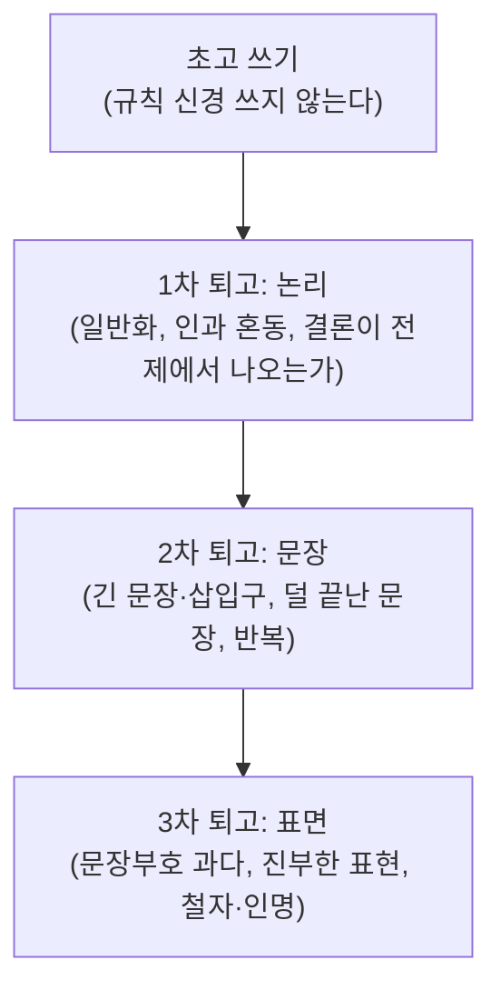

> Jane의 「[움베르토 에코, 글을 잘 쓰는 방법](https://brunch.co.kr/@janegray/149)」(2023.10)을 바탕으로 재구성한 노트다. 원 자료는 움베르토 에코의 칼럼 「글을 잘 쓰는 방법(Come scrivere bene)」이며, 한국어판은 『책으로 천년을 사는 법』(김운찬 옮김, 열린책들)에 실려 있다.

## 에코의 규칙이란

움베르토 에코가 시사 주간지 『레스프레소(L'Espresso)』의 칼럼 「미네르바 성냥갑(La bustina di Minerva)」에 쓴 글쓰기 규칙 모음이다. 이탈리아어 원문은 40개, 한국어판은 37개 항목이다.

**규칙마다 자기가 금지하는 실수를 그 문장 안에서 저지른다.** 「두운을 피하라」는 규칙은 두운으로 쓰여 있고, 「감탄 부호를 줄여라」는 규칙은 감탄 부호로 끝나며, 「완성된 문장을 써라」는 마지막 규칙은 문장 중간에서 끊긴다. 규칙을 읽는 동안 나쁜 예를 직접 겪게 하는 장치다. 그래서 각 항목은 **무엇이 거슬리는지 몸으로 확인하는 체크리스트**로 읽으면 된다.

## 규칙 묶음

번호는 한국어판 기준이다.

| 묶음 | 규칙 | 피하는 것 |
| --- | --- | --- |
| 어휘 | 두운 피하기(1), 굳은 문장 피하기(3), 진부한 비유 피하기(12), 낡은 표현·난해한 전문어 줄이기(35) | 소리 장난, 「다시 데운 수프」 같은 기성품 문장 |
| 외국어·표기 | 외국어로 멋 내지 않기(10), 사투리에 기대지 않기(20), 외래어를 임의로 복수형으로 바꾸지 않기(25), 외국 인명 정확히 쓰기(26), 철자 확인(29) | 정확한 말 대신 낯선 말로 때우기 |
| 문장 | 접속사는 필요할 때만(2), 한 단어짜리 문장 없애기(16), 긴 문장·삽입구 줄이기(23), 완성된 문장 쓰기(37) | 흐름을 끊는 문장, 덜 끝난 문장 |
| 문장부호 | 괄호(6)·말줄임표(7)·따옴표(8)·감탄 부호(24) 줄이기, 쉼표 정확히(18), 콜론과 세미콜론 구별(19) | 부호로 어조를 대신하기 |
| 비유 | 과감한 은유 조심(17), 어울리지 않는 은유 섞지 않기(21) | 이미지가 서로 부딪히는 비유 |
| 논리 | 일반화 금지(9), 과잉 설명·반복 금지(13), 수사적 질문은 꼭 필요할 때만(22), 원인과 결과 혼동 금지(33), 결론은 전제에서 나오게(34) | 근거 없는 단정, 같은 말 되풀이 |
| 인용·지시 | 인용 줄이고 내 말로 쓰기(11), 저자·인물은 돌려 말하지 말고 이름을 대기(27) | 남의 권위 뒤에 숨기, 「어떤 학자는」 |
| 태도 | 자기 생각 드러내기(4), 구체성은 적당히(15), 서두에 아부성 감사 넣지 않기(28), 반어법 남용 금지(30), 위엄 있는 1인칭 복수 「우리」 쓰지 않기(32) | 독자 환심 사기, 책임 흐리기 |
| 형식 | 상업적 기호·약어 쓰지 않기(5), 저속한 말 쓰지 않기(14), 문단은 필요할 때만 나누기(31), 장황하지도 너무 짧지도 않게(36) | 글의 격을 떨어뜨리는 표지 |

## 한국어 글에 옮겨 쓰기

일부 규칙은 이탈리아어 사정에서 나왔다. 원리만 남겨 한국어 글에 맞추면 다음과 같다.

| 원래 규칙 | 한국어 글에서는 |
| --- | --- |
| 외국어 복수형 금지(25) | 「데이터들」, 「팩트들」처럼 외래어에 복수 표지를 붙이지 않는다 |
| 외국어로 멋 내지 않기(10) | 우리말로 충분한 자리에 영어 단어를 섞지 않는다. 처음 나오는 전문 용어만 원어를 병기한다 |
| 위엄 있는 「우리」 금지(32) | 혼자 쓴 글에서 「우리는 ~라고 본다」로 주장을 일반화하지 않는다. 판단이면 판단이라고 쓴다 |
| 콜론·세미콜론 구별(19) | 한국어에서는 세미콜론이 드물다. 두 문장으로 나누는 편이 대개 낫다 |
| 상업적 기호·약어 금지(5) | 본문에 「&」, 「w/」, 「→」 같은 메모용 기호를 남기지 않는다 |

## 쓰는 법

규칙 37개를 외워서 쓰는 것이 아니라 **퇴고할 때 대조표로 쓴다.**

규칙끼리 부딪히는 자리도 있다. 「장황하지도 너무 짧지도 않게」(36)처럼 정도를 정하지 않는 규칙은 기계적으로 적용할 수 없다. 기준은 늘 **이 독자가 멈추지 않고 읽을 수 있는가**다.

## 정리

- 에코의 규칙은 규칙 자체가 나쁜 예가 되는 역설 형식이라, 무엇이 거슬리는지 직접 느끼게 한다.
- 핵심은 세 가지로 모인다: 기성품 표현 대신 내 말로, 부호와 수사 대신 문장으로, 단정 대신 근거로.
- 언어 특유의 규칙은 원리만 가져와 한국어 사정에 맞춘다.
- 초고가 아니라 퇴고 단계의 체크리스트로 쓴다.

관련 노트: [[persuasive-writing|글쓰기 원칙: 구조, 설득, 문장력]], [[ux-writing|UX 라이팅]]
