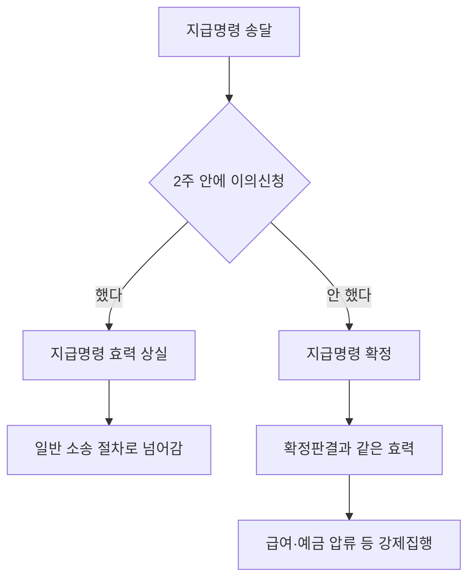

> 금융위원회의 개인채무자보호법 안내와 채무자대리인 운영 방안(2026.1), 채무상담 대표번호 1375 개통 발표(2026.10), 「민사소송법」의 지급명령 조문, 법무부의 압류금지 금액 상향 안내(2026.2 시행)를 종합한 노트다.

## 상황별로 쓸 수 있는 제도

| 상황 | 제도 | 창구 |
| --- | --- | --- |
| 대출을 연체했고 갚을 조건을 바꾸고 싶다 | 채무조정 요청권 | 돈을 빌린 금융회사 |
| 추심 연락이 지나치게 잦다 | 추심 횟수 제한, 연락 시간·수단 지정 요청 | 금융회사·추심회사 |
| 불법사금융, 협박·지인 연락 같은 불법추심을 당한다 | 채무자대리인 무료 지원 | 금융감독원 1332, 대한법률구조공단 |
| 어디에 물어야 할지 모르겠다 | 채무상담 대표번호 | 1375 |
| 법원에서 지급명령이 왔다 | 2주 안에 이의신청 | 지급명령을 보낸 법원 |

## 개인채무자보호법

정식 이름은 「개인금융채권의 관리 및 개인금융채무자의 보호에 관한 법률」이고 2024년 10월 17일부터 시행 중이다. 금융회사가 연체 채권을 추심회사에 넘기기 전에 채무자와 직접 조정하도록 만든 법이다.

### 채무조정 요청권

| 항목 | 내용 |
| --- | --- |
| 대상 | **원금 3천만 원 미만**인 개인 대출을 연체 중인 채무자 |
| 방법 | 서면(전자문서 포함), 전화, 방문으로 금융회사에 직접 요청한다 |
| 회신 | 금융회사는 요청받은 날부터 **10영업일 안에** 조정 여부를 알려야 한다 |
| 거절 | 채권 존부를 다투는 소송 중이거나 신용회복위원회 채무조정, 법원 개인회생·파산이 진행 중이면 거절할 수 있다. 그 밖에도 금융회사 내부 기준에 따라 받아들이지 않을 수 있다 |
| 거절 시 의무 | 거절하더라도 법원 회생 절차와 신용회복위원회 채무조정을 안내해야 한다 |
| 합의 해제 | 합의 후 변제 계획을 3개월 이상 지키지 않으면 금융회사가 합의를 해제할 수 있다. 입원 치료나 실업 같은 사정이 있으면 6개월 이상이다 |

요청권은 채무자가 먼저 행사해야 하는 권리다. 연체가 시작됐으면 금융회사의 안내를 기다리지 않고 요청한다. 금융회사가 받아들이지 않으면 신용회복위원회 채무조정이나 법원 개인회생으로 넘어간다.

### 연체이자와 경매 제한

- **연체이자**: 원금 5천만 원 미만 대출은 기한의 이익을 잃어도(연체로 남은 대출 전액을 한꺼번에 갚아야 하는 상태가 되어도), 상환일이 아직 오지 않은 원금에는 연체 가산이자를 붙일 수 없다. 잔액 100 가운데 상환일이 지난 금액이 10이면 가산이자는 10에만 붙는다.
- **사전 통지**: 기한의 이익 상실, 주택 경매 신청, 채권 양도 같은 조치는 10영업일 전까지 서면으로 알려야 한다.
- **주택 경매 유예**: 전입신고를 하고 실제로 사는 6억 원 이하 주택은 경매 신청 사유가 생긴 날부터 6개월이 지나야 금융회사가 경매를 신청할 수 있다.

### 추심 제한

| 권리 | 내용 |
| --- | --- |
| 횟수 제한 | 추심 연락은 채권별로 **7일에 7회**를 넘을 수 없다. 법령상 의무 통지는 횟수에서 빠진다 |
| 연락 시간·수단 지정 | 1주일에 28시간 범위에서 연락받을 시간대를 지정해 달라고 요청할 수 있다. 방문, 전화, 문자, 이메일, 팩스 가운데 두 가지 이하를 지정할 수 있고 방문과 전화를 함께 지정할 수는 없다 |
| 추심 유예 | 재난을 당했거나 본인·배우자·직계 가족이 수술·입원했거나 혼인·사망이 있으면 3개월 이내로 추심 연락을 미루게 할 수 있고 한 번 연장할 수 있다 |

## 채무자대리인

불법사금융이나 불법추심 피해자를 대신해 **대한법률구조공단 소속 변호사가 무료로** 추심에 대응하는 제도다. 대리인은 추심자에게 선임 사실을 알려 추심을 멈추게 하고, 대응 방법과 고소 절차, 증거 확보 방법을 안내한다.

| 항목 | 내용 |
| --- | --- |
| 대상 | 불법사금융·불법추심 피해를 본 채무자, 그리고 추심 연락을 받는 가족·지인 같은 관계인 |
| 신청 | 금융감독원(1332), 대한법률구조공단, 서민금융통합지원센터 |
| 관계인 신청 | 2026년 2월부터 채무자 본인의 신청 없이 관계인 혼자서도 신청할 수 있다 |
| 추심자 특정 | 전화번호를 몰라도 SNS 아이디만으로 신청할 수 있다 |
| 선임 전 조치 | 선임까지 10일가량 걸린다. 그 사이 금융감독원이 불법추심자에게 경고를 보내고, 물리적 위해가 우려되면 경찰과 연계한다 |
| 지원 횟수 | 2026년부터 횟수 제한이 없어졌다. 추심이 다시 시작되거나 길어지면 필요한 만큼 다시 이용한다 |
| 소송 | 법정 최고금리를 넘는 이자의 반환 청구처럼 불법 대부계약 관련 소송도 무료로 대리한다 |

협박이나 지인 연락 같은 불법추심의 증거(문자, 통화 녹음, SNS 대화 화면)는 지우지 말고 모아 둔다.

## 채무상담 대표번호 1375

금융위원회와 신용회복위원회가 2026년 10월 29일 개통한 채무 상담 전화다. 평일 오전 9시부터 오후 6시까지 운영하고 통화료는 신용회복위원회가 부담한다.

- 금융회사 대출뿐 아니라 통신비·전기요금 채무조정, 법원 개인회생·파산 신청 지원, 불법사금융 피해 신고를 한 번에 상담한다.
- 상담 중에 전화를 끊지 않고 다른 전문기관으로 연결해 준다.
- 생계·심리·재무 문제가 겹친 경우에는 심층상담반이 맡는다.

## 지급명령

### 무엇인가

채권자가 법원에 신청하면 법원이 **채무자를 부르지 않고 서류만 보고** 돈을 지급하라고 명하는 간이 절차다. 채권자 주장만으로 나오므로 금액이 틀렸거나 이미 갚은 빚, 소멸시효가 지난 빚에도 발령될 수 있다. 다투는 것은 채무자의 몫이다.

### 이의신청

- 지급명령을 **송달받은 날부터 2주 이내**에 이의신청을 하면 그 범위에서 지급명령은 효력을 잃는다(민사소송법 제470조). 이 2주는 법원이 늘려 줄 수 없는 불변기간이다.
- 적법한 이의신청이 있으면 지급명령을 신청한 때에 소가 제기된 것으로 보고 일반 소송으로 이어진다. 구체적인 반박은 그 소송에서 한다.
- 이의신청이 없으면 지급명령은 **확정판결과 같은 효력**을 갖는다(제474조). 채권자는 이것으로 바로 강제집행을 신청할 수 있다. 지급명령으로 확정된 채권은 소멸시효도 10년으로 늘어난다.
- 내용이 부당하다고 생각해 서류를 무시하는 것이 가장 나쁜 대응이다. 받아 놓고 열어 보지 않아도 기간은 흐른다.

### 압류에도 한도가 있다

지급명령이 확정돼도 전부를 가져갈 수는 없다(민사집행법 제246조).

| 재산 | 압류할 수 없는 범위 |
| --- | --- |
| 급여·상여금·연금 | 2분의 1. 다만 월 **250만 원**까지는 전액 압류 금지다 (2026년 2월 1일부터 185만 원에서 상향) |
| 퇴직금 | 2분의 1 |
| 생계비계좌 | 1인당 1개만 만들 수 있고, 한 달 누적 입금액 250만 원까지 압류되지 않는다 (2026년 2월 1일 도입) |
| 보장성 보험 | 사망보험금 1,500만 원, 만기·해약환급금 250만 원까지 |

압류금지 금액이 일반 계좌로 들어와 압류된 경우에는 법원에 압류명령 취소를 신청할 수 있다.

## 정리

- 연체가 시작되면 금융회사에 먼저 채무조정을 요청한다. 10영업일 안에 답을 받을 권리가 있다.
- 추심 연락은 7일에 7회까지다. 넘으면 기록을 남기고 신고한다.
- 불법추심은 혼자 상대하지 않고 1332나 1375로 채무자대리인을 신청한다.
- 지급명령은 내용이 틀렸더라도 2주 안에 이의신청을 해야 한다.

관련 노트: [[household-loans|가계대출의 기본]], [[investment-and-shopping-scams|투자·쇼핑·대출 사기]], [[voice-phishing-response|보이스피싱과 스미싱]], [[consumer-payment-protections|소비자 결제·계약 보호]]
