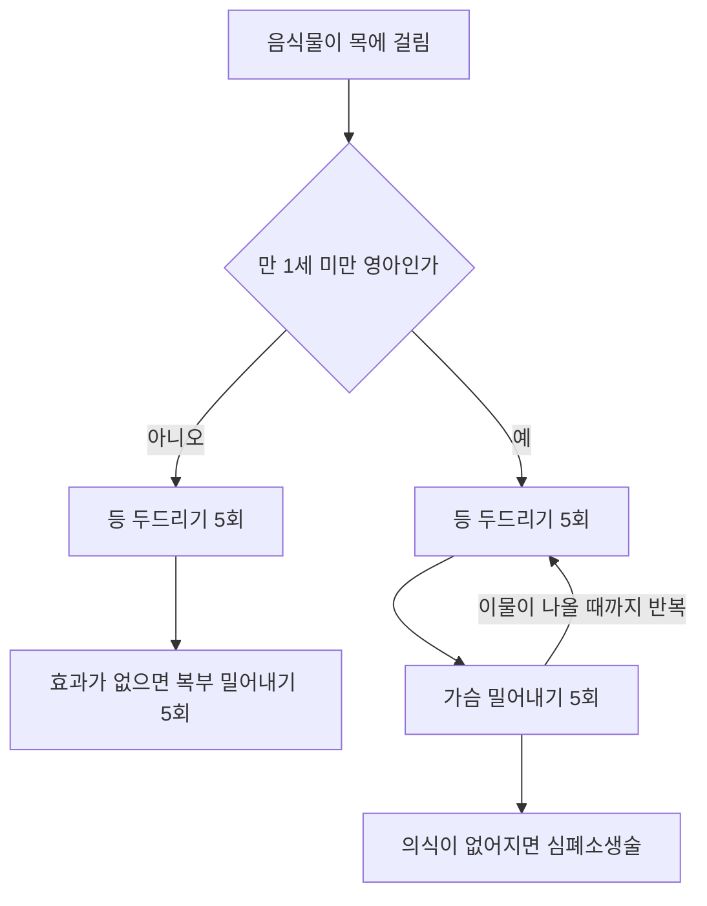

> 질병관리청의 [심뇌혈관질환 조기증상 안내](https://kdca.go.kr/kdca/3363/subview.do)와 [2025년 한국 심폐소생술 가이드라인 발표 자료](https://www.kdca.go.kr/bbs/kdca/42/309906/artclView.do), 행정안전부의 침수·물놀이 국민행동요령, 소방청의 캠핑 안전 수칙, 한국소방안전원의 위험물 해설을 종합한 노트다. 일반 대중용 공식 행동 요령을 정리한 것이며 의학적 진단이나 처치를 대신하지 않는다.

## 공통 원칙

응급 상황의 공식 요령에는 공통점이 있다. **혼자 판단하며 시간을 보내지 않고 먼저 119에 알린다. 그리고 구하려는 사람이 같이 위험해지는 행동을 하지 않는다.** 아래 상황은 모두 직관(조금 지켜본다, 물을 뿌린다, 뛰어들어 구한다, 문을 연다)이 틀리는 경우다.

## 뇌졸중과 심근경색의 조기증상

두 질환은 치료가 빠를수록 결과가 좋아지므로, 증상을 알아보고 바로 119를 부르는 것이 대응의 전부에 가깝다. 질병관리청이 안내하는 조기증상은 모두 「갑자기」 나타난다는 점이 같다.

| 질환 | 조기증상 |
| --- | --- |
| 뇌졸중 | 한쪽 얼굴·팔·다리에 힘이 빠진다 |
| | 말이 어눌해지거나 다른 사람의 말을 이해하지 못한다 |
| | 한쪽 눈이 보이지 않거나, 양쪽 눈 시야의 반이 보이지 않거나, 물체가 두 개로 보인다 |
| | 어지럽거나 몸의 중심을 잡기 힘들다 |
| | 이제까지 겪어 보지 못한 심한 두통이 있다 |
| 심근경색 | 가슴에 심한 통증이나 압박감, 짓누르는 느낌이 있다 |
| | 턱, 목, 등에 심한 통증이나 답답함이 있다 |
| | 숨이 많이 찬다 |
| | 팔이나 어깨에 통증이나 불편함이 느껴진다 |

증상이 보일 때의 행동은 다음과 같다.

- 지체 없이 119에 도움을 요청하고, 급성기 치료가 가능한 병원으로 간다.
- 환자가 직접 운전하지 않는다.
- 가족이 올 때까지 기다리거나, 증상이 저절로 나아지기를 기다리지 않는다.
- 야간이나 주말이어도 외래 진료 시간까지 미루지 않는다.

## 음식물로 기도가 막혔을 때

질병관리청과 대한심폐소생협회의 2025년 한국 심폐소생술 가이드라인(2026년 1월 발표)은 이물질에 의한 기도 폐쇄 처치를 나이에 따라 나눈다.

| 대상 | 처치 |
| --- | --- |
| 성인, 만 1세 이상 소아 | **등 두드리기 5회**를 먼저 한다. 효과가 없으면 **복부 밀어내기(하임리히법) 5회**를 한다 |
| 만 1세 미만 영아 | **등 두드리기 5회와 가슴 밀어내기 5회**를 번갈아 반복한다. 가슴 밀어내기는 한 손 손꿈치로 압박한다. 이물이 나오거나 의식이 없어질 때까지 계속하고, 의식이 없어지면 즉시 심폐소생술로 바꾼다 |

- **영아에게는 복부 밀어내기를 하지 않는다.** 내부 장기가 손상될 수 있어 가이드라인이 권고하지 않는다.
- 주변에 사람이 있으면 한 사람은 처치를 하고 다른 사람은 119에 신고한다.

## 텐트와 차 안의 일산화탄소

일산화탄소는 색도 냄새도 없어 중독되고 있다는 것을 스스로 알아채기 어렵다. 좁고 닫힌 공간에서는 농도가 빨리 오른다. 소방청의 캠핑 안전 수칙은 세 가지다.

1. 텐트 내부 같은 **밀폐 공간에서는 난방 기구를 쓰지 않는다.**
2. 부득이하게 쓸 때는 반드시 환기창을 연다.
3. 가능하면 일산화탄소 경보기를 늘 비치한다.

차 안에서 잠을 자는 차박도 같은 밀폐 공간이므로 같은 수칙이 적용된다.

## 침수: 차량과 지하 공간

### 차량

행정안전부의 국민행동요령은 「들어가지 않는다 → 일찍 옮긴다 → 못 옮기면 차를 버린다」 순서다.

| 상황 | 행동 |
| --- | --- |
| 도로나 지하차도에 물이 흘러든다 | 진입하지 않는다. 이미 들어갔다면 차를 두고 즉시 대피한다 |
| 교량·하천에 물이 넘친다 | 진입하지 않고 우회하거나, 안전한 곳에서 수위가 내려가기를 기다린다 |
| 타이어가 잠기기 시작한다 | **타이어 높이의 3분의 2가 잠기기 전에** 차를 안전한 곳으로 옮긴다 |
| 차가 침수돼 문이 열리지 않는다 | 운전석 머리받침의 철제 막대 같은 단단한 물체로 유리창을 깨고 나온다 |
| 유리창을 깨지 못했다 | 차 안팎의 **수위 차이가 30cm 이하**가 되면 문이 열리므로 그때 바로 열고 나온다 |
| 급류에 차가 고립됐다 | 급류가 밀려오는 반대쪽 문을 열거나 창문을 깨고 탈출한다 |

바깥 수위가 높은 동안에는 수압 때문에 문이 열리지 않는다. 그래서 유리창이 첫 번째 탈출구이고, 수위 차가 줄어드는 순간이 두 번째 기회다.

### 접합유리는 망치로 깨지지 않는다

차량 유리에는 깨지면 잘게 부서지는 강화유리와, 유리 사이에 필름을 넣어 깨져도 형태가 남는 접합유리가 있다. 한국소비자원의 2026년 11월 조사에서 **접합유리는 비상 탈출용 망치로 세게 쳐도 금만 갈 뿐 탈출할 구멍이 생기지 않았다.** 조사한 국산차 47종 가운데 25%는 앞좌석과 뒷좌석 측면 창 모두에 접합유리를 썼고, 소비자 10명 중 7명 이상은 자기 차에 접합유리가 쓰였는지 몰랐다.

- 내 차의 어느 창이 접합유리인지 미리 확인하고, 깨지는 창(강화유리)을 탈출 경로로 정해 둔다.
- 비상 탈출용 도구를 손이 닿는 곳에 둔다.

### 지하 공간

| 장소 | 행동 |
| --- | --- |
| 반지하, 지하 상가 | 바닥에 물이 조금이라도 차오르거나 하수구가 역류하면 즉시 대피한다. 문 밖 수심이 무릎 높이를 넘으면 혼자 힘으로는 문을 열 수 없으므로, 전기를 차단하고 여러 사람이 함께 연다 |
| 지하 주차장 | 물이 조금이라도 차오르면 차를 두고 나온다. 물이 들어온 뒤에는 차를 빼러 가지도, 차를 확인하러 들어가지도 않는다 |
| 지하 계단 | 물이 조금이라도 흘러들면 즉시 올라간다. 운동화가 좋고 마땅한 신발이 없으면 맨발로, 난간을 잡고 이동한다 |

## 물놀이

행정안전부 물놀이 안전 수칙의 핵심은 다음과 같다.

- 몸에 맞는 구명조끼를 입고 끈과 지퍼를 제대로 채운다.
- 보호자가 지켜보거나 안전요원이 있는 곳에서 논다. 하천처럼 수영장이 아닌 곳은 바닥이 고르지 않고 갑자기 깊어지거나 뻘층이 있을 수 있다.
- 음식을 먹은 직후나 술을 마신 뒤에는 물에 들어가지 않는다.
- 몸이 떨리거나 입술이 파래지면 물에서 나와 몸을 따뜻하게 한다.
- 튜브에 의지해 깊은 곳이나 먼 곳으로 나가지 않는다.

**물에 빠진 사람을 보았을 때는 뛰어들지 않는다.** 구하려던 사람까지 함께 빠질 위험이 있기 때문이다.

1. 구조 요원과 119에 즉시 알린다.
2. 튜브처럼 물에 뜨는 물건을 던져 준다.
3. 구하려고 직접 물에 들어가지 않는다.

## 물을 뿌리면 안 되는 불: 금수성 물질

칼륨, 나트륨, 알킬알루미늄, 알킬리튬 같은 물질은 물과 만나면 열과 가연성 가스를 내며 폭발할 수 있다. 「위험물안전관리법」은 이들을 제3류 위험물(자연발화성 물질 및 금수성 물질)로 분류한다.

| 항목 | 내용 |
| --- | --- |
| 보관 | 물과 닿지 않게 하는 것이 가장 중요하다. 칼륨과 나트륨은 석유류 보호액 속에 보관한다 |
| 표시 | 금수성 물질을 다루는 곳에는 「물기엄금」을 표시한다 |
| 소화 | 물을 쓰지 않는다. **마른 모래, 팽창질석, 팽창진주암**으로 덮어 공기를 차단한다 |
| 쓰면 안 되는 것 | 칼륨·나트륨 화재에는 이산화탄소도 심하게 반응하므로 쓰지 않는다 |
| 예외 | 같은 제3류여도 황린은 물과 반응하지 않고 공기 중에서 자연발화하므로 물속에 저장한다 |

물로 끄는 일반 화재와 대응이 정반대이므로, 금수성 물질을 다루는 곳은 물이 아닌 소화 수단을 따로 갖춰야 한다. 「물기엄금」 표시가 있는 곳에서 불이 나면 물을 뿌리지 않는다.

## 정리

- 뇌졸중·심근경색 증상은 「갑자기」 온다. 지켜보지 말고 119를 부르고, 환자가 직접 운전하지 않는다.
- 기도 폐쇄는 성인이면 등 두드리기 5회 다음 복부 밀어내기 5회, 영아면 등 두드리기 5회와 가슴 밀어내기 5회를 번갈아 한다.
- 밀폐된 텐트와 차 안에서는 난방 기구를 켜지 않는다.
- 침수된 곳에는 차로도 걸어서도 들어가지 않는다. 차가 잠기면 유리창을 깨고, 못 깨면 수위 차가 30cm 이하가 될 때 문을 연다. 접합유리는 깨지지 않으니 미리 확인한다.
- 물에 빠진 사람에게는 뛰어들지 말고 뜨는 물건을 던진다.
- 「물기엄금」 표시가 있는 곳의 불에는 물을 쓰지 않는다.

관련 노트: [[medical-care-basics|의료 이용 기본 상식]], [[road-safety-rules|운전자가 알아야 할 교통 안전 법규]]
