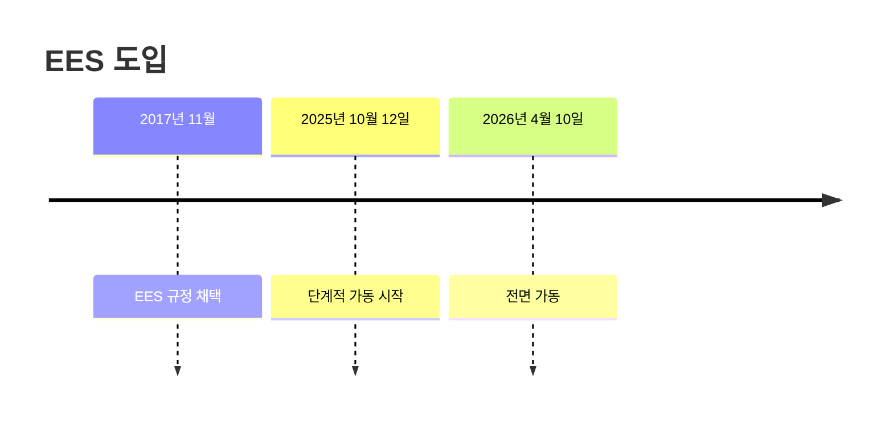

> EU 집행위원회 이민·내무총국의 [Entry/Exit System](https://home-affairs.ec.europa.eu/policies/schengen/smart-borders/entry-exit-system_en), [ETIAS](https://home-affairs.ec.europa.eu/policies/schengen/smart-borders/european-travel-information-authorisation-system_en) 안내를 바탕으로 정리한 노트다.

## 두 제도의 차이

둘 다 EU의 「스마트 국경」 제도이고 EU 비회원국 국민의 단기 방문에 적용되지만, 시점과 역할이 다르다. **EES는 국경에서 하는 등록이고, ETIAS는 출발 전에 받는 허가다.**

| 구분 | EES (Entry/Exit System) | ETIAS (European Travel Information and Authorisation System) |
| --- | --- | --- |
| 무엇인가 | 출입국 기록을 전산으로 등록하는 시스템 | 무비자 방문자의 사전 여행 허가 |
| 언제 하나 | 외부 국경을 넘을 때마다, 국경에서 | 출발 전에, 온라인으로 |
| 대상 | 단기 체류로 방문하는 EU 비회원국 국민 | 단기 체류에 비자가 필요 없는 EU 비회원국 국민 |
| 적용 국가 | 유럽 29개국 | 유럽 30개국 |
| 비용 | - | 20유로로 정해졌다 |
| 상태 | **2026년 4월 10일부터 전면 가동** | **가동 전. 신청을 받지 않는다** |

여기서 단기 체류는 180일 가운데 최대 90일까지 머무는 것을 말한다. 한국 여권 소지자는 이 범위에서 비자 없이 방문하므로 두 제도 모두 해당한다.

## EES

EES는 여권에 찍던 출입국 도장을 대신하는 자동화된 전산 시스템이다. 단기 체류자가 외부 국경을 넘을 때마다 다음 정보를 기록한다.

| 기록하는 정보 | 내용 |
| --- | --- |
| 신원 | 이름, 여행 문서(여권) 정보 |
| 생체 정보 | 지문, 얼굴 사진 |
| 출입국 | 입국·출국 날짜와 장소 |
| 입국 거부 | 입국이 거부된 기록 |

도장을 눈으로 세던 방식과 달리 체류 일수가 자동으로 계산되므로, 허용 기간을 넘겨 머문 사람이 자동으로 드러난다. 이것이 제도의 주된 목적이다.

### 도입 일정

2025년 10월 12일에 단계적으로 가동을 시작했고, 2026년 4월 10일부터 전면 가동 중이다. 시스템의 개발과 운영은 EU 기구인 eu-LISA가 맡는다.

## ETIAS

ETIAS는 무비자 방문자가 유럽 30개국으로 **출발하기 전에** 받아 두어야 하는 여행 허가다. 보안, 불법 이민, 감염병 측면의 위험을 여행 전에 확인하는 것이 목적이고, 국경에서는 여권과 함께 확인한다. 미국의 ESTA와 비슷한 성격이다.

| 항목 | 내용 |
| --- | --- |
| 현재 상태 | 가동 전이다. 여행 허가 신청을 받지 않는다 |
| 시작 시점 | 구체적인 날짜는 가동 몇 달 전에 EU가 발표한다 |
| 수수료 | 20유로 (처음 정했던 7유로에서 인상). ETIAS가 가동되면 적용된다 |
| 신청 경로 | 공식 누리집과 공식 모바일 앱 |

**ETIAS가 가동되기 전에는 누구도 신청을 대신 받아 줄 수 없다.** 가동 전에 수수료를 받고 「ETIAS 신청 대행」을 내세우는 누리집은 공식 경로가 아니다. 시작 여부는 EU 공식 안내([travel-europe.europa.eu](https://travel-europe.europa.eu/en/etias))에서 확인한다.

## 정리

- 지금 유럽에 단기로 입국하면 EES 등록(지문, 얼굴 사진)을 한다. 사전에 할 일은 없고 국경에서 이뤄진다.
- ETIAS는 아직 시작되지 않았다. 유럽 여행을 예약할 때 EU 공식 안내에서 가동 여부를 확인한다.
- 체류 한도는 180일 가운데 90일이고, EES 도입으로 초과 체류는 자동으로 집계된다.

관련 노트: [[road-safety-rules|운전자가 알아야 할 교통 안전 법규]], [[emergency-first-response|응급 상황 초기 대응]]
