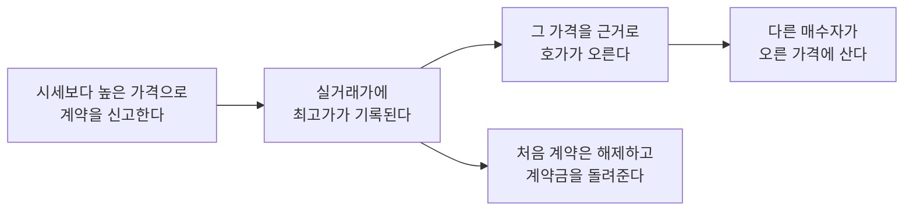

> 「부동산 거래신고 등에 관한 법률」, 「공인중개사법」과 시행령, 「주택건설기준 등에 관한 규정」 제14조의2를 바탕으로 정리한 노트다.

## 세 가지를 따로 확인하는 이유

집을 살 때 보는 정보는 대부분 남이 만든 것이다. 가격은 신고된 실거래가, 권리관계는 중개사의 설명, 집의 품질은 겉모습으로 판단한다. 셋 모두 **만들어진 방식과 한계**를 알아야 걸러 읽을 수 있다.

## 실거래가: 신고된 가격과 끝난 거래는 다르다

### 신고 제도

| 신고 | 기한 | 어기면 |
| --- | --- | --- |
| 거래 신고 | 계약 체결일부터 **30일 이내**에 거래당사자가 공동으로 신고 | 과태료 |
| 해제 신고 | 계약이 해제·무효·취소되면 확정된 날부터 **30일 이내**에 신고 | 신고하지 않으면 500만 원 이하 과태료 |

실거래가는 **계약을 신고한 시점**에 기록된다. 잔금과 소유권 이전등기는 보통 그 몇 달 뒤다. 신고된 가격이 곧 완결된 거래의 가격은 아니다.

### 가격 띄우기

이 시차를 이용한 시세 조작 수법이 있다.

| 제재 | 내용 |
| --- | --- |
| 과태료 | 거래 신고나 해제 신고를 거짓으로 하면 3천만 원 이하 |
| 형사처벌 | 부당하게 재산상 이득을 얻거나 제3자가 얻게 할 목적으로 거짓 신고하면 3년 이하 징역 또는 3천만 원 이하 벌금(부동산거래신고법 제26조 제1항) |

### 확인하는 법

- 최고가 **한 건**만 보고 따라 사지 않는다. 그 뒤로 비슷한 가격의 거래가 이어졌는지 본다.
- 그 거래에 해제 신고가 접수됐는지 국토교통부 실거래가 공개시스템에서 확인한다.
- 계약 후 시간이 충분히 지났는데도 소유권 이전등기가 없다면 완결되지 않은 거래다. 등기사항증명서로 확인할 수 있다.
- 호가는 팔려는 사람이 부르는 값이고 실거래가는 신고된 값이다. 둘 다 내가 살 가격의 근거가 되려면 여러 건이 겹쳐야 한다.

## 중개사고 손해배상 보장

개업공인중개사는 중개 과정에서 고의나 과실로 거래당사자에게 재산상 손해를 입히면 배상해야 하고, 이를 담보하려고 업무를 시작하기 전에 보증보험이나 공제에 가입하거나 공탁을 해야 한다(공인중개사법 제30조).

| 구분 | 보장금액 |
| --- | --- |
| 법인이 아닌 개업공인중개사 | **2억 원 이상** |
| 법인인 개업공인중개사 | 4억 원 이상. 분사무소마다 2억 원 이상 추가 |

- 중개보수는 거래 금액에 비례해 커지지만 **보장금액은 거래 금액과 무관하게 정해져 있다.** 고가 거래에서 손해가 보장금액을 넘으면 공제만으로는 다 메우지 못한다. 나머지는 중개사 개인에게 청구해야 하고, 받아 낼 수 있을지는 그 사람의 재산에 달렸다.
- 중개가 끝나면 중개사는 보장금액, 보장기관과 그 소재지, 보장기간을 설명하고 공제증서 사본을 줘야 한다. 계약 전에 미리 보여 달라고 해서 금액과 기간을 확인한다.
- 공제는 사고가 난 뒤의 보전 수단이다. 등기사항증명서의 소유자와 근저당, 선순위 권리는 계약 당일에 직접 다시 떼어 확인한다.

### 매물 광고

| 규칙 | 위반 시 |
| --- | --- |
| **개업공인중개사가 아닌 사람은 중개대상물을 표시·광고할 수 없다** | 중개업을 하려고 광고한 경우 1년 이하 징역 또는 1천만 원 이하 벌금 |
| 개업공인중개사는 없는 매물, 사실과 다른 가격, 과장된 내용을 광고할 수 없다 | 500만 원 이하 과태료 |
| 광고에는 중개사무소와 개업공인중개사에 관한 사항을 밝혀야 하고, 중개보조원에 관한 내용은 넣을 수 없다 | 100만 원 이하 과태료 |

광고에 중개사무소 정보가 없거나 중개보조원 이름만 있으면 정상적인 매물 광고가 아니다. 광고 문구를 누가, 어떤 도구로 썼든 내용에 대한 책임은 광고한 사람이 진다.

## 층간소음과 바닥 구조

공동주택의 층간소음은 생활 습관보다 **바닥 구조**가 먼저 정한다. 세대 사이 바닥(화장실 제외)은 아래 두 기준을 모두 채워야 한다(주택건설기준 등에 관한 규정 제14조의2).

| 기준 | 내용 |
| --- | --- |
| 콘크리트 슬래브 두께 | **210mm 이상**. 보와 기둥이 하중을 받는 라멘구조는 150mm 이상 |
| 바닥충격음 차단성능 | 경량충격음, 중량충격음 각각 **49dB 이하** |

- 이 기준은 사업계획승인을 받는 시점의 규정이 적용된다. 49dB 기준은 2022년 8월 4일 개정으로 들어왔고, 그 전에 승인을 받았거나 신청한 단지는 종전 기준을 따른다.
- 기준이 강화되기 전에 지은 아파트는 지금 기준을 채우지 않아도 되므로, 바닥 구조가 현행 기준에 못 미칠 수 있다. 오래된 아파트를 볼 때는 준공 연도와 구조 형식(벽식인지 라멘인지)을 확인하고, 가능하면 윗집에 사람이 있는 시간대에 방문한다.

## 정리

- 실거래가는 신고 시점의 기록이다. 최고가는 해제 신고와 등기 여부, 뒤따른 거래까지 보고 판단한다.
- 중개사고 보장금액은 개인 2억 원, 법인 4억 원 이상으로 고정돼 있어 고가 거래의 안전망으로는 부족하다. 권리관계는 직접 확인한다.
- 중개대상물 광고는 개업공인중개사만 할 수 있다.
- 층간소음은 준공 당시의 바닥 기준이 좌우한다. 현행 기준은 슬래브 210mm, 충격음 49dB다.

관련 노트: [[real-estate-auction|부동산 경매 입찰 전 점검]], [[land-transaction-permit|토지거래허가구역과 투기과열지구]], [[housing-tax-basics|주택 세금의 기준]], [[jeonse-housing-market|전세와 한국 주택 가격]]
