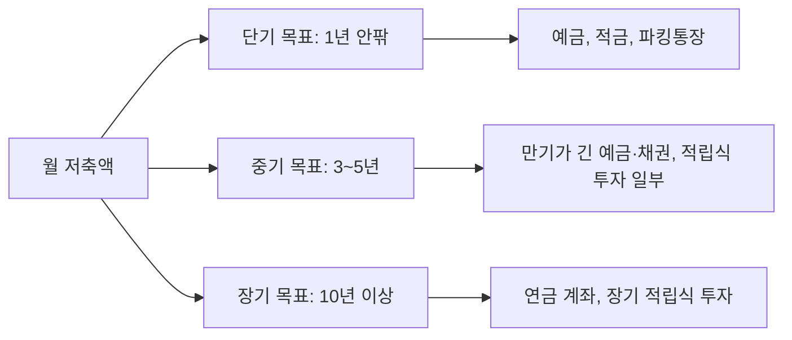

> 50/30/20 규칙은 Elizabeth Warren과 Amelia Warren Tyagi의 책 『All Your Worth』(2005)에서 나왔다([Kiplinger 해설](https://www.kiplinger.com/personal-finance/how-to-save-money/50-30-20-budget-rule-save-money)). 가로저축과 세로저축은 국내 재무설계에서 쓰는 구분으로, 뱅크샐러드의 「[가로식 저축](https://www.banksalad.com/articles/적금-추천-방식-‘가로식-저축’으로-효율적-투자하기)」 해설과 뉴닉에 실린 솔티라이프의 「[가로식 저축](https://newneek.co/@saltylife/article/10210)」 글을 참고해 정리했다.

## 선저축: 먼저 떼어 둔다

**저축은 쓰고 남은 돈으로 하는 것이 아니라, 다른 청구서보다 먼저 떼어 두는 것이다(pay yourself first).** 남는 돈을 모으겠다는 계획은 지출이 소득에 맞춰 늘어나기 때문에 잘 지켜지지 않는다.

- 월급날에 저축·투자 계좌로 자동이체를 걸어 두고, 남은 돈으로 한 달을 산다.
- 의지에 기대지 않도록 순서를 자동화하는 것이 핵심이다. 월급 통장, 고정비 통장, 생활비 통장을 나누면 남은 생활비가 한눈에 보인다.
- 저축과 같은 방식으로 소득의 일부(예: 3%)를 교육·자격증·건강 같은 자기 투자 몫으로 먼저 떼어 두는 방법도 있다.

## 예산 틀: 지출을 분류한다

예산의 첫 단계는 지출을 몇 개의 큰 묶음으로 나누는 것이다. 나누어 보면 금액에 비해 얻는 것이 적은 큰 항목이 드러난다.

### 50/30/20 규칙

세후 소득을 세 묶음으로 나누는 가장 널리 쓰이는 틀이다.

| 묶음 | 비율 | 내용 |
| --- | --- | --- |
| 필수(needs) | 50% | 주거비, 공과금, 식료품, 교통, 보험, 최소 대출 상환액처럼 줄이기 어려운 지출 |
| 선택(wants) | 30% | 외식, 여행, 취미, 구독, 쇼핑처럼 없어도 생활이 되는 지출 |
| 저축(savings) | 20% | 저축, 투자, 최소 상환액을 넘는 빚 상환 |

- 비율은 출발점이지 정답이 아니다. 주거비가 비싼 지역이나 소득이 낮은 시기에는 필수 지출이 50%를 넘는다. 그때는 선택 지출에서 먼저 줄이고 저축 비율을 지킨다.
- 틀의 쓸모는 숫자보다 **분류 자체**에 있다. 지출을 주거비, 그 밖의 고정 지출(차량·보험·식비·대출 상환), 재량 지출(오락·사교·패션)로 나누는 방식도 같은 원리다.

### 어디서부터 줄이나

| 순서 | 대상 | 이유 |
| --- | --- | --- |
| 1 | 주거비와 차량비 | 가장 큰 항목이라 한 번 줄이면 매달 효과가 난다. 소득에 비해 과한지 먼저 본다 |
| 2 | 이자 | 카드 할부 수수료, 리볼빙, 고금리 대출 이자는 아무것도 남기지 않는 지출이다 |
| 3 | 쓰지 않는 구독과 정기 결제 | 한 번 정리하면 다시 신경 쓸 일이 없다 |
| 4 | 충동 지출 | 배달·외식, 과시성 소비 |

- 예상한 비용과 실제 지출을 둘 다 적는다. 차이가 반복되는 항목이 예산이 새는 곳이다.
- 큰 지출은 결정을 30일 미룬다. 한 달 뒤에도 필요하면 그때 산다.
- 순서는 종잣돈 모으기, 목표에 도움이 안 되는 지출 줄이기, 모은 돈을 수익이 나는 자산으로 옮기기다.

## 저축 설계: 세로저축과 가로저축

재무설계는 수익률 좋은 상품을 찾는 일이 아니라, **돈이 필요한 인생의 사건(결혼, 전세 보증금, 주택 구입, 자녀 교육, 은퇴)을 먼저 적고 사건마다 시기와 금액, 수단을 정하는 일**이다.

| 구분 | 세로저축 | 가로저축 |
| --- | --- | --- |
| 방식 | 눈앞의 목표 하나에 전부 넣고, 끝나면 다음 목표로 넘어간다 | 단기·중기·장기 목표를 처음부터 동시에 나눠 넣는다 |
| 쓰는 상품 | 만기가 짧은 예·적금 위주 | 목표의 기간에 맞춘 여러 만기의 상품 |
| 장점 | 단순하고, 목표 하나를 빨리 이룬다 | 장기 목표에 긴 시간과 복리를 쓸 수 있다. 목표들이 고르게 준비된다 |
| 단점 | 뒤의 목표(특히 노후)는 준비할 시간이 줄어, 닥쳤을 때 부담이 한꺼번에 온다 | 당장 여러 곳에 나눠 넣어야 해서 단기적으로 빠듯하다 |

- 장기 목표일수록 일찍 시작한 금액이 크게 불어난다. 원리는 [[time-value-of-money|돈의 시간가치]]에 있다.
- 실제로는 가로저축을 기본으로 하되, 기한이 정해진 목표(전세 만기, 결혼)가 가까우면 그쪽 비중을 높이는 식으로 섞는다.
- 해마다 한 번, 목표별 적립액이 계획대로 쌓였는지와 목표 자체가 바뀌지 않았는지 점검한다.

## 금융상품을 고르는 순서

**목적과 돈을 쓸 시점을 먼저 정하고, 상품은 마지막에 고른다.**

| 순서 | 질문 | 판단 |
| --- | --- | --- |
| 1 | 무엇을 위한 돈인가 | 비상금, 주택 자금, 교육비, 노후처럼 목적을 적는다 |
| 2 | 언제 쓰는가 | 단기·중기·장기로 나눈다. 투자 상품의 만기는 돈을 쓸 시점에 맞춘다 |
| 3 | 잃어도 되는가 | 쓸 날이 정해진 돈은 원금이 지켜지는 상품에 둔다. 값이 떨어졌을 때 기다릴 수 없기 때문이다 |
| 4 | 보호와 세금 | 예금자보호 대상인지, 세후 수익이 얼마인지 본다 |
| 5 | 상품 비교 | 위 조건에 맞는 상품들 사이에서만 금리와 수수료를 비교한다 |

판매하는 쪽이 제시하는 환산 수익률이나 비과세 혜택은 유지 기간, 납입 한도 같은 요건을 채워야 성립한다. 요건을 따로 확인한다.

### 여윳돈을 쓰는 순서

1. **비상금**: 갑자기 소득이 끊기거나 큰돈이 나갈 때 빚을 지지 않도록, 몇 달 치 생활비를 [[deposit-savings-returns|파킹통장이나 CMA]]에 둔다.
2. **고금리 빚 상환**: 빚을 갚는 것은 대출 금리만큼의 수익을 위험 없이, 세금 없이 얻는 것과 같다.
3. **저축과 투자**: 그다음에 목표별 저축과 투자로 넘어간다.

빚 상환이 투자보다 앞서는 이유는 세금 때문이다. 이자·배당 수익에는 15.4%가 과세되므로, 연 8% 대출 이자를 투자 수익으로 상쇄하려면 세전 수익률이 `8% ÷ (1 - 0.154) = 약 9.5%`는 되어야 한다. 게다가 대출 이자는 확정된 비용이고 투자 수익은 불확실하다.

대출을 갈아탈 때는 금리 차이만 보지 않고 중도상환수수료와 새 대출의 부대 비용을 뺀 실제 절감액을 계산한다. 계산 기준은 [[household-loans|가계대출의 기본]]에 있다.

## 정리

- 저축은 월급날 먼저 떼고, 순서를 자동이체로 고정한다.
- 지출은 분류해서 큰 항목과 이자부터 줄인다.
- 목표는 단기·중기·장기로 나눠 동시에 모은다.
- 상품보다 목적과 시점이 먼저다. 쓸 날이 정해진 돈은 원금이 지켜지는 곳에 둔다.
- 여윳돈은 비상금, 고금리 빚 상환, 저축·투자 순으로 쓴다.

관련 노트: [[deposit-savings-returns|예금·적금의 실제 수익률과 파킹통장·CMA]], [[time-value-of-money|돈의 시간가치]], [[household-loans|가계대출의 기본]], [[deposit-insurance|예금자보호제도]]
