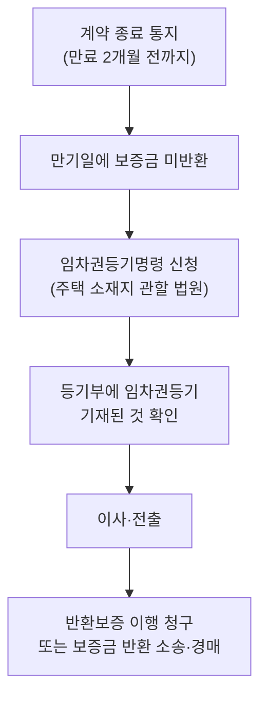

> 「주택임대차보호법」(법률 제21065호, 2026.1.2. 시행) 조문, 법무부의 [개정 주택임대차보호법 안내](https://moj.go.kr/bbs/moj/85/572899/artclView.do), 주택도시보증공사(HUG)의 [전세반환보증 안내](https://www.khug.or.kr/hug/web/ig/dr/igdr000001.jsp), 국토교통부의 전세사기 피해자 [최소보장제 발표](https://korea.kr/news/policyNewsView.do?newsId=148973064)(2026.10), 대법원 2023다307116 판결을 바탕으로 종합한 노트다. 전세가가 어떻게 정해지는지는 [[jeonse-housing-market|전세와 한국 주택 가격]]에 있다.

## 보증금을 지키는 세 겹

임차인의 보증금은 등기 없이도 법이 보호하지만, 보호는 임차인이 요건을 갖춘 순간부터 시작된다. 장치는 세 겹이다.

| 장치 | 요건 | 효과 | 근거 |
| --- | --- | --- | --- |
| 대항력 | 주택의 인도(이사) + 주민등록(전입신고) | 집이 팔리거나 경매로 넘어가도 새 소유자에게 임차권을 주장할 수 있다 | 주택임대차보호법 제3조 |
| 우선변제권 | 대항요건 + 계약서의 확정일자 | 경매·공매 때 후순위 권리자보다 먼저 보증금을 배당받는다 | 제3조의2 |
| 전세보증금 반환보증 | 보증기관 심사 통과 + 보증료 | 임대인이 돌려주지 않으면 보증기관이 대신 지급하고 임대인에게 구상한다 | HUG 등 보증 약관 |

- 대항력과 우선변제권은 **순위 싸움**이다. 내 권리보다 먼저 설정된 근저당이 있으면 그 뒤로 밀린다.
- 반환보증은 순위와 무관하게 보증기관이 지급하므로, 경매로 다 회수하지 못하는 위험까지 덮는다.

### 대항력은 전입신고 다음 날 0시에 생긴다

대항력은 인도와 주민등록을 마친 **다음 날부터** 효력이 생긴다(제3조 제1항). 근저당은 등기소에 접수한 날 바로 효력이 생기므로, 임대인이 잔금일 당일에 대출을 받아 근저당을 설정하면 임차인의 보증금이 그 뒤로 밀린다. 등기부를 계약 당일에 확인해도 막지 못하는 공백이다.

| 대응 | 내용 |
| --- | --- |
| 잔금일 재확인 | 잔금을 치르기 직전에 등기부를 다시 떼어 새 근저당·압류가 없는지 본다 |
| 특약 | 「잔금일 다음 날까지 근저당 등 권리를 새로 설정하지 않으며, 위반하면 계약을 해제하고 보증금을 반환한다」는 조항을 넣는다 |
| 당일 처리 | 이사한 날 바로 전입신고와 확정일자를 마친다 |

발생 시점을 「전입신고 처리 시」로 앞당기는 법 개정은 2026년 3월 정부의 전세사기 대책에 포함됐지만, 2026년 11월 기준 시행 중인 조문은 「다음 날부터」 그대로다. 대책 발표 당시 개정안은 국회 법제사법위원회에 계류돼 있었다.

## 계약 전에 확인할 것

등기부에는 소유자와 근저당·압류만 나온다. 체납 세금, 같은 건물 다른 세입자의 보증금, 임대인의 보증사고 이력은 **등기부에 나오지 않는다.** 그래서 서류를 따로 확인한다.

| 확인 대상 | 방법 | 보는 이유 |
| --- | --- | --- |
| 소유자, 근저당, 압류, 신탁 | 등기사항전부증명서 (계약 전, 잔금 직전 두 번) | 선순위 채권 합계와 계약 상대가 실제 소유자인지 확인한다. 신탁 등기가 있으면 수탁자(신탁회사)의 동의 없는 계약은 보호받기 어렵다 |
| 선순위 보증금 | 확정일자 부여 현황, 전입세대 확인 | 다가구주택은 먼저 들어온 세입자들의 보증금이 내 앞 순위다 |
| 체납 세금 | 임대인의 국세·지방세 납세증명서 | 세금은 등기부에 없지만 경매 배당에서 보증금보다 앞설 수 있다 |
| 임대인의 보증 이력 | HUG 임대인 정보 조회 | 과거에 보증금을 떼먹어 HUG가 대신 갚아 준 적이 있는지 본다 |
| 반환보증 가입 가능 여부 | 보증기관 한도 조회 | 보증이 거절되는 집은 보증금이 집값에 비해 과하다는 신호다 |

- **임대인의 정보 제시 의무**: 계약을 체결할 때 임대인은 해당 주택의 확정일자 부여일·차임·보증금 정보와 납세증명서를 임차인에게 제시해야 한다(제3조의7, 2023년 4월 시행). 정보 열람에 동의하는 것으로 갈음할 수 있다. 주택임대차표준계약서에는 제시한 정보가 사실과 다르면 위약금 없이 계약을 해제할 수 있다는 특약이 들어 있다.
- **임대인 정보 조회**: 2025년 5월 27일부터 계약 전에도 **임대인 동의 없이** 조회할 수 있다(주택도시기금법 개정). 공인중개사를 통해 계약 의사가 확인된 예비 임차인이 HUG 지사나 안심전세 앱으로 신청한다.

| 항목 | 내용 |
| --- | --- |
| 조회되는 정보 | HUG 전세금반환보증 가입 주택 보유 건수, 보증 금지 대상 여부, 최근 3년간 대위변제 발생 건수 |
| 처리 | 최대 7일 이내 문자 또는 앱으로 통지 |
| 남용 방지 | 신청인당 월 3회 제한, 임대인에게 조회 사실 통지 |
| 한계 | HUG가 가진 보증 데이터만 나온다. 다른 금융기관 채무, 세금 체납, 보증에 가입하지 않은 주택의 사고는 나오지 않는다 |

### 전자계약

부동산거래 전자계약시스템으로 계약하면 종이 계약서 대신 휴대폰·PC에서 전자서명한다. 등록된 공인중개사만 쓸 수 있고 당사자 신분을 확인하므로 **무등록 중개, 계약서 위·변조, 이중계약**이 어렵다. 임대차 신고와 확정일자가 자동으로 처리되고, 은행에 따라 대출 우대금리가 붙는다. 다만 전자계약이 그 집의 권리관계나 보증금의 안전까지 검증해 주지는 않는다.

## 주택 임대차 계약 신고제

「부동산 거래신고 등에 관한 법률」에 따른 의무로, 흔히 전월세 신고제라고 부른다.

| 항목 | 내용 |
| --- | --- |
| 대상 금액 | 보증금 6,000만 원 초과 또는 월세 30만 원 초과 |
| 대상 지역 | 수도권(서울·인천·경기), 광역시, 세종, 제주, 도의 시 지역 (도의 군 지역은 제외) |
| 기한 | 계약 체결일부터 30일 이내 |
| 신고 의무자 | 임대인과 임차인 공동. 한쪽이 서명·날인된 계약서를 내면 공동 신고로 본다 |
| 방법 | 주택 소재지 행정복지센터 방문, 또는 부동산거래관리시스템(rtms.molit.go.kr) 온라인 |
| 과태료 | 미신고·지연 신고는 계약 금액과 지연 기간에 따라 2만~30만 원, 거짓 신고는 100만 원 |

- 계도 기간은 2025년 5월 31일에 끝났다. **2025년 6월 1일 이후 체결한 계약**부터 과태료가 부과된다.
- 금액이 바뀌지 않는 갱신 계약은 신고 대상이 아니다.
- 계약서를 첨부해 신고하면 확정일자가 함께 부여된다. 대항력은 여전히 이사와 전입신고가 있어야 생긴다.

## 전세보증금 반환보증

### 대출 보증과 반환보증은 다르다

| 구분 | 누구를 보호하나 | 사고가 나면 |
| --- | --- | --- |
| 전세대출 보증 | 은행 | 임차인이 대출을 못 갚으면 보증기관이 은행에 대신 갚는다. 임차인의 보증금은 보호하지 않는다 |
| 전세보증금 반환보증 | 임차인 | 임대인이 보증금을 돌려주지 않으면 보증기관이 임차인에게 지급한다 |

- HUG의 **전세금안심대출보증**은 반환보증과 대출특약보증을 묶은 상품이라, 이 보증으로 대출을 받으면 반환보증에 함께 가입된다.
- 대출 보증만 붙은 전세대출은 반환보증이 따로다. 대출이 나왔다고 보증금이 보호되는 것은 아니므로 **반환보증 가입 여부를 별도로 확인한다.**
- 임대인이 받은 보증금을 다른 데 투자했다면 자산 가격이 급락할 때 반환이 막힌다. 임대인의 자금 사정은 임차인이 통제할 수 없으므로 보증으로 넘긴다.

### 가입 한도: 「126% 룰」

HUG 전세반환보증의 한도는 다음 식으로 정해진다.

```text
보증 한도 = 주택가격 × 담보인정비율 90% - 선순위 채권

시세가 없어 공시가격으로 산정하는 주택: 주택가격 = 공시가격 × 140%
→ 보증금 + 선순위 채권 ≤ 공시가격 × 140% × 90% = 공시가격 × 126%

예) 공시가격 2억 원, 선순위 채권 없음 → 보증금 2억 5,200만 원까지 가입 가능
```

- 연립·다세대(빌라)처럼 시세 통계가 없는 주택은 공시가격 기준을 적용받는 일이 많아, 시세대로 전세금을 정하면 **보증 가입이 거절될 수 있다.**
- 그래서 순서는 「가입 가능 여부 확인 → 계약」이다. 계약서에 「반환보증 가입이 거절되면 계약을 무효로 하고 계약금을 돌려준다」는 특약을 넣는다.
- 신청 기한은 전세 계약 기간의 2분의 1이 지나기 전이다.
- 보증료는 `보증금액 × 보증료율 × 보증기간 / 365`로 계산한다. 보증료율은 주택 유형, 보증 기간, 부채 비율에 따라 연 0.097~0.211%다.

## 보증금을 돌려받지 못할 때



### 임차권등기명령

임대차가 끝났는데 보증금을 받지 못한 임차인은 법원에 임차권등기명령을 신청할 수 있다(제3조의3). 이사를 가면 인도와 주민등록이라는 대항요건이 사라지는데, 임차권등기는 **그 뒤에도 대항력과 우선변제권을 유지**시킨다.

- **신청만으로는 보호되지 않는다.** 효력은 임차권등기가 등기부에 **기재된 때** 생긴다. 등기 전에 짐을 빼거나 전출하면 대항력과 우선변제권을 잃는다. 등기사항증명서에서 기재를 확인한 뒤에 움직인다.
- 2023년 7월 19일부터는 결정문이 임대인에게 송달되기 전에도 등기를 할 수 있다. 임대인이 송달을 피하거나 주소가 불명이거나, 사망 후 상속 관계가 정리되지 않은 경우에도 등기가 가능해졌다.
- 신청과 등기에 든 비용은 임대인에게 청구할 수 있다(제8항).
- 임차권등기가 된 집에 새로 들어오는 임차인은 소액임차인 최우선변제를 받지 못한다(제6항). 등기부에 임차권등기가 있는 집은 피한다.
- 임대차는 기간이 끝나도 보증금을 돌려받을 때까지 존속하는 것으로 본다(제4조 제2항).

### 임대인이 사망한 경우

임대인이 사망했는데 상속인이 없거나 모두 상속을 포기하면 보증금을 청구하고 경매를 진행할 상대방이 없다. 이때는 가정법원이 **상속재산관리인**을 선임해야(민법 제1053조) 그 관리인을 상대로 절차를 밟을 수 있다.

HUG는 전세피해 임차인을 위해 **상속재산관리인 선임 지원사업**을 운영한다.

| 항목 | 내용 |
| --- | --- |
| 대상 | 임대인이 사망한 임차인 가운데 국토교통부의 전세사기피해자등 결정문 또는 HUG의 전세피해확인서를 받은 사람 |
| 지원 | 법무사를 통한 선임 청구 대행, 선임된 관리인의 보수 예납금 |
| 본인 부담 | 인지·송달료 등 |
| 신청 | 회차별 공고 기간에 HUG 안심전세포털 등으로 접수한다. 요건과 일정은 회차 공고에서 확인한다 |

## 전세사기 피해자 지원: 최소보장제

「전세사기피해자 지원 및 주거안정에 관한 특별법」에 따라 피해자로 결정되면 경·공매 지원, 공공의 피해주택 매입, 금융·법률 지원을 받는다. **2026년 11월 13일**부터는 회수액이 적은 피해자를 위한 두 제도가 추가로 시행 중이다.

| 제도 | 내용 |
| --- | --- |
| 최소보장 | 경·공매가 끝난 뒤 회복한 금액이 보증금의 **3분의 1**에 못 미치면 부족분을 지원한다 |
| 선지급 후정산 | 신탁사기 등 무권계약 피해자에게 경·공매가 끝나기 전에 먼저 지급하고, 이후 회수액을 반영해 정산한다 |

```text
최소지원금 = 보증금 × 1/3 - (배당 등으로 받은 금액 + 경매차익 + 임대료 지원액 등)

예) 보증금 1억 5,000만 원, 회복액 3,000만 원
    최소보장금 5,000만 원 - 3,000만 원 = 2,000만 원 추가 지원
```

- 신청·지급·정산 업무는 한국토지주택공사(LH)가 맡는다.
- LH는 신청일부터 **90일 이내**에 지급 여부와 금액을 결정해 통지한다(30일 이내에서 한 차례 연장 가능). 결정에 이의가 있으면 통지받은 날부터 30일 이내에 이의신청한다.
- 지급받은 뒤 보증금을 추가로 회수하면 신고하고 반납해야 한다. 반납하지 않으면 **3,000만 원 이하의 과태료**가 부과된다.

## 소유자가 바뀌면 보증금은 누가 돌려주나

대항력을 갖춘 임대차에서 집이나 건물이 팔리면 **양수인이 임대인의 지위를 승계한다**(주택임대차보호법 제3조 제4항, 상가건물 임대차보호법 제3조 제2항). 보증금 반환 의무도 새 소유자에게 넘어가고 이전 소유자는 벗어난다.

임대차가 **이미 끝난 뒤** 소유자가 바뀐 경우도 같다. 대법원 2026. 4. 9. 선고 2023다307116 판결은 상가 임대차에 대해 다음과 같이 판단했다.

| 단계 | 판단 |
| --- | --- |
| 임대차 종료 후 | 임차인이 보증금을 돌려받을 때까지 임대차 관계는 존속하는 것으로 본다(상가건물 임대차보호법 제9조 제2항) |
| 그 상태에서 건물 양도 | 양수인은 「임대차가 종료된 상태의 임대인 지위」를 당연히 승계한다 |
| 결과 | 양수인이 보증금 반환 채무를 면책적으로 인수하고, 양도인은 채무를 면한다 |

- 전제는 임차인의 **대항력**이다. 상가는 건물의 인도와 사업자등록 신청이 요건이다. 대항력이 없으면 승계되지 않는다.
- 건물을 사는 쪽에서는 계약이 끝났지만 보증금이 정산되지 않은 임차인이 남아 있는지를 매수 전에 확인해야 한다.

## 관리비: 「제2의 월세」

계약갱신요구권으로 갱신할 때 임대료 인상은 5%로 묶이지만 관리비에는 상한이 없다. 그래서 월세는 그대로 두고 관리비를 올리거나, 월세 일부를 관리비로 돌려 신고 기준과 인상 제한을 피하는 방식이 원룸·오피스텔에서 쓰인다.

| 대상 | 제도 |
| --- | --- |
| 등록 임대사업자의 민간임대주택 | 임대차계약을 신고할 때 **관리비와 사용료의 금액 또는 산정 방식**을 함께 신고한다(민간임대주택에 관한 특별법 시행령 2026년 10월 개정, 공포 6개월 뒤 시행) |
| 상가건물 | 임차인이 임대인에게 관리비 내역 제공을 요청할 수 있다(상가건물 임대차보호법, 2026년 5월 12일 시행) |
| 등록하지 않은 임대인의 주택 | 위 신고 의무가 적용되지 않는다 |

법이 닿지 않는 계약에서는 **계약서에 관리비 금액, 포함 항목(수도·인터넷·청소 등), 인상 조건을 적는 것**이 유일한 장치다.

## 정리

- 이사한 날 전입신고와 확정일자를 마친다. 대항력은 다음 날 0시에 생기므로 잔금 직전 등기부 재확인과 특약으로 공백을 메운다.
- 등기부만으로는 부족하다. 납세증명서, 확정일자 부여 현황, HUG 임대인 정보 조회로 등기부에 없는 위험을 본다.
- 반환보증은 계약 전에 가입 가능 여부부터 확인한다. 공시가격의 126%를 넘는 보증금은 HUG 보증이 거절될 수 있다.
- 보증금을 못 받고 이사해야 하면 임차권등기가 **등기부에 기재된 것을 확인한 뒤** 움직인다.
- 계약 체결 30일 안에 임대차 신고를 한다.

관련 노트: [[housing-lease-renewal|주택 임대차 갱신과 해지]], [[jeonse-housing-market|전세와 한국 주택 가격]], [[books/jeonse-jiok]]
