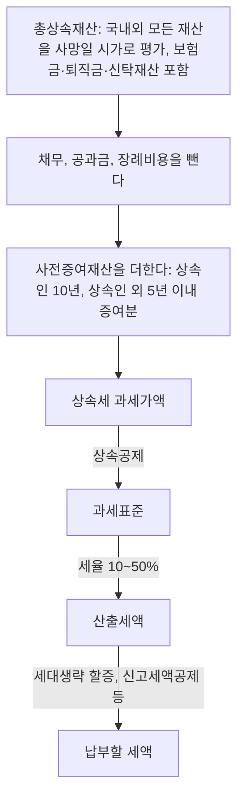

> 국세청의 상속세 안내([세액계산 흐름도](https://www.nts.go.kr/nts/cm/cntnts/cntntsView.do?cntntsId=7720), [신고납부기한](https://www.nts.go.kr/nts/cm/cntnts/cntntsView.do?mi=2325&cntntsId=7719), [납부](https://www.nts.go.kr/nts/cm/cntnts/cntntsView.do?cntntsId=7724), [재산 평가](https://www.nts.go.kr/nts/cm/cntnts/cntntsView.do?mi=2330&cntntsId=7723))와 [증여세 항목별 설명](https://www.nts.go.kr/nts/cm/cntnts/cntntsView.do?mi=6533&cntntsId=7960), 상속세 및 증여세법을 바탕으로 2026년 기준으로 정리한 노트다.

## 상속세와 증여세

둘 다 재산이 대가 없이 넘어갈 때 붙는 세금이고 세율표가 같다. 차이는 넘어가는 시점과 세금을 계산하는 단위다.

| 구분 | 상속세 | 증여세 |
| --- | --- | --- |
| 과세 원인 | 사망으로 재산이 넘어감 | 살아 있는 동안 무상으로 재산이나 이익을 넘김 |
| 계산 단위 | 피상속인(사망한 사람)이 남긴 **재산 전체** | **받은 사람별**, 준 사람별 |
| 납세의무자 | 상속인들 (각자 받은 재산 한도로 연대 납부) | 받은 사람(수증자) |
| 신고·납부 기한 | 상속개시일이 속한 달의 말일부터 **6개월** (피상속인이나 상속인이 외국에 주소를 두면 9개월) | 증여받은 날이 속한 달의 말일부터 **3개월** |
| 관할 | 피상속인 주소지 세무서 | 수증자 주소지 세무서 |

3월 10일에 사망했다면 상속세 기한은 9월 30일, 같은 날 증여받았다면 증여세 기한은 6월 30일이다.

### 세율 (상속세·증여세 공통)

| 과세표준 | 세율 | 누진공제 |
| --- | --- | --- |
| 1억 원 이하 | 10% | - |
| 1억 원 초과 5억 원 이하 | 20% | 1천만 원 |
| 5억 원 초과 10억 원 이하 | 30% | 6천만 원 |
| 10억 원 초과 30억 원 이하 | 40% | 1억 6천만 원 |
| 30억 원 초과 | 50% | 4억 6천만 원 |

세율은 재산가액이 아니라 공제를 뺀 뒤의 **과세표준**에 적용한다. 과세표준 10억 원이면 10억 × 30% - 6천만 = 2억 4천만 원이다. 기한 안에 신고하면 산출세액의 3%를 깎아 준다(신고세액공제).

## 상속세

### 계산 흐름

### 상속공제

| 공제 | 금액 |
| --- | --- |
| 기초공제 | 2억 원 |
| 자녀공제 등 인적공제 | 자녀 1명당 5천만 원 등 |
| 일괄공제 | 5억 원. 「기초공제 + 인적공제」 합계와 비교해 큰 쪽을 고른다 |
| 배우자 상속공제 | 배우자가 실제 상속받은 금액. 최소 5억 원, 최대 30억 원 (법정상속분 한도) |
| 금융재산 상속공제 | 순금융재산(금융재산 - 금융채무)이 2천만 원 이하면 전액, 2천만 원 초과 1억 원 이하면 2천만 원, 1억 원을 넘으면 그 20% (2억 원 한도) |
| 동거주택 상속공제 | 10년 이상 함께 산 1주택을 무주택 자녀가 상속받을 때 6억 원 한도 |

- **배우자와 자녀가 있으면 최소 10억 원(일괄 5억 + 배우자 5억), 배우자가 없으면 5억 원까지는 상속세가 없다.** 이 금액은 1990년대 후반 이후 그대로여서, 집값이 오른 지금은 수도권 아파트 한 채만으로 과세 대상이 되는 경우가 많다.
- 낼 세금이 0원이어도 신고해 두는 편이 낫다. 상속재산을 나중에 팔 때 양도소득세의 취득가액은 상속 당시 평가액인데, 신고하지 않으면 낮은 공시가격이 취득가액으로 잡혀 양도차익이 커진다.

### 사망보험금은 상속재산인가

민법상 상속재산이 아니어도 세법이 상속재산으로 보는 것(간주상속재산)이 있다. 보험금, 신탁재산, 퇴직금이다.

**피상속인의 사망으로 받는 보험금은, 피상속인이 보험계약자이거나 실제로 보험료를 낸 사람이면 상속재산에 포함된다**(상속세 및 증여세법 제8조). 수익자가 누구로 지정돼 있는지는 관계없다.

| 계약자 (실제 보험료 납부자) | 피보험자 | 수익자 | 사망보험금의 과세 |
| --- | --- | --- | --- |
| 부모 | 부모 | 자녀 | 상속재산에 포함 → 상속세 |
| 자녀 (자기 소득으로 납부) | 부모 | 자녀 | 자녀 자신의 돈으로 든 보험이므로 상속재산이 아니다 |
| 자녀 명의지만 부모가 보험료를 대 줌 | 부모 | 자녀 | 부모가 실질 납부자이므로 상속재산에 포함 |
| 부모 A | 부모 B | 자녀 | 납부자와 수익자가 달라 보험금에 증여세 |

- 판단 기준은 명의가 아니라 **보험료를 실제로 누가 냈는지**다. 자녀에게 소득이 없거나 보험료가 부모 계좌에서 나갔다면 계약자를 자녀로 해 두어도 소용없다. 자녀의 소득과 보험료 이체 내역으로 입증할 수 있어야 한다.
- 종신보험으로 상속세 납부 재원을 마련하라는 권유는 이 표의 둘째 구조를 전제로 한다. 사망 시점에 현금이 생긴다는 장점은 사실이지만, 종신보험은 사업비가 크고 중도 해지 환급금이 낸 보험료보다 적다. 수십 년 낼 보험료 총액과 예상 상속세를 비교하고, 과세 요건은 판매 자료가 아니라 세법으로 확인한다.

### 납부 방법

상속세는 기한 안에 **현금으로 한 번에 내는 것이 원칙**이다. 부동산이든 주식이든 예금이든 세율은 같기 때문에, 재산이 집 한 채처럼 현금화하기 어려운 자산에 몰려 있으면 세금 낼 돈이 없어 급하게 팔아야 하는 일이 생긴다. 재산 규모만큼 **납부할 유동성**을 따져야 하는 이유다.

| 방법 | 요건 | 내용 |
| --- | --- | --- |
| 분납 | 납부세액 1천만 원 초과 | 기한 후 2개월 안에 나눠 낸다. 2천만 원 이하면 1천만 원 초과분, 2천만 원 초과면 세액의 50% 이하. 이자 없음 |
| 연부연납 | 납부세액 2천만 원 초과, 납세담보 제공, 기한 내 신청 | 상속세는 허가일부터 **10년**(가업상속재산은 20년 또는 10년 거치 후 10년). 남은 세액에 가산금(이자)이 붙는다 |
| 물납 | 상속재산 중 부동산·유가증권이 절반 초과, 납부세액 2천만 원 초과, 납부세액이 상속받은 금융재산보다 큼 | 현금 대신 부동산·유가증권으로 낸다. 상속세에만 있고 관할 세무서장의 허가가 필요하다 |

- 연부연납 가산금의 이자율은 국세환급가산금 이자율(국세기본법 시행규칙 제19조의3)을 따르고 2026년 기준 연 3.1%다. 이자율은 시중 금리에 맞춰 조정된다.
- 연부연납을 허가받으면 분납은 함께 쓸 수 없다.
- 물납은 요건이 좁고, 넘긴 재산은 세무서가 평가한 가액으로 세금에 충당되므로 급매보다 유리한지 따져야 한다.

## 증여세

### 증여재산공제와 10년 합산

| 증여자 | 공제 (10년 합계) |
| --- | --- |
| 배우자 | 6억 원 |
| 직계존속 (부모, 조부모) | 5천만 원. 받는 사람이 미성년자면 2천만 원 |
| 직계비속 (자녀, 손주) | 5천만 원 |
| 그 밖의 친족 (4촌 이내 혈족, 3촌 이내 인척) | 1천만 원 |
| 혼인·출산 | 혼인신고일 전후 2년 또는 출생일부터 2년 안에 직계존속에게서 받으면 1억 원 추가 |

- **같은 사람에게서 10년 안에 받은 증여는 합쳐서 계산한다.** 아버지와 어머니는 같은 사람으로 본다. 공제도 10년 동안 한 번 쓰는 한도다.
- 여러 번 나눠 주어도 10년 안이면 합산되므로 쪼개서 누진세율을 피할 수 없다.
- 예: 성인 자녀가 부모에게서 1억 5천만 원을 받으면 과세표준은 1억 원, 산출세액은 1천만 원, 기한 안에 신고하면 3%를 빼 970만 원이다.
- 증여한 사람이 10년 안에 사망하면 그 증여재산은 상속세 계산에 다시 합산된다(상속인이 아닌 사람에게 준 것은 5년). 낸 증여세는 빼 준다.

### 세대생략 증여와 부담부증여

| 방식 | 내용 | 과세 |
| --- | --- | --- |
| 세대생략 증여 | 조부모가 자녀를 건너뛰고 손주에게 직접 준다 | 산출세액에 **30% 할증**. 받는 사람이 미성년자이고 증여재산이 20억 원을 넘으면 40% |
| 부담부증여 | 대출이나 전세보증금 같은 채무를 재산과 함께 넘긴다 | 채무만큼은 증여가 아니라 **유상 양도**로 본다. 받는 사람은 채무를 뺀 금액에 증여세를, 준 사람은 채무 부분에 양도소득세를 낸다 |

부담부증여에서 넘어간 채무를 받은 사람이 실제로 갚는지는 사후 관리 대상이다. 부모가 대신 갚아 주면 그 금액이 다시 증여가 된다.

## 시가 평가

### 원칙과 순서

상속·증여재산은 취득가액이나 공시가격이 아니라 **평가기준일(상속개시일, 증여일)의 시가**로 평가한다.

| 순서 | 가액 | 내용 |
| --- | --- | --- |
| 1 | 해당 재산의 거래가액 | 평가 기간 안의 매매, 감정, 수용, 경매·공매 가액. 평가 기간은 상속이 전후 6개월, 증여가 전 6개월부터 후 3개월 |
| 2 | 유사 재산의 매매사례가액 | 같은 단지, 비슷한 면적·공시가격인 아파트의 실거래가 등 |
| 3 | 보충적 평가 | 시가를 알 수 없을 때만. 토지는 개별공시지가, 주택은 공시가격, 그 밖의 건물은 국세청 기준시가 |

- 감정가액은 둘 이상 감정기관이 평가한 금액의 평균이 원칙이고, 기준시가 10억 원 이하인 부동산은 한 곳의 감정으로도 인정된다.
- 상장주식은 평가기준일 전후 각 2개월, 합계 4개월간 종가의 평균으로 평가한다.
- 아파트는 유사 매매사례가 많아 시가가 잡히기 쉽다. 단독주택, 꼬마빌딩, 토지는 거래가 드물어 공시가격으로 신고하는 일이 많았다.

### 저가 신고와 감정평가

공시가격은 시가보다 낮은 경우가 많아, 보충적 평가로 신고하면 세금이 줄어든다. 국세청은 이런 신고 가운데 시가와 차이가 큰 것을 골라 **직접 감정평가를 맡기고 그 감정가액으로 과세**한다.

- 대상은 처음에는 꼬마빌딩 같은 비주거용 부동산이었고, 2025년부터 초고가 아파트와 단독주택 등 주거용 부동산으로 넓어졌다.
- 선정 기준은 신고가액이 국세청 추정 시가보다 **5억 원 이상 낮거나, 차액이 추정 시가의 10% 이상**인 경우다.
- 신고 기한이 지난 뒤에도 법정 결정 기한(상속세는 신고기한부터 9개월, 증여세는 6개월)까지의 감정가액은 평가심의위원회를 거쳐 시가로 인정될 수 있다.
- 거래가 드문 고가 부동산은 신고 전에 납세자가 먼저 감정평가를 받아 신고하면 나중에 세액이 다시 계산될 위험이 줄어든다.

## 자금 출처 조사와 가족 간 금전 대여

### 재산 취득 자금의 증여 추정

직업, 나이, 소득, 재산 상태로 보아 자기 힘으로 취득했다고 보기 어려운 재산을 샀을 때, 자금 출처를 입증하지 못하면 그 돈을 **증여받은 것으로 추정**한다(상속세 및 증여세법 제45조). 소득이 적은데 고가 주택을 현금으로 사는 경우가 대표적이다.

- 입증하지 못한 금액이 취득가액의 20%와 2억 원 가운데 적은 금액에 못 미치면 추정에서 제외한다.
- 입증 자료는 신고된 소득, 재산 처분 대금, 대출금, 전세보증금 같은 것이다. 주택을 살 때 내는 자금조달계획서가 조사의 출발점이 된다.

### 가족 간 금전 대여

부모에게 빌린 돈은 증여가 아니다. 그러나 가족 사이의 돈은 일단 증여로 보기 쉬워서, 빌린 것임을 납세자가 입증해야 한다.

| 확인 항목 | 인정받기 위한 조건 |
| --- | --- |
| 계약 | 차용증에 금액, 이자율, 상환일을 적고, 작성 시점을 남긴다(공증, 확정일자 등) |
| 이자 | 약정한 이자를 실제로 계좌 이체한다 |
| 상환 | 빌린 사람의 소득으로 갚을 수 있는 조건이고, 실제로 원금을 갚아 나간다 |

- **적정 이자율은 연 4.6%다.** 이보다 낮게 빌리면 차액 이자만큼 증여받은 것으로 보지만, 그 이익이 1년에 1천만 원 미만이면 과세하지 않는다(상속세 및 증여세법 제41조의4). 무이자라면 원금 약 2억 1,700만 원까지가 이 범위다. 이 계산은 대여 자체가 진짜일 때의 이야기이고, 대여로 인정받지 못하면 원금 전체가 증여다.
- 조사에서 문제 되는 유형은 형식만 갖춘 차용증, 이자와 원금 상환이 한 번도 없는 대여, 상환 시점을 부모 사망 이후로 미룬 계약, 부모가 자녀의 대출을 대신 갚아 주는 경우, 사업 매출을 누락해 만든 자금이다.
- 차용 뒤에도 국세청은 채무를 실제로 갚는지 사후 관리한다.

## 유산세와 유산취득세

상속세를 매기는 방식은 두 가지다.

| 방식 | 과세 단위 | 특징 |
| --- | --- | --- |
| 유산세 | 피상속인이 남긴 재산 **전체**에 누진세율 적용 후 상속인들이 나눠 낸다 | 상속인 수와 무관하게 총 세액이 같다. 한국의 현행 방식 |
| 유산취득세 | 상속인 **각자가 받은 몫**에 누진세율 적용 | 여럿이 나눠 받을수록 낮은 세율 구간이 적용돼 총 세액이 줄어든다. 증여세와 방식이 같아진다 |

세율표만 단순 적용해 보면, 과세표준 30억 원을 유산세로 계산하면 30억 × 40% - 1억 6천만 = 10억 4천만 원이다. 세 자녀가 10억 원씩 받는 것으로 보고 각각 계산하면 2억 4천만 × 3 = 7억 2천만 원이다(공제 구조가 같다고 가정한 비교).

정부는 2025년 3월 유산취득세 전환 방안을 발표하고 2028년 시행을 목표로 법안을 국회에 냈다. 그러나 2025년 말 세법 개정에서 처리되지 않았고, **2026년 11월 기준 한국의 상속세는 유산세 방식 그대로다.** 공제 금액과 세율도 위 표에서 바뀌지 않았다.

## 정리

- 상속세는 남긴 재산 전체에, 증여세는 받은 사람별로 같은 세율표(10~50%)를 적용한다. 기한은 각각 6개월, 3개월이다.
- 상속은 배우자가 있으면 10억 원, 없으면 5억 원까지 세금이 없다. 증여는 10년 단위로 합산하고 공제한다.
- 상속세는 현금 납부가 원칙이다. 분납, 연부연납, 물납의 요건을 알고 납부 재원을 미리 따진다.
- 사망보험금은 보험료를 실제로 낸 사람이 피상속인이면 상속재산이다.
- 재산은 시가로 평가하고, 공시가격으로 낮게 신고한 고가 부동산은 감정평가로 다시 과세될 수 있다.
- 가족 간 대여는 차용증, 이자 지급, 원금 상환이 모두 실제로 있어야 인정된다.

관련 노트: [[financial-income-tax|금융소득 과세]], [[overseas-asset-tax|해외주식 양도소득세와 해외자산 신고]], [[jeonse-housing-market|전세와 주택 시장]], [[income-tax-filing|종합소득세 신고]]
