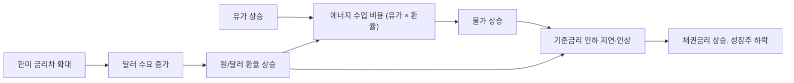

> 아웃스탠딩의 거시경제 기고(「[1200원이 귀여워진 환율.. 한국은행이 금리 인상 칼을 빼든 이유](https://outstanding.kr/interestpolicy20260720)」, 「[이란전쟁 여파로 '돌아온 3고'](https://outstanding.kr/iranwar20260323)」, 「[일본이 '리플레이션'을 중단한 이유](https://outstanding.kr/reflation20261026)」 등, 2026)를 바탕으로 재구성하고, 한국은행 「[통화정책 효과의 파급](https://www.bok.or.kr/portal/main/contents.do?menuNo=200289)」과 국제결제은행(BIS)의 [캐리 트레이드 청산 분석](https://www.bis.org/publ/bisbull90.htm)(2024.08)으로 보강한 노트다.

## 세 변수는 서로 맞물린다

금리, 환율, 물가는 따로 움직이지 않는다. 한 변수를 잡으려는 정책이 다른 변수를 흔든다.

## 금리차와 자금 흐름이 환율을 움직인다

- **금리차**: 미국 금리가 한국보다 높으면 달러를 들고 있을 때 받는 이자가 더 크다. 달러 수요가 늘어 원/달러 환율이 오른다. 기준금리 인상은 이를 막는 대표 수단이다.
- **역전 용인**: 미국 수준까지 금리를 올리면 국내 경기가 흔들릴 수 있다. 그래서 금리 역전을 어느 정도 용인하는 정책 판단도 있다.
- **수급**: 대규모 해외 증권 발행(ADR 등)으로 들어온 달러가 원화로 바뀌면 달러를 팔고 원화를 사는 셈이라 환율 하락 요인이다. 반대로 해외주식 투자 자금이 빠져나가면 환율 상승 요인이다.
- 환율은 금리차, 수급, 위험 선호가 함께 만든다. **한 요인만으로 다 설명할 수는 없다.**

### 무역흑자인데도 원화가 약세일 수 있는 이유

환율은 달러의 수급으로 정해지고, 달러는 무역으로만 드나들지 않는다. 수출로 번 달러(경상수지)보다 **투자하러 나가는 달러(금융계정)**가 많으면 흑자여도 원화는 약해질 수 있다.

| 달러가 나가는 경로 | 내용 |
| --- | --- |
| 연기금 | 운용 자산이 커지면서 해외 주식·채권 비중을 늘린다 |
| 개인 | 해외 주식과 해외 상장 ETF를 순매수한다 |
| 기업 | 해외 공장과 법인에 직접투자한다 |

- 이 유출은 경기에 따라 오가는 자금이 아니라 **구조적인 달러 수요**다. 그래서 무역수지가 좋아져도 환율이 예전 수준으로 돌아가지 않을 수 있다.
- 수출 실적이 좋아도 기업이 받은 달러를 원화로 바꾸지 않고 들고 있거나 해외에 재투자하면 외환시장의 달러 공급은 늘지 않는다.
- 자금을 움직이는 것은 금리차만이 아니다. 성장률과 기대 투자수익률이 더 높은 시장으로 주식 자금이 옮겨 가면 금리차가 그대로여도 환율이 움직인다.
- 주가가 오르면 보통 외국인 자금이 들어와 원화가 강해진다. 그러나 같은 시기에 내국인의 해외 투자가 더 크면 **주가와 환율이 함께 오른다.**

### CDS 프리미엄과 환율은 다른 것을 잰다

**CDS(신용부도스와프)**는 채권이 부도났을 때 손실을 보전받는 계약이고, 보장을 사는 쪽이 내는 수수료가 CDS 프리미엄이다. 한 나라 국채의 CDS 프리미엄은 그 나라의 **부도 위험**에 대한 시장의 평가다. 환율은 통화의 수급을 반영한다.

두 지표는 위기 때는 함께 뛰지만 평소에는 따로 움직일 수 있다. 국가 신용에 문제가 없어 CDS 프리미엄이 낮은데도 해외 투자로 달러 수요가 구조적으로 늘어 환율이 높게 유지되는 경우가 그렇다. 환율이 높다는 것만으로 대외 신용이 나빠졌다고 읽을 수 없고, 반대로 CDS 프리미엄이 낮다고 환율이 내려가지도 않는다.

## 3고: 고물가·고금리·고환율이 함께 오는 구조

원유는 달러로 사므로 에너지 수입 비용은 **유가 × 환율**로 커진다. 배럴당 60달러에 1,400원일 때와 140달러에 1,500원일 때는 원화 기준 비용이 2.5배 차이 난다. 에너지 값이 오르면 물가가 자극되고, 중앙은행은 금리 인하를 미루거나 인상을 고민한다. 그 결과 물가, 환율, 금리가 **동시에** 높아진다.

### 높은 환율의 양면

| 누구에게 | 영향 |
| --- | --- |
| 수출 기업 | 달러로 받은 매출의 원화 환산액이 늘어 이익이 커진다 |
| 원재료를 수입하는 기업 | 원가가 올라 마진이 줄거나 제품 가격을 올린다 |
| 가계 | 에너지, 곡물, 사료, 비료 같은 수입 원자재 값이 생활 물가 전반으로 번진다 |
| 원화 자산만 가진 사람 | 예금, 국내 주식, 부동산이 모두 원화 자산이라 달러로 환산한 구매력이 줄어든다 |

자산과 소득이 모두 원화인 가계는 따로 투자하지 않아도 환율 상승 위험을 지고 있는 셈이다. 해외여행, 수입품, 유학처럼 외화로 치르는 지출이 클수록 영향이 크다.

### 공급 충격과 스태그플레이션

이미 물가 압력이 높은 때 전쟁 같은 사건으로 유가가 급등하면 저성장과 고물가가 함께 오는 **스태그플레이션**이 길어질 수 있다(1973년 욤 키푸르 전쟁 뒤의 석유 파동이 대표 사례다). 디플레이션에서 인플레이션으로 막 넘어가던 시기의 충격과는 조건이 다르다.

| 특징 | 이유 |
| --- | --- |
| 생산성으로 상쇄하기 어렵다 | 에너지 같은 외부 공급 충격은 국내 효율 개선으로 메우지 못한다 |
| 재정 부담이 커진다 | 물가 때문에 금리가 내려오지 않아 이자 비용이 늘고 재정 적자 관리가 어렵다 |
| 원유 수입국이 크게 맞는다 | 원유 의존도가 높은 제조업 수출국은 비용과 환율 양쪽에서 압박받는다 |

## 중앙은행의 딜레마

### 채권금리 vs 환율

채권금리 급등을 진정시키려면 기준금리 인상을 늦춰야 한다. 환율을 안정시키려면 미국과의 금리차를 줄이려고 인상을 서둘러야 한다. 중앙은행이 「금리 상승은 시장 원리라 용인하지만 환율 상승은 용인하지 않는다」고 말하면 **환율 방어용 인상 가능성이 높아졌다**고 읽는다.

### 독립성과 기대 인플레이션

중앙은행이 정치적 압력으로 물가를 잡기 전에 금리를 내리면, 시장은 물가 안정 의지가 약해졌다고 보고 **기대 인플레이션**을 높인다. 기대가 오르면 임금·가격 결정에 반영돼 인플레이션이 더 강하고 오래 고착되고, 결국 뒤늦게 금리를 더 크게 올리는 비용을 치른다. 중앙은행 독립성이 중요한 이유다.

### 리플레이션(Reflation)

장기 디플레이션에서 벗어나려고 **물가가 오를 때까지 통화 공급을 늘리는 정책**이다. 돈이 많이 풀리면 화폐 가치가 떨어지고 물가가 오른다. 일본의 아베노믹스가 대표 사례이고, 2026년 일본 정부가 리플레이션이 더는 필요하지 않다고 밝힌 것은 정책 전환 신호로 받아들여졌다.

## 자산 가격으로 번지는 경로

성장 둔화 우려와 물가발 금리 상승 우려가 겹치면 **돈이 몰려 있던 성장 섹터**(반도체, 기술주 등)가 크게 흔들린다. 성장주는 먼 미래 이익의 비중이 커서 할인율(금리)이 오르면 현재 가치가 많이 깎이기 때문이다. 계산 원리는 [[asset-pricing-required-return|자산 가격의 형성]]에 있다.

### 장기 금리가 오르는 이유와 「좋은 지표가 악재」인 경우

기준금리는 중앙은행이 정하지만 장기 국채 금리는 시장이 정한다. 한국은행의 설명대로 정책금리는 단기 시장금리, 장기 시장금리, 예금·대출 금리 순으로 번지고, 장기 금리에는 시장의 전망이 더해진다.

| 장기 금리를 올리는 요인 | 경로 |
| --- | --- |
| 강한 고용·물가 지표 | 금리 인하 기대가 줄어 앞으로의 정책금리 경로가 높아진다 |
| 유가 상승 | 인플레이션 우려가 커진다 |
| 국채 발행 증가 | 채권 공급이 늘어 가격이 내리고 금리가 오른다 |

- 그래서 경기가 좋다는 지표가 나온 날 주가가 내릴 수 있다. 실적 전망은 그대로인데 **할인율이 오르기** 때문이다.
- 빚을 내 대규모 설비 투자를 하는 기업은 조달 비용도 함께 오른다.
- 금리 상승기에는 변동금리 대출자와 빚을 내 투자한 사람이 먼저 타격을 받는다.
- 지수가 최고치여도 상승이 소수 대형주에 몰려 있으면 하락 종목이 더 많을 수 있다. 신용융자가 많이 쌓인 시장은 급락 때 반대매매가 낙폭을 키운다.

### Risk-On과 Risk-Off

시장 전체의 **위험 선호**가 어느 쪽으로 기울었는지를 가리키는 말이다. 자산을 분류하는 용어가 아니라 자금이 흐르는 방향을 읽는 틀이다.

| 국면 | 상황 | 강세를 보이는 경향이 있는 자산 |
| --- | --- | --- |
| Risk-On | 성장 기대가 크고 불확실성이 낮다. 수익을 좇아 위험자산으로 자금이 간다 | 성장주·기술주, 하이일드 채권, 신흥국 주식과 통화, 암호화폐, 원유·구리 같은 경기 민감 원자재 |
| Risk-Off | 불확실성이 커져 손실 회피가 앞선다 | 미국 국채, 달러, 금, 엔화 |

- 원화는 위험자산에 가깝게 움직이는 통화라서 Risk-Off 때 약해지는 경향이 있다.
- 금리, 달러, 유가, 신용 스프레드가 함께 만드는 상태일 뿐 법칙이 아니다. 물가 충격으로 주식과 채권이 함께 떨어지는 국면에서는 국채가 안전자산 구실을 하지 못한다.

### 캐리 트레이드

**금리가 낮은 통화로 빌려 금리나 기대수익이 높은 자산에 투자하는 거래**다. 오랫동안 금리가 낮았던 엔화가 대표적인 조달 통화여서 엔 캐리 트레이드라고 부른다. 수익은 금리차에서 나오고 위험은 환율에서 온다. 조달 통화가 강세로 돌아서면 갚을 돈이 불어난다.

Risk-Off 때 엔화가 강해지는 이유가 여기에 있다. 변동성이 커지면 빌린 엔화를 갚으려고 해외 자산을 팔고 엔화를 사는 **청산**이 한꺼번에 일어난다. 2024년 8월에는 부진한 미국 경제지표를 계기로 주식과 외환시장의 차입 포지션이 동시에 풀렸다. 가격 하락이 증거금 인상과 추가 매도를 부르는 순환이 낙폭을 키웠다. 캐리 자금은 차입에 기대고 있어서, 들어올 때는 천천히 쌓이고 나갈 때는 한꺼번에 빠지며 세계 시장의 변동성을 키운다.

## 정리

- 금리차가 벌어지면 달러 수요가 늘어 환율이 오르고, 기준금리 인상이 대표 대응이다.
- 환율은 무역수지만이 아니라 해외 투자로 나가는 달러까지 봐야 한다. 신용위험(CDS)과 환율은 다른 지표다.
- 에너지 비용은 유가 × 환율이라 두 충격이 겹치면 물가, 금리, 환율이 함께 오른다.
- 공급 충격발 물가는 생산성으로 상쇄하기 어려워 스태그플레이션 위험이 크다.
- 중앙은행은 채권금리와 환율 사이에서 고르고, 너무 이른 인하는 기대 인플레이션을 고착시킨다.
- 금리 상승은 미래 이익 비중이 큰 성장주에 먼저 크게 반영된다.
- Risk-Off 국면에서는 달러, 국채, 금으로 자금이 옮겨 가고 캐리 트레이드 청산이 변동성을 키운다.

관련 노트: [[asset-pricing-required-return|자산 가격의 형성: 요구수익률, 멀티플, 성장]], [[macro-policy-concepts|거시경제 정책을 읽는 개념]], [[resource-curse-dutch-disease|자원의 저주와 네덜란드병]], [[jeonse-housing-market|전세와 한국 주택 가격]]
