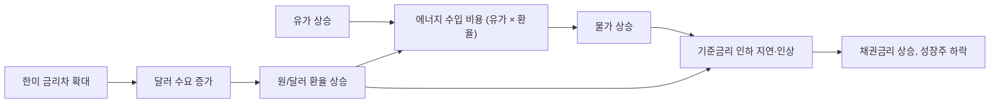

> 아웃스탠딩의 거시경제 기고(「[1200원이 귀여워진 환율.. 한국은행이 금리 인상 칼을 빼든 이유](https://outstanding.kr/interestpolicy20260720)」, 「[이란전쟁 여파로 '돌아온 3고'](https://outstanding.kr/iranwar20260323)」, 「[일본이 '리플레이션'을 중단한 이유](https://outstanding.kr/reflation20261026)」 등, 2026)를 바탕으로 재구성한 노트다.

## 세 변수는 서로 맞물린다

금리, 환율, 물가는 따로 움직이지 않는다. 한 변수를 잡으려는 정책이 다른 변수를 흔든다.

## 금리차와 자금 흐름이 환율을 움직인다

- **금리차**: 미국 금리가 한국보다 높으면 달러를 들고 있을 때 받는 이자가 더 크다. 달러 수요가 늘어 원/달러 환율이 오른다. 기준금리 인상은 이를 막는 대표 수단이다.
- **역전 용인**: 미국 수준까지 금리를 올리면 국내 경기가 흔들릴 수 있다. 그래서 금리 역전을 어느 정도 용인하는 정책 판단도 있다.
- **수급**: 대규모 해외 증권 발행(ADR 등)으로 들어온 달러가 원화로 바뀌면 달러를 팔고 원화를 사는 셈이라 환율 하락 요인이다. 반대로 해외주식 투자 자금이 빠져나가면 환율 상승 요인이다.
- 환율은 금리차, 수급, 위험 선호가 함께 만든다. **한 요인만으로 다 설명할 수는 없다.**

## 3고: 고물가·고금리·고환율이 함께 오는 구조

원유는 달러로 사므로 에너지 수입 비용은 **유가 × 환율**로 커진다. 배럴당 60달러에 1,400원일 때와 140달러에 1,500원일 때는 원화 기준 비용이 2.5배 차이 난다. 에너지 값이 오르면 물가가 자극되고, 중앙은행은 금리 인하를 미루거나 인상을 고민한다. 그 결과 물가, 환율, 금리가 **동시에** 높아진다.

### 공급 충격과 스태그플레이션

이미 물가 압력이 높은 때 전쟁 같은 사건으로 유가가 급등하면 저성장과 고물가가 함께 오는 **스태그플레이션**이 길어질 수 있다(1973년 욤 키푸르 전쟁 뒤의 석유 파동이 대표 사례다). 디플레이션에서 인플레이션으로 막 넘어가던 시기의 충격과는 조건이 다르다.

| 특징 | 이유 |
| --- | --- |
| 생산성으로 상쇄하기 어렵다 | 에너지 같은 외부 공급 충격은 국내 효율 개선으로 메우지 못한다 |
| 재정 부담이 커진다 | 물가 때문에 금리가 내려오지 않아 이자 비용이 늘고 재정 적자 관리가 어렵다 |
| 원유 수입국이 크게 맞는다 | 원유 의존도가 높은 제조업 수출국은 비용과 환율 양쪽에서 압박받는다 |

## 중앙은행의 딜레마

### 채권금리 vs 환율

채권금리 급등을 진정시키려면 기준금리 인상을 늦춰야 한다. 환율을 안정시키려면 미국과의 금리차를 줄이려고 인상을 서둘러야 한다. 중앙은행이 「금리 상승은 시장 원리라 용인하지만 환율 상승은 용인하지 않는다」고 말하면 **환율 방어용 인상 가능성이 높아졌다**고 읽는다.

### 독립성과 기대 인플레이션

중앙은행이 정치적 압력으로 물가를 잡기 전에 금리를 내리면, 시장은 물가 안정 의지가 약해졌다고 보고 **기대 인플레이션**을 높인다. 기대가 오르면 임금·가격 결정에 반영돼 인플레이션이 더 강하고 오래 고착되고, 결국 뒤늦게 금리를 더 크게 올리는 비용을 치른다. 중앙은행 독립성이 중요한 이유다.

### 리플레이션(Reflation)

장기 디플레이션에서 벗어나려고 **물가가 오를 때까지 통화 공급을 늘리는 정책**이다. 돈이 많이 풀리면 화폐 가치가 떨어지고 물가가 오른다. 일본의 아베노믹스가 대표 사례이고, 2026년 일본 정부가 리플레이션이 더는 필요하지 않다고 밝힌 것은 정책 전환 신호로 받아들여졌다.

## 자산 가격으로 번지는 경로

성장 둔화 우려와 물가발 금리 상승 우려가 겹치면 **돈이 몰려 있던 성장 섹터**(반도체, 기술주 등)가 크게 흔들린다. 성장주는 먼 미래 이익의 비중이 커서 할인율(금리)이 오르면 현재 가치가 많이 깎이기 때문이다. 계산 원리는 [[asset-pricing-required-return|자산 가격의 형성]]에 있다.

## 정리

- 금리차가 벌어지면 달러 수요가 늘어 환율이 오르고, 기준금리 인상이 대표 대응이다.
- 에너지 비용은 유가 × 환율이라 두 충격이 겹치면 물가, 금리, 환율이 함께 오른다.
- 공급 충격발 물가는 생산성으로 상쇄하기 어려워 스태그플레이션 위험이 크다.
- 중앙은행은 채권금리와 환율 사이에서 고르고, 너무 이른 인하는 기대 인플레이션을 고착시킨다.
- 금리 상승은 미래 이익 비중이 큰 성장주에 먼저 크게 반영된다.

관련 노트: [[asset-pricing-required-return|자산 가격의 형성: 요구수익률, 멀티플, 성장]], [[jeonse-housing-market|전세와 한국 주택 가격]]
